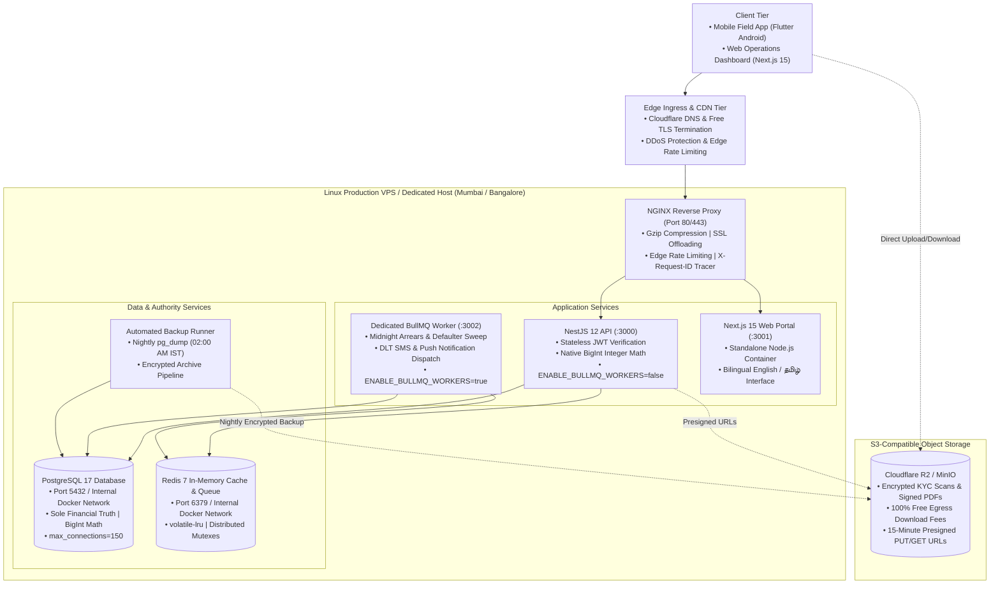

# Kumaran Chits — Production Infrastructure, Hosting Alternatives & Disaster Recovery Plan (DRP)

> **Product**: **Kumaran Chits** (Kumaran Finance)  
> **Company Reality**: 1 physical branch office (Head Office: Perundurai, Erode, Tamil Nadu), 4 equal partners, 1 desk accountant/cashier, 2–3 field collection agents, known subscribers, physical notebook onboarding.  
> **Primary Target Hosting**: Single Flat-Fee Linux VPS (Hostinger Mumbai / DigitalOcean Bangalore) + Cloudflare R2 (S3-Compatible Object Storage)  
> **Availability Targets**: $\text{RPO} \le 15\text{ minutes}$, $\text{RTO} \le 2\text{ hours}$

---

## 1. Production Architecture Overview

Kumaran Chits is packaged as a high-reliability, cloud-agnostic Docker Compose modular monolith. It is completely decoupled from proprietary cloud vendor lock-in and can run identically on a flat-fee Linux VPS, an on-premise physical office server, or an enterprise cloud provider.



---

## 2. Production Hosting Models & Cost Comparison

Kumaran Finance operates 1 branch office in Perundurai. To avoid surprise cloud bills, high egress bandwidth penalties, and unnecessary DevOps complexity, three hosting options are supported:

### 2.1 Primary Recommended Model: Flat-Fee Linux VPS + Cloudflare R2
- **Compute Provider**: Hostinger VPS (Mumbai) or DigitalOcean Droplet (Bangalore).
- **Recommended Hardware**: 4 vCPU, 8 GB RAM, 100 GB NVMe SSD.
- **Object Storage**: Cloudflare R2 (100% S3-compatible protocol).
- **Cost Structure**:
  - Compute: **Flat ₹900 to ₹1,800 / month** (billed in INR with GST invoices).
  - Object Storage (Cloudflare R2): **₹0 / month** (under 10 GB free tier with **₹0 bandwidth egress fees**).
  - **Total Monthly Cost**: **₹900 – ₹1,800 flat (Zero surprise billing)**.
- **Why this fits Kumaran Finance**:
  1. **100% Predictable Expense**: No metered NAT gateway fees, no per-request charges.
  2. **High Availability for Doorstep Agents**: Runs in a Tier-4 data center (Mumbai/Bangalore) with 99.99% network uptime, ensuring field agents can collect installments from morning to evening.
  3. **Single-Command Setup**: Entire system boots from a single command: `docker compose -f infra/docker/docker-compose.fullstack.yml up -d`.

### 2.2 Alternative Model 2: Local Head Office Mini-Server (Perundurai)
- **Hardware**: Dedicated office mini-PC (e.g. Intel NUC, Dell OptiPlex Micro, 16 GB RAM, 512 GB NVMe, mini-UPS).
- **One-Time Cost**: ~₹25,000 to ₹35,000 hardware purchase.
- **Monthly Cloud Cost**: **₹0 / month forever**.
- **External Access**: Exposed securely to field collection agents via a **free Cloudflare Tunnel** (`cloudflared`), requiring no public static IP or port forwarding.
- **Trade-off**: Requires local power and broadband reliability in Perundurai; if office internet drops, field collection agents cannot sync online until restored.

### 2.3 Alternative Model 3: Enterprise Cloud Hyperscalers
- Available as an optional cloud target if Kumaran Finance expands into multiple branches across Tamil Nadu in the future.
- Uses managed container clusters, managed PostgreSQL 17, and S3-compatible cloud storage in Mumbai (`ap-south-1`).
- Cost: ~₹4,500 to ₹9,000+ ($60–$120/month) with metered egress and managed service premiums.

---

## 3. Server Configuration & Security Hardening (Linux VPS)

### 3.1 Host Sizing & Startup Parameters
- **OS**: Ubuntu 24.04 LTS (x86_64).
- **Docker & Docker Compose**: Installed via official Docker repository (`docker-ce`, `docker-compose-plugin`).
- **PostgreSQL Database Server Limits**:
  - `max_connections = 150`
  - `shared_buffers = 512MB`
  - `statement_timeout = 15000` (15s query kill safeguard)
  - `lock_timeout = 5000` (5s lock abort safeguard)
- **Redis Cache Limits**:
  - `maxmemory 512mb` with `maxmemory-policy volatile-lru`.

### 3.2 S3-Compatible Storage Setup (Cloudflare R2)
Cloudflare R2 operates identically to S3 using the standard `@aws-sdk/client-s3` driver. In `.env`:
```env
STORAGE_DRIVER=s3
S3_ENDPOINT=https://<cloudflare-account-id>.r2.cloudflarestorage.com
S3_BUCKET=kumaran-chits-private
S3_ACCESS_KEY_ID=<r2-access-key-id>
S3_SECRET_ACCESS_KEY=<r2-secret-access-key>
S3_REGION=auto
S3_FORCE_PATH_STYLE=false
```

### 3.3 Host Storage & SSL Certificate Expiration Monitoring Policy
- **Storage Alarm Threshold**: Host root disk and database volume storage are monitored continuously. If disk usage reaches or exceeds **80% capacity**, an automated critical alert is triggered.
- **Storage Monitoring Automation**: Executed via [`infra/scripts/disk-monitor.sh`](file:///u:/Kumaran-finance/infra/scripts/disk-monitor.sh) (Linux) or [`infra/scripts/disk-monitor.ps1`](file:///u:/Kumaran-finance/infra/scripts/disk-monitor.ps1) (Windows), verifying free space and logging alerts before storage exhaustion.
- **SSL/TLS Expiration Probe**: Automated certificate monitoring probe via [`infra/scripts/cert-monitor.sh`](file:///u:/Kumaran-finance/infra/scripts/cert-monitor.sh) (Linux) and [`infra/scripts/cert-monitor.ps1`](file:///u:/Kumaran-finance/infra/scripts/cert-monitor.ps1) (Windows) triggers a critical alert whenever certificate validity drops to **$\le 30$ days** (`SSL_EXPIRY_THRESHOLD_SECONDS=2592000`).
- **SMS DLT Provider Credit Guardian**: SMS gateway balance is monitored with automated alerts at 500 remaining credits, with seamless fallback to free Firebase Cloud Messaging (FCM) mobile push alerts and Web Push notifications.

---

## 3. Disaster Recovery Plan (DRP)

### 3.1 Recovery Metrics
| Metric | Target | How It Is Achieved |
|---|---|---|
| **Recovery Point Objective (RPO)** | **$\le 15$ minutes** | PostgreSQL continuous Write-Ahead Log (WAL) archiving and automated nightly database dumps via `chitflow-backup-cron`. |
| **Recovery Time Objective (RTO)** | **$\le 2$ hours** | Automated database snapshot restore via `restore-db.sh` / `restore-from-s3.sh` and Docker container rebuild. |

### 4.2 Backup Lifecycle & Retention Schedule
1. **Automated Nightly Snapshot**: Full encrypted `pg_dump` taken every night at 02:00 AM IST by `chitflow-backup-cron`, verified, and uploaded to offsite S3-compatible storage (Cloudflare R2 / MinIO).
2. **Local Retention Buffer**: Last 7 daily backup dumps retained on host SSD for sub-minute disaster recovery.
3. **Offsite S3 Replication**: Encrypted archives retained offsite for **30 days** in S3-compatible object storage with versioning enabled to eliminate local hardware failure risks.

### 3.3 Quarterly Disaster Recovery Drill Procedure
Once every 90 days (or on demand during audits), the developer and Kumaran Finance administrator execute this automated drill:

```powershell
# Run the automated DRP drill via pnpm shortcut
pnpm run db:drp:drill

# Or run via cross-platform PowerShell runner
powershell -ExecutionPolicy Bypass -File infra/scripts/drp-drill.ps1
```

**Automated Drill Execution Flow**:
1. Captures baseline entity counts from the source database (`chitflow_dev`).
2. Triggers an automated S3/MinIO binary backup with timestamp and AES256 server-side encryption (`RPO Phase`).
3. Provisions a completely isolated target database (`chitflow_drp_drill`), preserving active developer data.
4. Downloads the S3 dump and restores via `pg_restore`, benchmarking recovery time against the 2-hour RTO standard (`RTO Phase`).
5. Executes 5 strict mathematical & financial invariant assertions on the restored database:
   - **Assertion 1**: Entity Row Parity (Users, Customers, Groups, Tickets, Dues, Payments).
   - **Assertion 2**: 4.00% Foreman Commission Freeze (ADR-04).
   - **Assertion 3**: Max 1 Ticket per subscriber per chit group (ADR-13).
   - **Assertion 4**: Pure whole-rupee `BigInt` math (zero floats, zero fractional paise).
   - **Assertion 5**: Accounting balance equation: $\sum \text{Dues Generated} = \sum \text{Payments} + \text{Remaining Unpaid Dues}$.
6. Drops `chitflow_drp_drill` cleanly and outputs an audit compliance report.

### 3.4 Local & Branch Database Backup / Restore Runbook
For on-premise branch operations and local developer testing, automated scripts in `infra/scripts/` provide immediate snapshot capabilities:

1. **Creating a Local Compressed Backup**:
   ```powershell
   powershell -ExecutionPolicy Bypass -File infra\scripts\backup-db.ps1
   ```
   - Connects to the running `chitflow-db` container.
   - Executes `pg_dump -F c` creating a compressed binary archive in `infra/backups/`.
   - Guarantees whole-rupee `BigInt` precision and index integrity.

2. **Automated S3 Off-Site Backup & 30-Day Retention Pruner**:
   ```powershell
   # PowerShell runner (Windows Task Scheduler / 02:00 AM IST)
   powershell -ExecutionPolicy Bypass -File infra\scripts\backup-to-s3.ps1

   # Or via pnpm shortcut:
   pnpm --filter api db:backup:s3

   # Or trigger on-demand snapshot via Docker cron container:
   docker exec chitflow-backup-cron /scripts/backup-cron-job.sh
   ```
   - Autonomous `chitflow-backup-cron` container executes nightly at 02:00 AM IST (`30 20 * * *` UTC).
   - Dumps PostgreSQL 17 database in custom compressed binary format (`-F c`).
   - Uploads to S3 storage under `backups/db/YYYY/MM/kumaran_chits_backup_YYYYMMDD_HHMMSS.dump` with `AES256` server-side encryption.
   - Automatically scans `backups/db/` and prunes backups older than **30 days** per §3.2. Local dumps are pruned after 7 days.

3. **Listing and Restoring from S3**:
   ```powershell
   # List all available backups in S3
   pnpm db:backups:list

   # Restore the latest backup from S3
   pnpm db:restore:s3

   # Or restore a specific backup key
   powershell -ExecutionPolicy Bypass -File infra\scripts\restore-from-s3.ps1 -S3Key "backups/db/2026/10/kumaran_chits_backup_20261020_020000.dump"
   ```

4. **Restoring from a Local Backup File**:
   ```powershell
   powershell -ExecutionPolicy Bypass -File infra\scripts\restore-db.ps1 -BackupFilePath "infra\backups\kumaran_chits_backup_YYYYMMDD_HHMMSS.dump"
   ```
   - Performs a clean, transactional restore using `pg_restore --clean`.

---

## 4. Production Go-Live Deployment Checklist (VPS & Cloud Production)

Before launching the platform into live customer and partner operations in Perundurai, the DevOps engineer must verify all 5 infrastructure transitions from local development defaults to hardened production configurations:

| Security Area | Local / Staging Default | Required in Live Production (VPS / Cloud) | Implementation Verification |
|---|---|---|---|
| **HTTPS / TLS** | Local HTTP (`http://localhost:3000`) | Enforce HTTPS-only via **Nginx Ingress with Let's Encrypt / Certbot** or **Cloudflare Edge SSL**. | Port 80 traffic automatically redirects (HTTP 301) to HTTPS port 443. Plaintext HTTP is rejected at ingress. |
| **Secrets Storage** | Plain text `.env` file on local disk | Store sensitive credentials (`DATABASE_URL`, `JWT_SECRET`) in root-owned `chmod 600 .env` file or cloud secrets manager. | Zero production passwords or JWT keys committed to git, Docker images, or unencrypted storage. |
| **Database Subnet Isolation** | Docker container port `5433` exposed on `127.0.0.1` | Deploy **PostgreSQL 17** within an isolated Docker bridge network (`chitflow-internal`) with **zero public host port mapping**. | Database port 5432 is accessible exclusively by internal services (`chitflow-api`, `chitflow-worker`, `backup-cron`). Zero external internet exposure. |
| **S3 Bucket Encryption & Access** | Local filesystem (`./storage/uploads`) | Enable **Server-Side Encryption** and enforce **Block All Public Access** on private S3 bucket (Cloudflare R2, MinIO, or S3). | Bucket blocks all public access. Documents are strictly accessible via 15-minute temporary presigned URLs. |
| **Automated Database Backups** | Local PowerShell scripts (`infra/scripts/backup-db.ps1`) | Enable **Automated Midnight pg_dump cron (`backup-cron`)** streamed off-site to S3 object storage with daily retention. | Nightly automated snapshot scheduled at 02:00 AM IST. RPO $\le 15$ min, RTO $\le 2$ hours verified via quarterly recovery drill. |

### 4.1 Production Secrets Management & Injection
In Linux VPS and production container environments:
- The production environment file (`.env`) is placed outside public web directories and protected with strict Linux permissions:
  ```bash
  chmod 600 /opt/kumaran-chits/.env
  chown root:root /opt/kumaran-chits/.env
  ```
- Docker Compose loads environment variables securely at container instantiation time into process memory, preventing unauthorized access by non-root OS users or disk scanners.
- In managed cloud container environments (e.g., K8s / Nomad), secrets can alternatively be injected directly from secret vaults (e.g. HashiCorp Vault, Doppler, or cloud secrets vault) into memory at boot time.

---

## 5. APM Observability & Prometheus Telemetry (`/metrics`)

Kumaran Chits provides real-time infrastructure and financial telemetry via Prometheus metrics exporter:

- **Endpoint**: `http://localhost:3000/metrics` (or `http://localhost/metrics` via Nginx ingress)
- **Authentication**: Protected via HTTP Basic Auth (`METRICS_USER` / `METRICS_PASSWORD`, default: `admin` / `chitflow_secret`).
- **Telemetry Catalog**:
  - **Latency Histograms**: `http_request_duration_seconds` measuring p95 read ($\le 200\text{ ms}$) and financial write ($\le 500\text{ ms}$) latencies per NFR §3.
  - **PostgreSQL Database Health**: `chitflow_db_connected` (1 = healthy, 0 = down).
  - **BullMQ Background Queues**: `bullmq_queue_jobs_count` tracking active, delayed, waiting, and failed jobs across all 3 queues.
  - **Chit Fund Invariants & KPIs**: Active chit groups, active subscribers, overdue tickets in 1-month and 3-month default buckets, pending Maker-Checker approvals, and today's total collection volume in whole Rupees (`BigInt`).
- **Detailed Documentation & PromQL Recipes**: Consult [`apps/api/src/metrics/README.md`](../../apps/api/src/metrics/README.md).

---

## 6. Sentry Error Monitoring & Crash Tracking (`@sentry/nestjs`)

Kumaran Chits utilizes Sentry for real-time application crash detection and server-side failure alerting:

- **Integration**: Native NestJS integration via `@sentry/nestjs` initialized in `main.ts` and wired into `GlobalExceptionFilter`.
- **Safe-Bypass Guarantee**: When `SENTRY_DSN` is empty or unset, Sentry operates in complete bypass mode with 0 external network requests and 0 latency overhead.
- **Indian DPDP Act 2023 Compliance**:
  - All outbound events pass through `beforeSend` sanitization.
  - Automatically scrubs sensitive credentials (`password`, `mpin`, `refreshToken`, `token`, `totpSecret`, `aadhaar`, `pan`).
  - Automatically normalizes and masks Indian phone numbers (`+91******3210`) via `PhoneHelper.maskPhone()`.
- **Noise Suppression**: Client validation errors (400, 401, 403, 404) are handled by standard response envelopes and excluded from Sentry. Only true server faults ($\ge 500$) and unhandled runtime errors trigger alerts.
- **Whole-Rupee BigInt Safety**: Automatically serializes `bigint` values to string format to prevent JSON serialization crashes during exception capture.
- **Diagnostic Verification**: `GET /health/sentry-test` triggers a test internal error for verification in staging environments.
- **Detailed Documentation**: Consult [`apps/api/src/common/sentry/README.md`](../../apps/api/src/common/sentry/README.md).

---

## 7. Production Nginx TLS 1.3 & Server-Sent Events (SSE) Reverse Proxy

Kumaran Chits deploys Nginx 1.27 as the production edge ingress:

- **TLS Hardening**: Terminates SSL on port 443 with TLS 1.2 and TLS 1.3 only, modern ECDHE ciphers, HSTS (`max-age=15768000; includeSubDomains; preload`), and automatic 301 redirection from HTTP (port 80).
- **Server-Sent Events (SSE) Unbuffered Streaming**:
  - The live Maker-Checker Approvals stream (`/api/v1/reports/approvals-stream`) requires zero proxy buffering.
  - Configured with `proxy_buffering off; chunked_transfer_encoding on; proxy_read_timeout 24h;` to eliminate 60-second gateway timeouts.
- **Automated Certificate Provisioning**: Supports Let's Encrypt / Certbot automated renewals via `/.well-known/acme-challenge/` and local self-signed certificates via `generate-self-signed.sh` / `.ps1`.
- **Detailed Step-by-Step Guide**: Consult [`infra/docker/PRODUCTION-DEPLOYMENT-GUIDE.md`](../../infra/docker/PRODUCTION-DEPLOYMENT-GUIDE.md).


