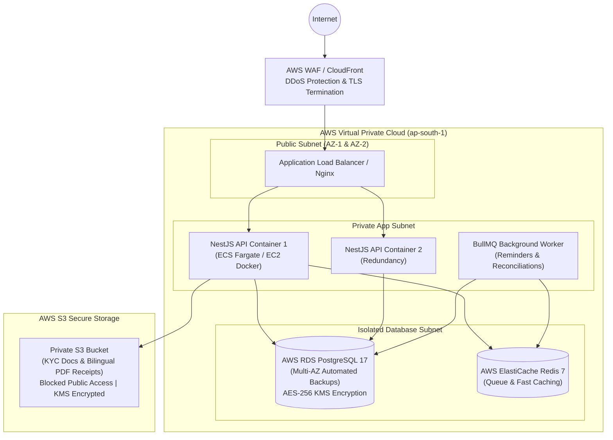

# Kumaran Chits — AWS Infrastructure & Disaster Recovery Plan (DRP)

> **Product**: **Kumaran Chits** (Kumaran Finance)  
> **Target Cloud**: Fresh AWS Account (Region: `ap-south-1` — Mumbai, India)  
> **Availability Targets**: $\text{RPO} \le 15\text{ minutes}$, $\text{RTO} \le 2\text{ hours}$

---

## 1. AWS Cloud Architecture Diagram



---

## 2. Fresh AWS Account Provisioning Checklist

### 2.1 Root Account & Security Hardening
1. **Enable Hardware/App MFA on AWS Root Account**: Use Microsoft Authenticator immediately upon account creation.
2. **Never use Root for deployment**: Create an administrative IAM user `admin-kumaran` with MFA for initial setup.
3. **Region Pinning**: Lock all resources to `ap-south-1` (Mumbai) for regulatory compliance and lowest latency to Tamil Nadu.
4. **AWS Cost & Budget Alerts**: Configure an AWS Budget alert at $50/month and $100/month to prevent surprise billing.

### 2.2 Network & Compute Configuration
- **VPC Setup**: 10.0.0.0/16 VPC with 2 Public Subnets (for ALB) and 2 Private Subnets (for App & Database).
- **Security Groups**:
  - `ALB-SG`: Ingress ports 80/443 from `0.0.0.0/0`.
  - `App-SG`: Ingress port 3000 solely from `ALB-SG`.
  - `DB-SG`: Ingress port 5432 solely from `App-SG`.
- **Database (AWS RDS PostgreSQL 17)**:
  - Instance: `db.t4g.micro` (Dev/Test) $\to$ `db.t4g.small` / `db.t4g.medium` (Production).
  - Storage: 20 GB gp3 with storage autoscaling up to 100 GB.
  - Automated backups enabled with **7-day point-in-time recovery (PITR)**.

### 2.3 Redis Cache & Queue Infrastructure (AWS ElastiCache Redis 7)
- **Node Type**: `cache.t4g.micro` (Dev/Test) $\to$ `cache.t4g.small` (Production Multi-AZ).
- **Parameter Group Configurations**:
  - `maxmemory-policy = volatile-lru` (Evicts keys with an explicit TTL under memory pressure, protecting BullMQ job queues).
- **CloudWatch Monitoring & Alarms**:
  - `DatabaseMemoryUsagePercentage >= 75%` triggers an operational warning alert before memory saturation.
  - `EngineCPUUtilization >= 70%` triggers an alert for cluster resizing.

### 2.4 Host Storage & Disk Capacity Monitoring Policy
- **Automated Alarm Threshold**: Host root disk and database volume storage are monitored continuously. If disk usage reaches or exceeds **80% capacity**, an automated critical alert is triggered.
- **Monitoring Automation**: Executed via [`infra/scripts/disk-monitor.sh`](file:///u:/Kumaran-finance/infra/scripts/disk-monitor.sh) (Linux) or [`infra/scripts/disk-monitor.ps1`](file:///u:/Kumaran-finance/infra/scripts/disk-monitor.ps1) (Windows), verifying free space and logging alerts before storage exhaustion.
- **PostgreSQL Server Timeouts**: Production database enforces `statement_timeout = 15000` (15s) and `lock_timeout = 5000` (5s) to guarantee rogue queries cannot cause cascading connection starvation.

### 2.5 Horizontal Autoscaling & Multi-AZ High Availability
- **Target Tracking Autoscaling**: Configured via AWS ECS Auto Scaling. Triggers scale-out when Average CPU Utilization $\ge 60\%$ or API response time exceeds $500\text{ms}$ (p95) for 2 consecutive minutes. Minimum 2 replicas running across distinct AZs (`ap-south-1a`, `ap-south-1b`).
- **Scheduled Auction-Day Pre-Warming**: Pre-warms cluster from 2 to 4 active replicas 30 minutes prior to scheduled branch auctions.
- **Deep Health Probing & Zero-Downtime Rolling Updates**: Configured via `/health/readiness` (PostgreSQL `SELECT 1` + Redis `PING`) with `minimumHealthyPercent = 100` and graceful 15-second connection draining. Full specification in [`docs/03-architecture/horizontal-scaling-and-high-availability.md`](../03-architecture/horizontal-scaling-and-high-availability.md).

---

## 3. Disaster Recovery Plan (DRP)

### 3.1 Recovery Metrics
| Metric | Target | How It Is Achieved |
|---|---|---|
| **Recovery Point Objective (RPO)** | **$\le 15$ minutes** | PostgreSQL continuous Write-Ahead Log (WAL) archiving to S3 via AWS RDS automated backups. |
| **Recovery Time Objective (RTO)** | **$\le 2$ hours** | Containerized app rebuild from Docker registry + automated point-in-time database snapshot restore. |

### 3.2 Backup Lifecycle & Retention Schedule
1. **Continuous Backups**: Automated RDS transactions backed up continuously for 7 days (point-in-time restore to any second).
2. **Daily Snapshot**: Encrypted RDS snapshot taken every midnight (02:00 AM IST) and retained for **30 days**.
3. **S3 Versioning & Replication**: S3 buckets storing customer KYC and PDF receipts have **Object Versioning enabled**, preventing accidental deletions.

### 3.3 Quarterly Disaster Recovery Drill Procedure
Once every 90 days (or on demand during audits), the developer and Kumaran Finance administrator execute this automated drill:

```powershell
# Run the automated DRP drill via pnpm shortcut
pnpm run db:drp:drill

# Or run via cross-platform PowerShell runner
powershell -ExecutionPolicy Bypass -File infra/scripts/drp-drill.ps1
```

**Automated Drill Execution Flow**:
1. Captures baseline entity counts from the source database (`chitflow_dev`).
2. Triggers an automated S3/MinIO binary backup with timestamp and AES256 server-side encryption (`RPO Phase`).
3. Provisions a completely isolated target database (`chitflow_drp_drill`), preserving active developer data.
4. Downloads the S3 dump and restores via `pg_restore`, benchmarking recovery time against the 2-hour RTO standard (`RTO Phase`).
5. Executes 5 strict mathematical & financial invariant assertions on the restored database:
   - **Assertion 1**: Entity Row Parity (Users, Customers, Groups, Tickets, Dues, Payments).
   - **Assertion 2**: 4.00% Foreman Commission Freeze (ADR-04).
   - **Assertion 3**: Max 1 Ticket per subscriber per chit group (ADR-13).
   - **Assertion 4**: Pure whole-rupee `BigInt` math (zero floats, zero fractional paise).
   - **Assertion 5**: Accounting balance equation: $\sum \text{Dues Generated} = \sum \text{Payments} + \text{Remaining Unpaid Dues}$.
6. Drops `chitflow_drp_drill` cleanly and outputs an audit compliance report.

### 3.4 Local & Branch Database Backup / Restore Runbook
For on-premise branch operations and local developer testing, automated scripts in `infra/scripts/` provide immediate snapshot capabilities:

1. **Creating a Local Compressed Backup**:
   ```powershell
   powershell -ExecutionPolicy Bypass -File infra\scripts\backup-db.ps1
   ```
   - Connects to the running `chitflow-db` container.
   - Executes `pg_dump -F c` creating a compressed binary archive in `infra/backups/`.
   - Guarantees whole-rupee `BigInt` precision and index integrity.

2. **Automated S3 Off-Site Backup & 30-Day Retention Pruner**:
   ```powershell
   # PowerShell runner (Windows Task Scheduler / 02:00 AM IST)
   powershell -ExecutionPolicy Bypass -File infra\scripts\backup-to-s3.ps1

   # Or via pnpm shortcut:
   pnpm --filter api db:backup:s3

   # Or trigger on-demand snapshot via Docker cron container:
   docker exec chitflow-backup-cron /scripts/backup-cron-job.sh
   ```
   - Autonomous `chitflow-backup-cron` container executes nightly at 02:00 AM IST (`30 20 * * *` UTC).
   - Dumps PostgreSQL 17 database in custom compressed binary format (`-F c`).
   - Uploads to S3 storage under `backups/db/YYYY/MM/kumaran_chits_backup_YYYYMMDD_HHMMSS.dump` with `AES256` server-side encryption.
   - Automatically scans `backups/db/` and prunes backups older than **30 days** per §3.2. Local dumps are pruned after 7 days.

3. **Listing and Restoring from S3**:
   ```powershell
   # List all available backups in S3
   pnpm db:backups:list

   # Restore the latest backup from S3
   pnpm db:restore:s3

   # Or restore a specific backup key
   powershell -ExecutionPolicy Bypass -File infra\scripts\restore-from-s3.ps1 -S3Key "backups/db/2026/10/kumaran_chits_backup_20261020_020000.dump"
   ```

4. **Restoring from a Local Backup File**:
   ```powershell
   powershell -ExecutionPolicy Bypass -File infra\scripts\restore-db.ps1 -BackupFilePath "infra\backups\kumaran_chits_backup_YYYYMMDD_HHMMSS.dump"
   ```
   - Performs a clean, transactional restore using `pg_restore --clean`.

---

## 4. Production Go-Live Deployment Checklist (Local vs Live AWS)

Before launching the platform into live customer and partner operations in Perundurai, the DevOps engineer must verify all 5 infrastructure transitions from local development defaults to hardened AWS production configurations:

| Security Area | Local / Staging Default | Required in Live Production (AWS) | Implementation Verification |
|---|---|---|---|
| **HTTPS / TLS** | Local HTTP (`http://localhost:3000`) | Enforce HTTPS-only via **AWS CloudFront / Application Load Balancer (ALB)** with an auto-renewing **AWS Certificate Manager (ACM)** SSL/TLS certificate. | Port 80 traffic automatically redirects (HTTP 301) to HTTPS port 443. Plaintext HTTP is rejected at the load balancer. |
| **Secrets Storage** | Plain text `.env` file on local disk | Store sensitive credentials (`DATABASE_URL`, `JWT_SECRET`) in **AWS Secrets Manager** or **AWS SSM Parameter Store** (`SecureString`). | Zero production passwords or JWT keys committed to git, Docker images, or unencrypted disk storage. |
| **Database Subnet Isolation** | Docker container port `5433` exposed on `127.0.0.1` | Deploy **AWS RDS PostgreSQL 17** in a **Private VPC Subnet** with **zero public IP address** (`PubliclyAccessible: No`). | Security group `DB-SG` allows inbound port 5432 exclusively from the Application Security Group (`App-SG`). Zero direct internet access. |
| **S3 Bucket Encryption & Access** | Local filesystem (`./storage/uploads`) | Enable **AWS SSE-KMS** encryption and turn on **Block All Public Access** on S3 bucket. | S3 bucket blocks all public ACLs and bucket policies. Documents are strictly accessible via 15-minute temporary presigned URLs. |
| **Automated Database Backups** | Local PowerShell scripts (`infra/scripts/backup-db.ps1`) | Enable **AWS RDS Automated Backups** with **7-day Continuous Point-in-Time Recovery (PITR)** and daily snapshots retained for **30 days**. | Nightly automated snapshot scheduled at 02:00 AM IST. RPO $\le 15$ min, RTO $\le 2$ hours verified via quarterly recovery drill. |

### 4.1 Production Secrets Injection Architecture
In production container environments (AWS ECS Fargate or Docker):
- The NestJS API container does **not** mount a physical `.env` file.
- Instead, the ECS Task Definition directly references secrets by ARN from **AWS Secrets Manager**:
  ```json
  "secrets": [
    {
      "name": "DATABASE_URL",
      "valueFrom": "arn:aws:secretsmanager:ap-south-1:123456789012:secret:kumaran/production/db-url"
    },
    {
      "name": "JWT_SECRET",
      "valueFrom": "arn:aws:secretsmanager:ap-south-1:123456789012:secret:kumaran/production/jwt-secret"
    }
  ]
  ```
- AWS ECS injects the decrypted values directly into process environment variables in memory at container boot time, preventing disk exposure.

---

## 5. APM Observability & Prometheus Telemetry (`/metrics`)

Kumaran Chits provides real-time infrastructure and financial telemetry via Prometheus metrics exporter:

- **Endpoint**: `http://localhost:3000/metrics` (or `http://localhost/metrics` via Nginx ingress)
- **Authentication**: Protected via HTTP Basic Auth (`METRICS_USER` / `METRICS_PASSWORD`, default: `admin` / `chitflow_secret`).
- **Telemetry Catalog**:
  - **Latency Histograms**: `http_request_duration_seconds` measuring p95 read ($\le 200\text{ ms}$) and financial write ($\le 500\text{ ms}$) latencies per NFR §3.
  - **PostgreSQL Database Health**: `chitflow_db_connected` (1 = healthy, 0 = down).
  - **BullMQ Background Queues**: `bullmq_queue_jobs_count` tracking active, delayed, waiting, and failed jobs across all 3 queues.
  - **Chit Fund Invariants & KPIs**: Active chit groups, active subscribers, overdue tickets in 1-month and 3-month default buckets, pending Maker-Checker approvals, and today's total collection volume in whole Rupees (`BigInt`).
- **Detailed Documentation & PromQL Recipes**: Consult [`apps/api/src/metrics/README.md`](../../apps/api/src/metrics/README.md).

---

## 6. Sentry Error Monitoring & Crash Tracking (`@sentry/nestjs`)

Kumaran Chits utilizes Sentry for real-time application crash detection and server-side failure alerting:

- **Integration**: Native NestJS integration via `@sentry/nestjs` initialized in `main.ts` and wired into `GlobalExceptionFilter`.
- **Safe-Bypass Guarantee**: When `SENTRY_DSN` is empty or unset, Sentry operates in complete bypass mode with 0 external network requests and 0 latency overhead.
- **Indian DPDP Act 2023 Compliance**:
  - All outbound events pass through `beforeSend` sanitization.
  - Automatically scrubs sensitive credentials (`password`, `mpin`, `refreshToken`, `token`, `totpSecret`, `aadhaar`, `pan`).
  - Automatically normalizes and masks Indian phone numbers (`+91******3210`) via `PhoneHelper.maskPhone()`.
- **Noise Suppression**: Client validation errors (400, 401, 403, 404) are handled by standard response envelopes and excluded from Sentry. Only true server faults ($\ge 500$) and unhandled runtime errors trigger alerts.
- **Whole-Rupee BigInt Safety**: Automatically serializes `bigint` values to string format to prevent JSON serialization crashes during exception capture.
- **Diagnostic Verification**: `GET /health/sentry-test` triggers a test internal error for verification in staging environments.
- **Detailed Documentation**: Consult [`apps/api/src/common/sentry/README.md`](../../apps/api/src/common/sentry/README.md).

---

## 7. Production Nginx TLS 1.3 & Server-Sent Events (SSE) Reverse Proxy

Kumaran Chits deploys Nginx 1.27 as the production edge ingress:

- **TLS Hardening**: Terminates SSL on port 443 with TLS 1.2 and TLS 1.3 only, modern ECDHE ciphers, HSTS (`max-age=15768000; includeSubDomains; preload`), and automatic 301 redirection from HTTP (port 80).
- **Server-Sent Events (SSE) Unbuffered Streaming**:
  - The live Maker-Checker Approvals stream (`/api/v1/reports/approvals-stream`) requires zero proxy buffering.
  - Configured with `proxy_buffering off; chunked_transfer_encoding on; proxy_read_timeout 24h;` to eliminate 60-second gateway timeouts.
- **Automated Certificate Provisioning**: Supports Let's Encrypt / Certbot automated renewals via `/.well-known/acme-challenge/` and local self-signed certificates via `generate-self-signed.sh` / `.ps1`.
- **Detailed Step-by-Step Guide**: Consult [`infra/docker/PRODUCTION-DEPLOYMENT-GUIDE.md`](../../infra/docker/PRODUCTION-DEPLOYMENT-GUIDE.md).


