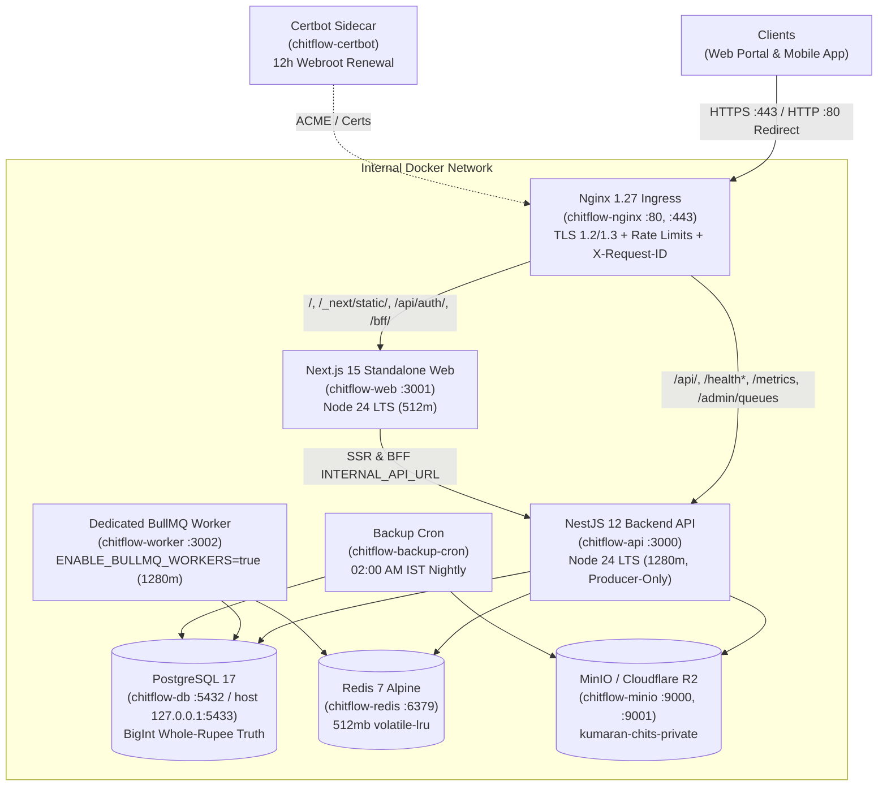

# Kumaran Chits — Production Deployment, Operations & Rollback Guide

> **Product**: **Kumaran Chits**  
> **Company**: **Kumaran Finance** (Head Office: Perundurai, Erode, Tamil Nadu)  
> **Production Target**: Ubuntu 24.04 LTS / Debian 12 on any Flat-Fee Linux VPS (Hostinger, DigitalOcean, Hetzner, Linode, Vultr, Contabo, etc.) + Cloudflare R2 (or MinIO S3)  
> **Runtime**: Node.js 24 LTS (`node:24-alpine`), pnpm `12.14.0`, PostgreSQL 17, Redis 7, Nginx 1.27  
> **Compliance**: ADR-01 through ADR-19, [`docs/06-devops/infrastructure-and-drp.md`](../06-devops/infrastructure-and-drp.md), and Zero-Downtime Operational Standards

---

## 1. Production Architecture & Verified Container Topology

Kumaran Chits runs as a single-tenant modular monolith orchestrated via [`infra/docker/docker-compose.fullstack.yml`](../../infra/docker/docker-compose.fullstack.yml) (9 production-parity containers) or [`infra/docker/docker-compose.yml`](../../infra/docker/docker-compose.yml) (3 backing containers `db`, `redis`, `minio` for local host development).



### 1.1 Service Matrix (`infra/docker/docker-compose.fullstack.yml`)

| Service | Container Name | Image / Dockerfile | Ports (Host Bind) | Memory Limit | Key Runtime Config |
|---|---|---|---|---|---|
| `nginx` | `chitflow-nginx` | `nginx:1.27-alpine` | `80:80`, `443:443` | `256m` | `ulimits.nofile=65535`, mounts `nginx.conf`, `conf.d/`, `ssl/` |
| `certbot` | `chitflow-certbot` | `certbot/certbot:latest` | — | `128m` | 12-hour `certbot renew --webroot -w /var/www/certbot` loop |
| `web` | `chitflow-web` | [`apps/web/Dockerfile`](../../apps/web/Dockerfile) (`node:24-alpine`) | `127.0.0.1:3001:3001` | `512m` | `NODE_OPTIONS="--max-old-space-size=512"`, `INTERNAL_API_URL=http://api:3000`, shared `JWT_SECRET`, `ulimits.nofile=65535` |
| `api` | `chitflow-api` | [`apps/api/Dockerfile`](../../apps/api/Dockerfile) (`node:24-alpine`) | `127.0.0.1:3000:3000` | `1280m` | `NODE_OPTIONS="--max-old-space-size=1024"`, `UV_THREADPOOL_SIZE=16`, `ENABLE_BULLMQ_WORKERS=${ENABLE_BULLMQ_WORKERS:-false}`, `connection_limit=25`, `ulimits.nofile=65535` |
| `worker` | `chitflow-worker` | [`apps/api/Dockerfile`](../../apps/api/Dockerfile) (`node:24-alpine`) | Internal `PORT=3002` | `1280m` | `NODE_OPTIONS="--max-old-space-size=1024"`, `UV_THREADPOOL_SIZE=16`, `ENABLE_BULLMQ_WORKERS=true`, `connection_limit=15`, `ulimits.nofile=65535` |
| `db` | `chitflow-db` | `postgres:17` | `127.0.0.1:5433:5432` | `1024m` | `max_connections=150`, `shared_buffers=512MB`, `statement_timeout=15000`, `lock_timeout=5000` |
| `redis` | `chitflow-redis` | `redis:7-alpine` | `127.0.0.1:6379:6379` | `640m` | `--maxmemory 512mb --maxmemory-policy volatile-lru --save 900 1 --save 300 10` |
| `minio` | `chitflow-minio` | `cgr.dev/chainguard/minio:latest` | `127.0.0.1:9000:9000`, `127.0.0.1:9001:9001` | `512m` | Private S3-compatible object storage console (`:9001`) and API (`:9000`) |
| `backup-cron` | `chitflow-backup-cron` | `postgres:17-alpine` + `aws-cli` | — | `256m` | Runs [`infra/scripts/backup-cron-job.sh`](../../infra/scripts/backup-cron-job.sh) at `30 20 * * *` UTC (`02:00 AM IST`) |

### 1.2 Resource Sizing, Concurrency & Resilience Guardrails

- **Database Connection Pool Budget** (`max_connections=150` in Compose):
  - API instance (`connection_limit=25`, `pool_timeout=10` in `DATABASE_URL`) → 25 connections per API replica (50 across 2 instances).
  - Dedicated BullMQ worker (`connection_limit=15`, `pool_timeout=10`) → 15 connections.
  - Remaining **85+ connections** reserved for Prisma migrations, `pg_dump`, and DRP drills.
- **Database Safety Timeouts**: PostgreSQL boots with `statement_timeout=15000` (15s) and `lock_timeout=5000` (5s).
- **Redis Memory & Queue Safety**: `--maxmemory 512mb` with `--maxmemory-policy volatile-lru` evicts only keys with explicit `EX` TTLs; persistent BullMQ keys (without TTL) remain immune from eviction, backed by RDB snapshots (`900 1`, `300 10`).
- **Process Bulkheading & V8 Heaps**: `api` runs producer-only (`ENABLE_BULLMQ_WORKERS=false`) while `worker` runs background queues (`ENABLE_BULLMQ_WORKERS=true`). Setting `--max-old-space-size=1024` inside a `1280m` container (and `512` inside `512m` for `web`) forces V8 GC before Linux OOM killer (`Exit Code 137`).
- **Libuv Thread Pool**: `UV_THREADPOOL_SIZE=16` prevents `bcrypt` password/MPIN hashing from starving DNS, file, or network I/O.
- **Reverse-Proxy Trust (`TRUST_PROXY`)**: [`parseTrustProxySetting()`](../../apps/api/src/common/context/proxy-ip.util.ts) defaults to `['loopback', 'linklocal', 'uniquelocal']` when `TRUST_PROXY` is unset so both 1-hop (`Mobile -> Nginx -> API`) and 2-hop (`Browser -> Nginx -> Web BFF -> API`) flows resolve real client IPs without trusting spoofed external `X-Forwarded-For` headers. Operators behind Cloudflare/CDN can set explicit CIDRs in `TRUST_PROXY`.
- **Container Log Rotation**: Every Compose service uses `json-file` logging bounded to `max-size: "50m"` and `max-file: "5"`.

---

## 2. Server Prerequisites, Environment Variables & Pre-Flight Gates

### 2.1 VPS Host Requirements & Docker Installation

- **Recommended Specs**: 2–4 vCPU, 4–8 GB RAM, 50 GB SSD/NVMe (`Ubuntu 24.04 LTS` or `Debian 12`).
- **Install Docker Engine & Compose v2**:
  ```bash
  sudo apt-get update && sudo apt-get install -y ca-certificates curl gnupg
  sudo install -m 0755 -d /etc/apt/keyrings
  curl -fsSL https://download.docker.com/linux/ubuntu/gpg | sudo gpg --dearmor -o /etc/apt/keyrings/docker.gpg
  sudo chmod a+r /etc/apt/keyrings/docker.gpg
  echo "deb [arch=$(dpkg --print-architecture) signed-by=/etc/apt/keyrings/docker.gpg] https://download.docker.com/linux/ubuntu $(. /etc/os-release && echo "$VERSION_CODENAME") stable" | sudo tee /etc/apt/sources.list.d/docker.list > /dev/null
  sudo apt-get update && sudo apt-get install -y docker-ce docker-ce-cli containerd.io docker-buildx-plugin docker-compose-plugin
  ```

### 2.2 Environment Files (Critical `JWT_SECRET` Parity)

Three `.env.example` templates govern runtime configuration:
1. [`infra/docker/.env.example`](../../infra/docker/.env.example) → copy to `infra/docker/.env` for Docker Compose variables (`POSTGRES_*`, `MINIO_*`, `NGINX_*_PORT`, `WEB_PORT`, `NEXT_PUBLIC_*`, plus production `JWT_SECRET` and `S3_*` credentials).
2. [`apps/api/.env.example`](../../apps/api/.env.example) → copy to `apps/api/.env` for local API/CLI operations (`DATABASE_URL`, `JWT_SECRET`, `TRUST_PROXY`, `STORAGE_DRIVER`, `S3_*`, `SMS_DRIVER`, `BULL_BOARD_*`, `METRICS_*`).
3. [`apps/web/.env.example`](../../apps/web/.env.example) → copy to `apps/web/.env` when running `apps/web` directly on the host (`INTERNAL_API_URL`, `NEXT_PUBLIC_API_URL`, `JWT_SECRET`, `COOKIE_SECURE`).

> [!IMPORTANT]
> **`JWT_SECRET` Must Match Across `api`, `worker`, and `web`**: Next.js Edge Middleware (`apps/web/src/lib/edge-auth.ts`) cryptographically verifies HS256 JWT cookies using `JWT_SECRET` and fails closed if missing or mismatched. In `docker-compose.fullstack.yml`, set a shared 64+ character `JWT_SECRET` inside `infra/docker/.env` (passed into `api`, `worker`, and `web`).

Verify local API env consistency before builds:
```bash
# Validates apps/api/.env (cross-platform: runs .ps1 on Windows, .sh on Linux/macOS)
pnpm --filter api run config:verify

# Or check a specific env file directly on Linux:
bash infra/scripts/verify-config.sh apps/api/.env
```

### 2.3 Pre-Flight Quality Gates

Run these gates from the repository root before building or promoting a release:
```bash
# 1. Monorepo Linters (oxlint + Next.js ESLint)
pnpm run lint

# 2. Monorepo TypeScript Typecheck (@kumaran/api-client, web + unit tests, api build)
pnpm run typecheck

# 3. Monorepo Unit Test Suites (SDK + API Jest + Web Node Test)
pnpm run test

# 4. Validate Full-Stack Docker Compose Schema
docker compose -f infra/docker/docker-compose.fullstack.yml config --quiet
```

*(Note: Build context builds both [`apps/api/Dockerfile`](../../apps/api/Dockerfile) and [`apps/web/Dockerfile`](../../apps/web/Dockerfile) from the monorepo root using the allow-list [`/.dockerignore`](../../.dockerignore), guaranteeing locked `pnpm@12.14.0` dependencies and excluding `.env*`, `*.dump`, `*.pem`/`*.key`, and test folders.)*

---

## 3. SSL / TLS Setup, Ingress Routing & Proxy Verification

### 3.1 Provisioning TLS Certificates

- **Production (Let's Encrypt / Certbot)**:
  1. Point DNS A/AAAA records (`kumaranfinance.in`, `www.kumaranfinance.in`) to the VPS public IP.
  2. Obtain initial certificates and copy them to `infra/docker/nginx/ssl/live/`:
     ```bash
     sudo apt-get install -y certbot
     sudo certbot certonly --standalone -d kumaranfinance.in -d www.kumaranfinance.in --agree-tos -m admin@kumaranfinance.in
     sudo mkdir -p infra/docker/nginx/ssl/live
     sudo cp /etc/letsencrypt/live/kumaranfinance.in/fullchain.pem infra/docker/nginx/ssl/live/
     sudo cp /etc/letsencrypt/live/kumaranfinance.in/privkey.pem infra/docker/nginx/ssl/live/
     ```
  3. Once running, `chitflow-certbot` automatically attempts renewal every 12 hours (`certbot renew --webroot -w /var/www/certbot --quiet`). Manual check/renewal:
     ```bash
     docker compose -f infra/docker/docker-compose.fullstack.yml logs certbot
     docker compose -f infra/docker/docker-compose.fullstack.yml exec certbot certbot renew --webroot -w /var/www/certbot
     docker compose -f infra/docker/docker-compose.fullstack.yml exec nginx nginx -s reload
     ```
- **Local / Staging (Self-Signed Certificates)**:
  ```bash
  # Linux / macOS:
  bash infra/docker/nginx/ssl/generate-self-signed.sh
  ```
  ```powershell
  # Windows PowerShell:
  .\infra\docker\nginx\ssl\generate-self-signed.ps1
  ```

### 3.2 Host Disk & Certificate Monitoring Probes

Run [`infra/scripts/cert-monitor.sh`](../../infra/scripts/cert-monitor.sh) and [`infra/scripts/disk-monitor.sh`](../../infra/scripts/disk-monitor.sh) on cron or pre-deploy:
```bash
# Alerts if TLS expiry <= 30 days (2,592,000s)
bash infra/scripts/cert-monitor.sh infra/docker/nginx/ssl/live/fullchain.pem

# Alerts if mount usage >= 80% (and probes TLS cert expiry if present)
bash infra/scripts/disk-monitor.sh /
```
*(Windows equivalents: `infra/scripts/cert-monitor.ps1` and `infra/scripts/disk-monitor.ps1 -DriveLetter U`.)*

### 3.3 Ingress Routing, Keep-Alive, SSE & Chunk-Skew Rules (`nginx.conf` + `chitflow.conf` + `main.ts`)

| Concern | Verified Setting | Source Proof |
|---|---|---|
| **HTTP `:80` Behavior** | Serves `/.well-known/acme-challenge/` and `/health*`; `301` redirects all other traffic to `https://$host$request_uri` | [`chitflow.conf`](../../infra/docker/nginx/conf.d/chitflow.conf#L22-L48) |
| **TLS & HSTS** | `TLSv1.2 TLSv1.3`, HSTS `max-age=15768000; includeSubDomains; preload`, `X-Request-ID $request_id` propagated end-to-end | [`chitflow.conf`](../../infra/docker/nginx/conf.d/chitflow.conf#L59-L81) |
| **HTTP Keep-Alive Alignment** | Nginx `keepalive_timeout 65;` < NestJS `server.keepAliveTimeout = 70000` (70s) & `headersTimeout = 71000` (71s) | [`nginx.conf`](../../infra/docker/nginx/nginx.conf#L36), [`main.ts`](../../apps/api/src/main.ts#L194-L195) |
| **Web BFF vs. Mobile Isolation** | `/api/auth/` (`burst=10`) & `/bff/` (`burst=30`) proxy to `web_upstream` (`:3001`); `/api/v1/auth/` (`burst=5`) & `/api/` (`burst=30`) proxy to `api_upstream` (`:3000`) | [`chitflow.conf`](../../infra/docker/nginx/conf.d/chitflow.conf#L95-L237) |
| **Rate Limits & `429` JSON** | `api_auth_limit` = `3r/s`; `api_general_limit` = `30r/s`; Nginx `@rate_limited` returns HTTP `429` JSON with `Retry-After: 60` | [`nginx.conf`](../../infra/docker/nginx/nginx.conf#L57-L59), [`chitflow.conf`](../../infra/docker/nginx/conf.d/chitflow.conf#L83-L89) |
| **Payload Limits** | Global Nginx `client_max_body_size 1M`; scoped `25M` upload proxy for `/api/v1/` and `/bff/api/v1/` KYC documents & safety proofs (app upload constant: `5 MB`) | [`nginx.conf`](../../infra/docker/nginx/nginx.conf#L40), [`chitflow.conf`](../../infra/docker/nginx/conf.d/chitflow.conf#L110-L176), [`storage.constants.ts`](../../apps/api/src/common/constants/storage.constants.ts#L4) |
| **Unbuffered SSE Streaming** | `/bff/api/v1/reports/approvals-stream` & `/api/v1/reports/approvals-stream`: `proxy_buffering off`, `proxy_cache off`, `chunked_transfer_encoding on`, `24h` timeouts | [`chitflow.conf`](../../infra/docker/nginx/conf.d/chitflow.conf#L126-L197) |
| **Static vs. HTML Caching** | `/_next/static/` → `public, max-age=31536000, immutable`; `/` → `no-cache, no-store, must-revalidate, max-age=0` | [`chitflow.conf`](../../infra/docker/nginx/conf.d/chitflow.conf#L287-L315) |
| **Chunk-Skew Self-Healing** | Dashboard [`error.tsx`](../../apps/web/src/app/%28dashboard%29/error.tsx#L25-L49) detects `ChunkLoadError` and reloads once every 10s (`10000` ms `sessionStorage` guard) | [`error.tsx`](../../apps/web/src/app/%28dashboard%29/error.tsx#L35-L45) |

Verify SSE streaming through Nginx:
```bash
curl -N -k -H "Authorization: Bearer <SUPER_ADMIN_JWT_TOKEN>" https://localhost/api/v1/reports/approvals-stream
```

Run the automated Nginx ingress verification suite against a running full-stack cluster:
```bash
pnpm run test:ingress
```

---

## 4. Full-Stack Startup, Zero-Downtime Deployment & Rollback

### 4.1 Initial Full-Stack Build & Startup

```bash
# 1. Create and configure infra/docker/.env
cp infra/docker/.env.example infra/docker/.env

# 2. Ensure TLS certificates exist in infra/docker/nginx/ssl/live/ (Section 3.1)

# 3. Build and start all 9 containers from repo root (or using pnpm script)
pnpm run docker:fullstack:up
# Equivalent:
docker compose -f infra/docker/docker-compose.fullstack.yml up -d --build

# 4. Run Prisma database migrations and initial seed on first boot
docker compose -f infra/docker/docker-compose.fullstack.yml exec api npx prisma migrate deploy

# 5. Check container status
docker compose -f infra/docker/docker-compose.fullstack.yml ps
```

### 4.2 Zero-Downtime API Hot Deployment

To update the `api` container without dropping live connections:
```bash
# Linux / Production VPS:
bash infra/scripts/zero-downtime-deploy.sh

# Windows Admin Terminal:
.\infra\scripts\zero-downtime-deploy.ps1
```
**What [`zero-downtime-deploy.sh`](../../infra/scripts/zero-downtime-deploy.sh) executes**:
1. Tags the currently running `chitflow-api` image as `chitflow-api:previous`.
2. Builds the updated `api` image (`docker compose -f infra/docker/docker-compose.fullstack.yml build api`).
3. Recreates `api` via `up -d --no-deps --build api`.
4. Polls `http://127.0.0.1:3000/health/readiness` every 2s for up to 30 retries (60s).
5. **Automated Rollback Trap**: If readiness does not return HTTP 200 within 60s, it re-tags `chitflow-api:previous`, restores the container, reloads Nginx (`nginx -s reload`), and exits `1`.
6. On HTTP 200 readiness, runs `docker exec chitflow-nginx nginx -s reload`.

> [!NOTE]
> `zero-downtime-deploy.sh` targets the `api` service (`TARGET_SERVICE="api"`). When releasing changes that also affect `worker` or `web`, run `docker compose -f infra/docker/docker-compose.fullstack.yml up -d --build worker web` alongside it.

### 4.3 One-Click Emergency Rollback (API)

```bash
# Linux / Production VPS:
bash infra/scripts/rollback.sh

# Windows Admin Terminal:
.\infra\scripts\rollback.ps1
```
Restores `chitflow-api:previous`, recreates `api`, verifies HTTP 200 on `/health/readiness` (up to 20 probes × 2s), and reloads Nginx.

---

## 5. Expand-and-Contract Database Migrations

Always use the 3-phase **Expand-and-Contract Pattern** when deploying PostgreSQL schema changes so older running containers (`api` / `worker`) do not break mid-rollout:

1. **Expand**: Add new columns as nullable or with defaults; deploy app code that dual-writes old + new columns and reads with fallback.
2. **Backfill**: Populate legacy rows in batches while traffic continues uninterrupted.
3. **Contract** *(following release)*: Drop obsolete columns/constraints only after 100% of API and Worker instances run the new version.

Rules:
- Never `DROP COLUMN` or `RENAME COLUMN` in the same release as code expecting the new column.
- Never add `NOT NULL` to populated tables without a `DEFAULT`.

---

## 6. Post-Deployment Observability & Smoke Checks

| Endpoint / Artifact | Access & Auth | Expected Verification | Source |
|---|---|---|---|
| `GET /health` & `GET /health/readiness` | Public (throttling & envelope bypassed) | HTTP `200`: `status: "ok"`, `database: "connected"`, `redis: "connected"` (`503` if degraded) | [`health.controller.ts`](../../apps/api/src/health/health.controller.ts#L34-L137) |
| `GET /health/liveness` | Public (in-process event loop check) | HTTP `200`: `status: "alive"`, `service: "chitflow-api"` | [`health.controller.ts`](../../apps/api/src/health/health.controller.ts#L143-L158) |
| `GET /metrics` | HTTP Basic Auth (`METRICS_USER` / `METRICS_PASSWORD`) | Prometheus text exposition (HTTP latency histograms, Node metrics, KPIs) | [`chitflow.conf`](../../infra/docker/nginx/conf.d/chitflow.conf#L275-L284) |
| `GET /admin/queues` | HTTP Basic Auth (`BULL_BOARD_USER` / `BULL_BOARD_PASSWORD`) | Bull Board dashboard for `daily-maintenance-queue`, `notification-queue`, `reconciliation-queue` | [`main.ts`](../../apps/api/src/main.ts#L178-L184) |
| `GET /api/docs` | Disabled automatically when `NODE_ENV=production` | Swagger explorer available only in non-production environments | [`main.ts`](../../apps/api/src/main.ts#L123) |
| Nginx Access Log | `/var/log/nginx/access.log` inside `chitflow-nginx` | Every entry carries `rid="<request-id>"`, `rt=`, `uct=`, `uht=`, `urt=` | [`nginx.conf`](../../infra/docker/nginx/nginx.conf#L24-L30) |
| Web Client Error Boundary | Browser UI `(dashboard)/error.tsx` | Non-chunk crashes display reference code `ERR-KUM-XXXXXX` | [`error-reporter.ts`](../../apps/web/src/lib/error-reporter.ts#L20-L36) |

---

## 7. Storage Bucket CORS & CDN Delivery Configuration

Direct client-side KYC and safety-proof uploads issue a 15-minute presigned `PUT` directly to S3 / Cloudflare R2 / MinIO so large files bypass Node.js memory.

### 7.1 S3 Bucket / Cloudflare R2 CORS Configuration

Configure this CORS policy on your `kumaran-chits-private` bucket in Cloudflare R2 (or S3/MinIO):

```json
[
  {
    "AllowedHeaders": ["*"],
    "AllowedMethods": ["GET", "PUT", "HEAD"],
    "AllowedOrigins": [
      "https://app.kumaranfinance.in",
      "https://admin.kumaranfinance.in",
      "http://localhost:3000",
      "http://localhost:3001"
    ],
    "ExposeHeaders": ["ETag"],
    "MaxAgeSeconds": 3600
  }
]
```

> **Why `AllowedHeaders: ["*"]` and `ExposeHeaders: ["ETag"]` are required**: Signed uploads include headers such as `Content-Type` and `x-amz-server-side-encryption: AES256`, and browser preflight `OPTIONS` / `PUT` checks require `ETag` exposure for [`direct-upload.ts`](../../apps/web/src/lib/direct-upload.ts).

### 7.2 CDN / Cloudflare Edge Rules

- **Origin**: Point private media distribution to `kumaran-chits-private` R2/S3 endpoint.
- **Query String Forwarding**: Preserve all `X-Amz-*` presigned query parameters.
- **Cache-Control**: Respect `private, max-age=900` so private KYC/document URLs are never cached publicly on shared CDN edges.
- **TLS & Geo**: Enforce TLS 1.3 minimum and restrict foreign scraping where applicable.

---

## 8. Automated Nightly Backups (02:00 AM IST) & Disaster Recovery

- **Containerized Schedule**: `chitflow-backup-cron` runs [`infra/scripts/backup-cron-job.sh`](../../infra/scripts/backup-cron-job.sh) at `30 20 * * *` UTC (`02:00 AM IST`), creating binary `pg_dump -F c` archives, uploading to `s3://<S3_BUCKET>/backups/db/<YYYY>/<MM>/kumaran_chits_backup_<TS>.dump`, and pruning local dumps older than 7 days.
- **Manual Container Snapshot & Logs**:
  ```bash
  docker exec chitflow-backup-cron /scripts/backup-cron-job.sh
  docker exec chitflow-backup-cron cat /var/log/backup-cron.log
  ```
- **Host CLI Backup, Restore & Quarterly DRP Drill** (from repo root):
  ```bash
  pnpm run db:backup:s3     # Upload encrypted pg_dump snapshot & prune >30d S3 retention
  pnpm run db:backups:list  # List S3 snapshots
  pnpm run db:restore:s3    # Restore latest S3 snapshot
  pnpm run db:drp:drill     # Execute automated RPO/RTO verification drill
  ```
  See [`docs/06-devops/infrastructure-and-drp.md`](../06-devops/infrastructure-and-drp.md) for full RPO/RTO recovery procedures.
