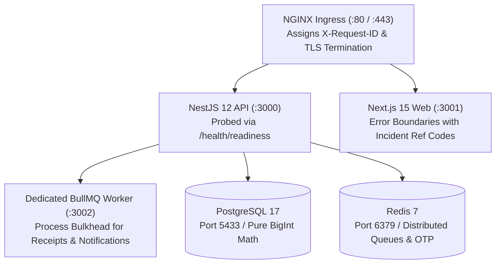

# Kumaran Chits — Production Deployment & Rollback Guide

> **Product**: **Kumaran Chits**  
> **Company**: **Kumaran Finance** (Head Office: Perundurai, Erode, Tamil Nadu)  
> **Target Audience**: DevOps Engineers, System Administrators, Managing Partners, and On-Call Engineers  
> **Compliance**: ADR-01 through ADR-19, `docs/06-devops/infrastructure-and-drp.md`, and Zero-Downtime Operational Standards  

---

## 1. Operating Reality & Infrastructure Topology

Kumaran Chits operates as a high-reliability, bank-grade modular monolith designed specifically for Kumaran Finance:
- **Topology**: Single-tenant Docker Compose production stack running PostgreSQL 17, Redis 7, MinIO S3, NestJS 12 API, Next.js 15 Web Portal, and NGINX 1.27 Ingress.
- **Concurrency & Resilience**: NGINX reverse-proxy handles TLS termination, edge rate limiting (30 req/s general, 3 req/s auth), and injects a deterministic `X-Request-ID` trace header into upstream services and response headers.
- **Zero-Downtime Guarantee**: Rolling container deployment ensures that the API service updates without dropped requests or connection resets.



---

## 2. Pre-Flight Verification Gates

Before deploying any release to production, the following four quality gates must pass:

```bash
# 1. Full API Test Suite (Must pass 100%)
pnpm --filter api test

# 2. API Fast Linter (Must report 0 errors)
pnpm --filter api lint

# 3. Web Frontend Typecheck & Test Suite (Must pass 100%)
pnpm --filter web typecheck
pnpm --filter web test

# 4. Validate Docker Compose Full-Stack Configuration
docker compose -f infra/docker/docker-compose.fullstack.yml config
```

---

## 3. Zero-Downtime Hot Deployment

Deployments are executed using the hardened orchestration scripts in `infra/scripts/`:

### Linux / Production Server:
```bash
bash infra/scripts/zero-downtime-deploy.sh
```

### Windows Server / Admin Terminal:
```powershell
.\infra\scripts\zero-downtime-deploy.ps1
```

### What the Deployment Script Executes Automatically:
1. **Preserves Rollback Tag**: Tags current running image as `chitflow-api:previous`.
2. **Builds New Image**: Pre-compiles updated NestJS container image in the background.
3. **Graceful Recreate**: Spawns updated container using `docker compose up -d --no-deps --build api`.
4. **Deep Health Probe**: Polls `/health/readiness` (PostgreSQL `SELECT 1` + Redis `PING`) every 2 seconds for up to 60 seconds.
5. **Automated Rollback Trap**: If readiness fails after 30 attempts, the script automatically halts, reverts to `chitflow-api:previous`, verifies recovery, reloads NGINX, and logs a critical alert.
6. **Zero-Dropped-Connection Reload**: Executes `nginx -s reload` only after the new container is confirmed healthy.

---

## 4. One-Click Emergency Rollback Protocol

If an unexpected regression or runtime anomaly is discovered post-deployment, operators can trigger an instant, single-command rollback:

### Linux / Production Server:
```bash
bash infra/scripts/rollback.sh
```

### Windows Server / Admin Terminal:
```powershell
.\infra\scripts\rollback.ps1
```

### Rollback Guarantees:
- Restores the exact Docker image tagged as `chitflow-api:previous`.
- Verifies deep database and cache connectivity (`/health/readiness`) before routing traffic.
- Hot-reloads NGINX ingress with zero dropped HTTP connections.

---

## 5. Expand-and-Contract Database Migrations

When releasing schema changes, engineers must strictly follow the 3-phase **Expand-and-Contract Pattern** to avoid breaking queries executed by concurrently running containers:

```mermaid
sequenceDiagram
    participant D as Database (Postgres)
    participant C1 as Running Containers (v1.0)
    participant C2 as Deploying Containers (v1.1)

    Note over D,C2: Phase 1: Expand
    D->>D: Add new column as NULLABLE / with DEFAULT
    C2->>D: Write to both old & new columns; Read with fallback
    C1->>D: Write to old column; Read from old column
    
    Note over D,C2: Phase 2: Backfill
    C2->>D: Batched background script populates legacy rows
    
    Note over D,C2: Phase 3: Contract (Next Release)
    D->>D: Drop obsolete column / constraint after 100% v1.1 traffic
```

### Dangerous DDL Rules:
- ❌ **Never `DROP COLUMN`** in the same release as application code changes.
- ❌ **Never `RENAME COLUMN`** directly; add new column, dual-write, and drop old in a subsequent release.
- ❌ **Never add `NOT NULL` without a `DEFAULT`** on existing tables.

---

## 6. Post-Deployment Observability & Verification

Following deployment, verify system health using these live endpoints:

| Service / Tool | Endpoint / Location | Verification Criteria |
|---|---|---|
| **Deep Readiness Probe** | `GET /health/readiness` | HTTP 200: `{"status":"ok","database":"connected","redis":"connected"}` |
| **Shallow Liveness Probe** | `GET /health/liveness` | HTTP 200: `{"status":"alive"}` |
| **Prometheus Telemetry** | `GET /metrics` | HTTP 200: HTTP duration histograms, memory, CPU, pool gauges |
| **BullMQ Queue Monitor** | `GET /admin/queues` | Live dashboard showing zero stalled or delayed receipt jobs |
| **Ingress Access Logs** | `/var/log/nginx/access.log` | Verify incoming requests contain `rid="<request-id>"` |
| **Client Error Boundaries** | Web Browser (`apps/web`) | Displays actionable `Reference: ERR-KUM-XXXXXX` if a client crash occurs |

---

## 7. Storage Bucket CORS & CDN Delivery Configuration

When configuring production S3-compatible object storage (Cloudflare R2, MinIO, or private S3) for Kumaran Chits, apply the following CORS policy to enable direct browser presigned PUT uploads:

### 7.1 S3 Bucket / Cloudflare R2 CORS Configuration
Apply this JSON configuration to the `kumaran-chits-private` bucket in the Cloudflare R2 / S3 storage dashboard:

```json
[
  {
    "AllowedHeaders": ["*"],
    "AllowedMethods": ["GET", "PUT", "HEAD"],
    "AllowedOrigins": [
      "https://app.kumaranfinance.in",
      "https://admin.kumaranfinance.in",
      "http://localhost:3000",
      "http://localhost:3001"
    ],
    "ExposeHeaders": ["ETag"],
    "MaxAgeSeconds": 3600
  }
]
```

### 7.2 Cloudflare / CDN Media Edge Rules
- **Origin**: Connect to `kumaran-chits-private` R2 bucket or S3 endpoint.
- **Query String Forwarding**: Forward all query parameters (`X-Amz-*`) to enable standard S3 presigned signature verification.
- **Cache-Control**: Pass through `Cache-Control: private, max-age=900` to prevent public caching of private customer documents while allowing browser caching during active viewing sessions.
- **TLS Version**: Enforce TLS 1.3 minimum.
- **Geo-Restriction**: Whitelist India (`IN`) to prevent foreign scraping of financial records.
