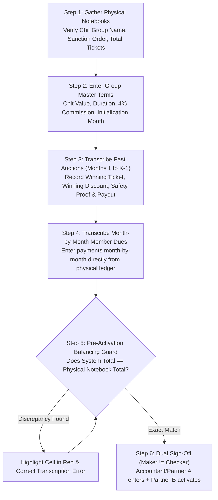

# Kumaran Chits — Physical Ledger to Digital Onboarding SOP

> **Product**: **Kumaran Chits** (Kumaran Finance)  
> **Target Audience**: Desk Accountants, Partners, and System Administrators (Operating from Perundurai Head Office)  
> **Context**: Kumaran Finance holds existing running chit records **exclusively in physical hand-written notebooks, paper ledgers, and physical receipts** (no soft copies/Excel in current business; `CONFIRMED-BY-DEVELOPER`). This SOP governs how active running chits are accurately transcribed into the software without human arithmetic errors.  
> **Integrity Standard**: Strictly enforced **Whole Integer Rupee arithmetic** (no paise) and **Maker-Checker dual authorization** (`CONFIRMED-BY-DEVELOPER`).

---

## 1. Overview of the Mid-Cycle Onboarding Flow

---

## 2. Step-by-Step Transcription Procedure

### Step 1: Pre-Entry Preparation
1. Retrieve the physical bound chit ledger notebook for the active group.
2. Note the essential attributes from the title page:
   - Chit Group Code (e.g., `KCA-1L-20M-03`)
   - Registrar Sanction Order Number & Date
   - Scheme Value (e.g., ₹1,00,000) and Total Duration (e.g., 20 months)
   - Current Running Month (e.g., Month 7 is upcoming; Months 1 to 6 are completed)

---

### Step 2: Open Digital Onboarding Wizard
Navigate to **Admin Web Portal $\to$ Chit Schemes $\to$ "Onboard Ongoing Physical Chit"**.
1. Enter Scheme Master Info:
   - Select Branch (e.g., Perundurai Head Office)
   - Chit Value: `₹1,00,000` (Whole integer Rupees)
   - Total Months: `20`
   - Foreman Commission: `4.00%` (Fixed default, frozen per chit)
   - Base Installment: `₹5,000` (Whole integer Rupees)
   - Set **Initialization Month**: Select `Month 7` (the upcoming un-auctioned month).

---

### Step 3: Transcribe Past Completed Auctions (Months 1 to $K-1$)
For each completed month from Month 1 up to Month 6, transcribe:
- **Month 1 (`CONFIRMED-BY-DEVELOPER`)**:
  - One company representative acts as a customer (holding 1 ticket).
  - Full first-month pool was collected and taken by the company.
  - **NO auction** was conducted in Month 1; dividend is **₹0**.
- **Months 2 through $K-1$ (Months 2 to 6) (`CONFIRMED-BY-DEVELOPER`)**:
  - Winning Ticket Number (e.g., Ticket #4)
  - Winning Bid Discount (e.g., `₹24,000`, strictly $\le$ 1/4 ceiling of `₹25,000`)
  - Prize Money Status:
    - `DISBURSED`: With physical cheque number, bank UTR, or cash voucher reference number and date.
    - `PENDING_VERIFICATION`: If winning subscriber has not yet completed safety proof checklist.
  - **Company Safety Proof Checklist Verification (`CONFIRMED-BY-DEVELOPER`)**:
    - Safety proof required for this winner? [Yes / No]
    - Winner agreement signed? [Yes / No]
    - Nominee signed? [Yes / No]
    - Signed blank cheque(s) with details submitted? [Yes / No]
    - Scanned copy uploaded to secure storage.
- **Automatic Calculation**: The software instantly calculates the historical Foreman Commission (4%) and the member dividend allocated equally to all members, verifying that it matches the dividend written in the physical ledger.

---

### Step 4: Transcribe Month-by-Month Member Payments
Because Kumaran Finance's physical ledgers record collections **month-by-month**, the software presents an interactive digital grid mirroring the physical notebook page:

| Ticket # | Subscriber Name | Month 1 (₹5,000) | Month 2 (₹3,700) | Month 3 (₹3,700) | Month 4 (₹3,800) | Month 5 (₹3,850) | Month 6 (₹3,900) | Net Overdue |
|:---:|---|:---:|:---:|:---:|:---:|:---:|:---:|:---:|
| **1** | M. Kathirvel | Paid (REC-012) | Paid (REC-098) | Paid (REC-145) | Paid (REC-210) | Paid (REC-280) | Paid (REC-340) | ₹0 |
| **2** | S. Sundaram | Paid (REC-014) | Paid (REC-101) | Paid (REC-148) | Paid (REC-212) | **UNPAID** | **UNPAID** | ₹7,750 |
| **3** | P. Meenakshi | Paid (REC-015) | Paid (REC-102) | Paid (REC-150) | Paid (REC-215) | Paid (REC-282) | Paid (REC-345) | ₹0 |

1. Check off paid installments or enter the physical paper receipt book number for cross-auditing.
2. **Binary Payments & Zero Partial Payments (`CONFIRMED-BY-DEVELOPER`)**:
   - Each historical month is strictly either **PAID in full** (with paper receipt number) or **UNPAID**.
   - Partial payment amounts do not exist in Kumaran Finance records.
   - Zero double payments and zero advance balances exist.
3. If a customer has unpaid past months (e.g., Ticket #2 unpaid for Months 5 & 6), the system calculates the exact overdue arrears in whole integer Rupees.

---

### Step 5: The Pre-Activation Balancing Guard
Before the chit can be activated, the system enforces a strict mathematical verification check:

$$\sum \text{Total Historical Collections (System)} \quad \text{vs.} \quad \sum \text{Physical Notebook Ledger Total}$$

- **Case 1 (Discrepancy Detected)**: If the system total is ₹4,52,000 but the physical ledger page total says ₹4,50,000, the screen blocks submission and flags the exact ticket rows where arithmetic differs.
- **Case 2 (Exact Match)**: When both totals match to the exact whole rupee, the screen displays a green verified badge.

---

### Step 6: Dual Sign-Off & Forward Activation (`CONFIRMED-BY-DEVELOPER` / Guardrails 10–11)
1. **Maker (Desk Accountant, Branch Manager, or Partner A)**: Enters the digitized historical data from the physical notebooks via `POST /api/v1/chits/onboard-ongoing` ([`chit.controller.ts:73-87`](file:///u:/Kumaran-finance/apps/api/src/chit/chit.controller.ts#L73-L87)) and submits for review.
2. **Checker (Independent Verified Partner B — `SUPER_ADMIN` with `isPartner: true`)**: Verifies the opening ledger balance against the physical notebook and clicks **"Confirm & Activate Chit"** (`POST /api/v1/chits/:id/activate`, [`chit.controller.ts:205-220`](file:///u:/Kumaran-finance/apps/api/src/chit/chit.controller.ts#L205-L220)).
   - Strict constraint enforced: `maker_user_id != checker_user_id` and verified Partner identity (`isPartner: true`, Guardrail 11 / `ADR-21`). The user who transcribed the data cannot self-activate the chit group.
3. **Forward Engine Activated**:
   - The chit is now officially `ACTIVE`.
   - Installments for Month 7 to Month 20 will be managed digitally.
   - Field collection agents record Month 7 dues via the responsive Web Portal in Phase 1 (and via the Android mobile app in Phase 2 Q2 2027, `ADR-26`).
   - All past subscriber payment histories, receipts, and safety proof documents remain fully searchable.
   - In Month 20 (Final Month $N$), there will be **no auction**; the company takes 4% commission and deducts the Month $N$ installment **only if unpaid** ($₹91,000$ net payout on a ₹1,00,000 scheme, marking Month $N$ `PAID`; or $₹96,000$ if the subscriber already paid Month $N$ at the branch desk — zero double collection per `KFC-FIN-001` / `FIN-B`).
