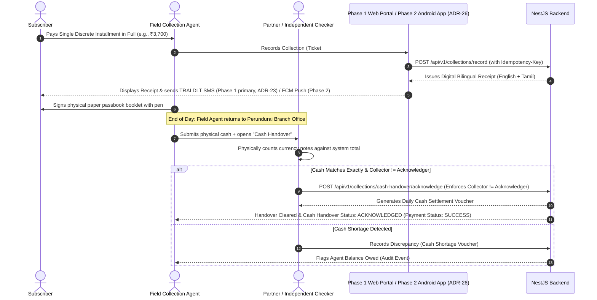
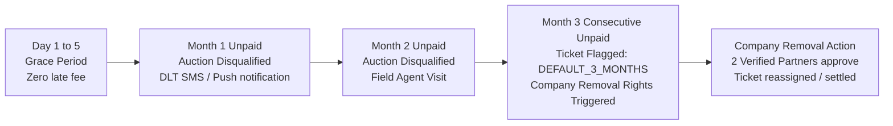

# Kumaran Chits — Standard Operating Procedures (SOP)

> **Product**: **Kumaran Chits** (Kumaran Finance)  
> **Scope**: Field Collection Operations, Cash Handover, Payment Reversals, and Defaulter Recovery

---

## 1. Daily Field Collection & Cash Handover SOP



### 1.1 Field Collection Rules
1. **Single Discrete Payment & Zero Partial Payments (`CONFIRMED-BY-DEVELOPER`)**:
   - The customer must pay the exact net installment due ($I_{net}$) in full.
   - Partial payments are strictly prohibited in the product.
   - The concept of "Advance Balance" is completely eliminated; each payment satisfies exactly one discrete monthly due.
2. **Instant Receipt Issuance**: The collection agent must generate a digital bilingual receipt on the spot. No paper slips without software entry are permitted.
3. **Zero Cash Retention**: Agents are strictly prohibited from holding physical cash overnight. All collected cash must be surrendered at the Perundurai branch office before closing for the day.
4. **Cash Handover Dual-Role Guard (`CONFIRMED-BY-DEVELOPER`)**:
   - Because field collection agents may also hold desk **Accountant** duties, the system strictly enforces both in NestJS and at the PostgreSQL 17 engine level (`chk_payment_cash_handover_maker_checker`):
     $$\texttt{collector\_user\_id} \ne \texttt{acknowledger\_user\_id}$$
   - An agent who collected the cash can **never** acknowledge their own handover.
   - An independent **Partner (`SUPER_ADMIN`), Branch Manager, or Desk Accountant** must physically count the currency notes, enter their credentials, and officially acknowledge the cash deposit into the branch vault.
   - Customer installment due is satisfied immediately (`paymentStatus: SUCCESS`), while branch vault custody is tracked via `cashHandoverStatus`. Until acknowledged, cash custody remains `PENDING_HANDOVER`. Once acknowledged by the independent checker, it transitions to `ACKNOWLEDGED`.

---

## 2. Payment Reversal & Correction SOP (Maker-Checker & Guardrail 11)

Financial transactions can never be deleted from the database. If a staff member makes an error, it must be resolved via a controlled **Payment Reversal**.

### 2.1 Permitted Reversal Scenarios:
- Field agent entered collection for the wrong ticket number.
- Cheque bounced or dishonored by the bank.
- Duplicate entry created due to network timeout.

### 2.2 Reversal Workflow (Strict Verified Partner Dual Control — `KFC-SEC-001` & Guardrail 11 / `ADR-21`):
1. **Maker (Verified Partner A — `SUPER_ADMIN` with `isPartner: true` exclusively)**:
   - Navigates to the payment record in the Web Dashboard.
   - Clicks **"Request Payment Reversal"** (`POST /api/v1/payments/:id/request-reversal`).
   - Selects mandatory reason code and uploads supporting proof (e.g., bank bounce slip or customer note).
   - *Note*: Branch Managers, Accountants, and non-Partner IT Super Admins (`isPartner: false`) are strictly blocked from requesting or approving reversals.
2. **Checker (Verified Partner B — `SUPER_ADMIN` with `isPartner: true`)**:
   - Receives high-priority reversal request in the Admin Dashboard.
   - Verifies the reason and clicks **"Approve Reversal"** (`POST /api/v1/payments/:id/approve-reversal`).
   - **Hard Rule**: `maker_user_id != checker_user_id` enforced in app + PostgreSQL `chk_reversal_maker_checker` (Partner A cannot approve their own reversal request; Partner B, C, or D must verify).
3. **Automated Ledger Effect**:
   - The original payment is flagged as `REVERSED`.
   - The corresponding `InstallmentDue` is restored strictly to `UNPAID` with zero mathematical discrepancy.
   - The original receipt is marked `REVERSED`, and all subsequent PDF downloads dynamically render the bold red diagonal watermark `ரத்து செய்யப்பட்டது / CANCELLED` (`KFC-PDF-001`).
   - An immutable audit log records the Maker ID, Checker ID, timestamp, and justification.

---

## 3. Defaulter Management & Company Removal SOP (`CONFIRMED-BY-DEVELOPER`)

> **Auction Ineligibility Rule (`CONFIRMED-BY-DEVELOPER`)**:  
> Any customer who has not paid their installment due for a specific month is **strictly ineligible to participate or bid** in that month's auction. The software automatically blocks staff from entering an unpaid subscriber as an active bidder or winner.



### 3.1 Non-Prized Subscriber Default & Removal (`CONFIRMED-BY-DEVELOPER`)
1. **Auction Disqualification**:
   - The customer who did not pay at a specific month will **not be able to participate in auctions at that specific month** (`CONFIRMED-BY-DEVELOPER`).
2. **3-Month Consecutive Default & Company Removal Rights (`CONFIRMED-BY-DEVELOPER`)**:
   - The customer who did not pay up to **3 continuous (consecutive) months**, the company has the full right and authority to **remove the customer from the chit group**.
   - The software tracks consecutive missed installments, flags the ticket with status `DEFAULT_3_MONTHS`, and prompts company management for review.
   - Company Management / Verified Partners (`isPartner: true`) formally execute the removal workflow in the software, transitioning the ticket to `REMOVED_DEF_3M` via two-partner dual control (`SEC-B`).
   - **Dual-Partner Control on Removal & Exit Settlement (`SEC-B`, Guardrail 11, `Q25`)**:
     - **Step 1 (Request Removal)**: Verified Partner A (`isPartner: true`) initiates removal request (`POST /api/v1/installments/tickets/:id/remove-defaulter/request`), specifying the mandatory justification. The ticket transitions from `DEFAULT_3_MONTHS` to `PENDING_REMOVAL_APPROVAL`.
     - **Step 2 (Approve Removal)**: Verified Partner B (`isPartner: true`) reviews the 3-month arrears history and approves removal (`POST /api/v1/installments/tickets/:id/remove-defaulter/approve`). Hard Guard: `ticket.removalRequestedByUserId !== approvingPartnerId` (`MAKER_CHECKER_VIOLATION` + `chk_ticket_removal_maker_checker`). Upon approval, the ticket transitions to `REMOVED_DEF_3M`.
     - **Step 3 (Exit Settlement Policy)**: Financial exit refund settlement under Q25 fails closed (`UNAPPROVED_SETTLEMENT_POLICY`) pending formal written confirmation of the contractual/statutory damages formula by the business owner.
   - **Prized Ticket Immutability (`KFC-SEC-004`)**:
     - Prized tickets can NEVER be removed or substituted (`PRIZED_TICKET_IMMUTABLE`). The system rejects any removal attempt on a prized ticket with HTTP 400.

### 3.2 Prized Subscriber Default (`CONFIRMED-BY-DEVELOPER` / `UNVERIFIED-LEGAL`)
Because a prized subscriber has already received the pool amount:
1. **Safety Proof Demand (`CONFIRMED-BY-DEVELOPER`)**:
   - Demand notice is served on the subscriber and nominee based on the physical documents recorded in the **Company Safety Proof Checklist** during prize disbursement (signed agreement with winner & nominee signatures, signed blank cheques, promissory notes).
2. **Statutory Recovery (`UNVERIFIED-LEGAL`)**:
   - Formal arbitration or legal petition before the Registrar of Chits for recovery of remaining installments. Legal citations are retained as `UNVERIFIED-LEGAL` pending inspection of primary Tamil Nadu regulatory orders.

---

### 3.3 Finalized Auction Correction SOP (`KFC-FIN-005` / Guardrail 11 / `CONFIRMED-BY-DEVELOPER`)
If a clerical error occurred during physical auction recording (e.g. inverted ticket number or mistyped discount):
1. **Maker Request**: Verified Partner A (`SUPER_ADMIN`, `isPartner: true`) enters `POST /api/v1/auctions/:id/correction/request` with corrected ticket ID or discount and documented justification.
   - **Pre-Condition**: Fails closed with `HTTP 400 Bad Request` if prize money has already been disbursed or downstream Month $m+1$ dues are already settled (`FIN-E`).
   - **Math Guard**: Enforces 25% discount ceiling and whole-rupee divisibility ($(D - C_f) \pmod N == 0$).
2. **Checker Approval**: Verified Partner B (`SUPER_ADMIN`, `isPartner: true`) reviews physical lot draw sheet and submits `POST /api/v1/auctions/:id/correction/approve`.
   - **Dual Control**: Enforces `maker_user_id != checker_user_id` (`HTTP 403 Forbidden`).
   - **Ledger Re-alignment**: Atomically updates auction math, swaps prized subscriber flag if winner changed, and reconciles downstream unpaid dues.

---

## 4. Disaster Recovery & Off-Site Backup SOP (`CONFIRMED-BY-DEVELOPER`)

> **Regulatory Reference**: Section 4 of [`docs/06-devops/infrastructure-and-drp.md`](../06-devops/infrastructure-and-drp.md)  
> **Verified Recovery Targets**: **$\text{RPO} \le 24\text{ hours}$** (nightly 02:00 AM IST unified `pg_dump -F c` + document recovery set; optional future WAL-G PITR upgrades RPO to $\le 15\text{ min}$), **$\text{RTO} \le 2\text{ hours}$** (1.04s–3.6s measured DRP drill)

### 4.1 Daily Off-Site Automated Backup (02:00 AM IST)
1. **Automated Snapshot**: Every night at 02:00 AM IST, the automated script ([`apps/api/scripts/ops/backup-to-s3.ts`](../../apps/api/scripts/ops/backup-to-s3.ts)) creates a compressed binary dump (`pg_dump -F c`) of the entire PostgreSQL database.
2. **Encrypted Cloud Upload**: The dump is encrypted using `AES256` and streamed to the private S3 bucket under `backups/db/YYYY/MM/`.
3. **Automated 30-Day Retention Prune**: Any backup older than 30 days is automatically purged to minimize storage overhead.
4. **Manual Run & Container Inspection**:
   ```bash
   # Host / Developer runner:
   pnpm --filter api db:backup:s3

   # Docker Container on-demand snapshot:
   docker exec chitflow-backup-cron /scripts/backup-cron-job.sh

   # Inspect backup cron logs:
   docker exec chitflow-backup-cron cat /var/log/backup-cron.log
   ```

### 4.2 Quarterly Disaster Recovery (DRP) Drill SOP
Once every 90 days, or ahead of any statutory audit by the Registrar of Chits, the Lead Developer and Kumaran Finance Administrator must execute the automated DRP drill:

1. **Execution**:
   ```powershell
   pnpm db:drp:drill
   ```
2. **What the Drill Automatically Executes**:
   - Takes a fresh S3 snapshot of the active database.
   - Creates an isolated database (`chitflow_drp_drill`) to avoid touching active business records.
   - Downloads the S3 dump and restores it, recording the exact recovery time in seconds (verifying $\text{RTO} \le 2\text{ hours}$).
   - Automatically asserts all **9** core financial, security, and storage invariants:
     - Record row parity between live and restored datasets (Users, Customers, Groups, Tickets, Dues, Payments, AuditLogs).
     - 4.00% Foreman Commission lock (ADR-04).
     - Unique subscriber ticket constraints per chit group (ADR-13).
     - 64-bit integer Rupee math integrity (zero floats, zero paise).
     - Accounting balance equation: $\sum \text{Dues} = \sum \text{Payments} + \text{Remaining Unpaid}$.
     - Maker != Checker reversal separation of duties (ADR-10).
     - PostgreSQL `AuditLog` append-only immutability triggers (`trg_prevent_audit_log_mutation`/`truncate`).
     - Non-regenerable KYC & safety-proof document checksum parity in isolated drill bucket.
     - Worker & queue sandboxing isolation (zero job replay).
   - Drops the temporary drill database cleanly and outputs the signed compliance report.
3. **Audit Log Filing**: The resulting audit log is retained in the operational records as proof of data disaster recoverability.

---

## 5. Indian DLT SMS Notification Operations & Maintenance SOP (`CONFIRMED-BY-DEVELOPER`)

> **Regulatory Reference**: Section 2 of [`docs/02-requirements/notification-and-receipt-templates.md`](../02-requirements/notification-and-receipt-templates.md)  
> **Telecom Mandate**: Telecom Regulatory Authority of India (TRAI) Distributed Ledger Technology (DLT) Registration  
> **Guiding ADR**: ADR-11, ADR-12, ADR-23 (DLT SMS Primary in Phase 1; WhatsApp permanently purged per Q34) & Open Question O-11

### 5.1 Operating Principles & Financial Non-Blocking Guarantee
1. **Financial Non-Blocking Guarantee**:
   - Cash collections, payment receipt issuance, and accounting ledgers must **never** be held up or aborted due to telecom gateway latency or network timeouts.
   - All SMS dispatches execute through resilient try-catch wrappers with exponential backoff retries (`SMS_RETRY_BASE_DELAY_MS * 2^attempt`).
2. **Indian DPDP Act 2023 Compliance**:
   - Customer phone numbers in application console logs and audit files are masked strictly as `+91******XXXX` via `PhoneHelper.maskPhone()`.
3. **TRAI DLT Template Exact Matching**:
   - Variables are mapped to registered `{#var#}` slots. Do not edit message body wording in code without registering the exact matching text on the DLT portal.

### 5.2 Provider Configuration & Switching
The system supports pluggable provider switching via `apps/api/.env`:

```env
# Local Development, Staging, QA or Offline Testing
SMS_DRIVER=mock

# Production Indian DLT Gateway
SMS_DRIVER=msg91
SMS_SENDER_ID=KMRCHT
MSG91_AUTH_KEY=your_msg91_production_auth_key
```

### 5.3 Operator DLT Template Registry Reference

| Purpose | DLT Template ID | Header | Registered Body Pattern |
|---|---|:---:|---|
| **Device OTP** | `1407169823412093847` | `KMRCHT` | `Kumaran Chits: Your one-time verification code is {#var#}. Valid for 5 minutes. Do not share this OTP with anyone. / உங்கள் சரிபார்ப்பு குறியீடு {#var#}. யாருடனும் பகிர வேண்டாம்.` |
| **Payment Receipt** | `1407169823412093848` | `KMRCHT` | `Kumaran Chits: Received Rs.{#var#} for Chit {#var#}, Ticket #{#var#} on {#var#}. Receipt: {#var#}. View passbook: {#var#}` |
| **Auction Reminder**| `1407169823412093849` | `KMRCHT` | `Kumaran Chits: Auction for Chit {#var#} Month {#var#} is scheduled on {#var#} at {#var#}. Venue: {#var#}. Contact: {#var#}` |
| **Default Warning** | `1407169823412093850` | `KMRCHT` | `Kumaran Chits: Urgent: Ticket #{#var#} in Chit {#var#} has {#var#} months overdue (Rs.{#var#}). Clear dues to avoid membership cancellation. Contact: {#var#}` |

---

## 6. Automated Background Cron Schedules & 24-Hour Timeline (`CONFIRMED-BY-DEVELOPER`)

The platform executes autonomous maintenance jobs scheduled strictly in Indian Standard Time (`Asia/Kolkata` / UTC+05:30) via BullMQ repeatable workers:

### 6.1 Daily Operations Timeline

| Time (IST) | Scheduled Routine | Automated Action Executed | Manual Trigger Override |
|:---:|---|---|---|
| **00:01 AM** | **Midnight Arrears Recalculation** | Transitions past unpaid dues to `OVERDUE`. Recalculates consecutive missed months, tags tickets with $\ge 3$ consecutive missed installments as `DEFAULT_3_MONTHS` (ADR-07), and emits warning notices. | `POST /api/v1/jobs/run-daily-arrears` |
| **02:00 AM** | **Off-Site Encrypted S3 Backup** | `pg_dump -F c` + unified document recovery set uploaded to Cloudflare R2 / S3 (`AES256` SSE). Purges old dev dumps past 30 days. | `pnpm db:backup:s3` |
| **06:00 AM** | **Bank Settlement Reconciliation (ADR-19)** | Compares direct Karur Vysya Bank settlement records / UPI claims against internal payments to auto-resolve ghost drops (`INITIATED` $\to$ `SUCCESS`). | `POST /api/v1/jobs/run-reconciliation` |
| **09:00 AM** | **Pre-Auction Broadcast Reminder** | Scans chits with auctions in 3 days; broadcasts bilingual TRAI DLT SMS (Phase 1 primary) & FCM Push (Phase 2) alerts with date, time, and branch venue. | `POST /api/v1/jobs/run-pre-auction-scan` |

### 6.2 Monitoring & Queue Inspection (`SUPER_ADMIN` Strictly — Guardrail 11)
- **Bull Board Dashboard**: `http://localhost:3000/admin/queues` (Active `SUPER_ADMIN` JWT session or configured `BULL_BOARD_USER` Basic Auth).
- **Repeatable Schedules Audit**: `GET /api/v1/jobs/repeatable-schedules` (`SUPER_ADMIN` only).
- **Queue Health Metrics**: `GET /api/v1/jobs/queue-status` (`SUPER_ADMIN` only).

---

## 7. Real-Time Maker-Checker Approvals Queue & Operational Monitoring

To enforce Invariant Guardrails #10–#11 (Maker $\ne$ Checker & Verified Partner Identity) without administrative friction, the platform consolidates all pending operational sign-offs into a unified queue:

### 7.1 Unified Approvals Queue (`GET /api/v1/reports/pending-approvals`)
- **Authorized Roles**: `SUPER_ADMIN` (Partners), `BRANCH_MANAGER`, `ACCOUNTANT`, `AUDITOR` ([`report.controller.ts:80-81`](file:///u:/Kumaran-finance/apps/api/src/report/report.controller.ts#L80-L81)).
- **Data Categories Aggregated**:
  1. **Cash Handovers**: Field collections awaiting vault counting and confirmation (`collectorUserId != acknowledgerUserId`).
  2. **Prize Disbursements**: Verified auction winner safety proofs awaiting Verified Partner (`isPartner: true`) payout authorization.
  3. **Payment Reversals**: Reversal requests awaiting Verified Partner (`isPartner: true`) sign-off (`makerUserId != checkerUserId`).
  4. **Safety Proof Verifications**: Auction winners awaiting desk verification of signed agreement, blank cheques, and promissory notes.
  5. **Customer UPI Claims (ADR-19)**: Pending customer 12-digit Bank UTR claims awaiting Desk Accountant / Manager / Partner verification against Karur Vysya Bank statement (`GET /api/v1/payments/pending-upi-claims`, `POST /api/v1/payments/:id/verify-upi-claim`, `makerUserId != checkerUserId`).
  6. **Two-Partner Defaulter Removals & Auction Corrections (`SEC-B` / `KFC-FIN-005`)**: Pending 3-month default removals (`PENDING_REMOVAL_APPROVAL`) and finalized auction correction requests awaiting independent Verified Partner B sign-off.
- **Branch Scoping**:
  - `BRANCH_MANAGER` / `ACCOUNTANT` view is restricted strictly to their branch.
  - `SUPER_ADMIN` / `AUDITOR` view encompasses all branches (note: `/reports/audit-logs` remains strictly `SUPER_ADMIN`-only per Guardrail 11).

### 7.2 Real-Time SSE Stream (`GET /api/v1/reports/approvals-stream`)
- Emits live `APPROVALS_UPDATE` payloads over Server-Sent Events every 15 seconds (asserting token/session revocation on every tick under `F15`).
- Powers the live notification badge counter on the Next.js Web Admin Portal (Phase 1) and future Phase 2 Mobile App (`ADR-26`).

---

## 8. Daily Branch Cash Reconciliation & Monthly Auction Day Runbook (Perundurai Head Office)

### 8.1 4-Phase Daily Branch Schedule
1. **09:00 AM — Morning Opening**: Desk Accountant logs into the Web Portal, confirms green `/health` readiness, counts the opening physical cash drawer float (typically ₹10,000–₹25,000), and reviews overdue dues / scheduled DLT SMS reminders.
2. **09:30 AM – 05:00 PM — Daytime Counter & KVB UPI Desk**: Cashier records counter cash/UPI/cheque collections (`POST /api/v1/payments`), prints bilingual receipts, and verifies customer self-reported 12-digit Bank UTR claims against the Karur Vysya Bank statement (`POST /api/v1/payments/:id/verify-upi-claim`).
3. **05:00 PM – 06:30 PM — Evening Field Agent Cash Handover**: Field agents return from Perundurai, Chennimalai, and Bhavani routes, submit their daily batch (`POST /api/v1/collections/cash-handover/submit`), and surrender currency notes to an independent Partner/Accountant/Manager for physical counting and dual-control acknowledgment (`POST /api/v1/collections/cash-handover/acknowledge`).
4. **06:30 PM – 07:00 PM — Daily Closing & Cash Book Sign-Off**:
   $$\text{Closing Cash} = \text{Opening Float} + \text{Counter Cash Collections} + \text{Acknowledged Agent Handovers} - \text{Cash Disbursements}$$
   Cashier generates the Daily Day Book (`GET /api/v1/reports/daybook?date=YYYY-MM-DD`); a Partner verifies, signs the physical Form XXII printout, and locks the branch safe.

### 8.2 Monthly Auction Day & 21-Day Statutory Filing Runbook
1. **10:00 AM — Pre-Auction Defaulter Screening**: Staff prints the eligible/ineligible subscriber roster (`ADR-07`: any subscriber with an unpaid due for the current month is strictly disqualified from bidding).
2. **05:00 PM — In-Branch Auction & Option A Tie-Break**: Members assemble at Perundurai branch; bids run from the 4% commission floor up to the fixed 1/4 ceiling ($D \le V/4$) with real-time whole-rupee divisibility enforcement ($(D - C_f) \pmod N == 0$). If 2+ members tie at the ceiling, the Foreman conducts an **Option A physical paper token draw** in front of all attendees and records the drawn winning ticket (`POST /api/v1/auctions/:id/tie-break`).
3. **Dual-Control Finalization & Form XVII**: An independent Verified Partner (`isPartner: true`, `conductedByUserId != finalizedByUserId`) finalizes the auction (`POST /api/v1/auctions/:id/finalize`), locking dividends and starting the 21-day statutory filing timer.
4. **Within 21 Days — Perundurai Sub-Registrar Filing**: Staff prepares signed Form XVII minutes (Foreman + 2 attending subscribers), pays the statutory challan at the Sub-Registrar Office, Perundurai, and records the challan reference (`POST /api/v1/auctions/:id/mark-minutes-filed`).


