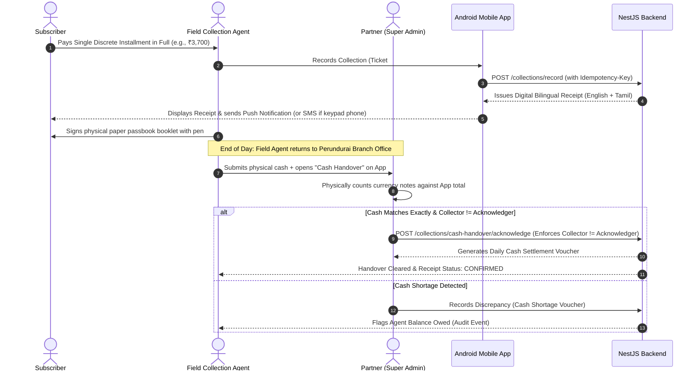
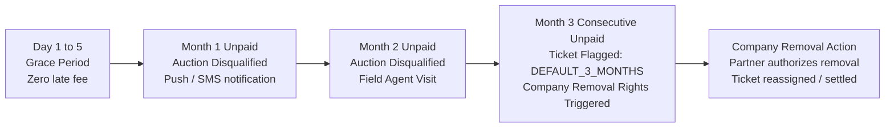

# Kumaran Chits — Standard Operating Procedures (SOP)

> **Product**: **Kumaran Chits** (Kumaran Finance)  
> **Scope**: Field Collection Operations, Cash Handover, Payment Reversals, and Defaulter Recovery

---

## 1. Daily Field Collection & Cash Handover SOP



### 1.1 Field Collection Rules
1. **Single Discrete Payment & Zero Partial Payments (`CONFIRMED-BY-DEVELOPER`)**:
   - The customer must pay the exact net installment due ($I_{net}$) in full.
   - Partial payments are strictly prohibited in the product.
   - The concept of "Advance Balance" is completely eliminated; each payment satisfies exactly one discrete monthly due.
2. **Instant Receipt Issuance**: The collection agent must generate a digital bilingual receipt on the spot. No paper slips without software entry are permitted.
3. **Zero Cash Retention**: Agents are strictly prohibited from holding physical cash overnight. All collected cash must be surrendered to an authorized Partner at the branch office before closing for the day.
4. **Cash Handover Dual-Role Guard (`CONFIRMED-BY-DEVELOPER`)**:
   - Because field collection agents also perform desk **Accountant** duties, the system strictly enforces:
     $$\texttt{collector\_user\_id} \ne \texttt{acknowledger\_user\_id}$$
   - An agent who collected the cash can **never** acknowledge their own handover.
   - An independent **Partner (Super Admin)** must physically count the currency notes, enter their credentials, and officially acknowledge the cash deposit into the branch vault.
   - Until acknowledged, payment status remains `PENDING_HANDOVER`. Once acknowledged, it updates to `CONFIRMED`.

---

## 2. Payment Reversal & Correction SOP (Maker-Checker)

Financial transactions can never be deleted from the database. If a staff member makes an error, it must be resolved via a controlled **Payment Reversal**.

### 2.1 Permitted Reversal Scenarios:
- Field agent entered collection for the wrong ticket number.
- Cheque bounced or dishonored by the bank.
- Duplicate entry created due to network timeout.

### 2.2 Reversal Workflow:
1. **Maker (Desk Accountant / Partner A)**:
   - Navigates to the payment record in the Web Dashboard.
   - Clicks **"Request Payment Reversal"**.
   - Selects mandatory reason code and uploads supporting proof (e.g., bank bounce slip or customer note).
2. **Checker (Partner B / Super Admin)**:
   - Receives high-priority reversal request in the Admin Dashboard.
   - Verifies the reason and clicks **"Approve Reversal"**.
   - **Hard Rule**: `maker_user_id != checker_user_id` (Partner A cannot approve their own reversal request; Partner B, C, or D must verify).
3. **Automated Ledger Effect**:
   - The original payment is flagged as `REVERSED`.
   - The corresponding `InstallmentDue` is restored strictly to `UNPAID` with zero mathematical discrepancy.
   - The original receipt is marked `VOID / CANCELED`.
   - An immutable audit log records the Maker ID, Checker ID, timestamp, and justification.

---

## 3. Defaulter Management & Company Removal SOP (`CONFIRMED-BY-DEVELOPER`)

> **Auction Ineligibility Rule (`CONFIRMED-BY-DEVELOPER`)**:  
> Any customer who has not paid their installment due for a specific month is **strictly ineligible to participate or bid** in that month's auction. The software automatically blocks staff from entering an unpaid subscriber as an active bidder or winner.



### 3.1 Non-Prized Subscriber Default & Removal (`CONFIRMED-BY-DEVELOPER`)
1. **Auction Disqualification**:
   - The customer who did not pay at a specific month will **not be able to participate in auctions at that specific month** (`CONFIRMED-BY-DEVELOPER`).
2. **3-Month Consecutive Default & Company Removal Rights (`CONFIRMED-BY-DEVELOPER`)**:
   - The customer who did not pay up to **3 continuous (consecutive) months**, the company has the full right and authority to **remove the customer from the chit group**.
   - The software tracks consecutive missed installments, flags the ticket with status `DEFAULT_3_MONTHS`, and prompts company management for review.
   - Company Management / Partners can formally execute the removal workflow in the software, transitioning the ticket to `REMOVED_DEF_3M`.
   - The company may then substitute a new subscriber or settle past contributions according to company terms.

### 3.2 Prized Subscriber Default (`CONFIRMED-BY-DEVELOPER` / `UNVERIFIED-LEGAL`)
Because a prized subscriber has already received the pool amount:
1. **Safety Proof Demand (`CONFIRMED-BY-DEVELOPER`)**:
   - Demand notice is served on the subscriber and nominee based on the physical documents recorded in the **Company Safety Proof Checklist** during prize disbursement (signed agreement with winner & nominee signatures, signed blank cheques, promissory notes).
2. **Statutory Recovery (`UNVERIFIED-LEGAL`)**:
   - Formal arbitration or legal petition before the Registrar of Chits for recovery of remaining installments. Legal citations are retained as `UNVERIFIED-LEGAL` pending inspection of primary Tamil Nadu regulatory orders.

---

## 4. Disaster Recovery & Off-Site Backup SOP (`CONFIRMED-BY-DEVELOPER`)

> **Regulatory Reference**: Section 3.1 & 3.3 of [`docs/06-devops/infrastructure-and-drp.md`](../06-devops/infrastructure-and-drp.md)  
> **Recovery Targets**: $\text{RPO} \le 15\text{ minutes}$, $\text{RTO} \le 2\text{ hours}$

### 4.1 Daily Off-Site Automated Backup (02:00 AM IST)
1. **Automated Snapshot**: Every night at 02:00 AM IST, the automated script ([`apps/api/scripts/backup-to-s3.ts`](../../apps/api/scripts/backup-to-s3.ts)) creates a compressed binary dump (`pg_dump -F c`) of the entire PostgreSQL database.
2. **Encrypted Cloud Upload**: The dump is encrypted using `AES256` and streamed to the private S3 bucket under `backups/db/YYYY/MM/`.
3. **Automated 30-Day Retention Prune**: Any backup older than 30 days is automatically purged to minimize storage overhead.
4. **Manual Run Command**:
   ```powershell
   pnpm db:backup:s3
   ```

### 4.2 Quarterly Disaster Recovery (DRP) Drill SOP
Once every 90 days, or ahead of any statutory audit by the Registrar of Chits, the Lead Developer and Kumaran Finance Administrator must execute the automated DRP drill:

1. **Execution**:
   ```powershell
   pnpm db:drp:drill
   ```
2. **What the Drill Automatically Executes**:
   - Takes a fresh S3 snapshot of the active database.
   - Creates an isolated database (`chitflow_drp_drill`) to avoid touching active business records.
   - Downloads the S3 dump and restores it, recording the exact recovery time in seconds (verifying $\text{RTO} \le 2\text{ hours}$).
   - Automatically asserts 5 core financial invariants:
     - Record row parity between live and restored datasets.
     - 4.00% Foreman Commission lock (ADR-04).
     - Unique subscriber ticket constraints per chit group (ADR-13).
     - 64-bit integer Rupee math integrity (zero floats, zero paise).
     - Accounting balance equation: $\sum \text{Dues} = \sum \text{Payments} + \text{Remaining Unpaid}$.
   - Drops the temporary drill database cleanly and outputs the signed compliance report.
3. **Audit Log Filing**: The resulting audit log is retained in the operational records as proof of data disaster recoverability.

---

## 5. Indian DLT SMS Notification Operations & Maintenance SOP (`CONFIRMED-BY-DEVELOPER`)

> **Regulatory Reference**: Section 2 of [`docs/02-requirements/notification-and-receipt-templates.md`](../02-requirements/notification-and-receipt-templates.md)  
> **Telecom Mandate**: Telecom Regulatory Authority of India (TRAI) Distributed Ledger Technology (DLT) Registration  
> **Guiding ADR**: ADR-11, ADR-12 & Open Question O-11

### 5.1 Operating Principles & Financial Non-Blocking Guarantee
1. **Financial Non-Blocking Guarantee**:
   - Cash collections, payment receipt issuance, and accounting ledgers must **never** be held up or aborted due to telecom gateway latency or network timeouts.
   - All SMS dispatches execute through resilient try-catch wrappers with exponential backoff retries (`SMS_RETRY_BASE_DELAY_MS * 2^attempt`).
2. **Indian DPDP Act 2023 Compliance**:
   - Customer phone numbers in application console logs and audit files are masked strictly as `+91******XXXX` via `PhoneHelper.maskPhone()`.
3. **TRAI DLT Template Exact Matching**:
   - Variables are mapped to registered `{#var#}` slots. Do not edit message body wording in code without registering the exact matching text on the DLT portal.

### 5.2 Provider Configuration & Switching
The system supports pluggable provider switching via `apps/api/.env`:

```env
# Local Development, Staging, QA or Offline Testing
SMS_DRIVER=mock

# Production Indian DLT Gateway
SMS_DRIVER=msg91
SMS_SENDER_ID=KMRCHT
MSG91_AUTH_KEY=your_msg91_production_auth_key
```

### 5.3 Operator DLT Template Registry Reference

| Purpose | DLT Template ID | Header | Registered Body Pattern |
|---|---|:---:|---|
| **Device OTP** | `1407169823412093847` | `KMRCHT` | `Kumaran Chits: Your one-time verification code is {#var#}. Valid for 5 minutes. Do not share this OTP with anyone. / உங்கள் சரிபார்ப்பு குறியீடு {#var#}. யாருடனும் பகிர வேண்டாம்.` |
| **Payment Receipt** | `1407169823412093848` | `KMRCHT` | `Kumaran Chits: Received Rs.{#var#} for Chit {#var#}, Ticket #{#var#} on {#var#}. Receipt: {#var#}. View passbook: {#var#}` |
| **Auction Reminder**| `1407169823412093849` | `KMRCHT` | `Kumaran Chits: Auction for Chit {#var#} Month {#var#} is scheduled on {#var#} at {#var#}. Venue: {#var#}. Contact: {#var#}` |
| **Default Warning** | `1407169823412093850` | `KMRCHT` | `Kumaran Chits: Urgent: Ticket #{#var#} in Chit {#var#} has {#var#} months overdue (Rs.{#var#}). Clear dues to avoid membership cancellation. Contact: {#var#}` |
