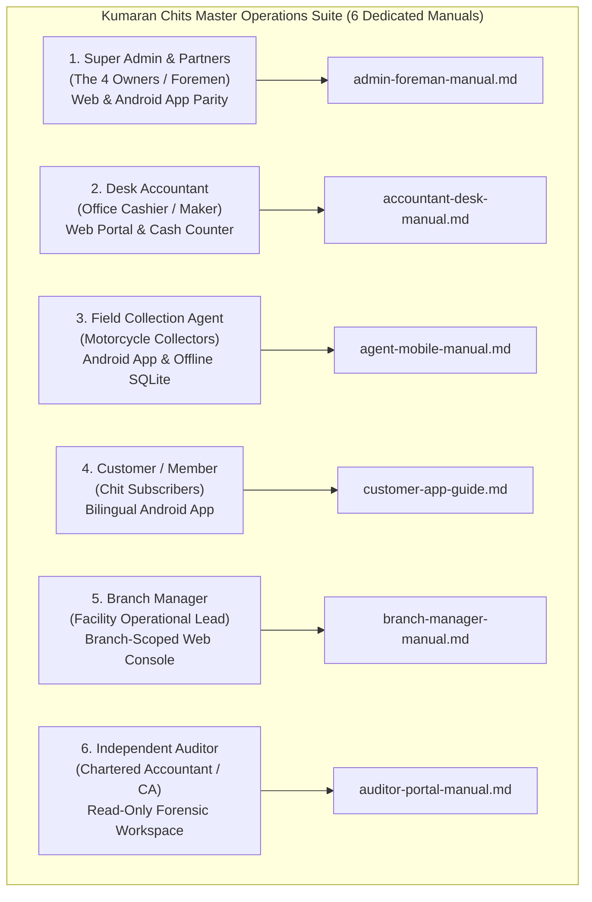

# Kumaran Chits — Comprehensive User Manuals Suite

> **Product**: **Kumaran Chits** (Official Chit Fund Operations Platform)  
> **Company**: **Kumaran Finance** (Head Office: Perundurai, Erode, Tamil Nadu)  
> **Scope**: 100% Operational Manual Coverage for All 6 Personas Across All Platforms.  
> **Target Audience**: Business Partners, Branch Managers, Cashiers, Field Agents, CA Auditors, and Subscribers.  
> **Standard**: Action-oriented operator handbooks featuring **complete flow diagrams for each and every operational workflow**.

---

## 1. Master Persona User Manual Directory

Every role in Kumaran Finance is governed by a dedicated, standalone operations manual designed to be shown to business stakeholders and used to train staff:

### Complete Cross-Reference Table:

| # | Persona | Operational Role | Primary Platform | Manual Link | Total Action Diagrams |
|---|---|:---:|:---:|---|:---:|
| **1** | **Super Admin / Owner (The 4 Partners)** | `SUPER_ADMIN` | Web Portal & Android Mobile (100% Parity) | [`admin-foreman-manual.md`](./admin-foreman-manual.md) | **14 Flow Diagrams** |
| **2** | **Desk Accountant / Cashier** | `ACCOUNTANT` | Web Portal (High-Density Ledgers & Counter) | [`accountant-desk-manual.md`](./accountant-desk-manual.md) | **10 Flow Diagrams** |
| **3** | **Field Collection Agent** | `COLLECTION_AGENT` | Android Mobile App (Offline SQLite Sync) | [`agent-mobile-manual.md`](./agent-mobile-manual.md) | **9 Flow Diagrams** |
| **4** | **Customer / Chit Subscriber** | `CUSTOMER` | Android Mobile App (Bilingual English & தமிழ்) | [`customer-app-guide.md`](./customer-app-guide.md) | **10 Flow Diagrams** |
| **5** | **Branch Manager (Operational Lead)** | `BRANCH_MANAGER` | Web Portal (Branch-Scoped Facility) | [`branch-manager-manual.md`](./branch-manager-manual.md) | **10 Flow Diagrams** |
| **6** | **Independent Auditor (CA)** | `AUDITOR` | Web Portal (Global Read-Only Console) | [`auditor-portal-manual.md`](./auditor-portal-manual.md) | **9 Flow Diagrams** |
| **Total** | **All 6 Personas** | | | | **62 Action Flow Diagrams (+1 Suite Overview = 63 Total)** |

---

## 2. Core Governance & The 10 Invariant Guardrails

Every single manual strictly assert and enforces the 10 invariant guardrails of Kumaran Finance:

1. **Single-Company Tenancy (ADR-01)**: Dedicated exclusively to Kumaran Finance; zero `company_id` columns exist in any database table.
2. **Whole Rupee Precision (`BigInt`)**: All monetary figures are discrete 64-bit integer Rupees. Decimal fractions (`.00`), paise, and floats are completely prohibited.
3. **Commission Freeze (ADR-04)**: Foreman commission is permanently locked at **4.00%** upon chit scheme activation.
4. **Universal Equal Dividend (ADR-03)**: Net installments are uniformly discounted ($I_{net} = I_{base} - Div_{ticket}$) for **all members in the chit scheme, including the auction winner**.
5. **Month 1 & Month $N$ Special Rules**:
   - **Month 1**: Company ticket takes full pool; **no auction**, ₹0 dividend.
   - **Month $N$ (Final Month)**: Direct settlement to the final subscriber with 4% commission retained; **no auction**.
   - In-office auctions occur exclusively in **Months 2 through $N-1$**.
6. **Fixed 1/4 (25%) Ceiling & Option A Paper Token Draw (ADR-06)**: Maximum winning bid discount is strictly capped at one-fourth of chit value ($D \le \frac{V}{4}$). If multiple members bid the ceiling, the Foreman conducts a live physical paper lot draw at the branch; staff records the drawn ticket into the software (Option A).
7. **Ticket Limit Constraint (ADR-13)**: A customer can join multiple chit groups, but **can never hold 2 or more tickets in the same chit group** (`@@unique([chitGroupId, customerId])`).
8. **Defaulter & Single Discrete Payment Rules (ADR-07)**: Any member with an unpaid installment for the month is **strictly ineligible to bid in that month's auction**. Single discrete payments satisfy each month; zero partial payments and zero advance balances are permitted.
9. **Company Safety Proof Checklist (ADR-15)**: Property deeds are completely eliminated. Flexible safety checklist (signed chit agreement with winner & nominee, signed blank cheques, promissory notes) evaluated on a case-by-case basis.
10. **Maker-Checker Dual Control (ADR-08)**: Sensitive financial actions (scheme activations, auction finalizations, payout voucher authorizations, payment reversals, and cash handover sign-offs) strictly enforce:
    $$\texttt{maker\_user\_id} \ne \texttt{checker\_user\_id}$$

---

## 3. How to Use These Manuals to Train Staff & Subscribers

- **For New Partners & Foremen**: Review [`admin-foreman-manual.md`](./admin-foreman-manual.md) to master 1-tap mobile push approvals, live auction bidding, and evening vault cash count.
- **For Counter Cashiers**: Review [`accountant-desk-manual.md`](./accountant-desk-manual.md) to learn note-sorter machine setup, walk-in receipt printing, physical notebook transcription, and Form XXII 12-column daily balancing.
- **For Field Collection Staff**: Review [`agent-mobile-manual.md`](./agent-mobile-manual.md) for 30-second doorstep collections, low-network offline SQLite queue sync, and 5:00 PM vault handovers.
- **For Customers**: Share [`customer-app-guide.md`](./customer-app-guide.md) to show how to pay in 1 tap via Google Pay / PhonePe, view 20-month digital passbooks, and track auction results.
- **For Branch Expansion**: Use [`branch-manager-manual.md`](./branch-manager-manual.md) as the standard operating handbook for local facility management, KYC compliance, and Chit Registrar filings.
- **For Statutory Auditors & Regulators**: Provide [`auditor-portal-manual.md`](./auditor-portal-manual.md) to navigate the read-only forensic workspace, verify conservation invariants, and export certified compliance packets.
