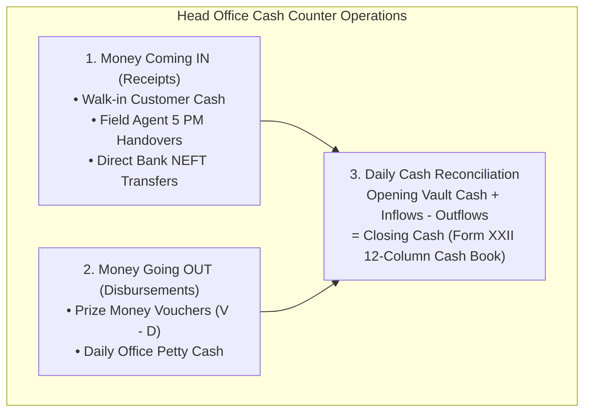
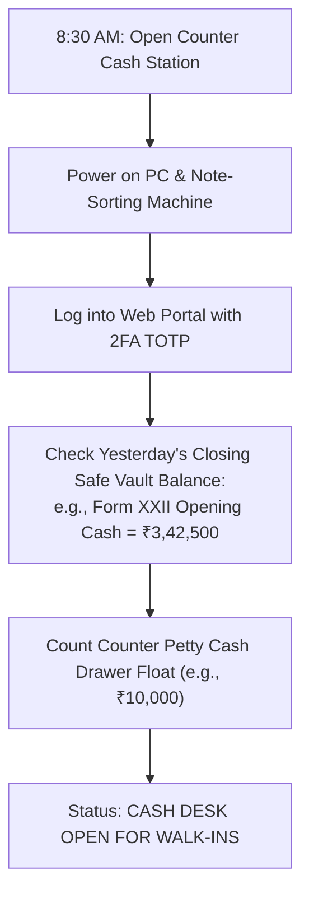
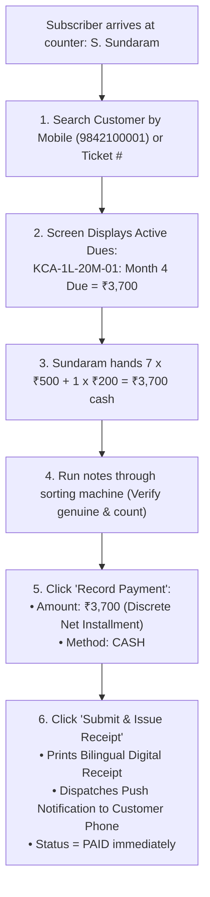
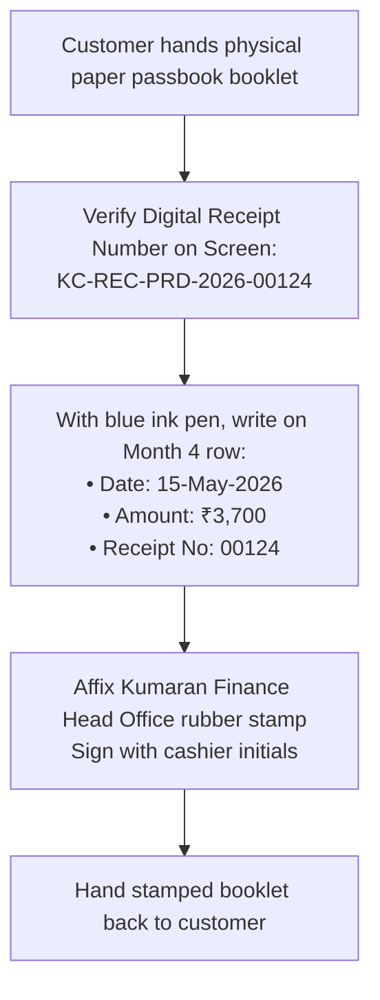
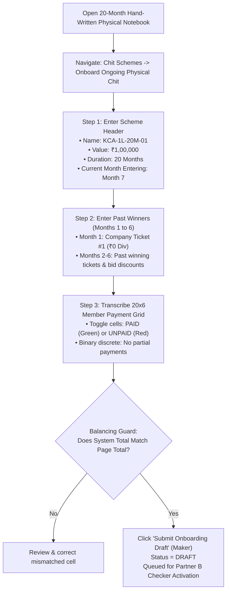
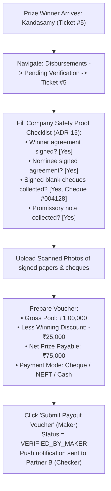
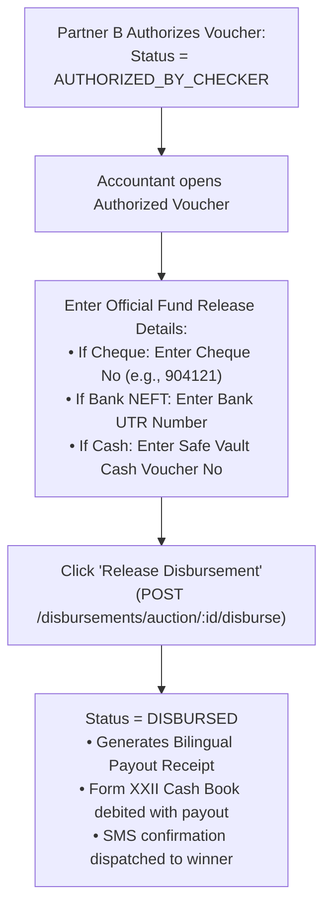
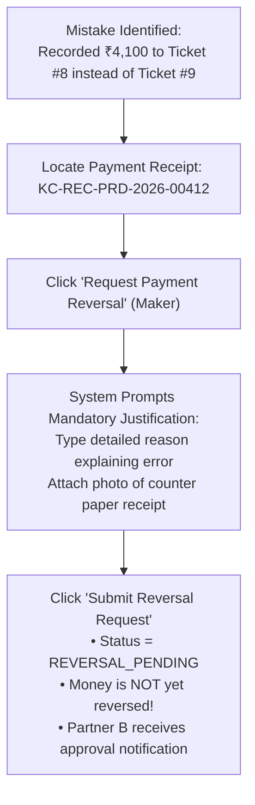
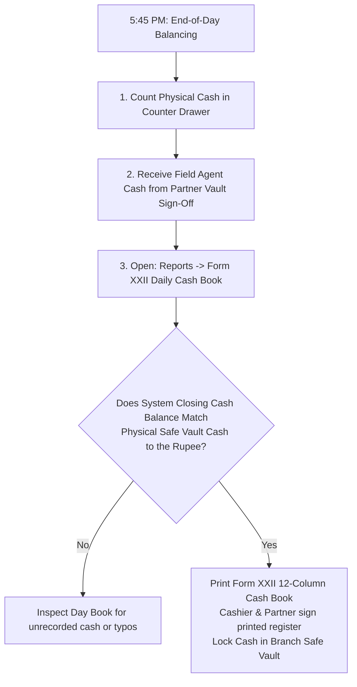

# Kumaran Chits — Desk Accountant & Cashier Operations Manual

> **Product**: **Kumaran Chits**  
> **Company**: **Kumaran Finance** (Head Office: Perundurai, Erode, Tamil Nadu)  
> **Target Persona**: **Desk Accountant / Office Cashier**  
> **Primary Platform**: **Web Portal (`apps/web/`)** (High-Density Ledgers, Day Book, Cash Counter)  
> **Secondary Platform**: **Android Mobile App (`apps/mobile/`)** (Dual-Role Collections)  
> **Core Role in Governance**: **Primary Operational Maker** for ongoing scheme drafts, payment receipts, and payout vouchers.

---

## 1. Operating Reality & Teaching Overview

The **Desk Accountant** sits behind the physical customer service counter at the Head Office in Perundurai. Their operational station includes:
- A desktop computer logged into the Kumaran Chits Web Portal.
- A high-speed **electronic currency note-sorting & counting machine** on the counter.
- A physical cash drawer with slots for ₹500, ₹200, ₹100, and ₹50 notes.
- Heavy **hand-written paper day-book ledgers** and physical passbooks presented by walk-in subscribers.
- Steel filing cabinets storing signed subscriber chit agreements, blank bank cheques, and promissory notes.

### The Dual-Role Safety Invariant (Collector + Accountant):
In our local operating reality, staff members frequently collect cash in the field during the morning and sit behind the office counter in the afternoon.
> [!IMPORTANT]
> **Anti-Self-Acknowledgment Guard (`collector_user_id != acknowledger_user_id`)**:  
> Even if you hold both `COLLECTION_AGENT` and `ACCOUNTANT` permissions, **you can NEVER acknowledge or sign off on your own collected field cash**. An independent Partner must physically count your cash and sign it into the vault.

---

## 2. Daily Workflow Index & Action Diagrams

| Section | Operational Action | Role / Dual-Control | Primary Interface |
|---|---|:---:|:---:|
| **§3** | Morning Cash Desk Setup & Note-Sorter Check | Single Actor | Physical Desk & Web Portal |
| **§4** | Walk-in Cash Collection & Bilingual Receipt | Single Actor | Web Portal (`POST /payments`) |
| **§5** | Physical Paper Passbook Pen Endorsement | Physical Action | Subscriber Booklet |
| **§6** | High-Density Paper Notebook Transcription | Maker Role | Web Portal (`POST /chits/onboard-ongoing`) |
| **§7** | Preparing Prize Payout Vouchers & Safety Proof | Maker Role | Web Portal (`POST /disbursements/...`) |
| **§8** | Releasing Authorized Disbursement Funds | Fund Release | Web Portal (`POST /disbursements/.../disburse`) |
| **§9** | Requesting Payment Reversals with Justification | Maker Role | Web Portal (`POST /payments/.../request-reversal`) |
| **§10** | Daily Form XXII Balancing & 6:00 PM Closure | Reconciliation | Web Portal (`GET /reports/form-xxii`) |

---

## 3. Morning Cash Desk Setup & Note-Sorter Check

### Step-by-Step Instructions:
1. Arrive at the branch at 8:30 AM. Power on the PC and the desktop electronic currency counter.
2. Log into `https://admin.kumaranfinance.com` using your mobile number, password, and Microsoft Authenticator TOTP.
3. Open **Reports $\to$ Form XXII Daily Cash Book**.
4. Note the opening cash balance (e.g., `₹3,42,500`) and verify that yesterday's safe vault count matches.
5. Place currency notes neatly into the counter drawer slots sorted by denomination.

---

## 4. Walk-in Cash Collection & Digital Bilingual Receipt

### Step-by-Step Instructions:
1. Greet the customer and ask for their mobile number or chit ticket code.
2. In the top search bar, enter the number to display their profile.
3. Review the pending installment due:
   - Base Installment: `₹5,000`
   - Minus Month 3 Auction Dividend: `-₹1,300`
   - **Net Amount Payable**: **`₹3,700`**
4. Take the physical currency notes and run them through the note-sorting machine to confirm amount and verify against counterfeits.
5. **Discrete Binary Rule (`CONFIRMED-BY-DEVELOPER`)**:
   - The customer must pay the full net amount (`₹3,700`).
   - The system **strictly rejects partial payments** (e.g., ₹2,000) and **advance balances**.
6. Select Payment Mode: **`CASH`** (or `UPI` if scanned via office counter QR).
7. Click **"Submit & Issue Receipt"** (`POST /payments`).
8. The system instantly generates the official sequential receipt number (e.g., `KC-REC-PRD-2026-00124`) and sends a free push notification to the customer's mobile app.

---

## 5. Physical Paper Passbook Pen Endorsement

### Step-by-Step Instructions:
1. Physical passbooks remain the primary record for local members in Perundurai.
2. Open the subscriber's booklet to the 20-month grid table.
3. Locate the current active month row.
4. Using a pen, record:
   - **Date**: Today's date (e.g., `15-May-2026`).
   - **Amount Paid**: `₹3,700` (in whole Rupees).
   - **Receipt Reference**: The last 5 digits of the digital receipt number (`00124`).
5. Stamp with the official branch seal, add your cashier signature, and hand the booklet back to the subscriber.

---

## 6. High-Density Paper Notebook Transcription (Maker Role)

### Step-by-Step Instructions:
1. When migrating an active running chit from physical records, navigate to **Chit Schemes $\to$ "Onboard Ongoing Physical Chit"** (`POST /chits/onboard-ongoing`).
2. Enter the chit scheme header and specify the **Current Active Month** (e.g., Month 7).
3. Transcribe past auction winners and their discounts for Months 1 through 6.
4. Fill in the 20-subscriber payment grid directly from your notebook page:
   - Click once to mark a cell **`PAID`** (Green).
   - Leave as **`UNPAID`** (Red) if the member did not pay that month.
5. **Balancing Guard Check**: Check the computed total at the bottom of the screen. Confirm that it matches the handwritten total on the notebook page to the exact rupee.
6. Click **"Submit Onboarding Draft"** (Maker). The draft is now locked and queued for Partner Checker verification.

---

## 7. Preparing Prize Payout Vouchers & Safety Proof (Maker Role)

### Step-by-Step Instructions:
1. Open **Disbursements $\to$ Pending Verification $\to$ Ticket #5**.
2. Inspect the physical papers provided by the prized subscriber.
3. Complete the **Company Safety Proof Checklist**:
   - Check off each submitted item (agreement, nominee signature, blank cheques, promissory note).
   - Enter bank name and cheque numbers.
   - Upload scanned copies or mobile camera captures to encrypted S3 storage.
4. Select the requested payout mode (**Account Payee Cheque**, **NEFT/RTGS**, or **Cash**).
5. Click **"Submit Payout Voucher"** (`POST /disbursements/auction/:id/verify-safety-proof`). Status transitions to `VERIFIED_BY_MAKER`.

---

## 8. Fund Release Execution upon Partner Authorization

### Step-by-Step Instructions:
1. Once Partner B authorizes the payout voucher, the status updates to `AUTHORIZED_BY_CHECKER`.
2. Open the voucher and prepare the physical payment:
   - If paying by cheque, write the cheque from the company current account.
   - If paying by NEFT, initiate the transfer on the corporate net banking portal.
3. In the Kumaran Chits portal, enter the **Cheque Number** or **Bank UTR Reference**.
4. Click **"Release Disbursement"** (`POST /disbursements/auction/:id/disburse`).
   - The status updates to `DISBURSED`.
   - The disbursement is permanently stamped into the Form XXII Cash Book.
   - Print the formal bilingual payout receipt for the subscriber's signature.

---

## 9. Requesting Payment Reversals with Written Justification (Maker Role)

### Step-by-Step Instructions:
1. Locate the erroneous payment under **Payments $\to$ Recent Collections**.
2. Click **"Request Payment Reversal"** (`POST /payments/:id/request-reversal`).
3. You must provide a **Mandatory Written Reason** (e.g., *"Cashier error: Member Mani (Ticket #9) paid ₹4,100 cash, but was entered against Ticket #8 (Kannan). Signed receipt attached."*).
4. Upload a photo of the counter receipt.
5. Click **"Submit Reversal Request"**. The payment status changes to `REVERSAL_PENDING`. It remains pending until a Partner signs off as Checker.

---

## 10. Daily Form XXII Balancing & 6:00 PM Office Closure

### Step-by-Step Instructions:
1. At 5:45 PM, count all physical cash inside the counter drawer.
2. Ensure all evening field collection batches have been acknowledged by a Partner into the vault.
3. Open **Reports $\to$ Form XXII Daily Cash Book**.
4. Review the 12-Column Cash Balance:
   - **Opening Cash** + **Total Receipts** (Walk-in cash + Agent handovers) - **Total Disbursements** (Prize payouts + Expenses) = **Closing Cash Balance**.
5. Confirm that the physical notes inside the safe match the software balance to the exact rupee.
6. Click **"Export PDF"**, print the daily cash sheet, sign your initials alongside the Partner's signature, and lock the vault.
