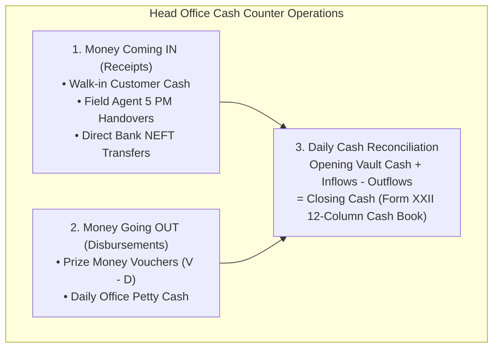
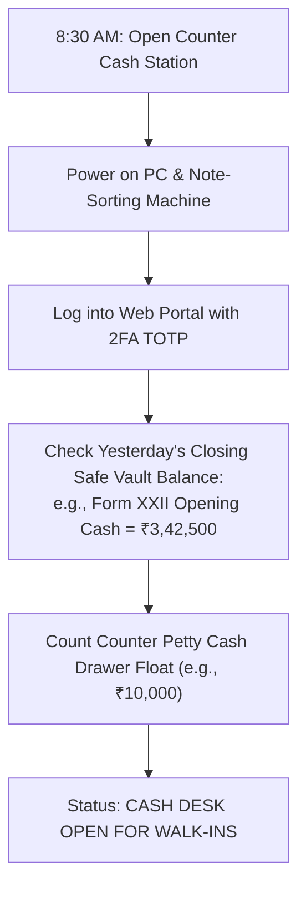
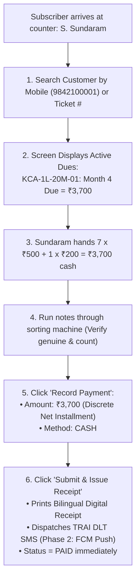
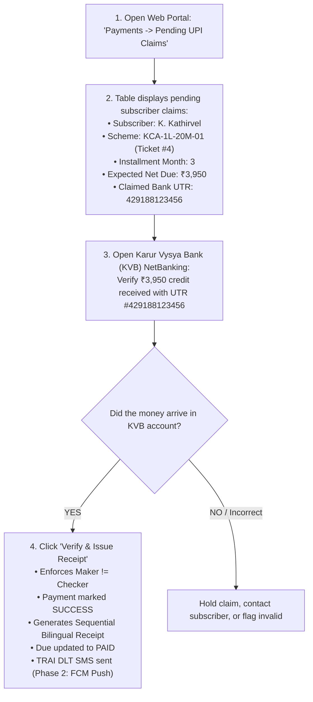
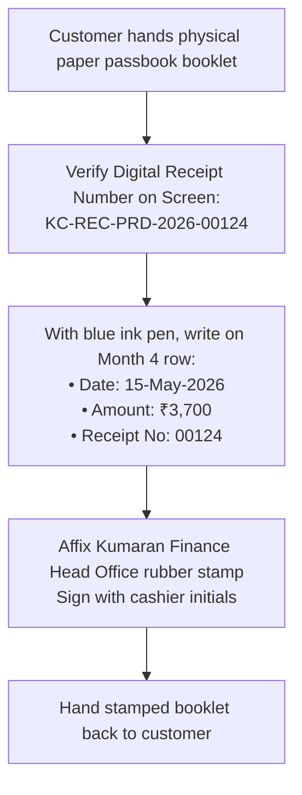
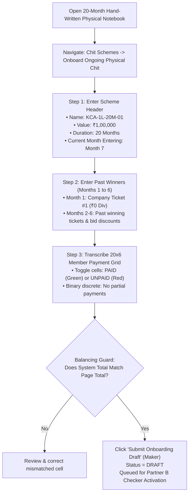
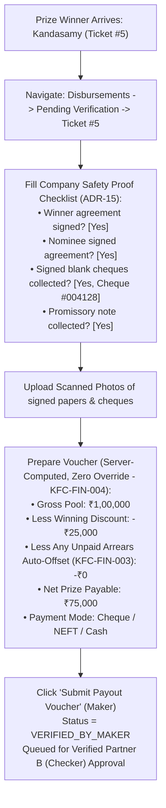
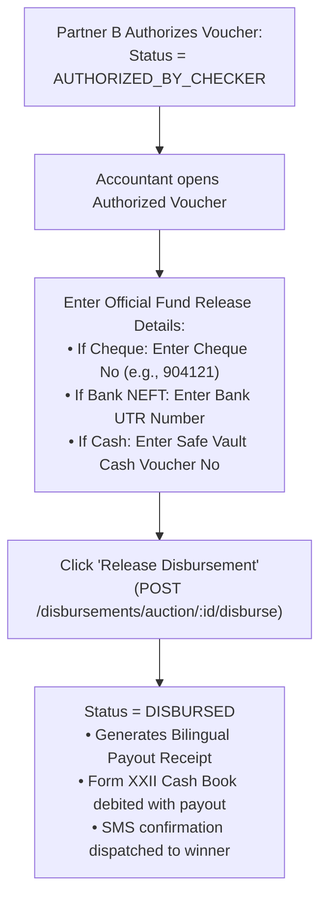
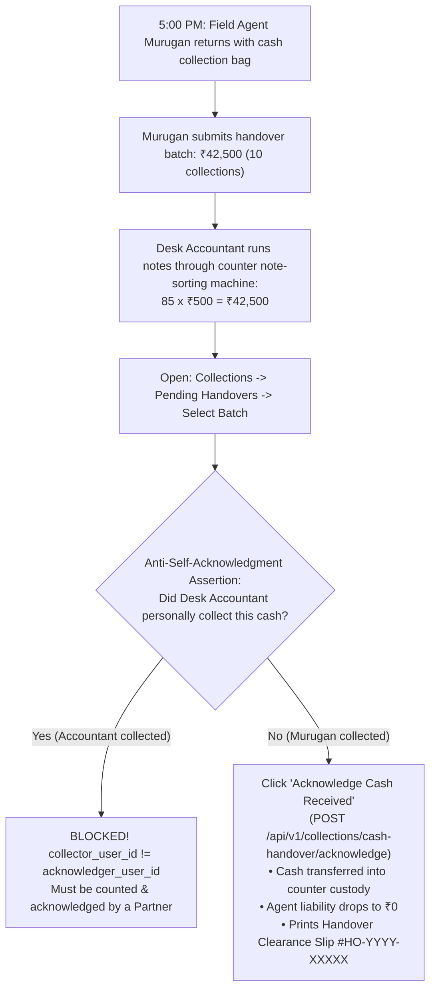
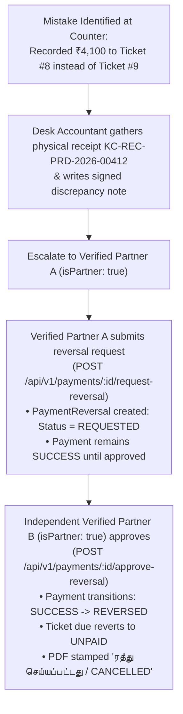

# Kumaran Chits — Desk Accountant & Cashier Operations Manual

> **Product**: **Kumaran Chits**  
> **Company**: **Kumaran Finance** (Head Office: Perundurai, Erode, Tamil Nadu)  
> **Target Persona**: **Desk Accountant / Office Cashier**  
> **Primary Platform**: **Web Portal (`apps/web/`)** (High-Density Ledgers, Day Book, Cash Counter)  
> **Secondary Platform (`ADR-26`)**: Responsive Web Portal in Phase 1; Android Mobile App (`apps/mobile/`) rolls out in Phase 2 (Q2 2027) for dual-role field collections.  
> **Core Role in Governance**: **Primary Operational Maker** for ongoing scheme drafts, payment receipts, and payout vouchers. *(Note: Payment reversal initiation is Partner-exclusive per `KFC-SEC-001` — see §10.)*

---

## 1. Operating Reality & Teaching Overview

The **Desk Accountant** sits behind the physical customer service counter at the Head Office in Perundurai. Their operational station includes:
- A desktop computer logged into the Kumaran Chits Web Portal.
- A high-speed **electronic currency note-sorting & counting machine** on the counter.
- A physical cash drawer with slots for ₹500, ₹200, ₹100, and ₹50 notes.
- Heavy **hand-written paper day-book ledgers** and physical passbooks presented by walk-in subscribers.
- Steel filing cabinets storing signed subscriber chit agreements, blank bank cheques, and promissory notes.

### The Dual-Role Safety Invariant (Collector + Accountant):
In our local operating reality, staff members frequently collect cash in the field during the morning and sit behind the office counter in the afternoon.
> [!IMPORTANT]
> **Anti-Self-Acknowledgment Guard (`collector_user_id != acknowledger_user_id`)**:  
> Even if you hold both `COLLECTION_AGENT` and `ACCOUNTANT` permissions, **you can NEVER acknowledge or sign off on your own collected field cash**. An independent Partner must physically count your cash and sign it into the vault.

---

## 2. Daily Workflow Index & Action Diagrams

| Section | Operational Action | Role / Dual-Control | Primary Interface |
|---|---|:---:|:---:|
| **§3** | Morning Cash Desk Setup & Note-Sorter Check | Single Actor | Physical Desk & Web Portal |
| **§4** | Walk-in Cash Collection & Bilingual Receipt | Single Actor | Web Portal (`POST /payments`) |
| **§4B** | Verifying Customer UPI Claims against KVB Bank | Checker Role | Web Portal (`POST /payments/:id/verify-upi-claim`) |
| **§5** | Physical Paper Passbook Pen Endorsement | Physical Action | Subscriber Booklet |
| **§6** | High-Density Paper Notebook Transcription | Maker Role | Web Portal (`POST /chits/onboard-ongoing`) |
| **§7** | Preparing Prize Payout Vouchers & Safety Proof | Maker Role | Web Portal (`POST /disbursements/...`) |
| **§8** | Releasing Authorized Disbursement Funds | Fund Release | Web Portal (`POST /disbursements/.../disburse`) |
| **§9** | Receiving & Acknowledging Agent Cash Handovers | Checker Role | Web Portal (`POST /collections/.../acknowledge`) |
| **§10** | Escalating Payment Reversals to Verified Partners | Escalation (`KFC-SEC-001`) | Physical Receipt + Partner Portal |
| **§11** | Daily Form XXII Balancing & 6:00 PM Closure | Reconciliation | Web Portal (`GET /reports/form-xxii`) |
| **§12** | Cashier Counter Error Handling & Traps | Operational Guide | Web Portal |

---

## 3. Morning Cash Desk Setup & Note-Sorter Check

### Step-by-Step Instructions:
1. Arrive at the branch at 8:30 AM. Power on the PC and the desktop electronic currency counter.
2. Log into `https://admin.kumaranfinance.in` using your mobile number, password, and Microsoft Authenticator TOTP.
3. Open **Reports $\to$ Form XXII Daily Cash Book**.
4. Note the opening cash balance (e.g., `₹3,42,500`) and verify that yesterday's safe vault count matches.
5. Place currency notes neatly into the counter drawer slots sorted by denomination.

---

## 4. Walk-in Cash Collection & Digital Bilingual Receipt

### Step-by-Step Instructions:
1. Greet the customer and ask for their mobile number or chit ticket code.
2. In the top search bar, enter the number to display their profile.
3. Review the pending installment due:
   - Base Installment: `₹5,000`
   - Minus Month 3 Auction Dividend: `-₹1,300`
   - **Net Amount Payable**: **`₹3,700`**
4. Take the physical currency notes and run them through the note-sorting machine to confirm amount and verify against counterfeits.
5. **Discrete Binary Rule (`CONFIRMED-BY-DEVELOPER`)**:
   - The customer must pay the full net amount (`₹3,700`).
   - The system **strictly rejects partial payments** (e.g., ₹2,000) and **advance balances**.
6. Select Payment Mode: **`CASH`** (or `UPI` if scanned via office counter QR).
7. Click **"Submit & Issue Receipt"** (`POST /api/v1/payments`).
8. The system instantly generates the official sequential receipt number (e.g., `KC-REC-PRD-2026-00124`) and dispatches a bilingual TRAI DLT SMS confirmation (Phase 1 primary per ADR-23; plus Android FCM push alert in Phase 2 per ADR-26).
9. **Receipt Printing & Passbook PDF Download**:
    - Click **"Print A5 Receipt"** to print the official bilingual counter receipt slip formatted exactly for A5 paper.
    - Click **"Download PDF"** to save an offline copy (`downloadReceiptPdf`) delivered directly as an authenticated binary blob via the BFF proxy.
    - If the customer requests their 20-month continuous statement, open their profile, navigate to the **Form XXI Passbook** tab, and click **"Download Passbook PDF"** (`downloadPassbookPdf`) to hand them an official signed ledger copy.

---

## 4B. Verifying Customer UPI Payment Claims against Bank Statement

When subscribers pay online via NPCI Native UPI Intent (GPay / PhonePe / Paytm) via the Web Portal or Phase 2 Android Mobile App (`ADR-19`, `ADR-26`), they submit their 12-digit Bank UTR reference number. These claims sit in `INITIATED` status awaiting accounting verification.

### Step-by-Step Instructions:
1. In the Web Portal navigation menu, click **Payments $\to$ Pending UPI Claims** (`GET /api/v1/payments/pending-upi-claims`).
2. Review the pending claim details:
   - **Subscriber**: `K. Kathirvel (9842100001)`
   - **Scheme / Ticket**: `KCA-1L-20M-01, Ticket #4`
   - **Installment Month**: `Month 3`
   - **Net Amount**: `₹3,950`
   - **Bank UTR Number**: `429188123456`
3. On your desk computer, open Karur Vysya Bank (KVB) NetBanking or mobile banking app.
4. Verify that the exact whole-rupee amount (`₹3,950`) has credited to Kumaran Finance's current account under UTR `429188123456`.
5. In the Web Portal, click **"Verify & Issue Receipt"** (`POST /api/v1/payments/:id/verify-upi-claim`). Enter optional verification notes (e.g., `"Verified in KVB NetBanking at 15:30"`).
6. **Dual-Control Safety Invariant (`maker_user_id != checker_user_id`)**:
   - If you submitted the claim on the customer's behalf, you **cannot** verify it. An independent Partner or colleague must confirm the bank credit.
7. Upon clicking verify:
   - The payment transitions from `INITIATED` $\to$ **`SUCCESS`**.
   - The official bilingual receipt (`KC-REC-PRD-2026-XXXXX`) is generated immediately.
   - The customer's due status updates to **`PAID`**.
   - A bilingual TRAI DLT SMS receipt confirmation is dispatched to the subscriber's mobile number (Phase 1 primary per ADR-23; plus Android FCM Push in Phase 2 per ADR-26).

---

## 5. Physical Paper Passbook Pen Endorsement

### Step-by-Step Instructions:
1. Physical passbooks remain the primary record for local members in Perundurai.
2. Open the subscriber's booklet to the 20-month grid table.
3. Locate the current active month row.
4. Using a pen, record:
   - **Date**: Today's date (e.g., `15-May-2026`).
   - **Amount Paid**: `₹3,700` (in whole Rupees).
   - **Receipt Reference**: The last 5 digits of the digital receipt number (`00124`).
5. Stamp with the official branch seal, add your cashier signature, and hand the booklet back to the subscriber.

---

## 6. High-Density Paper Notebook Transcription (Maker Role)

### Step-by-Step Instructions:
1. When migrating an active running chit from physical records, navigate to **Chit Schemes $\to$ "Onboard Ongoing Physical Chit"** (`POST /chits/onboard-ongoing`).
2. Enter the chit scheme header and specify the **Current Active Month** (e.g., Month 7).
3. Transcribe past auction winners and their discounts for Months 1 through 6.
4. Fill in the 20-subscriber payment grid directly from your notebook page:
   - Click once to mark a cell **`PAID`** (Green).
   - Leave as **`UNPAID`** (Red) if the member did not pay that month.
5. **Balancing Guard Check**: Check the computed total at the bottom of the screen. Confirm that it matches the handwritten total on the notebook page to the exact rupee.
6. Click **"Submit Onboarding Draft"** (Maker). The draft is now locked and queued for Partner Checker verification.

---

## 7. Preparing Prize Payout Vouchers & Safety Proof (Maker Role)

### Step-by-Step Instructions:
1. Open **Disbursements $\to$ Pending Verification $\to$ Ticket #5**.
2. Inspect the physical papers provided by the prized subscriber.
3. Complete the **Company Safety Proof Checklist**:
   - Check off each submitted item (agreement, nominee signature, blank cheques, promissory note).
   - Enter bank name and cheque numbers.
   - Upload scanned copies or mobile camera captures to encrypted S3 storage.
4. **Server-Computed Payout & Automatic Arrears Offset (`KFC-FIN-003` / `KFC-FIN-004`)**:
   - The server automatically computes net prize money (`Gross Pool - Winning Discount - Unpaid Arrears`). Manual net-payout overrides are strictly prohibited (`KFC-FIN-004`); any unpaid dues on the winning ticket are automatically deducted (`KFC-FIN-003`) before disbursement.
5. Select the requested payout mode (**Account Payee Cheque**, **NEFT/RTGS**, or **Cash**).
6. Click **"Submit Payout Voucher"** (`POST /api/v1/disbursements/auction/:id/verify-safety-proof`). Status transitions to `VERIFIED_BY_MAKER`, awaiting Verified Partner (`isPartner: true`) authorization.

---

## 8. Fund Release Execution upon Partner Authorization

### Step-by-Step Instructions:
1. Once Partner B authorizes the payout voucher, the status updates to `AUTHORIZED_BY_CHECKER`.
2. Open the voucher and prepare the physical payment:
   - If paying by cheque, write the cheque from the company current account.
   - If paying by NEFT, initiate the transfer on the corporate net banking portal.
3. In the Kumaran Chits portal, enter the **Cheque Number** or **Bank UTR Reference**.
4. Click **"Release Disbursement"** (`POST /disbursements/auction/:id/disburse`).
   - The status updates to `DISBURSED`.
   - The disbursement is permanently stamped into the Form XXII Cash Book.
   - Print the formal bilingual payout receipt for the subscriber's signature.

---

## 9. Receiving & Acknowledging Agent Cash Handovers (Checker Role)

### Step-by-Step Instructions:
1. At 5:00 PM, field agents return to the Head Office.
2. The agent submits their cash handover batch in the portal (or Android mobile app in Phase 2 per ADR-26) and places the cash bag on your counter.
3. Place the currency notes through the counter note-sorting machine to verify the physical count against counterfeits and note quality.
4. Navigate to **Collections $\to$ Pending Handovers** on the Web Portal.
5. Verify that the machine count matches the submitted batch total (e.g., `₹42,500`).
6. **The Anti-Self-Acknowledgment Guard (`CONFIRMED-BY-DEVELOPER`)**:
   - If **you (the accountant)** collected this cash during morning rounds, the system **blocks you** from clicking Acknowledge (`collector_user_id != acknowledger_user_id`). A Partner or Branch Manager must acknowledge your handover.
   - If **Field Agent Murugan** collected the cash, you are fully authorized to acknowledge his batch.
7. Click **"Acknowledge Cash Received"** (`POST /api/v1/collections/cash-handover/acknowledge`).
8. The cash is formally transferred into counter custody, Agent Murugan's cash-in-hand liability is cleared to `₹0`, and a printed Clearance Slip `#HO-YYYY-XXXXX` is issued to the agent.

---

## 10. Escalating Payment Reversals to Verified Partners (`KFC-SEC-001`)

> [!IMPORTANT]
> **Verified Partner Exclusivity (`KFC-SEC-001` / ADR-21)**: Under live backend enforcement (`payment.controller.ts`), the `ACCOUNTANT` role is **strictly blocked (`HTTP 403 Forbidden`)** from calling `POST /api/v1/payments/:id/request-reversal` or `POST /api/v1/payments/:id/approve-reversal`. Both Maker and Checker steps for payment reversals must be executed by two distinct **Verified Partners (`SUPER_ADMIN` with `isPartner: true`)**.

### Step-by-Step Instructions:
1. Locate the erroneous payment under **Payments $\to$ Recent Collections** and note the exact receipt number (e.g., `KC-REC-PRD-2026-00412`).
2. Do **not** attempt to cancel or reverse the entry directly from an `ACCOUNTANT` login — the API returns `HTTP 403 Forbidden` by design (`KFC-SEC-001`).
3. Print or retrieve the physical counter receipt and write a clear discrepancy memo (e.g., *"Cashier error: Member Mani (Ticket #9) paid ₹4,100 cash, but was entered against Ticket #8 (Kannan)."*).
4. Hand the physical receipt and memo to **Verified Partner A (`isPartner: true`)** to submit the Maker reversal request (`POST /api/v1/payments/:id/request-reversal`, creating a `PaymentReversal` record in **`REQUESTED`** status while the original `Payment` stays **`SUCCESS`**).
5. **Independent Verified Partner B (`isPartner: true`)** then approves the reversal (`POST /api/v1/payments/:id/approve-reversal`, enforcing `maker != checker`), transitioning the payment to **`REVERSED`**, reverting the ticket due to `UNPAID`, and stamping future PDF downloads with the bold red **`ரத்து செய்யப்பட்டது / CANCELLED`** watermark (`KFC-PDF-001`).
6. Once reversed, record the payment cleanly against the correct subscriber ticket (`Ticket #9`) and issue the new official receipt.

---

## 11. Daily Form XXII Balancing & 6:00 PM Office Closure

### Step-by-Step Instructions:
1. At 5:45 PM, count all physical cash inside the counter drawer.
2. Ensure all evening field collection batches have been acknowledged into counter/vault custody.
3. Open **Reports $\to$ Form XXII Daily Cash Book**.
4. Review the 12-Column Cash Balance:
   - **Opening Cash** + **Total Receipts** (Walk-in cash + Agent handovers) - **Total Disbursements** (Prize payouts + Expenses) = **Closing Cash Balance**.
5. Confirm that the physical notes inside the safe match the software balance to the exact rupee.
6. Click **"Print Sheet"**: The built-in `@media print` stylesheet automatically hides all sidebars, topbar navigation, and dark-mode styling, rendering a high-contrast black-on-white 12-column daily cash sheet suitable for paper filing.
7. Click **"Export CSV"** if a digital spreadsheet is required for ledger audit reconciliation.
8. Sign your initials alongside the Partner's signature on the physical printed sheet and lock the vault.

---

## 12. Cashier Counter Error Handling & Operational Traps

| Common Trap / Mistake | Software Behavior | Proper Resolution by Cashier |
|---|---|---|
| **Member insists on paying ₹2,000 partial installment** | Input rejected; system enforces discrete binary amount ($I_{net} = \text{₹}3,700$). | Politely explain: *"Under company policy, full monthly installment must be paid at once."* Hold physical cash in customer envelope until full balance is ready. |
| **Cashier tries to request or approve a payment reversal** | Software throws `HTTP 403 Forbidden` (`KFC-SEC-001`: reversals are strictly restricted to Verified Partners with `isPartner: true`). | Escalate physical receipt + written discrepancy memo to Verified Partner A (Maker) and Verified Partner B (Checker). |
| **Member brings soiled / counterfeit currency note** | Note-sorting machine rejects note. | Hand note back to subscriber immediately; request clean replacement note before issuing receipt. |
| **Customer forgot physical paper passbook** | Digital receipt prints normally and TRAI DLT SMS alert is sent (Phase 2: FCM Push). | Issue printed paper slip; inform member to bring passbook next month for pen endorsement. |
