# Kumaran Chits — Super Admin & Partner Operations Manual

> **Product**: **Kumaran Chits**  
> **Company**: **Kumaran Finance** (Head Office: Perundurai, Erode, Tamil Nadu)  
> **Target Persona**: **Company Partners (Super Admin) & Foremen**  
> **Platform Parity**: **100% Full Feature Parity across Web Portal (`apps/web/`) AND Partner Android Mobile App (`apps/mobile/`)**  
> **Currency Standard**: Strictly whole integer Rupees (**`BigInt`**); zero paise, zero decimals.  
> **Governance Model**: The 4 equal partners share executive oversight with strict **Maker-Checker Dual Control** (`maker_user_id != checker_user_id`).

---

## 1. Operating Reality & Teaching Overview

Kumaran Finance is operated by **4 equal partners** based at the Head Office in Perundurai. Unlike corporate financial institutions with detached administrators, our partners actively run daily operations:
- Conducting monthly branch auctions in person.
- Inspecting physical notes, bank cheques, and promissory notes.
- Verifying and acknowledging evening cash handovers into the safe vault.
- Acting as independent **Checkers** to authorize disbursements, auction finalizations, and payment reversals.

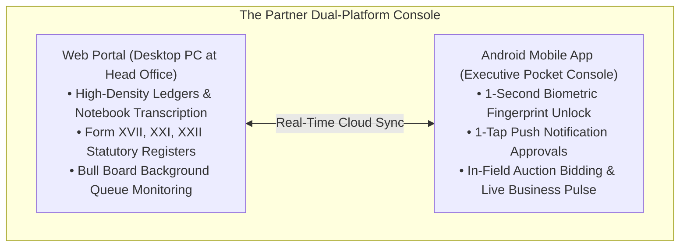

---

## 2. Daily Workflow Index & Action Diagrams

The following table summarizes all 10 core partner actions, each documented with a dedicated flow diagram and step-by-step instructions:

| Section | Operational Action | Role / Dual-Control | Primary Platform |
|---|---|:---:|:---:|
| **§3** | Morning Login & Executive Business Pulse | Single Actor | Web Portal & Mobile |
| **§4** | Launching a Fresh Chit Scheme | Maker (Partner A) | Web Portal |
| **§5** | Verifying & Activating Ongoing Paper Chits | Checker (Partner B) | Web Portal |
| **§6** | Conducting Monthly In-Office Auctions (M2 to $N-1$) | Maker (Partner A) | Web & Mobile |
| **§7** | Finalizing Auctions & Committing Dividends | Checker (Partner B) | Web & Mobile |
| **§8** | Authorizing Prize Payout Vouchers (2-Step Payout) | Checker (Partner B/C) | Web & Mobile |
| **§9** | Evening Field Cash Handover Sign-Off into Vault | Checker (Partner A/B) | Web & Mobile |
| **§10** | Approving Erroneous Payment Reversals | Checker (Partner B) | Web & Mobile |
| **§10B** | Verifying Customer UPI Claims (ADR-19) | Checker (Partner B/C) | Web & Mobile |
| **§11** | Month 1 Company Pool & Month $N$ Final Settlement | Single / Checker | Web Portal |
| **§12** | 3-Month Arrears Tagging & Defaulter Removal | Single / Maker | Web Portal |
| **§13** | Staff Role Provisioning & Security Resets | Single Actor | Web Portal |
| **§14** | Bull Board Asynchronous Queue Monitoring | Operational View | Web Portal (`/admin/queues`) |
| **§15** | Form XXII Daily Vault Cash Book Sign-Off | Reconciliation | Web Portal & Safe Vault |

---

## 3. Morning Login & Executive Business Pulse

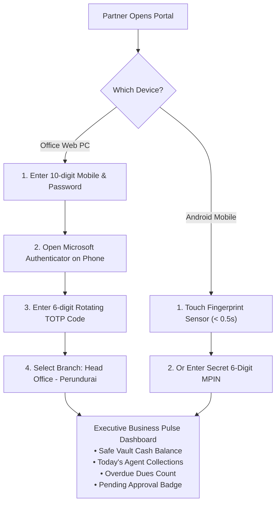

### Step-by-Step Instructions:
1. **Desktop Web Login**:
   - Navigate to `https://admin.kumaranfinance.com`.
   - Enter your registered 10-digit mobile number and password.
   - When challenged, open **Microsoft Authenticator** on your smartphone, view the rotating 6-digit TOTP code, and type it into the portal.
   - Select your active branch: **`Head Office - Perundurai`**.
2. **Mobile Biometric Login**:
   - Open the **Kumaran Chits** app on your Android phone.
   - Touch your registered finger to the sensor for 1-second biometric authentication (or enter your 6-digit MPIN).
3. **Inspect the 4 Key Business Metrics**:
   - **Vault Cash Balance**: Physical cash currently secured inside the office safe.
   - **Today's Collections**: Live aggregate cash collected by field agents today.
   - **Overdue Installments**: Count of subscribers currently in default.
   - **Pending Approvals Queue**: Badges showing pending prize vouchers, reversals, or auctions awaiting checker sign-off.

---

## 4. Launching a Fresh Chit Scheme (Starting Month 1)

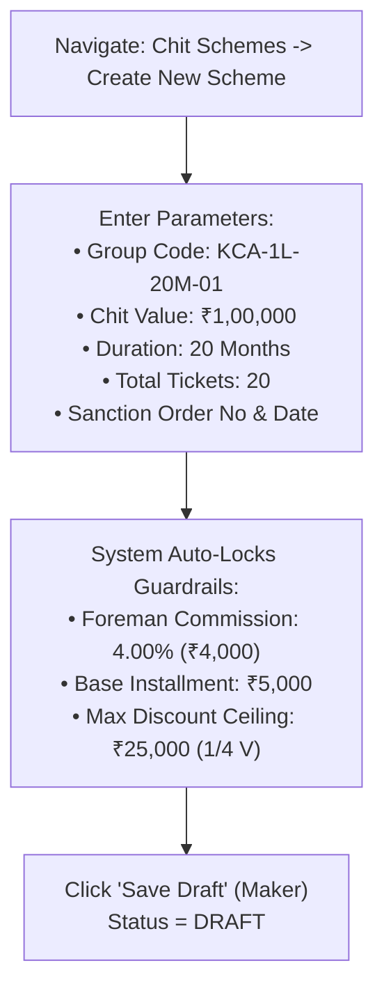

### Step-by-Step Instructions:
1. Go to **Chit Schemes $\to$ "Create New Scheme"** on the Web Portal.
2. Enter the Scheme Parameters:
   - **Group Code**: e.g., `KCA-1L-20M-01`.
   - **Chit Value ($V$)**: Enter strictly whole integer Rupees (e.g., `₹1,00,000`).
   - **Duration ($N$)**: e.g., `20 months`.
   - **Total Tickets ($M$)**: e.g., `20`. The system strictly enforces a maximum of 1 ticket per customer in this group (`@@unique([chitGroupId, customerId])`).
   - **Chit Registrar Sanction Order Number & Date**: Required for legal compliance.
3. System Enforces Invariants:
   - **Foreman Commission**: Automatically set to **`4.00%`** (`₹4,000`) and permanently frozen upon activation.
   - **Base Monthly Installment ($I_{base}$)**: Auto-calculated as $V / N = \text{₹}5,000$.
   - **Maximum Discount Ceiling ($D_{max}$)**: Automatically locked to strictly **one-fourth (1/4 or 25%) of total chit value** ($D_{max} = V / 4 = \text{₹}25,000$). Dynamic ceilings are completely eliminated.
4. Click **"Save Draft"**. The scheme is now queued for ticket assignments and subsequent activation.

---

## 5. Verifying & Activating Ongoing Paper Chits (Checker Role)

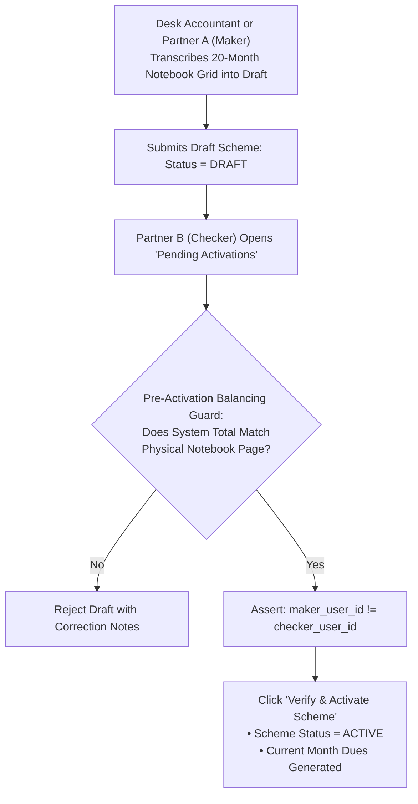

### Step-by-Step Instructions:
1. Open the physical hand-written paper notebook on the desk to page 42.
2. Navigate to **Chit Schemes $\to$ Pending Activations $\to$ Select Scheme**.
3. Inspect the transcribed historical winners and binary payment grid (`PAID` / `UNPAID`).
4. **Balancing Guard Check**: Check the bottom footer: `System Total Collected: ₹4,82,500`. Verify that this matches the handwritten ledger summary line to the exact rupee.
5. Click **"Verify & Activate Scheme"** (`POST /chits/:id/activate`).
   - The backend validates that `maker_user_id !== checker_user_id`.
   - The scheme transitions to `ACTIVE`, and the current month's discrete installment dues are instantly published.

---

## 6. Conducting Monthly In-Office Auctions (Months 2 to $N-1$)

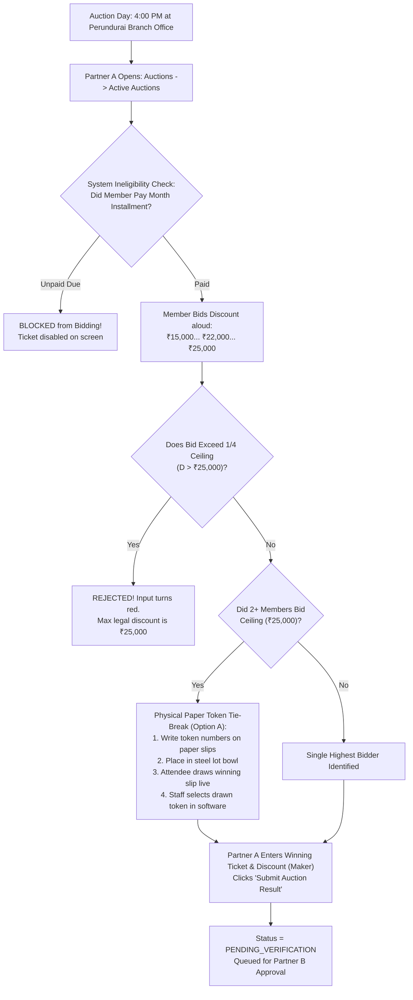

### Step-by-Step Instructions:
1. **Auction Scope**: In-office auctions occur strictly in **Months 2 through $N-1$**. Month 1 is the company pool (no auction); Month $N$ is the final member direct settlement (no auction).
2. **Defaulter Check**: The software automatically evaluates member payment status. Any subscriber with an unpaid installment for the current month is **strictly inoperable on screen** and cannot participate or bid.
3. **Bidding & Statutory Ceiling**: The discount ceiling is fixed at $\frac{V}{4}$ (`₹25,000` for a ₹1L chit). The minimum floor is the 4% commission (`₹4,000`). Bids outside this range are rejected by validation guards.
4. **Option A Physical Tie-Breaker**: If multiple attendees shout the ceiling discount:
   - Fold paper slips bearing the competing ticket numbers and place them in the brass/steel lot bowl.
   - Have an independent attendee or child draw one token in front of all members.
   - In the app, click **"Record Tie-Breaker Draw"** and select the drawn ticket number.
5. Click **"Submit Auction Result"** (Maker: Partner A).

---

## 7. Finalizing Auctions & Committing Dividends (Checker Role)

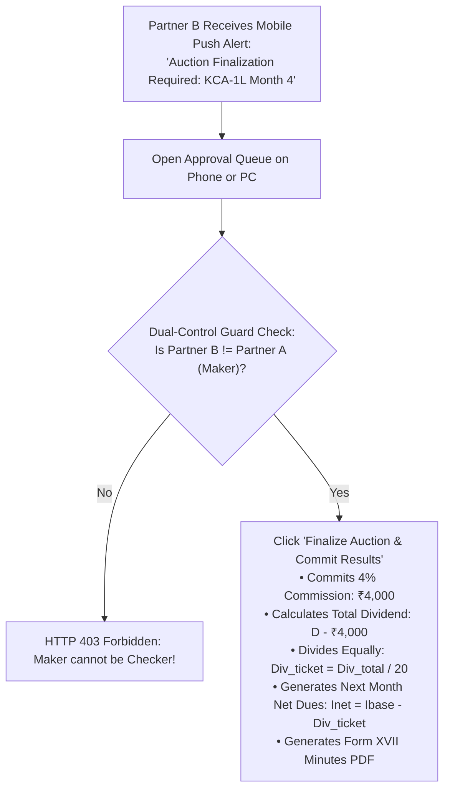

### Step-by-Step Instructions:
1. Partner B receives a push notification on their Android phone.
2. Tap the alert to open the **Auction Verification Screen**.
3. Verify the winning ticket number, bid discount, and attendee list.
4. Click **"Finalize Auction & Commit Results"** (`POST /auctions/:id/finalize`).
   - The software commits the 4.00% Foreman Commission.
   - Calculates the **Universal Equal Dividend**: allocated equally across **all members in the chit group, INCLUDING the auction winner**.
   - Uniformly sets next month's net installment: $I_{net} = I_{base} - Div_{ticket}$.
   - Publishes the statutory **Form XVII Minutes** ready for printing, physical signatures, and filing with the Chit Registrar.

---

## 8. Authorizing Prize Payout Vouchers (2-Step Payout Workflow)

```mermaid
sequenceDiagram
    autonumber
    actor Winner as Prized Subscriber
    actor Maker as Desk Accountant / Partner A (Maker)
    actor Checker as Partner B (Checker)
    participant App as Web / Mobile Portal
    participant S3 as Private Encrypted S3

    Winner->>Maker: Arrives to claim prize money (₹75,000)
    Maker->>App: Fills Company Safety Proof Checklist (ADR-15)
    Maker->>App: Uploads scans of signed agreement & blank cheques
    Maker->>App: Prepares Voucher & clicks "Submit Voucher" (Maker)
    App-->>Checker: Dispatches Push Notification: "Authorize Payout Voucher"
    Checker->>App: Opens Voucher & reviews S3 scans via presigned URL
    Checker->>App: Clicks "Authorize Payout Voucher" (maker != checker)
    App-->>App: Status transitions to AUTHORIZED_BY_CHECKER
    Maker->>App: Enters Cheque No / Bank UTR & clicks "Release Disbursement"
    App-->>App: Status = DISBURSED; Payout Receipt issued
```

### Step-by-Step Instructions:
1. **Safety Proof Checklist (Maker)**:
   - Winner Chit Agreement signed with nominee? [Yes/No]
   - Signed blank bank cheque(s) collected? [Yes/No, enter cheque # and bank]
   - Promissory note / personal guarantee collected? [Yes/No]
   - Upload scanned images of the paperwork.
2. **Submit Voucher**: Maker selects payout mode (**Account Payee Cheque**, **NEFT/RTGS**, or **Cash**) and clicks **"Submit Payout Voucher"** (`POST /disbursements/auction/:id/verify-safety-proof`). Status transitions to `VERIFIED_BY_MAKER`.
3. **Checker Authorization**: Partner B opens the approval queue on phone or PC, inspects the attached documents via 15-minute presigned URLs, and clicks **"Authorize Payout Voucher"** (`POST /disbursements/auction/:id/authorize-payout`). Status transitions to `AUTHORIZED_BY_CHECKER`.
4. **Fund Release**: Accountant or Partner enters the cheque number or bank UTR reference and clicks **"Release Disbursement"** (`POST /disbursements/auction/:id/disburse`). Status transitions to `DISBURSED`, generating the official payout receipt.

---

## 9. Evening Field Cash Handover Sign-Off into Vault (Checker Role)

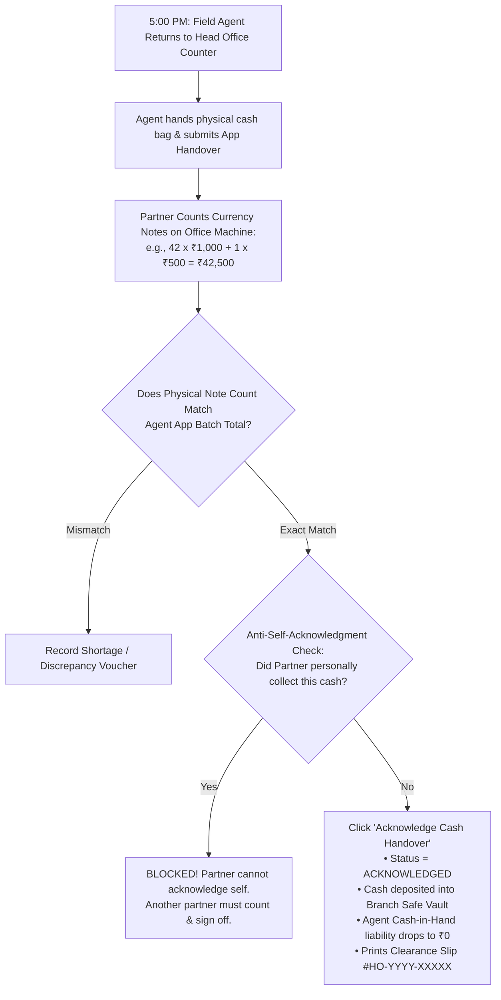

### Step-by-Step Instructions:
1. When a field collection agent finishes their rounds, they submit their batch on their mobile app and place their leather cash bag on the counter.
2. Put the notes through the counter currency note-sorting machine to verify the total count.
3. Open **Collections $\to$ Pending Handovers** on your phone or PC.
4. Verify that the machine count matches the software batch total.
5. **Anti-Self-Acknowledgment Guard**: If you personally collected cash under your user account, you cannot acknowledge it. One of the other 3 partners must verify and acknowledge.
6. Click **"Acknowledge Cash Received"** (`POST /collections/cash-handover/acknowledge`).
   - Cash custody moves into the **Branch Safe Vault**.
   - Agent liability drops to `₹0`.
   - Generates official Handover Clearance Slip `#HO-YYYY-XXXXX`.

---

## 10. Approving Erroneous Payment Reversals (Checker Role)

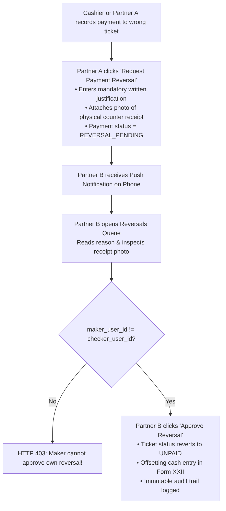

### Step-by-Step Instructions:
1. When an erroneous payment entry is identified, the cashier or Partner A initiates a reversal request with a written explanation (Maker).
2. Partner B opens **Pending Approvals $\to$ Payment Reversals**.
3. Review the reason and inspect the physical counter receipt.
4. Click **"Approve Payment Reversal"** (`POST /payments/:id/approve-reversal`).
   - The ticket due reverts to `UNPAID`.
   - An offsetting reversal line is stamped into the Form XXII Daily Cash Book.
   - An immutable audit trail entry is permanently recorded.

---

## 10B. Verifying Customer Online UPI Claims against Bank Statement (Checker Role)

Subscribers paying online via the Android Mobile App utilize NPCI 1-Tap UPI Intent deep-linking directly into Kumaran Finance's Karur Vysya Bank (KVB) current account with **₹0 gateway fees** (ADR-19). Subscribers self-report their 12-digit Bank UTR reference, entering the approvals queue:

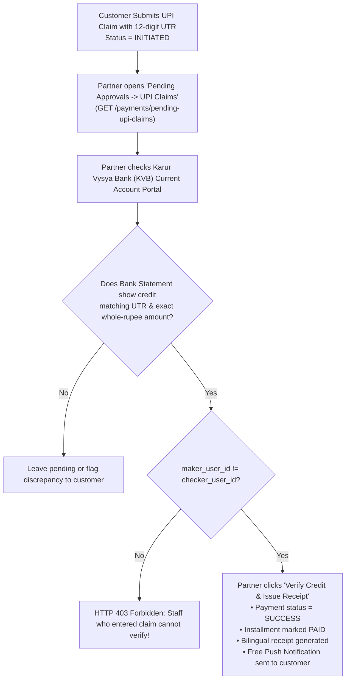

### Step-by-Step Instructions:
1. In the Web Portal or Mobile App, navigate to **Pending Approvals $\to$ UPI Claims**.
2. View the pending list: Subscriber Name, Chit Group Code, Ticket Number, Net Amount ($I_{net}$), and 12-digit UTR.
3. Cross-reference the UTR against the incoming credits on the KVB corporate net banking statement.
4. Click **"Verify Credit & Issue Receipt"** (`POST /payments/:id/verify-upi-claim`).
5. **Maker != Checker Enforcement**: If a partner recorded the claim on behalf of a walk-in or phone customer, another partner or accountant must verify it.

---

## 11. Month 1 Company Pool & Month $N$ Final Member Settlement

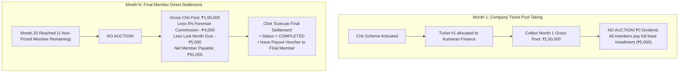

### Step-by-Step Instructions:
1. **Month 1 Rule**: Upon scheme activation, Ticket #1 belongs to the company. Kumaran Finance receives the full gross pool (`₹1,00,000`). There is no auction and ₹0 dividend. Every member pays the base installment ($I_{base} = \text{₹}5,000$).
2. **Month $N$ (Final Month) Rule**:
   - In Month 20, there is only one remaining non-prized subscriber.
   - No auction takes place.
   - Partner opens **Disbursements $\to$ Group KCA-1L-20M-01 $\to$ "Month 20 Final Settlement"**.
   - Click **"Execute Final Settlement"** (`POST /disbursements/group/:chitGroupId/final-settlement`).
   - System retains the 4% commission (`₹4,000`) and final installment (`₹5,000`), disbursing the net balance (`₹91,000`) directly to the subscriber and marking the chit scheme as `COMPLETED`.

---

## 12. 3-Month Arrears Tagging & Defaulter Removal Workflow

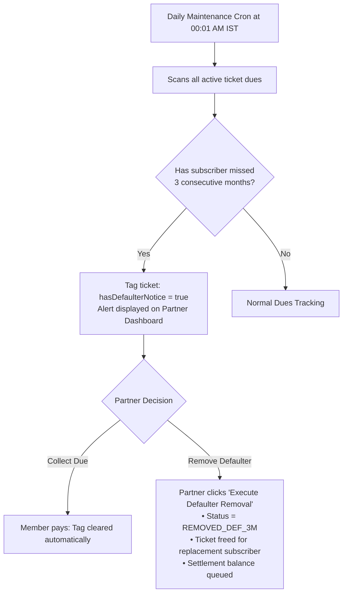

### Step-by-Step Instructions:
1. The background scheduler flags any subscriber who misses 3 consecutive installment payments.
2. Defaulters appear under **Subscribers $\to$ Defaulter Management**.
3. If informal field collection fails, open the subscriber's ticket and click **"Execute Defaulter Removal"** (`POST /tickets/:id/remove-defaulter`).
4. The ticket transitions to `REMOVED_DEF_3M`, enabling the company to assign a substitute subscriber (`POST /tickets/:id/substitute`) or settle the accrued balance.

---

## 13. Staff Multi-Role Provisioning & Emergency Credential Resets

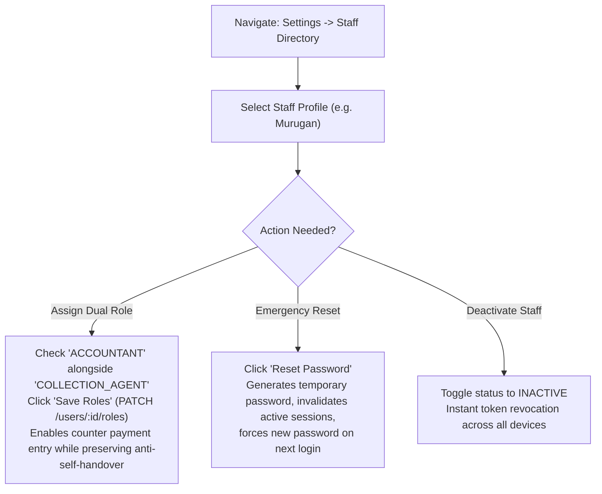

### Step-by-Step Instructions:
1. Open **Settings $\to$ Staff Directory**.
2. **Dual-Role Assignment**: Check both `COLLECTION_AGENT` and `ACCOUNTANT` for employees who collect in the morning and balance accounts in the afternoon. The system maintains the anti-self-acknowledgment guard automatically.
3. **Emergency Credential Reset**: Click **"Reset Password"** (`POST /users/:id/reset-password`). All active mobile and web JWT tokens are instantly invalidated.
4. **Deactivation**: Toggle status to `INACTIVE` to instantly block all access if an employee leaves the company.

---

## 14. Bull Board Asynchronous Queue Monitoring (`/admin/queues`)

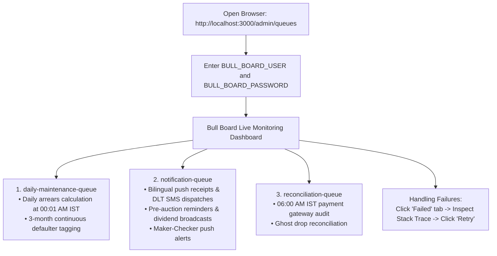

### Step-by-Step Instructions:
1. Navigate to `https://admin.kumaranfinance.com/admin/queues` (or `http://localhost:3000/admin/queues`).
2. Log in using configured `BULL_BOARD_USER` and `BULL_BOARD_PASSWORD`.
3. Verify live queue health:
   - **`daily-maintenance-queue`**: Runs nightly at **00:01 AM IST (`1 0 * * *`)** to recompute arrears balances and tag defaulters.
   - **`notification-queue`**: Dispatches push notifications and fallback DLT SMS messages.
   - **`reconciliation-queue`**: Verifies morning bank gateway settlements.
4. **Retry Failed Jobs**: If an external telecom SMS timeout causes a job to fail, open the **"Failed"** tab, review the error, and click **"Retry"** to re-dispatch the job instantly without restarting the server.

---

## 15. Form XXII Daily Vault Cash Book Sign-Off Procedure

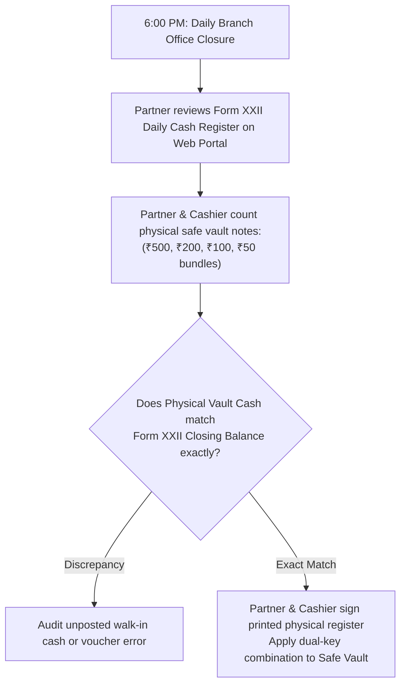

### Step-by-Step Instructions:
1. At 6:00 PM, join the Desk Accountant at the office safe vault.
2. Open **Reports $\to$ Form XXII Daily Cash Book** on the Web Portal.
3. Physically count all currency bundles inside the safe vault.
4. Verify that:
   $$\text{Opening Vault Cash} + \text{Today's Total Receipts} - \text{Total Disbursements} = \text{Closing Vault Cash}$$
   matches to the exact rupee without discrepancies.
5. Sign the physical register alongside the Desk Accountant, apply the dual-key lock to the vault, and set facility alarms.
