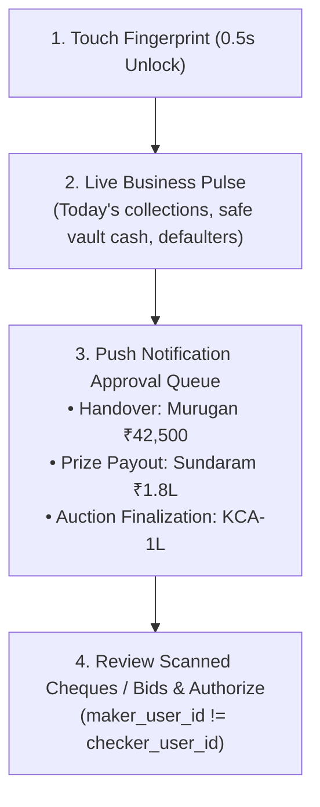

# Kumaran Chits — Admin & Foreman Operations Manual

> **Product**: **Kumaran Chits** (Kumaran Finance)  
> **Target Users**: Company Partners (Super Admin), Foremen, and Desk Accountants  
> **Platform**: Web Dashboard (`https://admin.kumaranfinance.com`) AND Partner Mobile App (`apps/mobile/`)  
> **Currency Standard**: All monetary values are strictly in **whole integer Rupees (₹)** (`CONFIRMED-BY-DEVELOPER`).
> **Dual-Platform Parity**: The 4 Partners have 100% full feature parity across both Web and Mobile for both Maker and Checker roles.
>
> [!NOTE]
> **Operational Status**: This manual specifies the standard operational workflows for the Web Dashboard and Partner Mobile App designed against the completed backend API. Client app initialization in `apps/web/` is scheduled in Phase 2.

---

## 1. Logging In with 2-Factor Authentication (2FA)

1. Open the Web Portal in your browser.
2. Enter your registered 10-digit Mobile Phone Number and Password.
3. When prompted, open your **Microsoft Authenticator** app on your phone.
4. Enter the current 6-digit rotating TOTP code.
5. Select your active Branch Office (e.g., *Head Office - Perundurai*).

---

## 2. Managing Chit Schemes

### 2.1 Launching a New Chit Scheme (Starting Month 1)
1. Navigate to **Chit Schemes $\to$ "Create New Scheme"**.
2. Enter Scheme Details:
   - Group Code (e.g., `KCA-1L-20M-01`)
   - Chit Value: `₹1,00,000` (Whole integer Rupees)
   - Duration: `20 months`
   - Total Tickets: `20` (System enforces maximum 1 ticket per customer in this group)
   - Foreman Commission: Auto-set to **`4.00%`** (Frozen upon activation)
   - Base Monthly Installment: `₹5,000`
   - Discount Ceiling: Auto-set to fixed **one-fourth (1/4 or 25.00%) of total chit value** ($D_{max} = \frac{V}{4} = \text{₹}25,000$). Dynamic ceilings are completely eliminated (`CONFIRMED-BY-DEVELOPER`).
3. Enter the **Registrar Prior Sanction Order Number & Date**.
4. Click **"Save Draft"**.

### 2.2 Onboarding an Active Ongoing Chit from Physical Notebooks
1. Navigate to **Chit Schemes $\to$ "Onboard Ongoing Physical Chit"**.
2. Enter scheme parameters and specify the **Current Active Month** (e.g., Month 7).
3. Transcribe past auction winners (Months 1 to 6) and payout statuses.
4. Fill in the month-by-month member payment grid directly from your physical notebook (each month is strictly binary: `PAID` in full or `UNPAID`; zero partial payments).
5. Check the **Pre-Activation Balancing Guard**: Confirm that the system computed total matches your physical ledger page total.
6. **Maker-Checker Activation**: Desk Accountant or Partner A submits transcription (Maker); Partner B clicks **"Verify & Activate Scheme"** (Checker; `maker_user_id != checker_user_id`).

---

## 3. Conducting & Finalizing In-Office Auctions (Months 2 to $N-1$)

> **Important Operational Note (`CONFIRMED-BY-DEVELOPER`)**:  
> - **Month 1**: There is **NO auction**. The company customer ticket takes the full pool; dividend is ₹0.  
> - **Month $N$ (Final Month)**: There is **NO auction**. The company retains 4% commission and last month's payable, settling the remaining prize directly to the final subscriber with a receipt.  
> - In-office auctions occur exclusively in **Months 2 through $N-1$**.

1. Navigate to **Auctions $\to$ Active Auctions**.
2. Select the scheduled auction for the current month.
3. Conduct the physical auction at the branch office in front of attending subscribers.
4. In the software (**Maker — Partner A or Staff**):
   - Select the **Winning Subscriber Ticket Number**.
   - Enter the **Winning Bid Discount** (e.g., `₹22,000` or maximum ceiling `₹25,000`).
5. **Validation Checks**:
   - **Auction Ineligibility for Unpaid Dues (`CONFIRMED-BY-DEVELOPER`)**: The system actively checks installment payment status and **strictly blocks selecting any subscriber who has not paid their installment due for that month**. Unpaid subscribers are not permitted to bid or win.
   - **Fixed 1/4 Ceiling**: The system checks that the discount does not exceed 1/4 of total chit value ($D \le \frac{V}{4} = \text{₹}25,000$). Any bid $> \text{₹}25,000$ is rejected.
   - **Minimum Floor**: The system ensures discount $\ge$ Foreman Commission ($4.00\% = \text{₹}4,000$).
   - **Tie-Breaker Protocol (`CONFIRMED-BY-DEVELOPER`)**: If multiple members bid the maximum ceiling discount simultaneously:
     - Conduct a physical paper token/lot draw live at the branch in front of the members.
     - In the software, click **"Record Tie-Breaker Draw"** and enter the physically drawn winning ticket number into the system (Option A). (No autonomous computer lottery).
6. Click **"Submit Auction Results"** (Maker).
7. A different Partner / Super Admin (Partner B) reviews and clicks **"Finalize Auction & Commit Results"** (Checker; `maker_user_id != checker_user_id`):
   - The system calculates the 4% Foreman Commission (`₹4,000`) and allocates member dividends equally across **all members (including the auction winner)**.
   - Automatically generates next month's net installment dues in whole integer Rupees ($I_{net} = I_{base} - Div_{ticket}$) uniformly for all members.
   - Generates the statutory **Auction Minutes** for physical signing and filing with the Chit Registrar.

---

## 4. Prize Money Disbursement & Safety Proof Checklist (`CONFIRMED-BY-DEVELOPER`)

1. When a winning subscriber claims their prize money, navigate to **Disbursements $\to$ Pending Verification**.
2. Fill in the **Company Safety Proof Checklist** (**Maker — Desk Accountant or Partner A**):
   - **Safety proof required for this winner?** [Yes / No] (Note: Evaluated on a case-by-case basis by company decision; **not mandatory** across the board).
   - **Winner agreement signed?** [Yes / No]
   - **Nominee signed?** [Yes / No]
   - **Signed blank cheque(s) with details submitted?** [Yes / No, enter bank & cheque numbers]
   - **Promissory note / personal guarantee submitted?** [Yes / No]
   - Upload scanned copies of the signed papers / cheques to secure storage.
3. Prepare the Payout Voucher:
   - Select payment mode: **Account Payee Cheque**, **Bank Transfer (NEFT/RTGS/IMPS)**, or **Cash**.
   - Enter cheque number or bank reference details.
4. **Checker Authorization**:
   - Partner B (Super Admin) reviews the voucher and checklist, then clicks **"Authorize & Disburse Prize Money"** (`maker_user_id != checker_user_id`).
   - Software records disbursement timestamp and generates a bilingual payout receipt.

---

## 5. Partner Mobile App Operations — 1-Tap Pocket Approvals (`CONFIRMED-BY-DEVELOPER`)

For partners on the move, at home, or in customer meetings, the **Kumaran Chits Mobile App (`apps/mobile/`)** provides an executive console with 100% operational parity:

### 5.1 Routine Daily Mobile Workflows:
1. **Evening Cash Handover Sign-Off**:
   - Field collection agent submits collection batch at 5:00 PM.
   - Partner receives push notification: *"Murugan submitted ₹42,500 cash"*.
   - Partner counts physical cash, opens app, taps **"Acknowledge Cash Received"** (`collector != acknowledger`).
2. **Prize Money Authorization**:
   - Desk accountant enters voucher on office PC (Maker).
   - Partner receives push notification: *"Prize payout pending for Sundaram"*.
   - Partner taps notification, reviews uploaded photos of signed blank cheques & agreement, and taps **"Authorize Disbursement"** with fingerprint confirmation (`maker != checker`).
3. **Conducting In-Office Auction on Mobile**:
   - In the auction room, Partner A holds smartphone, enters winning discount (system validates $D \le V/4$), records the paper lot ticket drawn (Option A), and taps **"Submit Bid"** (Maker).
   - Partner B on phone or laptop taps **"Finalize Auction"** (Checker).
4. **Instant PDF Receipt & Report Sharing**:
   - View Form XXII Cash Book or subscriber passbooks and click **"Download PDF"** or **"Export Excel"** (or use native mobile share) to send statements directly to partners or the CA auditor.

---

## 6. Bull Board Background Queue Monitor (`/admin/queues`)

For operational visibility over asynchronous background workers, partners can open the visual **Bull Board Queue Monitor**:

### 6.1 Accessing the Queue Monitor
1. Open your browser and navigate to:  
   `http://localhost:3000/admin/queues` (or `https://admin.kumaranfinance.com/admin/queues` in production).
2. When the native browser authentication dialog appears:
   - **Username**: Enter configured `BULL_BOARD_USER` (defaults to `admin`).
   - **Password**: Enter configured `BULL_BOARD_PASSWORD`.
3. Click **Log In** to view the live dashboard.

### 6.2 Monitored Background Queues
- **`daily-maintenance-queue`**:
  - Tracks daily arrears calculation running at 02:00 AM IST.
  - Verifies automated 3-month continuous defaulter tagging (ADR-07).
- **`notification-queue`**:
  - Monitors bilingual payment receipt dispatches, pre-auction reminders, and default warning notices.
  - Verifies Push notification delivery and DLT SMS fallback queues for keypad phones.
  - Displays any delivery failures caused by telecom timeouts with 1-click DLQ retry.
- **`reconciliation-queue`**:
  - Tracks the 06:00 AM IST payment gateway settlement audit.
  - Shows auto-resolved ghost drops and gateway mismatch alerts.

### 6.3 Handling Failed Jobs
1. In Bull Board, click the **"Failed"** tab under the relevant queue.
2. Click on the failed job to read the error stack trace (e.g., SMS provider gateway timeout).
3. Click **"Retry"** to re-dispatch the job immediately without restarting any server processes.
