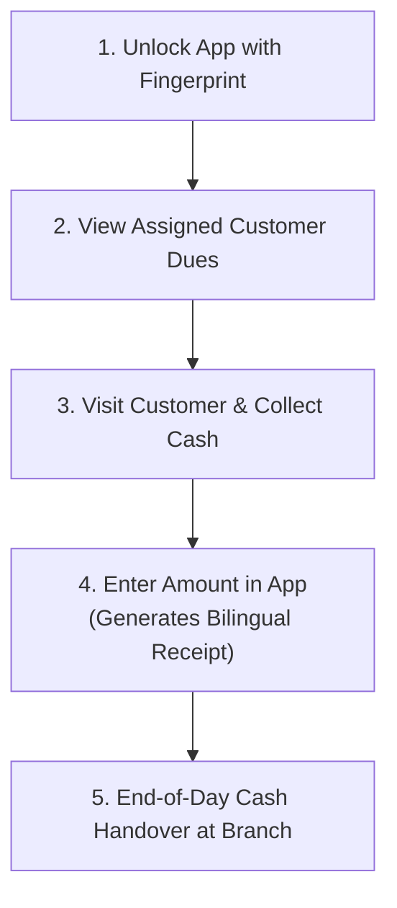

# Kumaran Chits — Field Collection Agent Mobile App Guide

> **Product**: **Kumaran Chits** (Kumaran Finance)  
> **Target Users**: Field Collection Agents  
> **Platform**: Android Mobile App (Flutter)

---

## 1. Initial Device Setup & Login

1. **First-Time Registration**:
   - Open the **Kumaran Chits Agent App** on your Android smartphone.
   - Enter your registered 10-digit mobile phone number.
   - Enter the one-time SMS OTP sent to your phone.
   - Choose a secret **6-digit MPIN** that you will remember.
   - When prompted, scan your fingerprint to enable **Biometric Quick Login**.
2. **Daily Login (1-Second Unlock)**:
   - Every morning, open the app and simply touch your fingerprint sensor (or enter your 6-digit MPIN).
   - No SMS OTP is required for daily login.

---

## 2. Daily Collection Workflow

### 2.1 Viewing Assigned Dues
- The home screen displays:
  - **Today's Collection Target** (e.g., ₹45,000 across 12 customers).
  - **Collected So Far** (e.g., ₹28,000).
  - **Pending Customer List**: Sorted by street/area or overdue urgency.

### 2.2 Recording a Cash Collection
1. Tap on the customer’s name or search by **Customer Code** / **Chit Ticket Number**.
2. Tap **"Record Collection"**.
3. Select Payment Method: **`CASH`** (or `UPI` if customer transfers directly to company QR).
4. Enter the amount collected (e.g., `₹3,700`).
5. Tap **"Confirm & Issue Receipt"**:
   - The app instantly displays the **Bilingual Digital Receipt (English + Tamil)**:
     - *"ரசீது எண் / Receipt No: KC-REC-VNR-2026-00124"*
     - *"சந்தாதாரர் பெயர் / Subscriber Name: S. Sundaram"*
     - *"செலுத்திய தொகை / Amount Paid: ₹3,700"*
   - Tap **"Share via WhatsApp / SMS"** to immediately send a receipt link to the customer.

### 2.3 Working Offline in Low-Network Areas
- If mobile signal is lost, the app displays an **Offline Mode** indicator.
- You can continue recording collections normally.
- The transactions are saved securely on your phone and automatically upload to the office server as soon as mobile connectivity returns.

---

## 3. End-of-Day Cash Handover Procedure

1. Return to the branch office before closing time.
2. Tap **"Daily Summary & Cash Handover"** in the app menu.
3. The app displays your exact physical cash tally (e.g., `Total Cash Collected: ₹42,500`).
4. Hand the physical currency notes to the Branch Cashier.
5. The cashier counts the money and confirms the handover on their computer.
6. Your app will update to **"Cash Handover Cleared — Status: CONFIRMED"**.
7. **Strict Rule**: Never take company cash home overnight.
