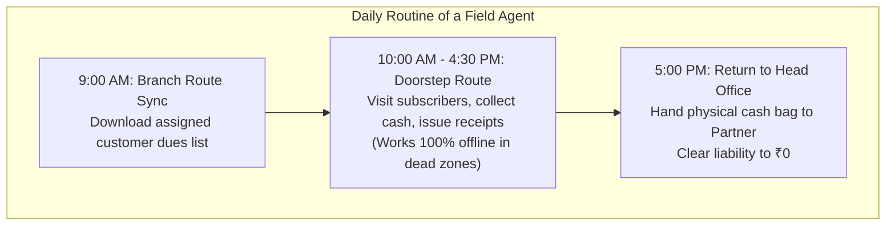
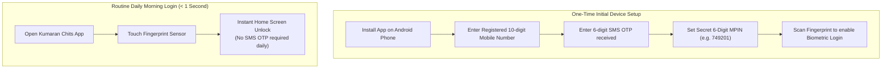
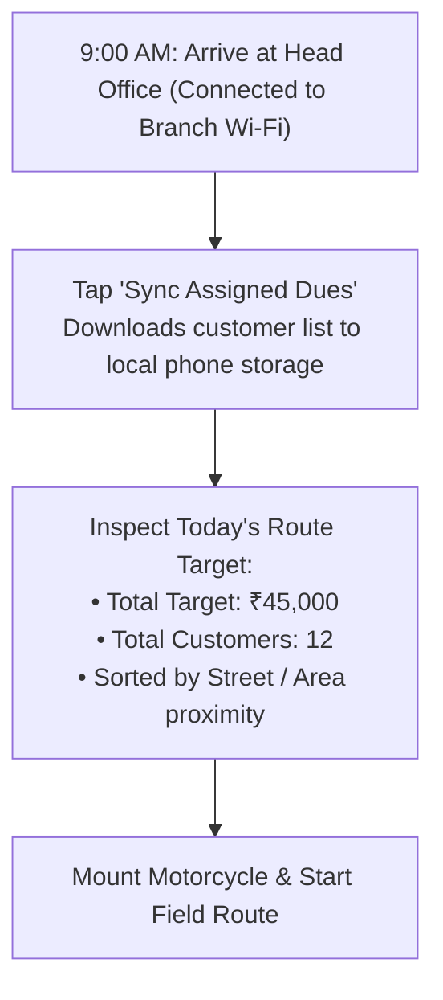
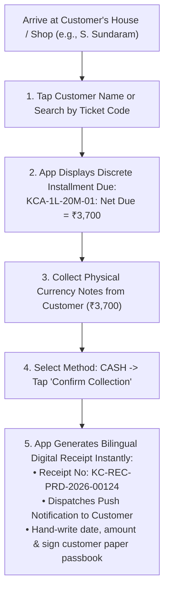
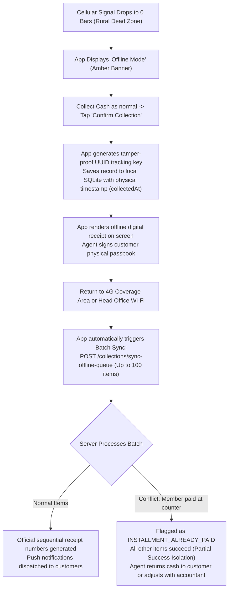
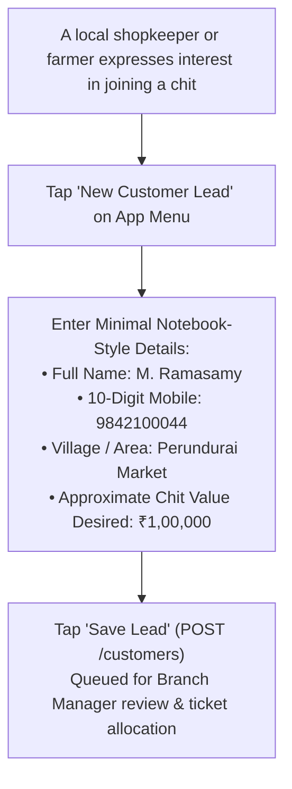
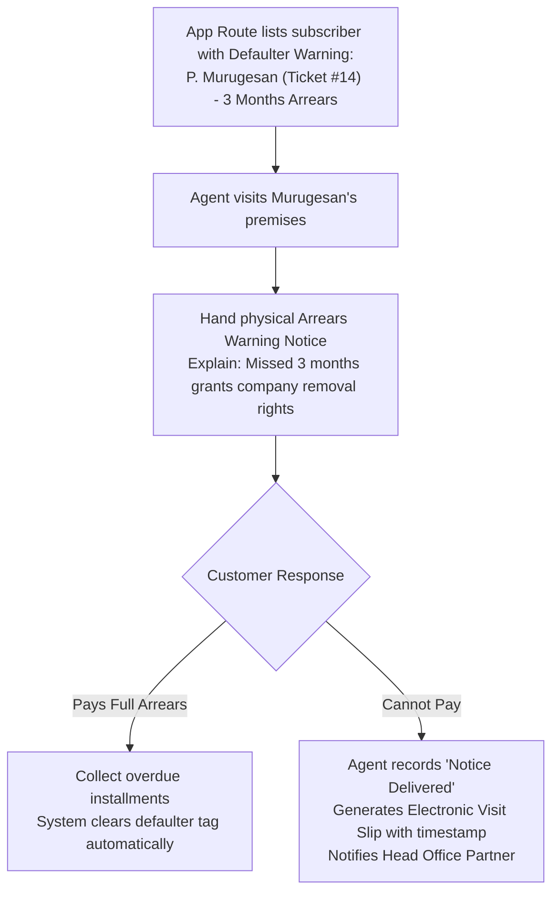
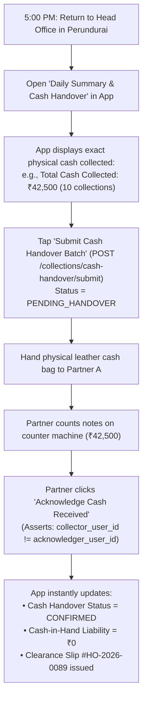

# Kumaran Chits — Field Collection Agent Mobile App Manual

> **Product**: **Kumaran Chits**  
> **Company**: **Kumaran Finance** (Head Office: Perundurai, Erode, Tamil Nadu)  
> **Target Persona**: **Field Collection Agents (Motorcycle Collection Staff)**  
> **Primary Platform**: **Android Mobile App (Flutter in `apps/mobile/`)**  
> **Hardware Support**: Android 10+, Biometric Fingerprint Sensor, Offline Local SQLite Database  
> **Core Operating Standard**: Single discrete payments, instant bilingual digital receipts, zero cash retention overnight.

---

## 1. Operating Reality & Field Training Overview

Kumaran Finance operates **2 to 3 field collection agents** who travel by motorcycle across Perundurai, Chennimalai, and surrounding rural agricultural villages in Erode District. Their operational reality involves:
- Visiting village homes, weaver sheds, and local markets to collect monthly cash installments.
- Entering cellular dead zones where 4G/5G mobile connectivity drops to zero.
- Carrying heavy leather cash collection bags on motorbikes.
- Maintaining customer trust through transparent digital receipts and physical passbook pen-and-ink signatures.

---

## 2. Daily Workflow Index & Action Diagrams

| Section | Operational Action | Connectivity | Primary Interface |
|---|---|:---:|:---:|
| **§3** | First-Time Setup, MPIN & Biometric Unlock | Online / Daily Offline | Mobile App |
| **§4** | Morning Route Sync & Inspecting Assigned Dues | Online (Branch Wi-Fi) | Mobile App |
| **§5** | 30-Second Doorstep Cash Collection & Digital Receipt | Online Mode | Mobile App (`POST /collections/record`) |
| **§6** | Doorstep Collection in Dead Zones & Batch Sync | Offline $\to$ Sync | Mobile App (`POST /collections/sync-offline-queue`) |
| **§7** | On-the-Road Customer Lead Registration | Online / Offline | Mobile App (`POST /customers`) |
| **§8** | 3-Month Arrears Notice Delivery & Clearance Slips | Online / Offline | Mobile App |
| **§9** | End-of-Day Cash Handover at Head Office Counter | Online (Branch Office) | Mobile App (`POST /collections/cash-handover/submit`) |

---

## 3. First-Time Setup, MPIN & Biometric Unlock

### Step-by-Step Instructions:
1. **One-Time Registration**:
   - Open the app on your Android smartphone.
   - Enter your registered 10-digit mobile number and tap **"Send OTP"**.
   - Type the 6-digit SMS verification code.
   - Set a private **6-digit MPIN** that you will remember.
   - When prompted, touch your thumb to the phone's fingerprint reader to enable **Biometric Quick Login**.
2. **Routine Daily Morning Login**:
   - Every morning, simply open the app and touch your fingerprint sensor.
   - The app unlocks in under 1 second without requiring mobile signal or SMS OTP.

---

## 4. Morning Route Sync & Inspecting Assigned Dues

### Step-by-Step Instructions:
1. Before leaving the Perundurai office, connect to the branch Wi-Fi.
2. Tap the **"Sync Assigned Dues"** icon.
3. The app downloads your route data into encrypted local SQLite storage.
4. Review your **Today's Route Dashboard**:
   - **Target Collection**: e.g., `₹45,000` across 12 customers.
   - **Collected So Far**: `₹0`.
   - **Pending Customer List**: Sorted by village, street, or priority.

---

## 5. 30-Second Doorstep Cash Collection & Digital Receipt

### Step-by-Step Instructions:
1. Tap the customer's name on your route list.
2. The app displays the net monthly installment due: **`₹3,700`**.
3. **The Single Discrete Payment Rule (`CONFIRMED-BY-DEVELOPER`)**:
   - You must collect the exact net installment in full (`₹3,700`).
   - The app **strictly rejects partial payments** (e.g., ₹1,500) and advance balances.
4. Count the physical currency notes.
5. Tap **"Record Collection"**, select **`CASH`**, and tap **"Confirm & Issue Receipt"** (`POST /collections/record`).
6. The app instantly issues the **Bilingual Digital Receipt (English + தமிழ்)**:
   - *"ரசீது எண் / Receipt No: KC-REC-PRD-2026-00124"*
   - *"சந்தாதாரர் பெயர் / Subscriber Name: S. Sundaram"*
   - *"செலுத்திய தொகை / Amount Paid: ₹3,700"*
7. With a pen, record the date, amount, and receipt number in the subscriber's physical paper passbook booklet and sign your initials.

---

## 6. Doorstep Collection in Dead Zones & Batch Synchronization

### Step-by-Step Instructions:
1. If network connectivity drops while visiting rural agricultural fields, the app automatically switches to **Offline Mode**.
2. You can record payments without interruption. The app generates a tamper-proof local UUID tracking key and stamps the exact physical collection time (`collectedAt`).
3. Show the on-screen digital receipt to the subscriber and sign their physical passbook.
4. **Batch Synchronization (`POST /collections/sync-offline-queue`)**:
   - As soon as your phone reconnects to 4G/5G or branch Wi-Fi, the app automatically uploads your offline queue in a single batch (up to 100 collections).
   - **Idempotency Guarantee**: If network drops mid-sync and the app retries, the server uses the UUID key to return the original receipt without creating double charges.
   - **Conflict Handling (Partial Success Isolation)**: If a customer paid at the office counter while you were on the road, the server marks that single ticket as `INSTALLMENT_ALREADY_PAID` while committing all other valid payments. The app notifies you immediately so you can return the cash.

---

## 7. On-the-Road Customer Lead Registration

### Step-by-Step Instructions:
1. If a local shopkeeper or farmer expresses interest in enrolling, tap **"New Customer Lead"** in the app menu.
2. In keeping with our village intake reality, enter minimal fields: Full Name, Mobile Number, Village/Area, and Nominee Name.
3. Tap **"Save Lead"** (`POST /customers`). The lead appears on the Branch Manager's desk for scheme enrollment and ticket allocation.

---

## 8. 3-Month Arrears Notice Delivery & Clearance Slips

### Step-by-Step Instructions:
1. When a subscriber misses 3 consecutive months, the app highlights their profile with a red **`3M ARREARS`** badge.
2. Visit the member and deliver the formal company warning notice.
3. If they pay, record the discrete payments. If they cannot pay, tap **"Record Visit Notice"** to record an electronic timestamped visit slip, notifying the Partner to initiate formal substitution procedures.

---

## 9. End-of-Day Cash Handover at Head Office Counter

### Step-by-Step Instructions:
1. Return to the Perundurai branch office before 5:00 PM closing.
2. Tap **"Daily Summary & Cash Handover"** in the app.
3. Verify your day's total: e.g., `Total Cash Collected: ₹42,500`.
4. Tap **"Submit Cash Handover Batch"** (`POST /collections/cash-handover/submit`).
5. Hand your physical currency notes to an authorized Partner at the counter.
6. The Partner runs the notes through the currency counting machine and acknowledges receipt in the software.
7. **The Anti-Self-Acknowledgment Guard**: If you also hold accountant permissions, you cannot acknowledge your own cash. A Partner must sign off (`collector_user_id != acknowledger_user_id`).
8. Your mobile app screen turns green: **`Handover Cleared — Status: CONFIRMED`**.
9. **Strict Company Rule**: Never take company cash home overnight.
