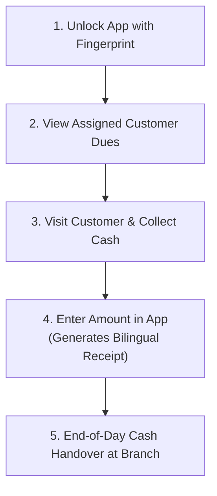

# Kumaran Chits — Field Collection Agent Mobile App Guide

> **Product**: **Kumaran Chits** (Kumaran Finance)  
> **Target Users**: Field Collection Agents  
> **Platform**: Android Mobile App (Flutter)
>
> [!NOTE]
> **Operational Status**: This manual specifies field collection workflows designed against the completed backend API (`apps/api/`). Flutter client app initialization in `apps/mobile/` is scheduled in Phase 2.

---

## 1. Initial Device Setup & Login

1. **First-Time Registration**:
   - Open the **Kumaran Chits Agent App** on your Android smartphone.
   - Enter your registered 10-digit mobile phone number.
   - Enter the one-time SMS OTP sent to your phone.
   - Choose a secret **6-digit MPIN** that you will remember.
   - When prompted, scan your fingerprint to enable **Biometric Quick Login**.
2. **Daily Login (1-Second Unlock)**:
   - Every morning, open the app and simply touch your fingerprint sensor (or enter your 6-digit MPIN).
   - No SMS OTP is required for daily login.

---

## 2. Daily Collection Workflow

### 2.1 Viewing Assigned Dues
- The home screen displays:
  - **Today's Collection Target** (e.g., ₹45,000 across 12 customers).
  - **Collected So Far** (e.g., ₹28,000).
  - **Pending Customer List**: Sorted by street/area or overdue urgency.

### 2.2 Recording a Cash Collection
1. Tap on the customer’s name or search by **Customer Code** / **Chit Ticket Number**.
2. Tap **"Record Collection"**.
3. Select Payment Method: **`CASH`** (or `UPI` if customer transfers directly to company QR).
4. Enter the exact net installment amount due (e.g., `₹3,700`).  
   *(Strict Rule: The system enforces single discrete payments of full $I_{net}$; partial payments and advance balances are rejected).*
5. Tap **"Confirm & Issue Receipt"**:
   - The app instantly displays the **Bilingual Digital Receipt (English + Tamil)**:
     - *"ரசீது எண் / Receipt No: KC-REC-PRD-2026-00124"*
     - *"சந்தாதாரர் பெயர் / Subscriber Name: S. Sundaram"*
     - *"செலுத்திய தொகை / Amount Paid: ₹3,700"*
   - The app automatically dispatches a free Push Notification to the customer's phone (or SMS if keypad phone).
   - Hand-write the date, month, amount, and sign the customer's physical paper passbook booklet with a pen.

### 2.3 Working Offline in Low-Network Areas (Perundurai & Rural Erode)
- If mobile signal is lost, the app displays an **Offline Mode** indicator.
- You can continue recording collections normally. The app generates a tamper-proof local UUID tracking key and timestamps the physical collection time (`collectedAt`).
- **Batch Synchronization (`POST /collections/sync-offline-queue`)**:
  - As soon as cellular network (4G/5G) is restored or when you return to the branch Wi-Fi, the app transmits all queued collections as a single batch (up to 100 payments per batch).
  - **Idempotency Guarantee**: If a sync request is interrupted by an unstable network connection and retried, the server recognizes the UUID tracking key and returns the original receipt without creating a duplicate charge.
  - **Conflict Handling (Partial Success Isolation)**:
    - If a subscriber paid their installment at the head office counter while you were on the road, that specific ticket will be flagged as `INSTALLMENT_ALREADY_PAID` in the sync report.
    - All other valid collections in your batch succeed and issue official sequential bilingual receipt numbers (`KC-REC-PRD-YYYY-XXXXX`).
    - The app alerts you to the conflict so you can immediately return the physical cash to the customer or adjust records with the office accountant.

---

## 3. End-of-Day Cash Handover Procedure

1. Return to the Perundurai branch office before closing time.
2. Tap **"Daily Summary & Cash Handover"** in the app menu.
3. The app displays your exact physical cash tally (e.g., `Total Cash Collected: ₹42,500`).
4. Hand the physical currency notes to an authorized **Partner (Super Admin)** at the branch office.
5. The Partner physically counts the money and officially acknowledges receipt on the web portal.  
   *(Dual-Role Guard: If you also hold accountant permissions, the system enforces `collector_user_id != acknowledger_user_id`; you can never acknowledge your own cash handover).*
6. Your app will update to **"Cash Handover Cleared — Status: CONFIRMED"**.
7. **Strict Rule**: Never take company cash home overnight.
