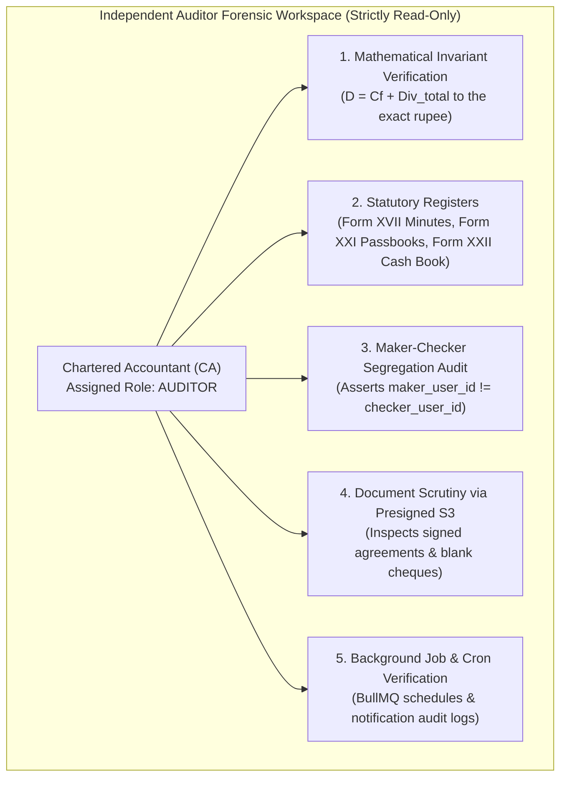
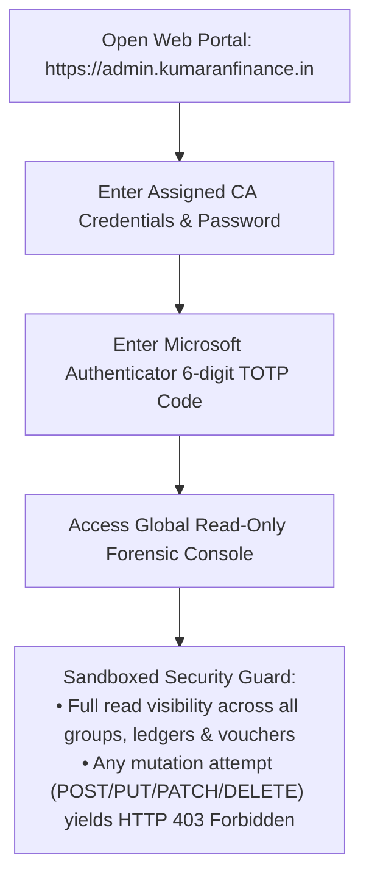
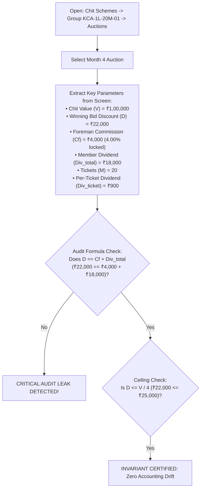
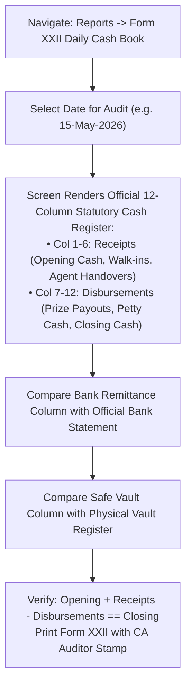
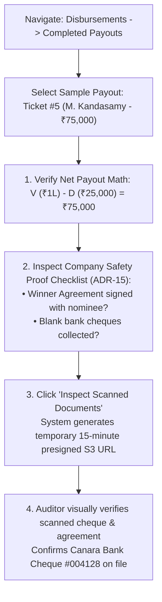
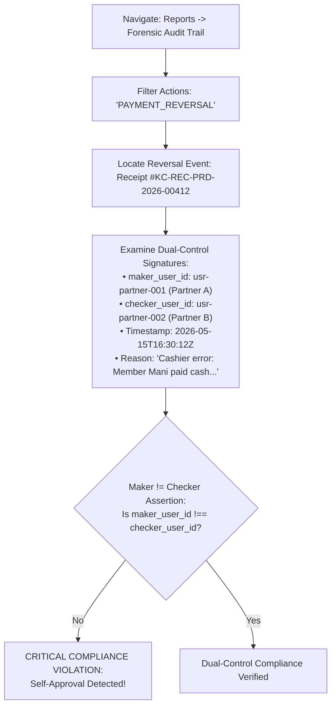
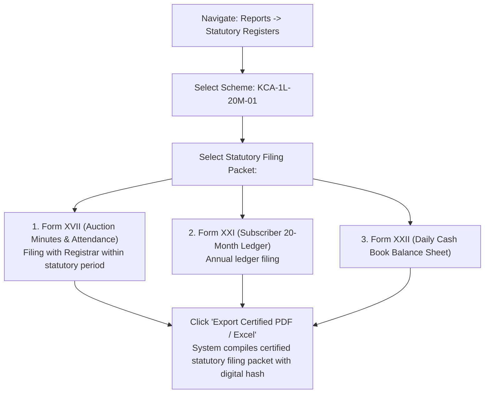
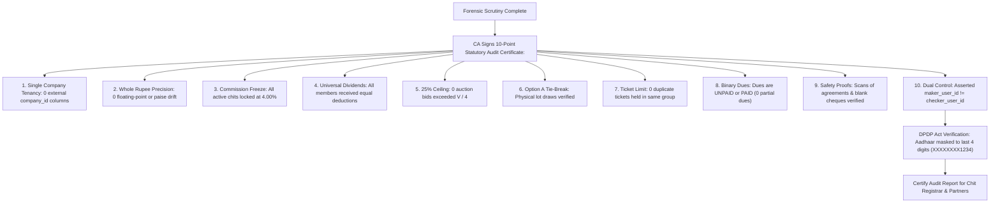

# Kumaran Chits — Independent Auditor Portal Manual

> **Product**: **Kumaran Chits**  
> **Company**: **Kumaran Finance** (Head Office: Perundurai, Erode, Tamil Nadu)  
> **Target Persona**: **Independent Statutory Auditor / Chartered Accountant (CA)** (`AUDITOR`)  
> **Primary Platform**: **Web Portal (`apps/web/`)** (Strictly Read-Only Forensic Console)  
> **Statutory Framework**: **Chit Funds Act, 1982** & **Tamil Nadu Chit Funds Rules, 1984**  
> **Security Guard**: **Global Read-Only Isolation**; all state mutations (`POST`, `PUT`, `PATCH`, `DELETE`) are permanently blocked with `HTTP 403 Forbidden`.

---

## 1. Operating Reality & Professional Mandate

The **Independent Auditor** is a licensed **Chartered Accountant (CA)** appointed to conduct quarterly, annual, and statutory compliance audits for Kumaran Finance:
- Reviewing financial integrity on behalf of the company partners and the **Chit Registrar** (Government of Tamil Nadu).
- Operating under a professional mindset of **Forensic Professional Skepticism**: verifying mathematical proofs, physical vouchers, and tamper-evident digital records.
- Verifying the 4 Core Invariants:
  1. Did the Foreman take more than 4.00% commission?
  2. Did any auction bid exceed the 25% (1/4) statutory ceiling?
  3. Were dividends shared equally among all members (including auction winners)?
  4. Was Maker-Checker segregation enforced on all sensitive actions without self-approval?

---

## 2. Audit Workflow Index & Action Diagrams

| Section | Audit Procedure | Statutory Scope | Primary Interface |
|---|---|:---:|:---:|
| **§3** | Auditor 2FA Web Login & Workspace Orientation | Access Control | Web Portal (`POST /auth/web/login`) |
| **§4** | Forensic Verification of the Conservation Invariant | Chit Math Invariant | Web Portal (`GET /auctions/:id`) |
| **§5** | Form XXII Daily Cash Book Audit Against Bank Statements | Cash & Banking | Web Portal (`GET /reports/form-xxii`) |
| **§6** | Sampling Prize Disbursements & Presigned S3 Cheques | Safety Proofs | Web Portal (`GET /disbursements/...`) |
| **§7** | Inspecting Immutable Audit Trail for Reversals | Dual Control | Web Portal (`GET /reports/audit-trail`) |
| **§8** | Exporting Statutory Filing Packets for Chit Registrar | Compliance Packets | Web Portal (`GET /reports/form-xvii`) |
| **§9** | Auditing BullMQ Background Cron Schedules & Logs | Operational Resilience | Web Portal (`GET /jobs/...`) |
| **§10** | Statutory Audit Certification & DPDP Act Checklist | Compliance Sign-off | Web Portal |

---

## 3. Auditor 2FA Web Login & Workspace Orientation

### Step-by-Step Instructions:
1. Open Chrome/Edge and navigate to `https://admin.kumaranfinance.in`.
2. Enter your assigned statutory auditor credentials and password.
3. Complete 2-Factor Authentication using Microsoft Authenticator.
4. **Strict Read-Only Enforcement**:
   - The auditor account is completely sandboxed.
   - You have global read access across all chit groups, customer folders, ledgers, and cash books.
   - If you attempt to trigger any state change, the backend immediately returns **`HTTP 403 Forbidden: Read-Only Auditor Access`**. Company financial truth cannot be modified.

---

## 4. Forensic Verification of the Conservation Invariant

### Step-by-Step Instructions:
1. Navigate to **Chit Schemes $\to$ Group KCA-1L-20M-01 $\to$ Auctions $\to$ Month 4**.
2. Scrutinize the mathematical breakdown:
   - Winning Bid Discount ($D$): `₹22,000`
   - Foreman Commission ($C_f$): `₹4,000` (locked permanently at 4.00% of $V$)
   - Total Member Dividend ($Div_{total}$): `₹18,000` (`₹22,000 - ₹4,000`)
   - Net Installment Payable ($I_{net}$): `₹4,100` (`₹5,000 - ₹900`) across all 20 tickets.
3. **The Conservation Invariant Check**: Verify that:
   $$D = C_f + Div_{total}$$
   If there is a mismatch by even a single rupee, flag an accounting leak.
4. **Whole-Rupee Math (`BigInt`) Verification**: Verify that all figures are discrete integers without decimal fractions (`.00`), floating-point drift, or paise.

---

## 5. Form XXII Daily Cash Book Audit Against Bank Statements

### Step-by-Step Instructions:
1. Navigate to **Reports $\to$ Form XXII Daily Cash Book**.
2. Select the audit date range (e.g., Month of May 2026).
3. The screen renders the statutory 12-column cash book mandated by the Tamil Nadu Chit Funds Rules:
   - **Receipt Columns**: Opening cash, subscriber monthly installments, field agent batch handovers, bank withdrawals.
   - **Disbursement Columns**: Prize payouts, foreman commission withdrawals, bank cash deposits, closing cash.
4. Compare bank inward/outward entries against the corporate current account bank statement.
5. Confirm that the physical safe vault balance reconciles to the last rupee without discrepancies.

---

## 6. Sampling Prize Disbursements & Presigned S3 Cheques

### Step-by-Step Instructions:
1. Open **Disbursements $\to$ Completed Payouts**.
2. Pull a random sample of disbursed prize vouchers (e.g., Ticket #5, Kandasamy, ₹75,000).
3. Verify the net prize calculation: $V - D = \text{₹}1,00,000 - \text{₹}25,000 = \text{₹}75,000$.
4. Review the attached **Company Safety Proof Checklist (ADR-15)**.
5. Click **"Inspect Scanned Documents"** (`GET /disbursements/auction/:auctionId/safety-proof-url`).
   - The portal generates an encrypted, 15-minute presigned S3 URL.
   - Visually inspect the high-resolution scanned copy of the winner's agreement, nominee signature, and signed blank cheque.
   - Confirm that bank details match disbursement records.

---

## 7. Inspecting Immutable Audit Trail for Reversals

### Step-by-Step Instructions:
1. Navigate to **Reports $\to$ Forensic Audit Trail**.
2. Filter the log for high-risk mutations: `PAYMENT_REVERSAL`, `AUCTION_FINALIZATION`, and `PRIZE_DISBURSEMENT`.
3. Open a sample payment reversal event.
4. **The Maker-Checker Dual-Control Verification (`CONFIRMED-BY-DEVELOPER`)**:
   - Verify that `maker_user_id` and `checker_user_id` are two distinct, non-identical users.
   - Verify that a mandatory written justification is documented.
   - Verify that the reversal created an offsetting balancing entry in the Form XXII Cash Book.

---

## 8. Exporting Statutory Filing Packets for Chit Registrar

### Step-by-Step Instructions:
1. Open **Reports $\to$ Statutory Registers** (or directly access `/reports/minutes`, `/reports/ledger`, or `/reports/cash-book`).
2. Select the chit group and export the required statutory forms:
   - **Form XVII (Auction Minutes Register)**: Navigate to `/reports/minutes`. For any finalized auction month, click **"Download PDF"** to receive the official Form XVII statutory PDF (`application/pdf`) streamed securely as an authenticated blob via the Next.js BFF proxy. Click **"Print Sheet"** for high-contrast print layout without dashboard chrome.
   - **Form XXI (Subscriber Ledgers & Passbook)**: Navigate to `/reports/ledger`. Filter by subscriber ticket number and click the **"PDF"** button on any subscriber ledger card (`downloadPassbookPdf`) to download their continuous 20-month schedule. Alternatively, click **"Print Passbook"** to print directly or **"Export CSV"** for external spreadsheet import.
   - **Form XXII (Day Book / Cash Book)**: Navigate to `/reports/cash-book`. Review the 12-column ledger for any operational date and click **"Print Sheet"** or **"Export CSV"** to reconcile against physical bank statements.
3. All statutory PDFs are delivered directly to the browser as binary blobs with zero pop-up blocker warnings, zero CORS headers, and zero internal Docker DNS resolution errors.

---

## 9. System Infrastructure Administration & Telemetry Boundary

> [!NOTE]
> **Super Admin Infrastructure Boundary**:  
> In accordance with Kumaran Finance's zero-trust security policy, background queue telemetry (`GET /jobs/*`) and internal system audit logs (`GET /reports/audit-logs`) are restricted strictly to **Super Admin** users (IT Administrators & Managing Partners).  
> The CA Auditor portal focuses exclusively on **independent financial books and statutory registers** (Form XXII Cash Book, Form XXI Subscriber Ledgers, Form XVII Minutes, Day Book, and Trial Balance), ensuring forensic audit separation from internal IT operations.

### Super Admin Maintenance Scrutiny:
Super Admin administrators oversee background queues and automated schedules directly:
1. Verify active cron schedules via **System $\to$ Background Jobs & Schedules** (`GET /jobs/repeatable-schedules`):
   - **Daily Arrears Calculation**: Stamped at **00:01 AM IST (`1 0 * * *`)** to prevent arrears accumulation errors.
   - **Payment Gateway Reconciliation**: Stamped at **06:00 AM IST (`0 6 * * *`)**.
2. Inspect **Notification Delivery Audit Logs** (`GET /jobs/notification-audit-logs`):
   - Review push notification delivery success rates.
   - Verify that fallback SMS was dispatched for keypad-phone subscribers.
3. Auditors verify financial ledger entries produced by these jobs directly within Form XXII and Form XXI without requiring direct infrastructure-level queue access.

---

## 10. Statutory Audit Certification & DPDP Act Checklist

### Statutory Auditor Formal Sign-Off:
1. **Mathematical Conservation Invariant**: Confirmed $D = C_f + Div_{total}$ across all completed auctions without a single rupee variance.
2. **Whole Rupee Arithmetic (`BigInt`)**: Confirmed all ledger values in the database are 64-bit integer Rupees (`BigInt`).
3. **DPDP Act 2023 Compliance**: Verified that zero unmasked 12-digit Aadhaar numbers are stored in plain text. All customer identity records store strictly masked numbers (`XXXXXXXX1234`), with scanned documents secured under AES-256 encrypted private S3 storage with 15-minute presigned access.
4. **Dual-Control Enforcement**: Certified that all high-risk mutations (reversals, activations, payouts, handovers) enforced non-identical Maker and Checker signatures.
