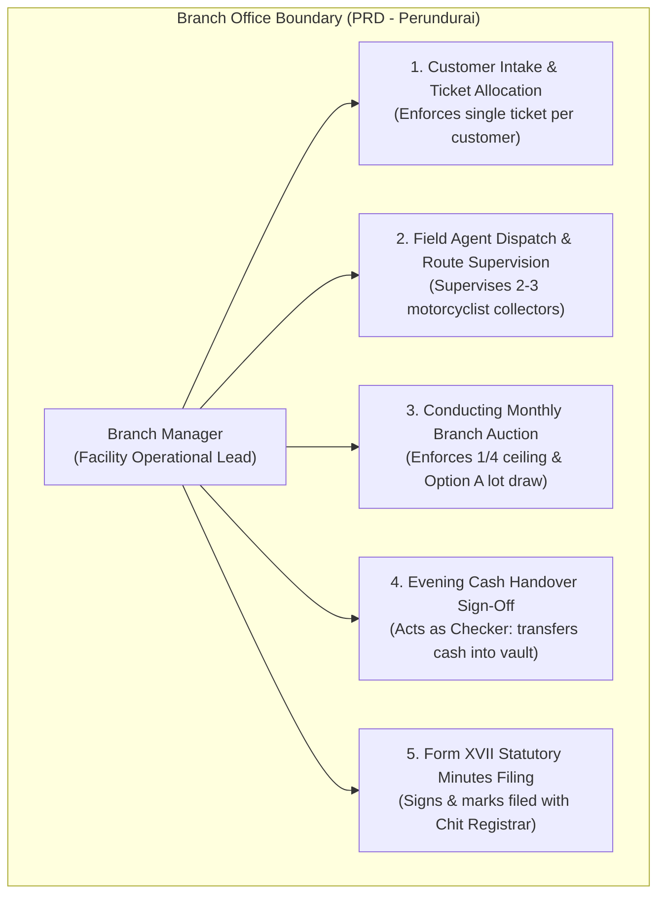
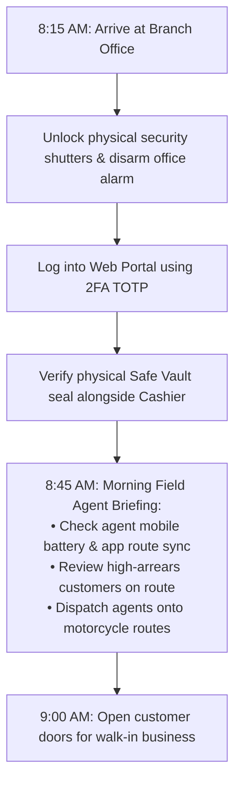
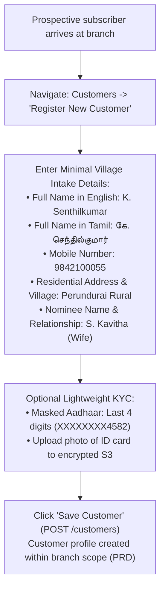
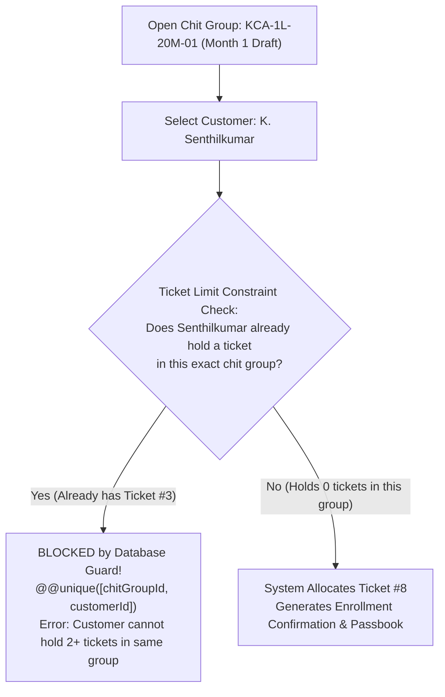
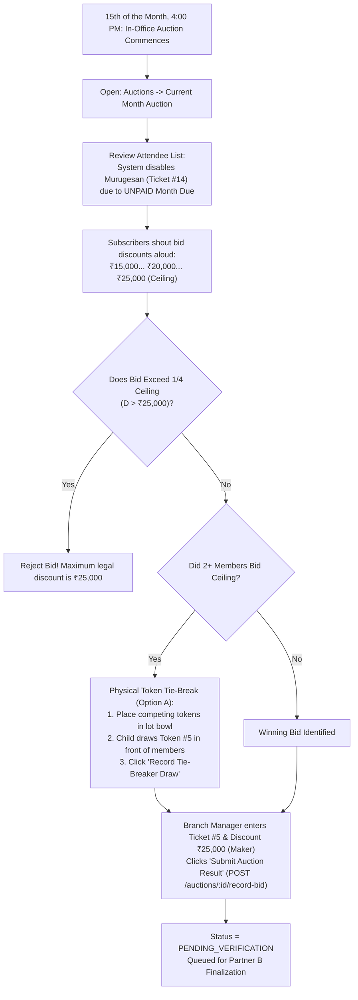
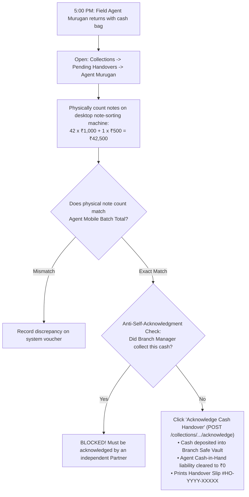
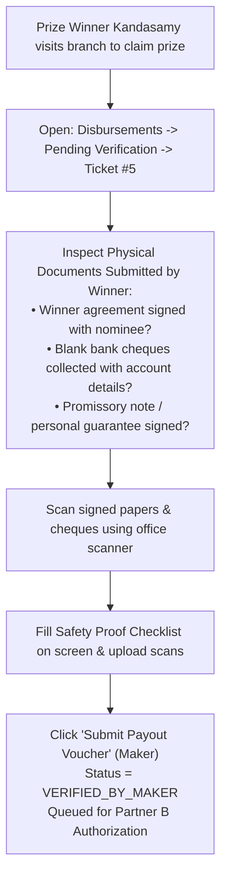
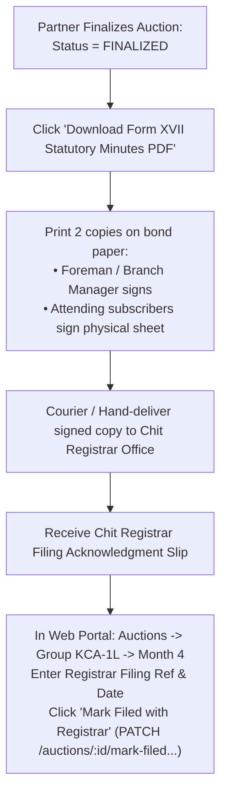
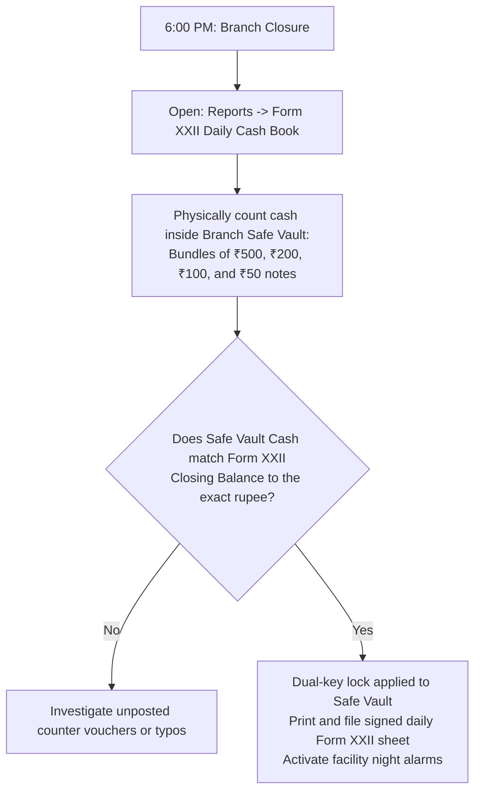

# Kumaran Chits — Branch Manager Operations Manual

> **Product**: **Kumaran Chits**  
> **Company**: **Kumaran Finance** (Head Office: Perundurai, Erode, Tamil Nadu)  
> **Target Persona**: **Branch Manager / Operational Lead (`BRANCH_MANAGER`)**  
> **Primary Platform**: **Web Portal (`apps/web/`)** (Branch-Scoped Workspace)  
> **Operating Reality**: In current operations at Kumaran Finance, the 4 Partners directly execute Branch Manager duties. However, the system enforces this role as a distinct, branch-scoped persona to govern branch-level operations and future branch expansions.  
> **Core Role in Governance**: Operational Maker for branch auctions and customer intake; Checker for field agent cash handovers.

---

## 1. Operating Reality & Facility Leadership

The **Branch Manager** is the operational captain of a physical facility (e.g., Head Office - Perundurai, code `PRD`):
- Supervising branch staff: the Desk Accountant and the 2 to 3 Field Collection Agents.
- Leading local customer onboarding and verifying lightweight KYC records.
- Conducting the **monthly in-person chit auctions** at the branch counter in the presence of attending subscribers.
- Supervising the cash desk, counting evening cash handovers from field agents, and ensuring the branch vault balances to the last rupee.

### Strict Branch Scoping & Anti-BOLA Security (OWASP Top 10):
To prevent cross-branch data leaks, the Kumaran Chits platform enforces strict **Branch Scoping (`user.branchId === item.branchId`)**:
- A Branch Manager assigned to Perundurai (`PRD`) can **only** access subscribers, tickets, collections, and cash books belonging to Perundurai.
- If a manager attempts to open a document or voucher from a different branch, the backend's security guard immediately blocks the request with `HTTP 403 Forbidden`.

---

## 2. Daily Workflow Index & Action Diagrams

| Section | Operational Action | Role / Dual-Control | Primary Interface |
|---|---|:---:|:---:|
| **§3** | Morning Branch Facility Opening & Route Dispatch | Single Actor | Physical Desk & Web Portal |
| **§4** | Branch Customer Intake & KYC Verification | Single Actor | Web Portal (`POST /customers`) |
| **§5** | Ticket Allocation (Single-Ticket Limit Constraint) | Single Actor | Web Portal (`POST /chits/:id/tickets/assign`) |
| **§6** | Conducting In-Office Monthly Auctions (Maker Role) | Maker Role | Web Portal (`POST /auctions/:id/record-bid`) |
| **§7** | Evening Cash Handover Sign-Off into Branch Vault | Checker Role | Web Portal (`POST /collections/.../acknowledge`) |
| **§8** | Verifying Prize Winner Safety Proof Checklist | Maker Role | Web Portal (`POST /disbursements/...`) |
| **§9** | Statutory Form XVII Minutes Signing & Registrar Filing | Operational Lead | Web Portal (`PATCH /auctions/.../mark-filed...`) |
| **§10** | Branch Form XXII Cash Book & Vault Count | Daily Closing | Web Portal (`GET /reports/form-xxii`) |

---

## 3. Morning Branch Facility Opening & Route Dispatch

### Step-by-Step Instructions:
1. Arrive at the branch at 8:15 AM. Unlock physical facility doors and disable security alarms.
2. Log into the Web Portal with your 10-digit mobile number, password, and Microsoft Authenticator TOTP.
3. Open the safe vault with the Desk Accountant and verify the opening cash balance against yesterday's Form XXII register.
4. Conduct the 15-minute morning briefing with field collection agents:
   - Ensure all agents have synchronized their routes on the branch Wi-Fi.
   - Review high-priority defaulter visits and route plans.
5. Dispatch agents onto their motorcycle routes and open customer service counters at 9:00 AM.

---

## 4. Branch Customer Intake & KYC Verification

### Step-by-Step Instructions:
1. Go to **Customers $\to$ "Register New Customer"** on the Web Portal.
2. In keeping with our rural village operating context, enter minimal customer details:
   - Full Name in English and தமிழ்.
   - 10-Digit Mobile Phone Number.
   - Residential Address and Village landmark.
   - Nominee Full Name and Relationship.
3. **Lightweight KYC Scans**:
   - Enter strictly the masked last 4 digits of Aadhaar (`XXXXXXXX1234`) or PAN to comply with DPDP Act regulations.
   - Capture a photo of the ID document using the webcam or file upload.
4. Click **"Save Customer"** (`POST /customers`). The customer profile is immediately registered within the `PRD` branch scope.

---

## 5. Ticket Allocation (Single-Ticket Limit Constraint)

### Step-by-Step Instructions:
1. Open the draft chit scheme under **Chit Schemes $\to$ Ticket Management**.
2. Select an unallocated ticket (e.g., `Ticket #8`).
3. Search and select the customer to assign.
4. **The Ticket Limit Constraint Guard (`CONFIRMED-BY-DEVELOPER`)**:
   - A customer can join multiple different chit schemes.
   - However, **a customer can NEVER hold 2 or more tickets in the same chit scheme**.
   - If you attempt to assign a second ticket to an existing subscriber in the same group, the backend rejects it with `HTTP 409 Conflict: Customer already holds a ticket in this scheme`.
5. Confirm ticket allocation (`POST /chits/:id/tickets/assign`).

---

## 6. Conducting In-Office Monthly Auctions (Maker Role)

### Step-by-Step Instructions:
1. Gather participating subscribers in the branch auction room at 4:00 PM.
2. Open **Auctions $\to$ Active Auctions** on the branch PC.
3. Verify attendee eligibility: any member with unpaid dues for the month is automatically disabled from bidding.
4. Oversee the bidding:
   - Ensure bids do not exceed the **one-fourth (1/4) ceiling** ($D \le \text{₹}25,000$).
   - If multiple members bid the ceiling, conduct the **Option A Physical Paper Token Draw** live in the room.
5. In the portal, select the winning ticket number, enter the winning bid discount, and click **"Submit Auction Result"** (`POST /auctions/:id/record-bid`).
6. The result enters `PENDING_VERIFICATION` status, ready for Partner Checker finalization.

---

## 7. Evening Cash Handover Sign-Off into Branch Vault (Checker Role)

### Step-by-Step Instructions:
1. At 5:00 PM, receive the physical cash bag from the field collection agent.
2. Place the currency notes into the counter sorting machine to verify the exact count.
3. Open **Collections $\to$ Pending Handovers** on the Web Portal.
4. Verify that the physical count matches the submitted mobile batch total.
5. **The Anti-Self-Acknowledgment Guard**: Ensure that you are not acknowledging cash collected under your own user profile (`collector_user_id != acknowledger_user_id`).
6. Click **"Acknowledge Cash Handover"** (`POST /collections/cash-handover/acknowledge`).
   - The money is officially transferred into the **Branch Safe Vault**.
   - The field agent's liability is cleared to `₹0`.
   - Issue the printed Handover Clearance Slip to the agent.

---

## 8. Verifying Prize Winner Safety Proof Checklist (Maker Role)

### Step-by-Step Instructions:
1. Open **Disbursements $\to$ Pending Verification $\to$ Ticket #5**.
2. Inspect the physical papers provided by the prized subscriber.
3. Complete the **Company Safety Proof Checklist**:
   - Check off each submitted item (agreement, nominee signature, blank cheques, promissory note).
   - Enter bank name and cheque numbers.
   - Upload scanned copies to encrypted S3 storage.
4. Select the requested payout mode (**Account Payee Cheque**, **NEFT/RTGS**, or **Cash**).
5. Click **"Submit Payout Voucher"** (`POST /disbursements/auction/:id/verify-safety-proof`). Status transitions to `VERIFIED_BY_MAKER`.

---

## 9. Statutory Form XVII Minutes Signing & Registrar Filing

### Step-by-Step Instructions:
1. Once Partner B finalizes the auction, navigate to **Auctions $\to$ Auction Minutes**.
2. Click **"Download Form XVII Minutes PDF"**.
3. Print two copies on official paper.
4. Affix your branch manager signature and collect signatures from the attending subscribers.
5. Submit one signed original copy to the **Chit Registrar** (Government of Tamil Nadu) in compliance with the Chit Funds Act, 1982.
6. When the registrar issues the acknowledgment stamp, open the auction screen and click **"Mark Filed with Registrar"** (`PATCH /auctions/:auctionId/mark-filed-with-registrar`), entering the filing reference number and filing date.

---

## 10. Branch Form XXII Cash Book & Vault Count

### Step-by-Step Instructions:
1. At 6:00 PM, initiate the formal branch closing procedure.
2. Open **Reports $\to$ Form XXII Daily Cash Book**.
3. Count all physical currency bundles inside the heavy branch safe vault.
4. Verify that the physical cash matches the system closing balance to the last rupee.
5. Print the Form XXII sheet, sign your initials alongside the Cashier and Partner, apply the dual-key lock to the vault, and set the night alarm.
