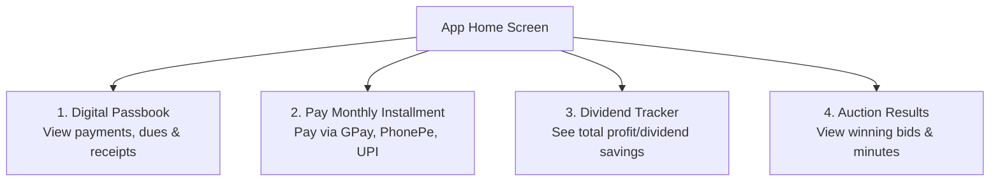

# Kumaran Chits — Customer Mobile App Guide

> **Product**: **Kumaran Chits** (Kumaran Finance)  
> **Target Users**: Chit Subscribers / Members  
> **Platform**: Android Mobile App (Flutter)  
> **Languages**: Bilingual (English & தமிழ்)

---

## 1. Getting Started & Logging In

1. Download the **Kumaran Chits Customer App** from the Google Play Store.
2. Enter your 10-digit mobile number registered with Kumaran Finance.
3. Enter the SMS verification OTP.
4. Set your private **6-digit MPIN** (or enable Fingerprint Unlock) for instant login in the future.
5. Select your preferred display language: **English** or **தமிழ் (Tamil)**.

---

## 2. Main Features

### 2.1 Viewing Your Digital Passbook
- Tap **"My Chits / எனது சீட்டுகள்"**.
- View your active chit groups, ticket numbers, and current status:
  - **Due Amount**: Exact amount payable for the upcoming month (with dividend deduction already applied).
  - **Due Date**: Payment cutoff date.
- Tap any completed month to view and download your **Bilingual PDF Receipt (English + Tamil)**.

### 2.2 Paying Online via UPI (GPay / PhonePe / Paytm)
1. On the home screen, tap **"Pay Due / பணம் செலுத்துக"**.
2. Review the breakdown:
   - Base Installment: ₹5,000
   - Minus Dividend: -₹1,300
   - **Net Payable: ₹3,700** (Single discrete monthly installment; partial payments and advance balances are not permitted).
3. Tap **"Pay with UPI"**.
4. Select your preferred payment app (Google Pay, PhonePe, Paytm, or BHIM).
5. Authorize the payment in your UPI app.
6. Return to Kumaran Chits — your payment is instantly confirmed, and a digital receipt is issued immediately.

### 2.3 Auction Schedule & Results
- Check when the next in-office auction will be held at the Perundurai branch.
- **Auction Eligibility**: If you have an unpaid installment due for the current month, you cannot participate or bid in that month's auction.
- View past auction results:
  - Winning ticket number and winner's name.
  - Winning bid discount.
  - Dividend credited to your ticket (**Universal Dividend**: shared equally among all members, including the auction winner).

---

## 3. Help & Support
- Tap **"Contact Branch / கிளை தொடர்பு"** to place a direct phone call to the Kumaran Finance Head Office in Perundurai (`0424-2223333`).
- View branch address and working hours.
