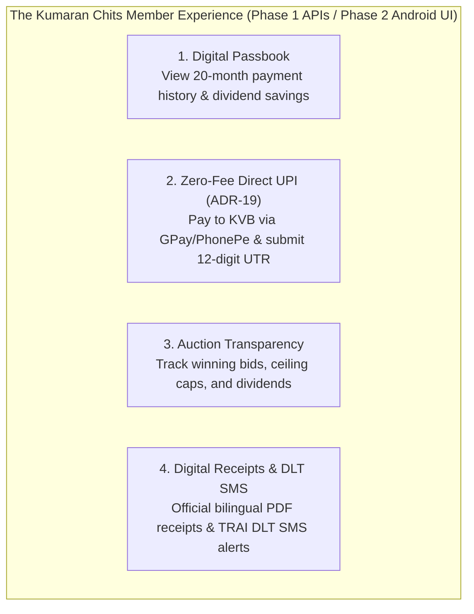
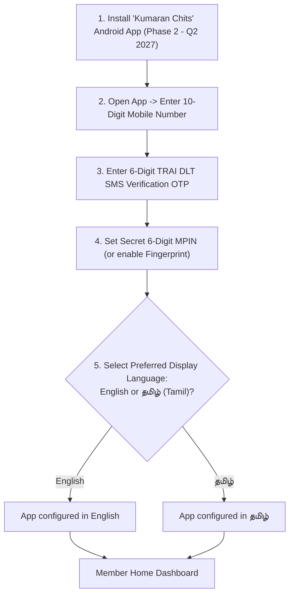
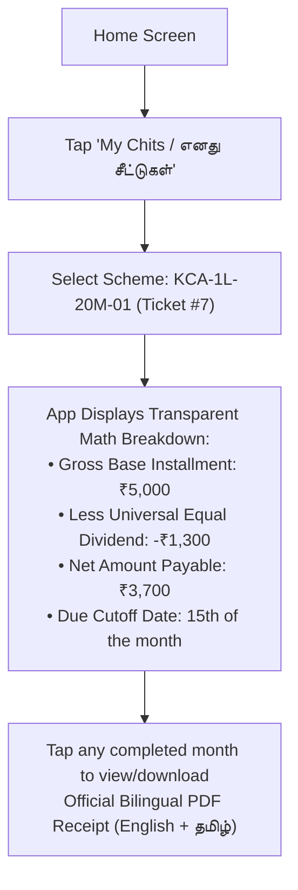
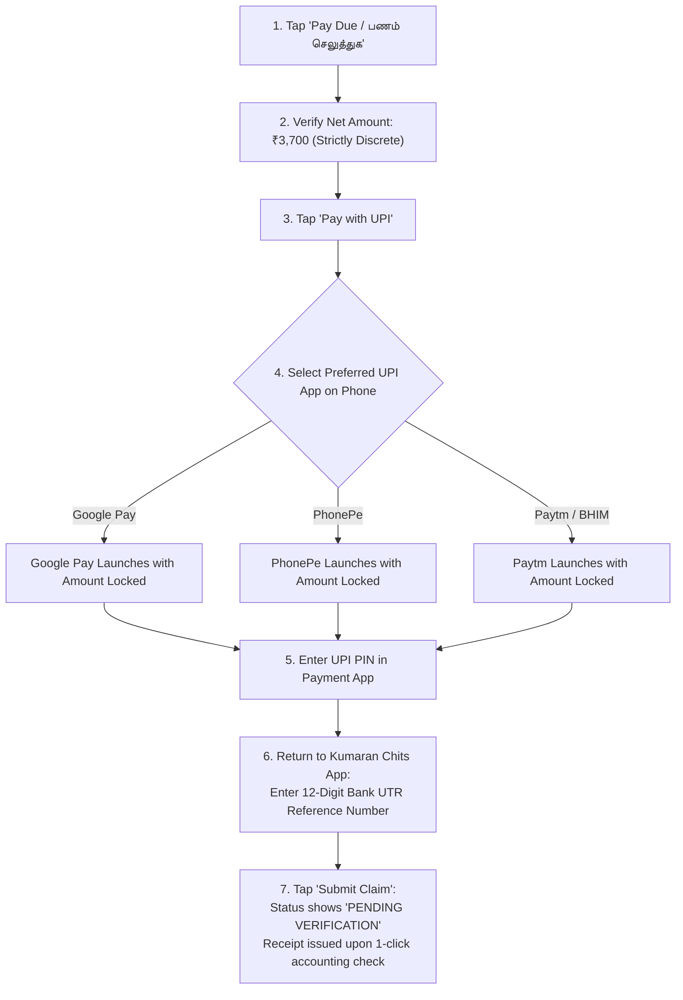
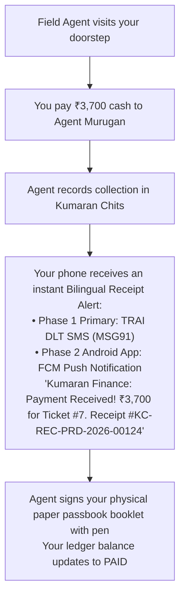
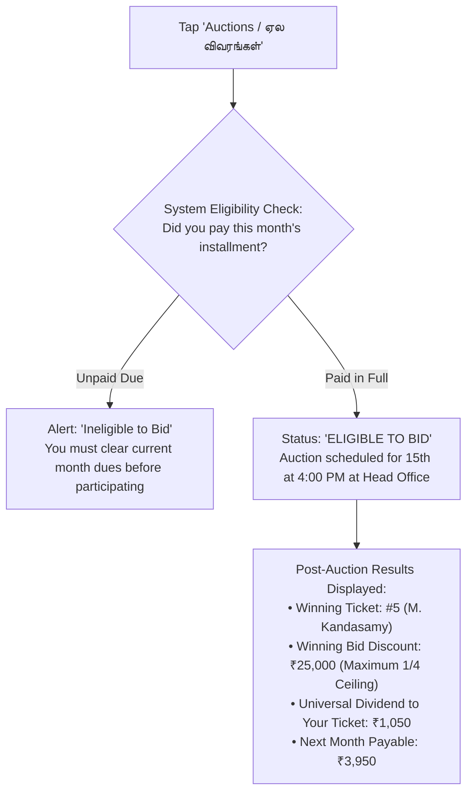
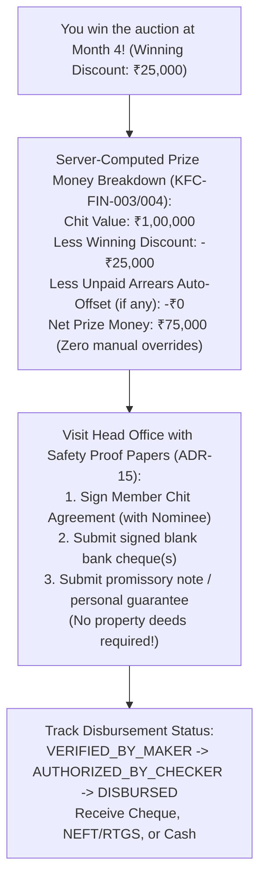
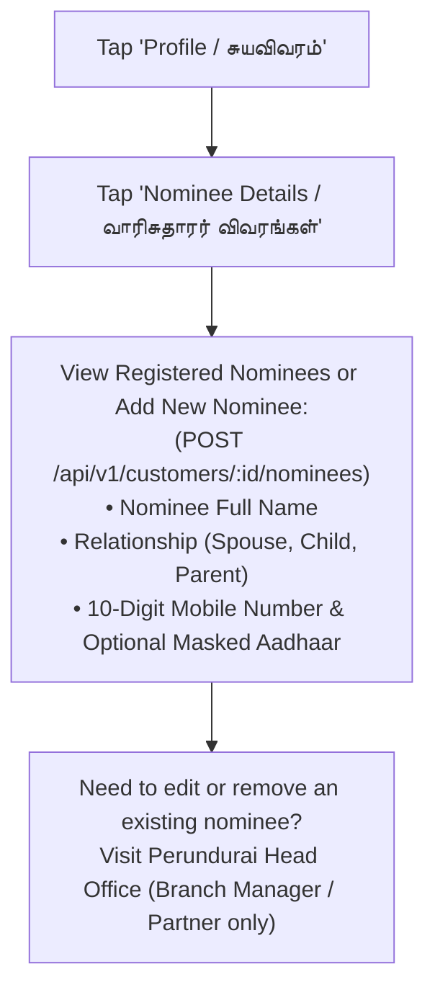
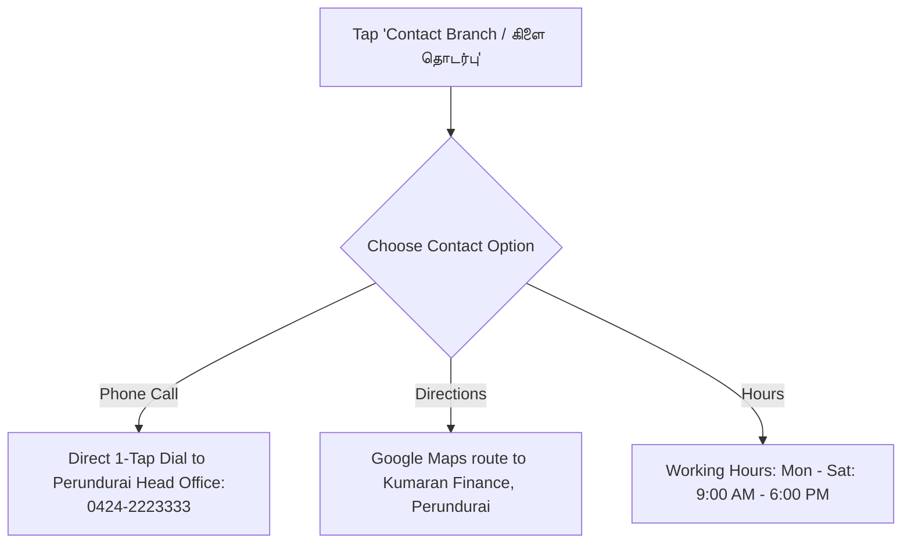
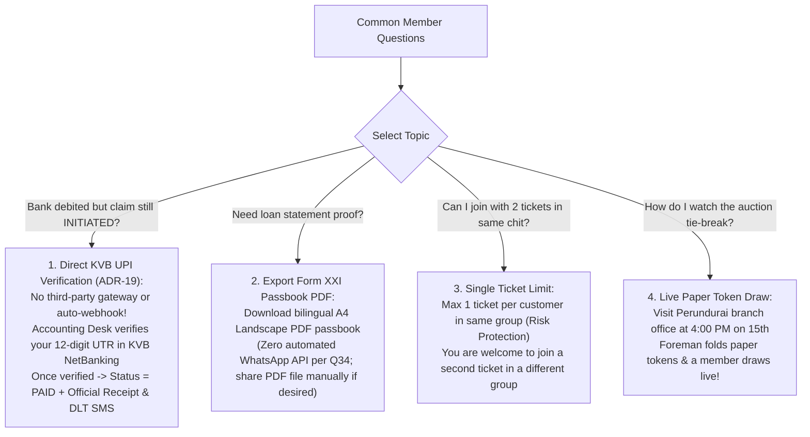

# Kumaran Chits — Customer Mobile App Guide

> **Product**: **Kumaran Chits**  
> **Company**: **Kumaran Finance** (Head Office: Perundurai, Erode, Tamil Nadu)  
> **Target Audience**: **Chit Subscribers / Members (சந்தாதாரர்கள்)**  
> **Platform Delivery (`ADR-26`)**: **Phase 1 (Live 2026)**: Bilingual A5 Counter Receipts, Form XXI PDF Passbooks (issued at Perundurai branch desk), Bilingual TRAI DLT SMS Alerts (`ADR-23`), & Direct Zero-Fee KVB UPI (`ADR-19`) | **Phase 2 (Q2 2027)**: Native Android Mobile App (Flutter UI + Google Play APK, built atop the already-implemented Dart Core SDK in `apps/mobile/lib/core/`)  
> **Languages Supported**: **Bilingual (English & தமிழ்)**  
> **Core Value**: Complete financial transparency, digital passbook access, zero-fee NPCI UPI payments, and zero surprise fees.

> [!IMPORTANT]
> **Phase 1 vs. Phase 2 Rollout Notice (`ADR-26`)**: Per Kumaran Finance's authoritative Phase 1 launch directive, the native **Flutter Android UI and Google Play Store APK are deferred to Phase 2 (Q2 2027)** (`apps/mobile/lib/core/` already contains the typed Dart API models and offline synchronization layer). During **Phase 1 (2026)**, subscribers receive official printed bilingual A5 receipts, signed Form XXI PDF passbooks from the Perundurai Head Office desk, instant **bilingual TRAI DLT SMS confirmations (`ADR-23`)**, and direct Karur Vysya Bank UPI payment links (`ADR-19`). The mobile app workflows below describe the canonical Phase 2 Android subscriber experience backed by the live Phase 1 REST APIs.

---

## 1. Operating Overview & Member Welcome

Welcome to **Kumaran Chits**, the official member service experience of Kumaran Finance. Built specifically for our subscribers in Perundurai and across Tamil Nadu, the Phase 2 Android app (backed by live Phase 1 APIs) puts your chit passbook directly into your pocket:
- Check your monthly installment dues and dividend savings 24/7.
- Pay your monthly dues directly to Kumaran Finance's Karur Vysya Bank account with **₹0 gateway fees** via Google Pay, PhonePe, Paytm, or BHIM UPI (`ADR-19`).
- View live auction results, winning discounts, and next month's discounted dues.
- Access bilingual digital receipts and Form XXI 20-month passbooks anytime without visiting the branch.

---

## 2. Member Journey Index & Action Diagrams

| Section | Member Action | Languages | Primary Feature |
|---|---|:---:|:---:|
| **§3** | First-Time Setup, OTP & Language Selection *(Phase 2 App)* | English & தமிழ் | Mobile App Registration |
| **§4** | Digital Passbook & 20-Month Ledger Inspection | English & தமிழ் | Form XXI Passbook |
| **§5** | Direct Zero-Fee UPI Payment & Bank UTR Claim (`ADR-19`) | English & தமிழ் | NPCI Native UPI Intent |
| **§6** | Doorstep Cash Payment & Bilingual Receipt Alerts (`ADR-23/26`) | English & தமிழ் | TRAI DLT SMS / Push Alert |
| **§7** | Auction Eligibility Check & Live Results Tracker | English & தமிழ் | Auction Tracker |
| **§8** | Prize Winner Claim & Company Safety Proof (`ADR-15`) | English & தமிழ் | Payout Status Screen |
| **§9** | Viewing & Submitting Nominee Details | English & தமிழ் | Profile Settings |
| **§10** | Branch Office Direct Phone Contact & Support | English & தமிழ் | Help Desk |
| **§11** | Member FAQs, PDF Export & Troubleshooting | English & தமிழ் | Member Self-Service |

---

## 3. First-Time Setup, OTP & Language Selection *(Phase 2 Android Rollout)*

### Step-by-Step Instructions:
1. *(Phase 2 — Q2 2027)* Install **Kumaran Chits** on your Android phone once published for Phase 2 rollout. *(In Phase 1, branch staff manage your passbook and issue instant bilingual A5 receipts & TRAI DLT SMS confirmations.)*
2. Enter your 10-digit mobile phone number registered with Kumaran Finance.
3. Enter the 6-digit TRAI DLT SMS verification code (`POST /api/v1/auth/mobile/request-otp` $\to$ `verify-otp`) sent to your phone.
4. Set a memorable **6-digit MPIN** (e.g., `482195`) or enable biometric unlock.
5. Choose your preferred display language: **English** or **தமிழ் (Tamil)**.
   *(You can switch languages anytime from the settings menu).*

---

## 4. Digital Passbook & 20-Month Ledger Inspection

### Step-by-Step Instructions:
1. On the home screen, tap **"My Chits / எனது சீட்டுகள்"**.
2. Select your active chit scheme (e.g., `KCA-1L-20M-01, Ticket #7`).
3. View your exact monthly breakdown:
   - **Base Installment ($I_{base}$)**: `₹5,000`
   - **Auction Dividend ($Div_{ticket}$)**: `-₹1,300`
   - **Net Amount Payable ($I_{net}$)**: **`₹3,700`**
4. Tap on any past month to inspect or download your **Bilingual Digital Receipt** showing the official receipt number, date, payment mode, and authorized cashier signature.

---

## 5. 1-Tap Online Installment Payment via UPI (GPay / PhonePe / Paytm)

### Step-by-Step Instructions:
1. Tap **"Pay Due / பணம் செலுத்துக"** on the home screen.
2. Review the payment details:
   - **Net Payable Amount**: `₹3,700` (Whole integer Rupees, after universal dividend deduction).
   - *(Note: Single discrete payments only; partial payments and advance balances are not permitted).*
3. Tap **"Pay with UPI"**. The app automatically builds an official NPCI deep-link locking our Karur Vysya Bank payee details (`kumaranfinance@kvb`).
4. Select your preferred UPI payment application: **Google Pay**, **PhonePe**, **Paytm**, or **BHIM**.
5. The UPI app opens with the exact amount (`₹3,700`) and transaction note locked. Authorize the payment using your secret UPI PIN.
6. Copy the **12-digit Bank UTR / Reference Number** (e.g., `429188123456`) displayed on your payment confirmation screen.
7. Return to the **Kumaran Chits** app, paste the UTR number, and tap **"Submit Claim"**.
8. Your payment claim is recorded instantly (`INITIATED`). As soon as the office accountant verifies the credit in the bank statement, your due is marked **`PAID`**, and your official bilingual receipt (`KC-REC-PRD-YYYY-XXXXX`) is delivered via instant Push Notification to your passbook!

---

## 6. Doorstep Cash Payment & Bilingual Receipt Alerts (`ADR-23` / `ADR-26`)

### Step-by-Step Instructions:
1. When our collection agent visits your premises, hand the exact net installment in cash.
2. The agent records the payment via the responsive web portal (or Phase 2 Android app).
3. Your mobile phone receives an official bilingual **TRAI DLT SMS receipt confirmation** (Phase 1 primary per `ADR-23`; plus Android FCM Push Notification in Phase 2 per `ADR-26`):
   - *"குமரன் பைனான்ஸ்: ரசீது எண் KC-REC-PRD-2026-00124. தொகை ₹3,700 பெறப்பட்டது."*
4. Ensure the agent writes the receipt number and signs your physical paper passbook booklet.

---

## 7. Auction Eligibility Check & Live Results Tracker

### Step-by-Step Instructions:
1. Tap **"Auctions / ஏல விவரங்கள்"** to check the auction schedule for your chit group.
2. **Auction Ineligibility Rule (`CONFIRMED-BY-DEVELOPER`)**:
   - If your installment for the current month is unpaid, the app displays: **`INELIGIBLE (UNPAID DUE)`**.
   - You must settle your current due before you can participate or call out bids in the branch auction.
3. **Universal Equal Dividend (`CONFIRMED-BY-DEVELOPER`)**:
   - Once the auction concludes, view the winning bid discount and the dividend allocated to your ticket.
   - Kumaran Finance deducts the **exact same dividend for ALL members**, including past auction winners.

---

## 8. Prize Winner Claim & Company Safety Proof (`ADR-15`)

### Step-by-Step Instructions:
1. When you win the in-office auction, your net prize money is automatically computed by the server as $V - D - \text{Unpaid Arrears Offset}$ (e.g., `₹1,00,000 - ₹25,000 = ₹75,000`). Manual payout overrides are strictly disallowed (`KFC-FIN-004`), and any pending unpaid installments on the winning ticket are automatically offset before release (`KFC-FIN-003`).
2. Visit the Perundurai Head Office with your nominee to complete the standard **Company Safety Proof Checklist**:
   - Sign the Winner Chit Agreement alongside your registered nominee.
   - Provide signed blank bank cheques with bank details.
   - Provide a standard promissory note / personal guarantee.
   - *(Note: Property deeds are completely eliminated).*
3. Once Verified Partner B authorizes your voucher (`AUTHORIZED_BY_CHECKER`), funds are disbursed via Account Payee Cheque, NEFT/RTGS, or Cash (`DISBURSED`).

---

## 9. Viewing & Submitting Nominee Details

### Step-by-Step Instructions:
1. Tap **"Profile"** in the menu and open **"Nominee Details"** (`GET /api/v1/customers/:id`).
2. Confirm that your nominee’s legal name, relationship, and contact mobile number are accurate.
3. To register a new nominee on your own profile, submit the details (`POST /api/v1/customers/:id/nominees`, strictly scoped to self).
4. To **modify or remove** an existing nominee or update core KYC/contact details (`PATCH /api/v1/customers/:id`, `DELETE /api/v1/customers/:id/nominees/:nomineeId`), visit the Perundurai Head Office so a Branch Manager or Managing Partner can verify and process the change.

---

## 10. Branch Office Contact & Support

### Step-by-Step Instructions:
- **Phone**: Tap the call icon to dial our Perundurai Head Office directly at `0424-2223333`.
- **Address**: Kumaran Finance, Main Road, Perundurai, Erode District, Tamil Nadu.
- **Operating Hours**: Monday through Saturday, 9:00 AM to 6:00 PM.

---

## 11. Member FAQs, PDF Export & Troubleshooting

### Frequently Asked Questions:
1. **My bank account was debited via Google Pay / PhonePe, but my due still shows "INITIATED / Pending Verification"?**
   - Don't worry — your money went directly into Kumaran Finance's Karur Vysya Bank (KVB) current account with **₹0 gateway fees (`ADR-19`)**. Because we do not use a commercial third-party payment gateway or automated webhooks, receipts are not auto-issued on bank debit.
   - Make sure you submitted your exact **12-digit Bank UTR reference number** (`POST /api/v1/payments/upi-claim`).
   - Our Accounting Desk verifies incoming KVB credits during branch hours (`POST /api/v1/payments/:id/verify-upi-claim`), after which your due immediately updates to **`PAID`** and your bilingual receipt & TRAI DLT SMS are issued. If your claim remains `INITIATED` after business hours, call the Perundurai office with your 12-digit UTR (and our 06:00 AM IST sweep flags stale claims for staff follow-up).
2. **How can I obtain my 20-month payment record for a bank loan or verification?**
   - Request a printed/PDF **Form XXI Passbook** (A4 Landscape) from the Perundurai branch desk during Phase 1, or download it directly under **"My Chits" $\to$ "Form XXI Passbook"** in Phase 2 (`GET /api/v1/reports/form-xxi`).
   - *(Note: Kumaran Finance does not send automated WhatsApp Business API messages per `Q34` / `KFC-NOT-001`; you may manually save and share your downloaded PDF passbook file with your bank officer using your phone's standard file share sheet.)*
3. **Can I buy two tickets in the same ₹1,00,000 group?**
   - No. Under Kumaran Finance's risk-management rules, a subscriber can hold a maximum of 1 ticket in any single group (`@@unique([chitGroupId, customerId])`).
   - If you want to save more, our staff can enroll you in a second chit group running on a different monthly cycle.
4. **If two people bid the ₹25,000 ceiling, how do you decide who wins?**
   - We do not use computer algorithms or software lotteries.
   - The Foreman conducts a transparent **Option A Physical Paper Token Draw** live in the Perundurai branch room. The competing ticket numbers are written on paper slips, placed into a steel bowl, and an attendee or child draws the winning token in front of everyone.
