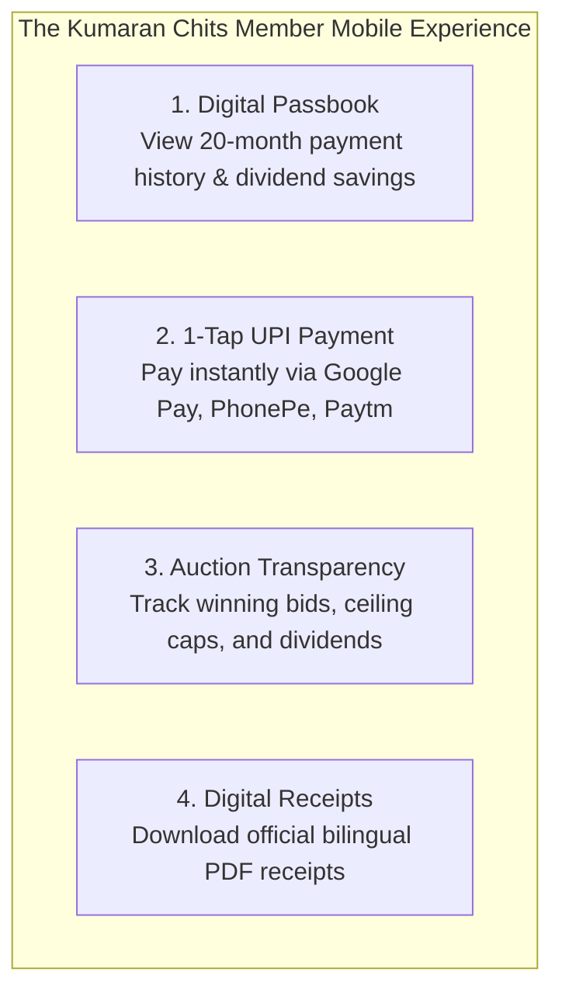
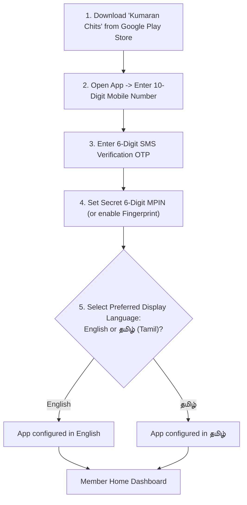
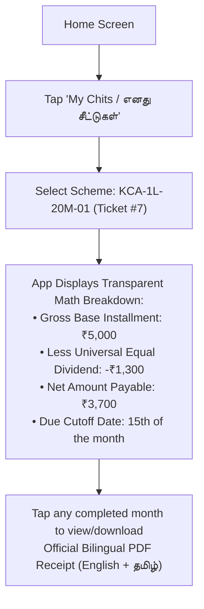
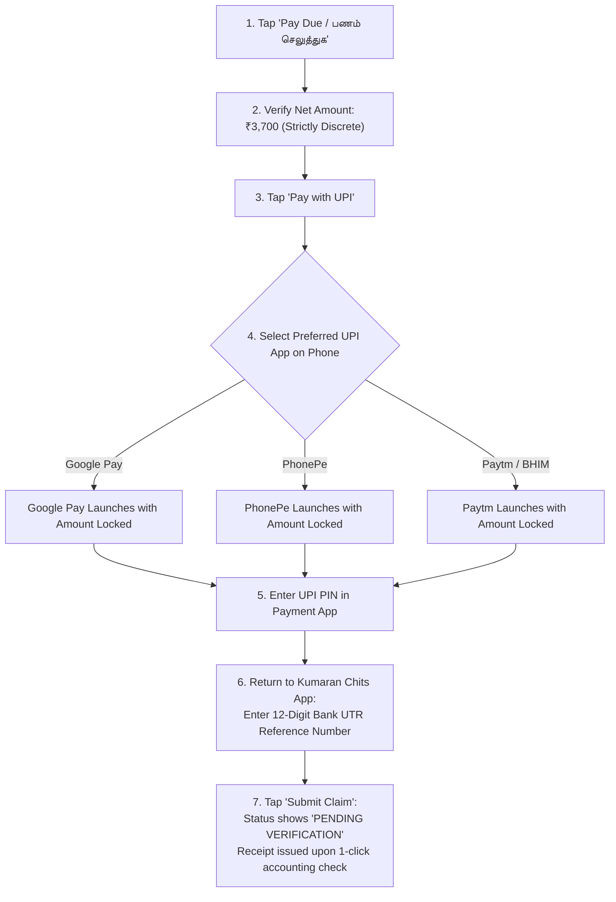
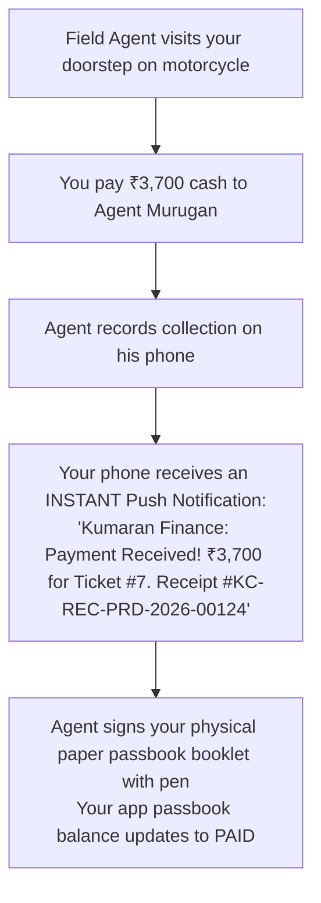
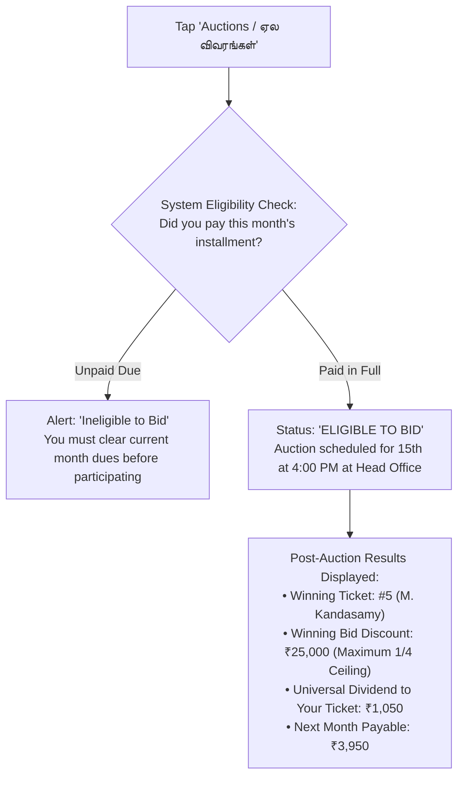
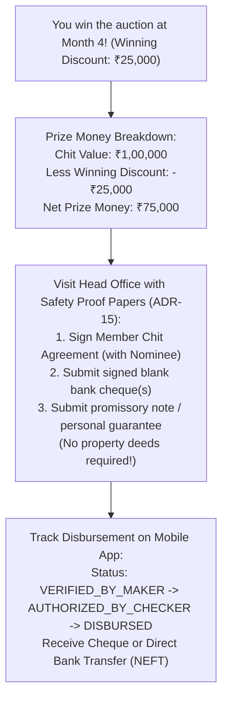
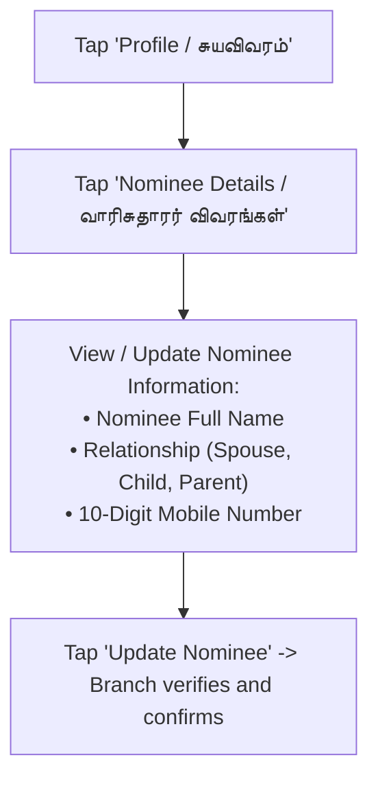
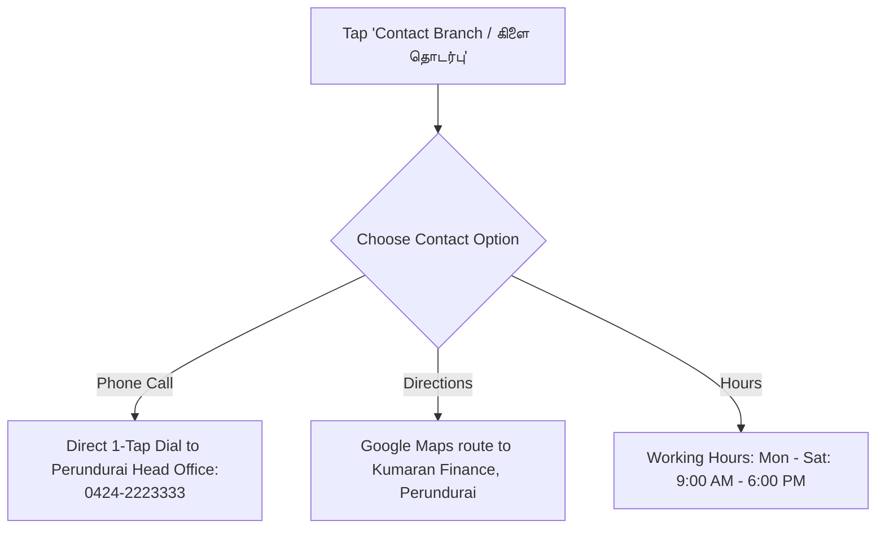
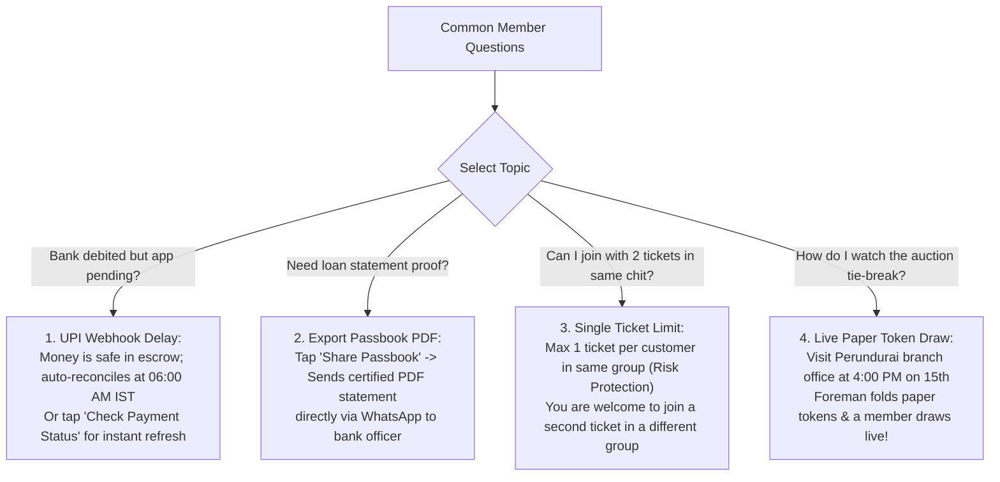

# Kumaran Chits — Customer Mobile App Guide

> **Product**: **Kumaran Chits**  
> **Company**: **Kumaran Finance** (Head Office: Perundurai, Erode, Tamil Nadu)  
> **Target Audience**: **Chit Subscribers / Members (சந்தாதாரர்கள்)**  
> **Primary Platform**: **Android Mobile App (Flutter in `apps/mobile/`)**  
> **Languages Supported**: **Bilingual (English & தமிழ்)**  
> **Core Value**: Complete financial transparency, digital passbook access, 1-tap UPI payments, and zero surprise fees.

---

## 1. Operating Overview & Member Welcome

Welcome to **Kumaran Chits**, the official mobile self-service app of Kumaran Finance. Built specifically for our subscribers in Perundurai and across Tamil Nadu, this app puts your chit passbook directly into your pocket:
- Check your monthly installment dues and dividend savings 24/7.
- Pay your monthly dues in seconds using Google Pay, PhonePe, Paytm, or BHIM UPI.
- View live auction results, winning discounts, and next month's discounted dues.
- Access bilingual digital receipts and Form XXI 20-month passbooks anytime without visiting the branch.

---

## 2. Member Journey Index & Action Diagrams

| Section | Member Action | Languages | Primary Feature |
|---|---|:---:|:---:|
| **§3** | First-Time Setup, OTP & Language Selection | English & தமிழ் | Mobile App Registration |
| **§4** | Digital Passbook & 20-Month Ledger Inspection | English & தமிழ் | Passbook Screen |
| **§5** | 1-Tap Online Installment Payment via UPI | English & தமிழ் | UPI Intent Gateway |
| **§6** | Doorstep Cash Payment & Push Notification Receipt | English & தமிழ் | Cash Collection Alert |
| **§7** | Auction Eligibility Check & Live Results Tracker | English & தமிழ் | Auction Tracker |
| **§8** | Prize Winner Claim & Company Safety Proof | English & தமிழ் | Payout Status Screen |
| **§9** | Managing Nominee Details & Profile Updates | English & தமிழ் | Profile Settings |
| **§10** | Branch Office Direct Phone Contact & Support | English & தமிழ் | Help Desk |
| **§11** | Member FAQs, WhatsApp Sharing & Troubleshooting | English & தமிழ் | Member Self-Service |

---

## 3. First-Time Setup, OTP & Language Selection

### Step-by-Step Instructions:
1. Download and install **Kumaran Chits** from the Google Play Store on your Android phone.
2. Enter your 10-digit mobile phone number registered with Kumaran Finance.
3. Enter the 6-digit SMS verification code sent to your phone.
4. Set a memorable **6-digit MPIN** (e.g., `482195`) or scan your fingerprint to enable 1-second biometric login.
5. Choose your preferred display language: **English** or **தமிழ் (Tamil)**.
   *(You can switch languages anytime from the settings menu).*

---

## 4. Digital Passbook & 20-Month Ledger Inspection

### Step-by-Step Instructions:
1. On the home screen, tap **"My Chits / எனது சீட்டுகள்"**.
2. Select your active chit scheme (e.g., `KCA-1L-20M-01, Ticket #7`).
3. View your exact monthly breakdown:
   - **Base Installment ($I_{base}$)**: `₹5,000`
   - **Auction Dividend ($Div_{ticket}$)**: `-₹1,300`
   - **Net Amount Payable ($I_{net}$)**: **`₹3,700`**
4. Tap on any past month to inspect or download your **Bilingual Digital Receipt** showing the official receipt number, date, payment mode, and authorized cashier signature.

---

## 5. 1-Tap Online Installment Payment via UPI (GPay / PhonePe / Paytm)

### Step-by-Step Instructions:
1. Tap **"Pay Due / பணம் செலுத்துக"** on the home screen.
2. Review the payment details:
   - **Net Payable Amount**: `₹3,700` (Whole integer Rupees, after universal dividend deduction).
   - *(Note: Single discrete payments only; partial payments and advance balances are not permitted).*
3. Tap **"Pay with UPI"**. The app automatically builds an official NPCI deep-link locking our Karur Vysya Bank payee details (`kumaranfinance@kvb`).
4. Select your preferred UPI payment application: **Google Pay**, **PhonePe**, **Paytm**, or **BHIM**.
5. The UPI app opens with the exact amount (`₹3,700`) and transaction note locked. Authorize the payment using your secret UPI PIN.
6. Copy the **12-digit Bank UTR / Reference Number** (e.g., `429188123456`) displayed on your payment confirmation screen.
7. Return to the **Kumaran Chits** app, paste the UTR number, and tap **"Submit Claim"**.
8. Your payment claim is recorded instantly (`INITIATED`). As soon as the office accountant verifies the credit in the bank statement, your due is marked **`PAID`**, and your official bilingual receipt (`KC-REC-PRD-YYYY-XXXXX`) is delivered via instant Push Notification to your passbook!

---

## 6. Doorstep Cash Payment & Push Notification Receipt

### Step-by-Step Instructions:
1. When our collection agent visits your premises, hand the exact net installment in cash.
2. The agent records the payment on his mobile phone.
3. Within 3 seconds, your smartphone will chime with an official **Push Notification**:
   - *"குமரன் பைனான்ஸ்: ரசீது எண் KC-REC-PRD-2026-00124. தொகை ₹3,700 பெறப்பட்டது."*
4. Ensure the agent writes the receipt number and signs your physical paper passbook booklet.

---

## 7. Auction Eligibility Check & Live Results Tracker

### Step-by-Step Instructions:
1. Tap **"Auctions / ஏல விவரங்கள்"** to check the auction schedule for your chit group.
2. **Auction Ineligibility Rule (`CONFIRMED-BY-DEVELOPER`)**:
   - If your installment for the current month is unpaid, the app displays: **`INELIGIBLE (UNPAID DUE)`**.
   - You must settle your current due before you can participate or call out bids in the branch auction.
3. **Universal Equal Dividend (`CONFIRMED-BY-DEVELOPER`)**:
   - Once the auction concludes, view the winning bid discount and the dividend allocated to your ticket.
   - Kumaran Finance deducts the **exact same dividend for ALL members**, including past auction winners.

---

## 8. Prize Winner Claim & Company Safety Proof

### Step-by-Step Instructions:
1. When you win the in-office auction, your prize money is calculated as $V - D$ (e.g., `₹1,00,000 - ₹25,000 = ₹75,000`).
2. Visit the Perundurai Head Office with your nominee to complete the standard **Company Safety Proof Checklist**:
   - Sign the Winner Chit Agreement alongside your registered nominee.
   - Provide signed blank bank cheques with bank details.
   - Provide a standard promissory note / personal guarantee.
   - *(Note: Property deeds are completely eliminated).*
3. Track the status on your mobile app: as soon as the Partner authorizes your voucher, funds are disbursed via Cheque, NEFT, or Cash.

---

## 9. Managing Nominee Details & Profile Updates

### Step-by-Step Instructions:
1. Tap **"Profile"** in the bottom menu.
2. Open **"Nominee Details"**.
3. Confirm that your nominee’s legal name, relationship, and contact mobile number are accurate.
4. If an update is required, submit the changes for branch verification.

---

## 10. Branch Office Contact & Support

### Step-by-Step Instructions:
- **Phone**: Tap the call icon to dial our Perundurai Head Office directly at `0424-2223333`.
- **Address**: Kumaran Finance, Main Road, Perundurai, Erode District, Tamil Nadu.
- **Operating Hours**: Monday through Saturday, 9:00 AM to 6:00 PM.

---

## 11. Member FAQs, WhatsApp Sharing & Troubleshooting

### Frequently Asked Questions:
1. **My bank account was debited via Google Pay, but the app still says "UNPAID"?**
   - Don't worry, your money is completely safe. Occasionally, Indian UPI bank servers experience 30-to-60 second delays in notifying our system.
   - Tap **"Refresh Payment Status"** on your due screen. The system queries the payment gateway directly.
   - If a temporary network drop occurred, our automated background reconciler at **06:00 AM IST** matches bank settlement credits and issues your receipt automatically.
2. **How can I share my 20-month payment record for a bank loan or visa application?**
   - Open **"My Chits" $\to$ "Form XXI Passbook"**.
   - Tap **"Export PDF"** or the WhatsApp share icon.
   - The app generates an official digitally signed PDF passbook that you can share with your bank manager or accountant.
3. **Can I buy two tickets in the same ₹1,00,000 group?**
   - No. Under Kumaran Finance's risk-management rules, a subscriber can hold a maximum of 1 ticket in any single group (`@@unique([chitGroupId, customerId])`).
   - If you want to save more, our staff can enroll you in a second chit group running on a different monthly cycle.
4. **If two people bid the ₹25,000 ceiling, how do you decide who wins?**
   - We do not use computer algorithms or software lotteries.
   - The Foreman conducts a transparent **Option A Physical Paper Token Draw** live in the Perundurai branch room. The competing ticket numbers are written on paper slips, placed into a steel bowl, and an attendee or child draws the winning token in front of everyone.
