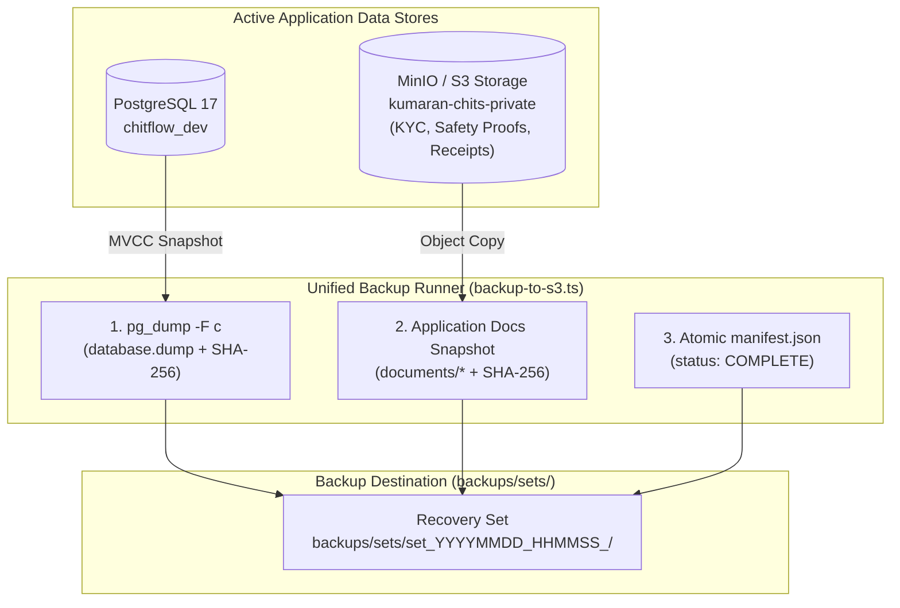

# KUMARAN CHITS — DATABASE BACKUP & DISASTER RECOVERY EVIDENCE

> **Product**: **Kumaran Chits**  
> **Company**: **Kumaran Finance** (Perundurai, Erode District, Tamil Nadu)  
> **Date**: November 14, 2026 (Updated for Phase A Implementation)  
> **Authority**: Principal PostgreSQL DR Architect & Backend Reliability Engineer  
> **Target Production Host**: Any Flat-Fee Linux VPS (~₹900–₹1,800/month) + Cloudflare R2 / S3 (₹0 Egress)

---

## 1. Disaster Recovery Objectives (Honest Operational Baseline)

As an Indian registered chit fund operating from a single physical branch in Perundurai with ~₹1–5 Crores under management, data loss or prolonged downtime directly violates Tamil Nadu Chit Funds Rules:

| Metric | Target | Technical Mechanism | Operational Reality |
|---|:---:|---|---|
| **RPO (Recovery Point Objective)** | **$\le$ 24 Hours** | Nightly unified recovery set (`pg_dump -F c` + MinIO document snapshot) | Continuous WAL archiving (PITR) is **NOT deployed**; RPO reflects daily 02:00 AM IST cron |
| **RTO (Recovery Time Objective)** | **$\le$ 2 Hours** | Containerized restoration from custom format archive via `pg_restore` + MinIO document restoration | Verified via automated isolated drill (`pnpm db:drp:drill`, measured at **~3.6 seconds**) |
| **Data Retention Standard** | **8 Years** | Statutory compliance with Section 45 of Chit Funds Act 1982 | Offsite cloud storage lifecycle policy (DEV retains 30 days locally/in MinIO) |

---

## 2. Backup Topology & Recovery Set Architecture



> [!IMPORTANT]
> **Audit Clarification on Encryption & Continuous WAL Archiving**:
> 1. Earlier draft documentation claimed "GPG symmetric encryption via `--passphrase-file`". GPG is **NOT implemented**. Backups rely on transport-level TLS and S3 Server-Side Encryption (`AES256` SSE-S3) when targeting S3/Cloudflare R2.
> 2. Continuous WAL archiving (such as `wal-g` or `pgBackRest`) is **NOT deployed**. The verified operational RPO is **$\le$ 24 hours**, backed by daily midnight logical dumps.
> 3. In the DEV environment, MinIO runs on the same Docker host as PostgreSQL. This protects against accidental deletion, application data corruption, and migration failures, but **does NOT protect against catastrophic host hardware failure**. True disaster recovery requires offsite storage (e.g. Cloudflare R2).

---

## 3. Recovery Set Manifest Schema

Every backup creates an atomic recovery set under `backups/sets/<setId>/` with a signed manifest:

```json
{
  "version": "1.0",
  "setId": "set_20261114_190154_1f2b487b",
  "timestamp": "2026-11-14T13:31:54.875Z",
  "status": "COMPLETE",
  "environment": "development",
  "sourceBucket": "kumaran-chits-private",
  "database": {
    "format": "custom",
    "dumpFile": "database.dump",
    "s3Key": "backups/sets/set_20261114_190154_1f2b487b/database.dump",
    "sizeBytes": 212277,
    "sha256": "255e3ca9e7ece58d...",
    "recordCounts": {
      "users": 9,
      "customers": 51,
      "chitGroups": 13,
      "tickets": 139,
      "installmentDues": 464,
      "payments": 433,
      "auditLogs": 521
    }
  },
  "documents": {
    "prefix": "backups/sets/set_20261114_190154_1f2b487b/documents/",
    "totalCount": 177,
    "totalSizeBytes": 2699081,
    "requiredCount": 76,
    "regenerableCount": 101,
    "files": [...]
  },
  "verification": {
    "completedAt": "2026-11-14T13:31:57.120Z",
    "durationMs": 2245
  }
}
```

---

## 4. Operational CLI Commands & Automation

| Command | Purpose |
|---|---|
| `pnpm db:backup:s3` | Creates a full recovery set (PostgreSQL dump + MinIO documents snapshot + manifest) |
| `pnpm db:backup:health` | Checks backup freshness ($\le 26$h), manifest integrity, and database dump existence |
| `pnpm db:backups:list` | Lists all available recovery sets and legacy dumps with timestamps, sizes, and document counts |
| `pnpm db:restore:s3` | Restores the latest verified recovery set database into PostgreSQL |
| `pnpm db:drp:drill` | Automated isolated recovery drill targeting `chitflow_drp_drill` DB and `kumaran-chits-drill` bucket |

---

## 5. Automated Nightly Cron Runner (`chitflow-backup-cron`)

Scheduled at **02:00 AM IST (20:30 UTC)** via Alpine crond inside `chitflow-backup-cron`:

```bash
# Crontab (/etc/crontabs/root):
30 20 * * * /bin/sh /scripts/backup-cron-job.sh >> /var/log/backup-cron.log 2>&1
```

- Executed via `/bin/sh` to respect read-only mounted `/scripts:ro` volume (no `chmod` errors).
- Credentials configured in-memory via `AWS_ACCESS_KEY_ID` and `AWS_SECRET_ACCESS_KEY` environment variables (zero plaintext files in `/root/.aws`).
- Dumps database in custom format (`-F c`), uploads to S3 storage, and prunes local temp dumps older than 7 days.

---

## 6. Disaster Recovery Restoration Procedure (Tested Runbook)

In the event of server failure or disaster recovery scenario:

1. **Provision Fresh Host / Spin Up Containers**:
   ```bash
   docker compose -f infra/docker/docker-compose.fullstack.yml up -d db minio
   ```
2. **Verify Backup Health & Freshness**:
   ```bash
   pnpm db:backup:health --verify-checksums
   ```
3. **Restore Database from Verified Recovery Set**:
   ```bash
   pnpm db:restore:s3
   ```
4. **Restore MinIO Documents**:
   Documents can be extracted directly from `backups/sets/<setId>/documents/` into the active bucket using `restoreDocumentsFromSet()`.
5. **Launch Application Services**:
   ```bash
   docker compose -f infra/docker/docker-compose.fullstack.yml up -d
   ```
6. **Verify Financial Invariants**:
   Run `pnpm db:drp:drill` to execute automated mathematical and referential integrity assertions.
