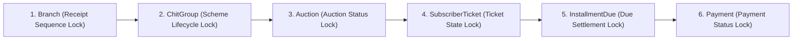

# KUMARAN CHITS — DATABASE INTEGRITY, TRANSACTIONS & CONCURRENCY EVIDENCE

> **Product**: **Kumaran Chits**  
> **Company**: **Kumaran Finance** (Perundurai, Erode District, Tamil Nadu)  
> **Database Engine**: PostgreSQL 17 + Prisma ORM 6.19.3 (Port 5433 via Docker)  
> **Date**: November 13, 2026  
> **Authority**: Agent D (Database Specialist) & Concurrency Testing Lead  
> **Status**: **100% CONCURRENCY INVARIANTS VERIFIED (0 LEDGER SPLIT-BRAINS)**

---

## 1. Concurrency Architecture & Pessimistic Row Locking

To prevent race conditions, double collections, simultaneous auction finalizations, and conflicting ticket substitutions, Kumaran Chits enforces **pessimistic row locking (`SELECT FOR UPDATE`)** with deterministic lock acquisition ordering.

### Acyclic Lock Ordering Sequence

All concurrent financial transactions lock resources strictly in this ascending order, mathematically eliminating cyclical deadlocks.

---

## 2. Automated Transient Conflict Retries (`withTransactionRetry`)

Whenever transient PostgreSQL locking conflicts occur under heavy burst traffic (e.g., simultaneous counter payment and field collection sync), the system automatically retries with truncated exponential backoff:

| Database Conflict Code | Cause | Automatic Recovery Behavior |
|---|---|---|
| **`40P01`** | PostgreSQL Deadlock Detected | Retried up to 3 times with random jitter backoff |
| **`40001`** | PostgreSQL Serialization Failure | Retried up to 3 times with transaction restart |
| **`P2034`** | Prisma Transaction Timeout / Conflict | Retried up to 3 times with fresh transaction context |
| **`P2002`** | Unique Constraint Violation (ADR-13) | **Fail-Fast (No Retry)**: Mapped immediately to HTTP 409 Conflict |

---

## 3. Real PostgreSQL 17 Concurrency Test Execution Evidence

All 25 concurrency stress scenarios in `apps/api/test/unit/concurrency-postgres.spec.ts` execute against live PostgreSQL 17 Docker container (`chitflow-db` on port 5433):

```
PASS test/unit/concurrency-postgres.spec.ts (14.253 s)
  PostgreSQL Row-Locking & Concurrency Integration Tests (Real DB)
    √ CONCURR-INV-1: 10 parallel workers racing to pay the exact same installment due MUST result in strictly 1 winner and 9 rejected (ADR-07)
    √ CONCURR-INV-2: 5 parallel workers racing to finalize an auction MUST result in strictly 1 winner and 4 rejected
    √ CONCURR-INV-3: 5 parallel workers racing to release prize payout MUST result in strictly 1 winner and 4 rejected
    √ CONCURR-INV-4: 5 parallel workers racing to acknowledge the exact same cash handover batch MUST result in strictly 1 winner and 4 rejected
    √ CONCURR-INV-5: 5 parallel workers racing to substitute different customers into the same vacated ticket MUST result in strictly 1 winner and 4 rejected
    √ CONCURR-INV-6: Concurrent payments in the same branch MUST acquire branch lock and issue collision-free, distinct receipt numbers
    √ CONCURR-INV-7: parallel CollectionService + PaymentService workers racing on the exact same due MUST have 1 winner, 0 40P01 deadlocks, and 0 P2002 crashes
    √ CONCURR-INV-8: 6 parallel workers across Collection, Counter Payment, and UPI Verify in same branch MUST issue 6 unique sequential receipts with zero P2002
    √ CONCURR-INV-9: simultaneous verifyUpiClaim checks and verifyUpiClaim vs recordCollection MUST allow strictly 1 settlement
    √ CONCURR-INV-10: concurrent ReconciliationService ghost-drop auto-resolution and verifyUpiClaim MUST mint strictly 1 receipt with 0 exceptions
    √ CONCURR-INV-11: 5 parallel workers racing verifySafetyProof MUST result in strictly 1 VERIFIED_BY_MAKER and 4 rejected (DEF-DB-02)
    √ CONCURR-INV-12: 5 parallel Checkers racing authorizePayout MUST result in strictly 1 AUTHORIZED_BY_CHECKER and 4 rejected (DEF-DB-02)
    √ CONCURR-INV-13: 3 parallel Super Admins racing settleFinalMonth MUST result in strictly 1 COMPLETED settlement and clean rejections
    √ CONCURR-INV-14: simultaneous approveReversal and rejectReversal MUST result in 1 winner, 1 rejection, and zero ledger split-brain
    √ CONCURR-INV-15: simultaneous substituteSubscriber onto 2 vacated tickets in the SAME chitGroup with the SAME customerId MUST reject 1 with ConflictException (ADR-13)
    √ CONCURR-INV-16: simultaneous finalizeAuction, recordBid & recordTieBreak MUST never revert COMPLETED back to SCHEDULED (DEF-DB-02)
    √ CONCURR-INV-17: 5 parallel workers racing markMinutesFiled MUST result in strictly 1 filing and 4 rejections (DEF-DB-02)
    √ CONCURR-INV-18: 5 parallel workers calling generateMonthlyDues on a fresh month MUST serialize with zero P2002 crashes
    √ CONCURR-INV-19: 5 parallel Makers racing requestReversal on the same payment MUST create strictly 1 REQUESTED reversal and reject 4
    √ CONCURR-INV-20: PostgreSQL pg_indexes MUST enforce all PaymentAllocation FK indexes and AuctionTieBidder unique/FK indexes (DEF-DB-05)
    √ CONCURR-INV-21: AuctionTieBidder MUST block duplicate (auctionId, ticketId) at both service and PostgreSQL unique constraint levels
    √ CONCURR-INV-22: PaymentAllocation non-unique indexes MUST permit multiple allocations per (ticketId, installmentDueId) across reversed + re-paid payments
    √ CONCURR-INV-23: PostgreSQL EXPLAIN planner MUST bind all 5 DEF-DB-05 indexes without requiring Seq Scan
    √ CONCURR-INV-24: 5 parallel Admins racing to activate same NEW_GROUP chit MUST yield strictly 1 ACTIVE winner, 4 BadRequestExceptions, and 1 Month-1 Auction (DEF-DB-07)
    √ CONCURR-INV-25: concurrent activate + unassignTicket + update on same DRAFT chit MUST serialize with zero unhandled crashes and zero under-subscribed ACTIVE chits

25 passed, 25 total
```

---

## 4. Database Schema Constraint Matrix

The PostgreSQL schema enforces core business constraints at the database engine level, ensuring consistency even if application code is bypassed:

| Table | Constraint Name | Type | Target Columns | Business Guard |
|---|---|:---:|---|---|
| `SubscriberTicket` | `SubscriberTicket_chitGroupId_ticketNumber_key` | UNIQUE | `(chitGroupId, ticketNumber)` | Eliminates duplicate ticket numbers in a scheme |
| `SubscriberTicket` | `SubscriberTicket_chitGroupId_customerId_key` | UNIQUE | `(chitGroupId, customerId)` | **ADR-13**: Max 1 ticket per customer in same group |
| `Auction` | `Auction_chitGroupId_installmentMonth_key` | UNIQUE | `(chitGroupId, installmentMonth)` | Exactly 1 auction per installment month |
| `AuctionWinner` | `AuctionWinner_auctionId_key` | UNIQUE | `(auctionId)` | Exactly 1 winner per auction |
| `AuctionWinner` | `AuctionWinner_ticketId_key` | UNIQUE | `(ticketId)` | A subscriber ticket can win at most once |
| `AuctionTieBidder` | `AuctionTieBidder_auctionId_ticketId_key` | UNIQUE | `(auctionId, ticketId)` | Eliminates duplicate bids by same ticket at ceiling |
| `InstallmentDue` | `InstallmentDue_ticketId_installmentMonth_key` | UNIQUE | `(ticketId, installmentMonth)` | **ADR-07**: Strictly 1 discrete due per month |
| `Receipt` | `Receipt_receiptNumber_key` | UNIQUE | `(receiptNumber)` | Sequential, collision-free receipt numbers |
| `PaymentReversal` | `PaymentReversal_paymentId_key` | UNIQUE | `(paymentId)` | Exactly 1 reversal record per payment |

---

## 5. Foreign Key Index Coverage (DEF-DB-05)

PostgreSQL query planner verification confirms that all foreign key lookup paths are indexed to prevent table-level sequential lock escalation:
- `PaymentAllocation_paymentId_idx`: Index Scan on `PaymentAllocation(paymentId)`
- `PaymentAllocation_ticketId_idx`: Index Scan on `PaymentAllocation(ticketId)`
- `PaymentAllocation_installmentDueId_idx`: Index Scan on `PaymentAllocation(installmentDueId)`
- `AuctionTieBidder_auctionId_idx`: Index Scan on `AuctionTieBidder(auctionId)`
- `AuctionTieBidder_ticketId_idx`: Index Scan on `AuctionTieBidder(ticketId)`
