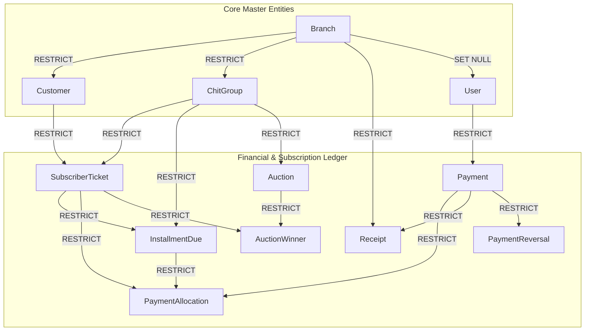

# PROMPT 04 — SCHEMA, RELATIONSHIPS & CONSTRAINT MATRIX

> **Product**: **Kumaran Chits**  
> **Company**: **Kumaran Finance** (Head Office: Perundurai, Erode, Tamil Nadu)  
> **Audit Scope**: Complete Prisma Schema Inventory, Foreign Key Integrity, Cascade Delete Behaviors, and Constraint Enforcement Matrix  
> **Target Schema**: [`apps/api/prisma/schema.prisma`](file:///u:/Kumaran-finance/apps/api/prisma/schema.prisma)  
> **Database Engine**: PostgreSQL 17 + Prisma ORM 6.19.3  
> **Auditor**: Senior PostgreSQL Database Architect & Lead Technical Auditor  

---

## 1. Complete Prisma Model Inventory (17 Models)

The database schema defines exactly **17 relational models** and **8 enumeration types**, strictly dedicated to a single company (Kumaran Finance) with zero multi-tenant `company_id` columns (ADR-01).

| # | Model | Business Purpose | Primary Key | Foreign Keys | Unique Constraints | Non-Unique Indexes | Financial Sensitivity |
|:---:|---|---|---|---|---|---|:---:|
| **1** | **`Branch`** | Physical branch offices (Head Office Perundurai) | `id` (UUID) | None | `code` | None | `LOW` |
| **2** | **`User`** | Office staff, collection agents, accountants, partners | `id` (UUID) | `branchId` $\to$ `Branch(id)` | `phone` | None | `HIGH` (Staff audit & auth) |
| **3** | **`Customer`** | Chit subscribers and members | `id` (UUID) | `branchId` $\to$ `Branch(id)` | `customerCode`, `phone` | `[branchId]` | `HIGH` (KYC & PII) |
| **4** | **`Nominee`** | Subscriber legal heirs / nominees | `id` (UUID) | `customerId` $\to$ `Customer(id)` | None | None | `MEDIUM` |
| **5** | **`CustomerDocument`** | Uploaded Aadhaar/PAN scans in S3 | `id` (UUID) | `customerId` $\to$ `Customer(id)` | None | None | `MEDIUM` (KYC metadata) |
| **6** | **`ChitGroup`** | Chit schemes (e.g. ₹1L 20M) & 4% commission snapshot | `id` (UUID) | `branchId` $\to$ `Branch(id)` | `groupCode` | None | `CRITICAL` (Pool configuration) |
| **7** | **`SubscriberTicket`** | Subscriber membership ticket in group (max 1/customer) | `id` (UUID) | `chitGroupId` $\to$ `ChitGroup(id)` `customerId` $\to$ `Customer(id)` | `[chitGroupId, ticketNumber]` `[chitGroupId, customerId]` | `[customerId]` | `CRITICAL` (Chit ownership & arrears) |
| **8** | **`Auction`** | Monthly auction round, bid discount & dividend snapshots | `id` (UUID) | `chitGroupId` $\to$ `ChitGroup(id)` | `[chitGroupId, installmentMonth]` | None | `CRITICAL` (Dividend & prize math) |
| **9** | **`AuctionWinner`** | Prized ticket winner, safety proof checklist & payout | `id` (UUID) | `auctionId` $\to$ `Auction(id)` `ticketId` $\to$ `SubscriberTicket(id)` | `auctionId` `ticketId` | None | `CRITICAL` (Prize disbursement) |
| **10**| **`AuctionTieBidder`** | Ceiling tie-break contenders & physical paper token | `id` (UUID) | `auctionId` $\to$ `Auction(id)` `ticketId` $\to$ `SubscriberTicket(id)` | `[auctionId, ticketId]` | `[ticketId]` | `HIGH` (Tie-break audit) |
| **11**| **`AuctionMinutes`** | Statutory Form XVII minutes & Registrar filing reference | `id` (UUID) | `auctionId` $\to$ `Auction(id)` | `auctionId` | None | `HIGH` (Regulatory compliance) |
| **12**| **`InstallmentDue`** | Discrete monthly installment schedule, gross, net & status | `id` (UUID) | `chitGroupId` $\to$ `ChitGroup(id)` `ticketId` $\to$ `SubscriberTicket(id)` | `[ticketId, installmentMonth]` | `[chitGroupId, installmentMonth]` `[status, dueDate]` | `CRITICAL` (Subscriber receivable truth) |
| **13**| **`Payment`** | Discrete payment transactions, counter cash & UPI claims | `id` (UUID) | `recordedByUserId` $\to$ `User(id)` | `idempotencyKey` `transactionRef` | `[createdAt]` `[recordedByUserId, cashHandoverStatus]` `[branchId, createdAt]` `[paymentStatus]` | `CRITICAL` (Financial money in) |
| **14**| **`PaymentAllocation`** | 1:1 or 1:N discrete settlement mapping payment $\to$ due | `id` (UUID) | `paymentId` $\to$ `Payment(id)` `ticketId` $\to$ `SubscriberTicket(id)` `installmentDueId` $\to$ `InstallmentDue(id)` | None | `[paymentId]` `[ticketId]` `[installmentDueId]` | `CRITICAL` (Audit settlement link) |
| **15**| **`Receipt`** | Sequential collision-proof bilingual receipts | `id` (UUID) | `branchId` $\to$ `Branch(id)` `paymentId` $\to$ `Payment(id)` | `paymentId` `receiptNumber` | `[issuedAt]` `[branchId, issuedAt]` | `CRITICAL` (Statutory subscriber voucher) |
| **16**| **`PaymentReversal`** | Dual-control maker-checker reversal requests | `id` (UUID) | `paymentId` $\to$ `Payment(id)` | `paymentId` | None | `CRITICAL` (Audit ledger reversal) |
| **17**| **`AuditLog`** | Immutable append-only audit trail with IP & user agent | `id` (UUID) | `userId` $\to$ `User(id)` | None | `[entityType, entityId]` `[timestamp]` | `CRITICAL` (Legal non-repudiation) |

---

## 2. Foreign Key Integrity & Cascade Deletion Assessment

Every relationship across the 17 models was inspected in the PostgreSQL migration DDL ([`20261018110459_init_kumaran_schema/migration.sql`](file:///u:/Kumaran-finance/apps/api/prisma/migrations/20261018110459_init_kumaran_schema/migration.sql#L366-L432)) to verify real database-level referential integrity.

### Foreign Key Behavior Inventory

### Assessment of Deletion Behaviors:

1. **Dangerous Cascades Eliminated (`VERIFIED IN SCHEMA`)**:
   - Out of 22 foreign key constraints, exactly **3** declare `ON DELETE CASCADE`:
     - `Nominee_customerId_fkey` $\to$ `Customer(id)` (`ON DELETE CASCADE`)
     - `CustomerDocument_customerId_fkey` $\to$ `Customer(id)` (`ON DELETE CASCADE`)
     - `AuctionTieBidder_auctionId_fkey` $\to$ `Auction(id)` (`ON DELETE CASCADE`)
   - **Crucial Architectural Safety**: `Customer` **CANNOT** be deleted if they hold a `SubscriberTicket`, because `SubscriberTicket_customerId_fkey` enforces `ON DELETE RESTRICT`. Therefore, a customer's nominees and documents cannot be cascaded if the customer has participated in any chit group.
   - Similarly, `Auction` **CANNOT** be deleted if an `AuctionWinner` or `AuctionMinutes` exists because both enforce `ON DELETE RESTRICT`.

2. **Absolute Financial History Preservation (`VERIFIED IN SCHEMA`)**:
   - `Payment`: Foreign key to `User(id)` has `ON DELETE RESTRICT`. Staff accounts that recorded payments can never be deleted from the database.
   - `Receipt`: Foreign key to `Payment(id)` and `Branch(id)` has `ON DELETE RESTRICT`.
   - `PaymentAllocation`: Foreign keys to `Payment(id)`, `SubscriberTicket(id)`, and `InstallmentDue(id)` all enforce `ON DELETE RESTRICT`.
   - `SubscriberTicket`: Foreign keys to `ChitGroup(id)` and `Customer(id)` enforce `ON DELETE RESTRICT`.
   - Any attempt to issue a raw SQL `DELETE FROM "Customer"`, `DELETE FROM "ChitGroup"`, or `DELETE FROM "Payment"` triggers PostgreSQL engine error `23503` (`foreign_key_violation`).

3. **Nullable Audit Reference (`VERIFIED IN SCHEMA`)**:
   - `AuditLog.userId` references `User(id)` with `ON DELETE SET NULL`. If a staff account is deleted, the audit log entries remain fully preserved with `userId = NULL`, and historical metadata intact in `oldValue` and `newValue` JSONB columns.

---

## 3. Database Constraints vs Application Invariants Matrix

This matrix evaluates which business rules are strictly guaranteed by the PostgreSQL engine versus those relying on NestJS application code or UI layers.

| # | Business / Financial Rule | PostgreSQL Engine Constraint | Application Code Validation | Transaction Row Lock | Current Gap / Risk Level |
|:---:|---|---|---|---|---|
| **1** | **Unique Ticket per Group** | `@@unique([chitGroupId, ticketNumber])` | Validated in `assignTicket` | N/A | `NONE` — 100% Guaranteed by Postgres (`P2002`) |
| **2** | **ADR-13 Ticket Limit (Max 1/customer)** | `@@unique([chitGroupId, customerId])` | Validated in `assignTicket` | N/A | `NONE` — 100% Guaranteed by Postgres (`P2002`) |
| **3** | **One Due per Month per Ticket** | `@@unique([ticketId, installmentMonth])` | Checked in `generateMonthlyDues` | N/A | `NONE` — 100% Guaranteed by Postgres (`P2002`) |
| **4** | **Collision-Proof Receipt Numbers** | `Receipt.receiptNumber @unique` | Sequential query in `generateNextReceiptNumber` | `Branch` row `FOR UPDATE` | `NONE` — 100% Guaranteed by Postgres + Branch lock |
| **5** | **Zero Double Payments on Due** | ⚠️ **No table constraint** (`DueStatus` enum only) | `if (due.status === PAID) throw BadRequest` | `InstallmentDue` `FOR UPDATE` | `LOW` — Row lock prevents race, but no SQL check constraint |
| **6** | **Payment Allocation Match Amount** | ⚠️ **No table constraint** | Checked in `recordPayment` | Single atomic `$transaction` | `MEDIUM` — No SQL trigger checking $\sum \text{Alloc} = \text{Payment.amount}$ |
| **7** | **Zero Negative Monetary Values** | ⚠️ **No SQL CHECK constraints** | `toWholeRupeeBigInt(..., { min: 0n })` | N/A | `MEDIUM` — Negative numbers rejected in DTO, but raw SQL could insert negative BigInt |
| **8** | **Single Auction Winner per Round** | `AuctionWinner.auctionId @unique` | Checked in `finalizeAuction` | `ChitGroup` $\to$ `Auction` `FOR UPDATE` | `NONE` — 100% Guaranteed by Postgres (`P2002`) |
| **9** | **Winner Cannot Win Another Auction** | `AuctionWinner.ticketId @unique` | Checked in `recordBid` & `finalizeAuction` | `SubscriberTicket` `FOR UPDATE` | `NONE` — 100% Guaranteed by Postgres (`P2002`) |
| **10**| **Disbursed Amount $\le$ Prize Money** | ⚠️ **No table constraint** | ⚠️ **Missing validation** (accepts arbitrary `dto.disbursedAmount`) | `AuctionWinner` `FOR UPDATE` | `HIGH` (**FIN-01** — No upper bound check on disbursement override) |
| **11**| **Undistributed Dividend Remainder** | ⚠️ **No remainder column** | Truncated via `totalDividend / totalTickets` | N/A | `MEDIUM` (**FIN-02** — Remainder untracked if non-clean bid entered) |
| **12**| **Reversed Receipt Invalidation** | ⚠️ **Receipt has no status column** | Derived via `payment.paymentStatus` | Single atomic `$transaction` | `MEDIUM` (**FIN-03** — Receipt PDF lacks cancelled watermark) |
| **13**| **One Active Reversal per Payment** | `PaymentReversal.paymentId @unique` | Checked in `requestReversal` | `PaymentReversal` `FOR UPDATE` | `NONE` — 100% Guaranteed by Postgres (`P2002`) |
| **14**| **Unique Bank Transaction UTR** | `Payment.transactionRef @unique` | Checked in `recordPayment` & UPI claim | N/A | `NONE` — 100% Guaranteed by Postgres (`P2002`) |
| **15**| **Payment Idempotency Key** | `Payment.idempotencyKey @unique` | Cached lookup in `recordPayment` | N/A | `NONE` — 100% Guaranteed by Postgres (`P2002`) |

---

## 4. Architectural Summary

1. **Structural Strength**: The PostgreSQL schema provides exceptional relational defenses. Cascade deletes are almost entirely eliminated, and 18 unique constraints prevent duplicate tickets, duplicate dues, duplicate receipt numbers, and duplicate auction winners.
2. **Defensive Gaps Identified**:
   - Absence of PostgreSQL `CHECK` constraints (`CHECK (amount > 0)`, `CHECK ("paidAmount" >= 0)`).
   - In `AuctionWinner`, absence of a check ensuring `disbursedAmount <= auction.prizeMoney`.
   - In `Receipt`, absence of an explicit `status` or `isCancelled` flag.
