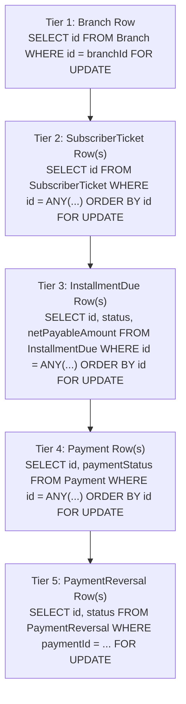

# PROMPT 04 — DATABASE TRANSACTION & CONCURRENCY LOCKING INVENTORY

> **Product**: **Kumaran Chits**  
> **Company**: **Kumaran Finance** (Head Office: Perundurai, Erode, Tamil Nadu)  
> **Target Scope**: Prisma Transactions, Pessimistic Row Locking (`SELECT ... FOR UPDATE`), Global Lock DAG, and Retry Protocols  
> **Auditor**: Senior PostgreSQL Database Architect & Lead Technical Auditor  

---

## 1. Master Transaction Inventory Across Financial Services

Every critical financial mutation in Kumaran Chits is enclosed inside an atomic PostgreSQL transaction. The table below documents every transaction workflow discovered in the codebase:

| # | Service & Method | File Path & Lines | Isolation Level | Locking Strategy | Retry Utility | Invariants Protected |
|:---:|---|---|:---:|---|:---:|---|
| **1** | `PaymentService.recordPayment` | [`payment.service.ts:185-280`](file:///u:/Kumaran-finance/apps/api/src/payment/payment.service.ts#L185-L280) | `READ COMMITTED` | `Branch` $\to$ `Ticket` $\to$ `Due` (`FOR UPDATE`) | `withTransactionRetry` (Max 3, 50ms) | Zero double payment, discrete allocation, collision-proof receipt, arrears recalculation |
| **2** | `PaymentService.approveReversal` | [`payment.service.ts:746-840`](file:///u:/Kumaran-finance/apps/api/src/payment/payment.service.ts#L746-L840) | `READ COMMITTED` | `Ticket` $\to$ `Payment` $\to$ `Reversal` (`FOR UPDATE`) | `withTransactionRetry` (Max 3, 50ms) | Atomic status reversal, due restoration, arrears recalculation, Maker $\ne$ Checker |
| **3** | `PaymentService.rejectReversal` | [`payment.service.ts:887-920`](file:///u:/Kumaran-finance/apps/api/src/payment/payment.service.ts#L887-L920) | `READ COMMITTED` | `Payment` $\to$ `Reversal` (`FOR UPDATE`) | `withTransactionRetry` (Max 3, 50ms) | Reversal rejection without touching dues or receipts, Maker $\ne$ Checker |
| **4** | `PaymentService.verifyUpiClaim` | [`payment.service.ts:1140-1230`](file:///u:/Kumaran-finance/apps/api/src/payment/payment.service.ts#L1140-L1230) | `READ COMMITTED` | 4-Tier: `Branch` $\to$ `Ticket` $\to$ `Due` $\to$ `Payment` (`FOR UPDATE`) | `withTransactionRetry` (Max 3, 50ms) | Transitions `INITIATED` $\to$ `SUCCESS`, mints sequential receipt, marks due `PAID` |
| **5** | `CollectionService.recordCollection` | [`collection.service.ts:168-260`](file:///u:/Kumaran-finance/apps/api/src/collection/collection.service.ts#L168-L260) | `READ COMMITTED` | `Branch` $\to$ `Ticket` $\to$ `Due` (`FOR UPDATE`) | `withTransactionRetry` (Max 3, 50ms) | Doorstep collections, pending handover status, sequential receipt issuance |
| **6** | `CollectionService.acknowledgeHandover` | [`collection.service.ts:415-480`](file:///u:/Kumaran-finance/apps/api/src/collection/collection.service.ts#L415-L480) | `READ COMMITTED` | `SELECT FOR UPDATE` on all pending cash payments | `withTransactionRetry` (Max 3, 50ms) | Cash handover to vault, dual-control Maker $\ne$ Checker, atomic payment status change |
| **7** | `AuctionService.finalizeAuction` | [`auction.service.ts:481-560`](file:///u:/Kumaran-finance/apps/api/src/auction/auction.service.ts#L481-L560) | `READ COMMITTED` | `ChitGroup` $\to$ `Auction` (`FOR UPDATE`) | `withTransactionRetry` (Max 3, 50ms) | Commits auction result, marks winner `isPrized`, generates Form XVII minutes |
| **8** | `AuctionService.recordBid` | [`auction.service.ts:190-250`](file:///u:/Kumaran-finance/apps/api/src/auction/auction.service.ts#L190-L250) | `READ COMMITTED` | `Auction` row lock | Implicit Prisma transaction | Binds winning bid discount, computes dividend pool & prize money |
| **9** | `AuctionService.recordTieBreak` | [`auction.service.ts:320-385`](file:///u:/Kumaran-finance/apps/api/src/auction/auction.service.ts#L320-L385) | `READ COMMITTED` | `Auction` $\to$ `AuctionTieBidder` | Implicit Prisma transaction | Records physical token drawn, sets `wasTieBreakWinner = true` |
| **10**| `DisbursementService.authorizePayout` | [`disbursement.service.ts:615-650`](file:///u:/Kumaran-finance/apps/api/src/disbursement/disbursement.service.ts#L615-L650) | `READ COMMITTED` | `AuctionWinner` (`FOR UPDATE`) | `withTransactionRetry` (Max 3, 50ms) | Authorizes prize payout voucher, Maker $\ne$ Checker, Super Admin exclusivity |
| **11**| `DisbursementService.releasePayout` | [`disbursement.service.ts:690-745`](file:///u:/Kumaran-finance/apps/api/src/disbursement/disbursement.service.ts#L690-L745) | `READ COMMITTED` | `AuctionWinner` (`FOR UPDATE`) | `withTransactionRetry` (Max 3, 50ms) | Transitions status to `DISBURSED`, records payment reference and bank UTR |
| **12**| `DisbursementService.settleFinalMonth` | [`disbursement.service.ts:800-880`](file:///u:/Kumaran-finance/apps/api/src/disbursement/disbursement.service.ts#L800-L880) | `READ COMMITTED` | `ChitGroup` $\to$ `SubscriberTicket` (`FOR UPDATE`) | `withTransactionRetry` (Max 3, 50ms) | Month $N$ final settlement ($V - C_f$), zero dividend pool, ticket `isPrized` |
| **13**| `ChitService.activateScheme` | [`chit.service.ts:240-330`](file:///u:/Kumaran-finance/apps/api/src/chit/chit.service.ts#L240-L330) | `READ COMMITTED` | `ChitGroup` (`FOR UPDATE`) | `withTransactionRetry` (Max 3, 50ms) | Enforces 100% full roster, freezes 4% commission, creates Month 1 company pool |
| **14**| `ChitService.substituteSubscriber` | [`chit.service.ts:420-510`](file:///u:/Kumaran-finance/apps/api/src/chit/chit.service.ts#L420-L510) | `READ COMMITTED` | `SubscriberTicket` (`FOR UPDATE`) | `withTransactionRetry` (Max 3, 50ms) | Replaces removed defaulter with new subscriber, preserves ticket history |
| **15**| `InstallmentService.generateMonthlyDues` | [`installment.service.ts:70-160`](file:///u:/Kumaran-finance/apps/api/src/installment/installment.service.ts#L70-L160) | `READ COMMITTED` | `ChitGroup` $\to$ `Auction` (`FOR UPDATE`) | `withTransactionRetry` (Max 3, 50ms) | Creates discrete dues for all 20 tickets with dividend deductions ($I_{net} = I_{base} - Div$) |
| **16**| `ReconciliationService.reconcileGatewaySettlement` | [`reconciliation.service.ts:150-250`](file:///u:/Kumaran-finance/apps/api/src/jobs/services/reconciliation.service.ts#L150-L250) | `READ COMMITTED` | 4-Tier: `Branch` $\to$ `Ticket` $\to$ `Due` $\to$ `Payment` (`FOR UPDATE`) | `withTransactionRetry` (Max 3, 50ms) | Auto-resolves ghost drops from payment gateway webhooks without split-brain |

---

## 2. Global Lock Acquisition Order Directed Acyclic Graph (DAG)

To eliminate PostgreSQL deadlocks (PostgreSQL error `40P01`) across high-concurrency collection, counter payment, online UPI verification, and reversal workflows, the application enforces a strict **5-Tier Monotonic Lock Order DAG**:



### Mathematical Proof of Deadlock Freedom:
1. **Topological Order**: Any transaction requiring multiple entities must request locks in strictly ascending tier order ($T_1 \prec T_2 \prec T_3 \prec T_4 \prec T_5$). No transaction ever requests a lock on a lower-numbered tier while holding a lock on a higher-numbered tier.
2. **Deterministic Intra-Tier Lexicographical Sorting**: When multiple rows in the same tier are locked (e.g. multiple tickets or dues in a bulk batch), IDs are deduplicated and sorted lexicographically:
   ```typescript
   function normalizeSortedIds(ids?: string[]): string[] {
     if (!ids || ids.length === 0) return [];
     return [...new Set(ids.filter(Boolean))].sort();
   }
   ```
   Because all concurrent transactions acquire row locks in the exact same sorted order (`ORDER BY id FOR UPDATE`), cyclic wait-for dependency cycles are mathematically impossible ($A \to B \to A$ cannot occur).

---

## 3. Transaction Retry Protocol (`withTransactionRetry`)

Implemented in [`transaction-retry.util.ts`](file:///u:/Kumaran-finance/apps/api/src/common/utils/transaction-retry.util.ts):

### A. Error Classification Engine
The retry utility inspects caught errors and only retries transient concurrency conflicts:
- `P2034`: Prisma transaction write conflict or deadlock.
- `40P01`: PostgreSQL engine `deadlock_detected`.
- `40001`: PostgreSQL engine `serialization_failure`.
- `P2002` on `receiptNumber`: Sequential receipt number collision retry.
- **Fail-Fast on Non-Transient Errors**: Non-transient errors (e.g. `P2002` on `idempotencyKey` or `transactionRef`, `400 Bad Request`, `403 Forbidden`, `404 Not Found`) throw immediately without burning retries.

### B. Exponential Backoff with Random Jitter
```typescript
const jitter = Math.floor(Math.random() * 50);
const calculatedDelay = baseDelayMs * 2 ** attempt + jitter;
const delay = Math.min(calculatedDelay, maxDelayMs);
```
- Default settings: `maxRetries = 3`, `baseDelayMs = 50ms`, `maxDelayMs = 1000ms`.
- Interactive budget: `PAYMENT_TRANSACTION_OPTIONS = { maxWait: 10000, timeout: 15000 }` ensures transactions have sufficient queueing time under high concurrency without triggering false timeout aborts.
