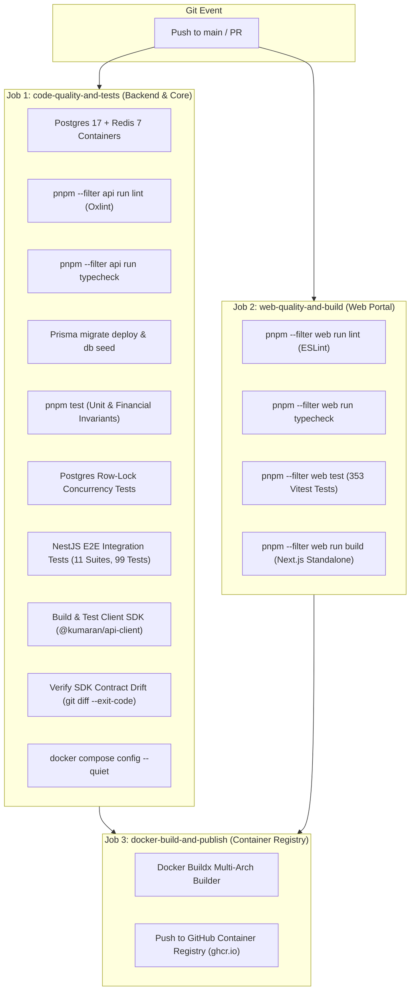

# PROMPT 06 — CI/CD, SECRETS & OBSERVABILITY AUDIT
## Kumaran Chits — Pipeline Integrity, Secrets Hygiene, Prometheus Metrics & Sentry Telemetry

> **Audit Stage**: Stage 06 (Infrastructure, DevOps, Disaster Recovery & Production Readiness)  
> **Subsystem**: GitHub Actions CI/CD, Secrets Management, Prometheus Exporter, Sentry APM, and Request Tracing  
> **Status**: COMPLETED — READ-ONLY AUDIT  
> **Date**: November 2026  
> **Source Files**: [`.github/workflows/ci.yml`](file:///u:/Kumaran-finance/.github/workflows/ci.yml), [`apps/api/src/config/env.validation.ts`](file:///u:/Kumaran-finance/apps/api/src/config/env.validation.ts), [`apps/api/src/metrics/`](file:///u:/Kumaran-finance/apps/api/src/metrics/)

---

## 1. CI/CD Pipeline Architecture & Quality Gates

The continuous integration pipeline is defined in [`.github/workflows/ci.yml`](file:///u:/Kumaran-finance/.github/workflows/ci.yml). It executes automatically on every `push` and `pull_request` targeting the `main` branch.

### Pipeline Strengths Discovered
1. **Real PostgreSQL Concurrency Gate**: Unlike typical web pipelines that rely on SQLite mocks, Job 1 starts a real `postgres:17` container and runs [`concurrency-postgres.spec.ts`](file:///u:/Kumaran-finance/apps/api/test/unit/concurrency-postgres.spec.ts), testing real row-level locking (`SELECT FOR UPDATE`) under parallel execution.
2. **Client SDK Drift Prevention**: Steps 99–105 run OpenAPI code generation and execute:
   `git diff --exit-code docs/03-architecture/openapi-spec.json packages/api-client/ apps/mobile/`
   If a developer alters backend endpoints without updating the client SDK or mobile models, the pipeline immediately fails!
3. **Multi-Stage Docker Caching**: Job 3 utilizes GitHub Actions cache (`type=gha`) for fast, reproducible container image compilation.

### Pipeline Limitations & Gaps
1. **Playwright Browser Tests Missing in CI**: While Job 2 runs Vitest unit tests (`pnpm --filter web test`), it does **NOT** run the Playwright browser E2E tests (`pnpm --filter web exec playwright test`). Browser regressions could theoretically pass CI if only caught in Playwright.
2. **Automated VPS Deployment Missing**: Job 3 pushes container images to GHCR, but does not execute an automated SSH or webhook trigger to deploy to the production VPS. Deployment requires a manual run of [`infra/scripts/zero-downtime-deploy.sh`](file:///u:/Kumaran-finance/infra/scripts/zero-downtime-deploy.sh).

---

## 2. Secrets Management & Production Hardening Audit

Inspected [`apps/api/src/config/env.validation.ts`](file:///u:/Kumaran-finance/apps/api/src/config/env.validation.ts):

### Production Strict Validation Checks
The backend enforces a fail-fast startup gate whenever `NODE_ENV === 'production'`:
- **`JWT_SECRET` Validation**: Rejects any key containing `'replace-with-a-secure-random'` or shorter than 32 characters (`env.validation.ts#L156-L163`).
- **`STORAGE_DRIVER` Validation**: Must be explicitly set to `'s3'` in production to prevent local disk storage fragmentation across container instances (`#L149-L154`).
- **`BULL_BOARD_PASSWORD` Hardening**: Rejects the development default password `"chitflow_secret"` (`#L165-L170`).
- **`METRICS_PASSWORD` Hardening**: Rejects the development default password `"chitflow_secret"` (`#L172-L177`).

### Secrets Exposure Risks in Source Control
- A comprehensive repository scan confirmed that **NO `.env` files containing live production credentials** are committed to git.
- `.gitignore` properly ignores `.env`, `.env.local`, `*.pem`, `*.key`, and `*.pfx`.
- Template files ([`.env.example`](file:///u:/Kumaran-finance/apps/api/.env.example)) contain only obvious placeholders (`chitflow_dev_only`, `replace-with-a-secure-random`).

---

## 3. Observability, Metrics & Telemetry Audit

### A. Prometheus Metrics Exporter ([`apps/api/src/metrics/`](file:///u:/Kumaran-finance/apps/api/src/metrics/))
- **Endpoint**: `GET /metrics`
- **Security**: Protected by [`MetricsAuthGuard`](file:///u:/Kumaran-finance/apps/api/src/metrics/guards/metrics-auth.guard.ts) requiring HTTP Basic Auth.
- **Instrumented Telemetry**:
  - `http_request_duration_seconds`: Histogram measuring HTTP latencies by method, route, and status code.
  - `chit_active_groups_total`: Gauge tracking running chit schemes.
  - `chit_installments_collected_total`: Counter tracking total rupee collections.
  - `sms_dispatched_total`: Counter tracking SMS delivery attempts and failures.
  - `reversals_requested_total`: Counter tracking payment reversal volume.

### B. Sentry Error Tracking ([`apps/api/src/common/sentry/`](file:///u:/Kumaran-finance/apps/api/src/common/sentry/))
- **Initialization**: Triggered at application startup via `initSentry()` in [`main.ts`](file:///u:/Kumaran-finance/apps/api/src/main.ts).
- **PII Stripping & Privacy Defense**:
  The global exception filter ([`global-exception.filter.ts`](file:///u:/Kumaran-finance/apps/api/src/common/filters/global-exception.filter.ts#L127-L141)) invokes `buildSafeSentryUserContext()`. It explicitly scrubs:
  - Full Aadhaar numbers (only last 4 allowed)
  - Plaintext passwords and MPINs
  - Customer bank account details
  - JWT authorization tokens
- **Diagnostic Verification Endpoint**: `GET /health/sentry-test` throws an intentional `InternalServerErrorException` to verify that Sentry alerts reach on-call engineers.

### C. Request-ID Distributed Tracing
- **Nginx Ingress**: Generates a cryptographically random Request ID (`$request_id`).
- **Header Injection**: Passes `X-Request-ID: $request_id` to both API and Web upstreams.
- **NestJS Context**: [`request-id.interceptor.ts`](file:///u:/Kumaran-finance/apps/api/src/common/interceptors/request-id.interceptor.ts) attaches the ID to logging context and returns it in client response headers (`X-Request-ID`).
- **Nginx Log Correlation**: Nginx access logs include `rid="$request_id"`, allowing operators to trace an entire request lifecycle from client browser to database query.
