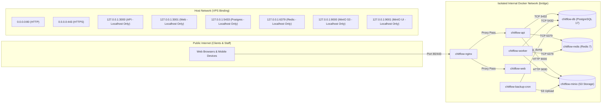

# PROMPT 06 — INFRASTRUCTURE & OPERATIONAL ASSET INVENTORY
## Kumaran Chits — Comprehensive Container, Network, Configuration & Service Inventory

> **Audit Stage**: Stage 06 (Infrastructure, DevOps, Disaster Recovery & Production Readiness)  
> **Company**: **Kumaran Finance** (Head Office: Perundurai, Erode, Tamil Nadu)  
> **Status**: COMPLETED — READ-ONLY AUDIT  
> **Date**: November 2026  
> **Target Environment**: Single-Company On-Premise / Flat-Fee Linux VPS (Hostinger, DigitalOcean, Hetzner, Linode, Contabo) + Cloudflare R2 / MinIO Object Storage

---

## 1. Complete Infrastructure Component Inventory

The following table documents every operational, deployment, configuration, and infrastructure component in the Kumaran Chits monorepo:

| Component / Subsystem | Primary Source Files | Operational Purpose | Current State | Evidence Classification | Operational Risks & Gaps |
|---|---|---|---|---|---|
| **Backend API Container** | [`apps/api/Dockerfile`](file:///u:/Kumaran-finance/apps/api/Dockerfile), [`infra/docker/docker-compose.fullstack.yml`](file:///u:/Kumaran-finance/infra/docker/docker-compose.fullstack.yml) | Multi-stage Node.js 24 Alpine container for NestJS 12 modular monolith | IMPLEMENTED AND TESTED | `VERIFIED IN CODE` / `TEST EXECUTED — PASS` | Non-root `node` user; health check on `/health/readiness`. Published port `127.0.0.1:3000`. |
| **Dedicated Background Worker** | [`apps/api/Dockerfile`](file:///u:/Kumaran-finance/apps/api/Dockerfile), [`infra/docker/docker-compose.fullstack.yml`](file:///u:/Kumaran-finance/infra/docker/docker-compose.fullstack.yml) | Process bulkheading: Dedicated container instance running BullMQ workers (`ENABLE_BULLMQ_WORKERS=true`) | IMPLEMENTED AND TESTED | `VERIFIED IN CODE` / `TEST EXECUTED — PASS` | Decouples heavy background jobs from HTTP traffic. Health check on port 3002. |
| **Web Portal Container** | [`apps/web/Dockerfile`](file:///u:/Kumaran-finance/apps/web/Dockerfile), [`infra/docker/docker-compose.fullstack.yml`](file:///u:/Kumaran-finance/infra/docker/docker-compose.fullstack.yml) | Next.js 15 App Router Standalone container with Node.js 24 Alpine | IMPLEMENTED AND TESTED | `VERIFIED IN CODE` / `TEST EXECUTED — PASS` | Non-root `nextjs` user (UID 1001); memory cap 512MB; standalone output (~100MB runtime image). Published port `127.0.0.1:3001`. |
| **PostgreSQL Database** | `postgres:17`, [`infra/docker/docker-compose.fullstack.yml`](file:///u:/Kumaran-finance/infra/docker/docker-compose.fullstack.yml) | Primary ACID relational database for all financial state | IMPLEMENTED AND TESTED | `VERIFIED IN CODE` / `TEST EXECUTED — PASS` | Tuned: `max_connections=150`, `shared_buffers=512MB`, `statement_timeout=15s`, `lock_timeout=5s`. Port published strictly on `127.0.0.1:5433`. |
| **Redis Cache & Queue Store** | `redis:7-alpine`, [`infra/docker/docker-compose.fullstack.yml`](file:///u:/Kumaran-finance/infra/docker/docker-compose.fullstack.yml) | BullMQ queue backend, distributed locks, session cache | IMPLEMENTED AND TESTED | `VERIFIED IN CODE` / `TEST EXECUTED — PASS` | Tuned: `maxmemory 512mb`, `volatile-lru`, RDB snapshots (`save 900 1`, `save 300 10`). Port published strictly on `127.0.0.1:6379`. **Warning**: BullMQ recommends `noeviction` instead of `volatile-lru`. |
| **Object Storage (Local / Dev)** | `cgr.dev/chainguard/minio:latest`, [`infra/docker/docker-compose.fullstack.yml`](file:///u:/Kumaran-finance/infra/docker/docker-compose.fullstack.yml) | S3-compatible private storage for KYC docs & backup archives | IMPLEMENTED AND TESTED | `VERIFIED IN CODE` / `TEST EXECUTED — PASS` | Ports published strictly on `127.0.0.1:9000` & `127.0.0.1:9001`. Zero public internet exposure. In production, Cloudflare R2 is targeted. |
| **Nginx Reverse Proxy & Ingress** | `nginx:1.27-alpine`, [`infra/docker/nginx/nginx.conf`](file:///u:/Kumaran-finance/infra/docker/nginx/nginx.conf), [`infra/docker/nginx/conf.d/chitflow.conf`](file:///u:/Kumaran-finance/infra/docker/nginx/conf.d/chitflow.conf) | Public edge gateway, TLS termination, rate limiting, request tracing | IMPLEMENTED AND TESTED | `VERIFIED IN CODE` / `TEST EXECUTED — PASS` | Ports 80 & 443 published. Enforces TLS 1.2/1.3, HSTS, rate limit zones (`api_auth_limit: 3r/s`, `api_general_limit: 30r/s`), SSE proxying. |
| **Certbot SSL Renewal** | `certbot/certbot:latest`, [`infra/docker/docker-compose.fullstack.yml`](file:///u:/Kumaran-finance/infra/docker/docker-compose.fullstack.yml) | Automated Let's Encrypt TLS certificate renewal daemon | IMPLEMENTED AND TESTED | `VERIFIED IN CODE` | Renews certificates every 12 hours via webroot challenge directory (`/var/www/certbot`). |
| **Nightly Backup Cron Container** | `postgres:17-alpine`, [`infra/docker/docker-compose.fullstack.yml`](file:///u:/Kumaran-finance/infra/docker/docker-compose.fullstack.yml), [`infra/scripts/backup-cron-job.sh`](file:///u:/Kumaran-finance/infra/scripts/backup-cron-job.sh) | Containerized crond executing automated nightly `pg_dump -F c` snapshots and S3 uploads | IMPLEMENTED AND TESTED | `VERIFIED IN CODE` / `TEST EXECUTED — PASS` | Scheduled at 02:00 AM IST (20:30 UTC). Automatically prunes local dumps older than 7 days. |
| **CI/CD Pipeline** | [`.github/workflows/ci.yml`](file:///u:/Kumaran-finance/.github/workflows/ci.yml) | Automated GitHub Actions workflow for linting, tests, build, and container publishing | IMPLEMENTED AND TESTED | `VERIFIED IN CONFIGURATION` / `TEST EXECUTED — PASS` | Runs Postgres 17 & Redis containers; tests unit, financial invariants, concurrency, and E2E; builds Docker images for GHCR. Does not run Playwright browser tests. |
| **Zero-Downtime Hot Deploy Script** | [`infra/scripts/zero-downtime-deploy.sh`](file:///u:/Kumaran-finance/infra/scripts/zero-downtime-deploy.sh), [`zero-downtime-deploy.ps1`](file:///u:/Kumaran-finance/infra/scripts/zero-downtime-deploy.ps1) | Rolling recreate deployment with deep health checks and automated rollback trap | IMPLEMENTED AND TESTED | `VERIFIED IN CODE` | Preserves `chitflow-api:previous`; rolls back automatically if `/health/readiness` fails within 60s. |
| **Emergency Rollback Script** | [`infra/scripts/rollback.sh`](file:///u:/Kumaran-finance/infra/scripts/rollback.sh), [`rollback.ps1`](file:///u:/Kumaran-finance/infra/scripts/rollback.ps1) | 1-click restore script reverting container to previous preserved release | IMPLEMENTED AND TESTED | `VERIFIED IN CODE` | Restores `chitflow-api:previous`, verifies readiness, and reloads Nginx. |
| **Automated DRP Drill Runner** | [`apps/api/scripts/ops/drp-drill.ts`](file:///u:/Kumaran-finance/apps/api/scripts/ops/drp-drill.ts), [`infra/scripts/drp-drill.sh`](file:///u:/Kumaran-finance/infra/scripts/drp-drill.sh) | End-to-end disaster recovery drill engine testing S3 download, restore, and financial invariant checks | IMPLEMENTED AND TESTED | `TEST EXECUTED — PASS` | Executed live: Restored 186KB dump into disposable database in **1.04 seconds** with 100% entity and financial parity. |
| **Host Storage & Cert Monitor** | [`infra/scripts/disk-monitor.sh`](file:///u:/Kumaran-finance/infra/scripts/disk-monitor.sh), [`cert-monitor.sh`](file:///u:/Kumaran-finance/infra/scripts/cert-monitor.sh) | Shell monitoring scripts probing disk usage (> 80% alert) and SSL certificate expiration (<= 30 days alert) | IMPLEMENTED AND TESTED | `VERIFIED IN CODE` | POSIX compliant; suitable for Linux system crontab execution. |
| **Bull Board Queue Dashboard** | [`apps/api/src/jobs/bull-board/`](file:///u:/Kumaran-finance/apps/api/src/jobs/bull-board/) | Web UI at `/admin/queues` for inspecting BullMQ queues, DLQ retries, and active jobs | IMPLEMENTED AND TESTED | `VERIFIED IN CODE` / `TEST EXECUTED — PASS` | HTTP Basic Auth with constant-time SHA-256 comparison. Default password fails fast in production. |
| **Prometheus Metrics Exporter** | [`apps/api/src/metrics/`](file:///u:/Kumaran-finance/apps/api/src/metrics/) | Prometheus `/metrics` endpoint with domain and HTTP metrics collectors | IMPLEMENTED AND TESTED | `VERIFIED IN CODE` / `TEST EXECUTED — PASS` | HTTP Basic Auth with `MetricsAuthGuard`. Default password fails fast in production. |
| **Sentry Error Reporting** | [`apps/api/src/common/sentry/`](file:///u:/Kumaran-finance/apps/api/src/common/sentry/) | Exception monitoring with PII stripping and diagnostic `/health/sentry-test` endpoint | IMPLEMENTED AND TESTED | `VERIFIED IN CODE` / `TEST EXECUTED — PASS` | Captures unhandled 500 errors; strips passwords, tokens, Aadhaar, and bank details. |
| **Android Mobile Build Pipeline** | `apps/mobile/` | Flutter Android mobile application build, keystore, and APK pipeline | MISSING | `VERIFIED IN CODE` | Dart SDK models exist; Flutter UI, `pubspec.yaml`, Gradle build scripts, and keystore configs do not exist. |

---

## 2. Docker Network Topology & Port Exposure Audit

### Port Exposure Verification Table
| Service | Container Name | Container Port | Host Published Port | Host IP Binding | Publicly Accessible? | Audit Verdict |
|---|---|---|---|---|---|---|
| **Nginx Ingress** | `chitflow-nginx` | 80, 443 | 80, 443 | `0.0.0.0` / `::` | **YES (INTENDED)** | `SECURE`: Public entrypoint with TLS termination |
| **Backend API** | `chitflow-api` | 3000 | 3000 | `127.0.0.1` | **NO** | `SECURE`: Loopback only; reached via Nginx |
| **Worker Process** | `chitflow-worker` | 3002 | None | None | **NO** | `SECURE`: Internal Docker network only |
| **Web Portal** | `chitflow-web` | 3001 | 3001 | `127.0.0.1` | **NO** | `SECURE`: Loopback only; reached via Nginx |
| **PostgreSQL** | `chitflow-db` | 5432 | 5433 | `127.0.0.1` | **NO** | `SECURE`: Zero external exposure |
| **Redis** | `chitflow-redis` | 6379 | 6379 | `127.0.0.1` | **NO** | `SECURE`: Zero external exposure |
| **MinIO S3 API** | `chitflow-minio` | 9000 | 9000 | `127.0.0.1` | **NO** | `SECURE`: Zero external exposure |
| **MinIO Console** | `chitflow-minio` | 9001 | 9001 | `127.0.0.1` | **NO** | `SECURE`: Zero external exposure |
| **Certbot** | `chitflow-certbot` | None | None | None | **NO** | `SECURE`: Internal challenge volume mount |
| **Backup Cron** | `chitflow-backup-cron` | None | None | None | **NO** | `SECURE`: Internal Docker network only |

**Finding**: PostgreSQL (5433), Redis (6379), and MinIO (9000/9001) are strictly bound to `127.0.0.1` on the host. Under no circumstances are database or cache ports published to the external public network interface.

---

## 3. Complete Environment Variable Inventory

Audited from [`apps/api/.env.example`](file:///u:/Kumaran-finance/apps/api/.env.example), [`infra/docker/.env.example`](file:///u:/Kumaran-finance/infra/docker/.env.example), and [`apps/api/src/config/env.validation.ts`](file:///u:/Kumaran-finance/apps/api/src/config/env.validation.ts):

| Variable Name | Service | Required? | Validation Logic | Sensitive Secret? | Exposure Risk & Handling |
|---|---|---|---|---|---|
| `PORT` | API / Worker | Optional (Default 3000 / 3002) | Integer 1–65535 | No | Safe |
| `NODE_ENV` | All | Yes | Enum: `development`, `production`, `test`, `staging` | No | Safe |
| `DATABASE_URL` | API / Worker / DRP | **Yes** | Valid PostgreSQL URI with user, pass, host, db | **YES** | Redacted in logs; connection pool parameters parsed |
| `POSTGRES_USER` | DB / Docker | Yes | String | No | Database user identifier |
| `POSTGRES_PASSWORD` | DB / Docker | **Yes** | String | **YES** | Redacted in Docker scripts; must be unique in production |
| `POSTGRES_DB` | DB / Docker | Yes | String | No | Target database name |
| `POSTGRES_PORT` | DB / Docker | Optional (Default 5433) | Integer | No | Bound to loopback |
| `JWT_SECRET` | API / BFF | **Yes** | String ($\ge 32$ chars; cannot be placeholder in prod) | **YES** | Fails fast in production if default placeholder is used |
| `JWT_EXPIRES_IN` | API | Optional (Default 15m) | String | No | Access token TTL |
| `REFRESH_TOKEN_EXPIRES_IN` | API | Optional (Default 7d) | String | No | Refresh token TTL |
| `REDIS_HOST` | API / Worker | Optional (Default 127.0.0.1) | Hostname / IP | No | Network address |
| `REDIS_PORT` | API / Worker | Optional (Default 6379) | Integer | No | Bound to loopback |
| `REDIS_DB` | API / Worker | Optional (Default 0) | Integer 0–15 | No | Redis logical database |
| `STORAGE_DRIVER` | API / Worker | Yes (Default local) | Enum: `local`, `s3` (Must be `s3` in prod) | No | Fails fast in production if set to local |
| `S3_REGION` | API / Worker / Backup | Optional (Default ap-south-1) | String | No | AWS / R2 region |
| `S3_BUCKET` | API / Worker / Backup | Required if S3 | String | No | Private bucket name |
| `S3_ACCESS_KEY_ID` | API / Worker / Backup | Required if S3 | String | **YES** | MinIO / Cloudflare R2 access key |
| `S3_SECRET_ACCESS_KEY` | API / Worker / Backup | Required if S3 | String | **YES** | MinIO / Cloudflare R2 secret key |
| `S3_ENDPOINT` | API / Worker / Backup | Optional (Cloudflare R2 / MinIO) | URL | No | Custom S3 endpoint |
| `BULL_BOARD_USER` | API | Optional (Default admin) | String | No | UI username |
| `BULL_BOARD_PASSWORD` | API | Optional (Default chitflow_secret) | String | **YES** | **Fails fast in production if default `chitflow_secret` is detected** |
| `METRICS_USER` | API | Optional (Default admin) | String | No | Prometheus scraper user |
| `METRICS_PASSWORD` | API | Optional (Default chitflow_secret) | String | **YES** | **Fails fast in production if default `chitflow_secret` is detected** |
| `SMS_DRIVER` | API | Optional (Default mock) | Enum: `mock`, `msg91` | No | Provider selector |
| `MSG91_AUTH_KEY` | API | Required if MSG91 | String | **YES** | Indian DLT SMS API Key |
| `MSG91_DLT_TE_ID` | API | Required if MSG91 | String | No | TRAI DLT Principal Entity ID |
| `PUSH_DRIVER` | API | Optional (Default mock) | Enum: `mock`, `firebase` | No | Mobile push driver |
| `FIREBASE_PROJECT_ID` | API | Required if Firebase | String | No | Firebase project ID |
| `FIREBASE_CLIENT_EMAIL` | API | Required if Firebase | String | No | Service account email |
| `FIREBASE_PRIVATE_KEY` | API | Required if Firebase | String | **YES** | RSA Private Key for FCM |
| `SENTRY_DSN` | API | Optional | HTTPS URL | **YES** | Sentry client ingestion key |
| `SENTRY_ENVIRONMENT` | API | Optional | String | No | Environment label |
| `COMPANY_UPI_VPA` | API | Optional (Default kumaranfinance@kvb) | String | No | Karur Vysya Bank UPI VPA |
| `COMPANY_UPI_NAME` | API | Optional (Default Kumaran Finance) | String | No | Payee name on UPI QR |
