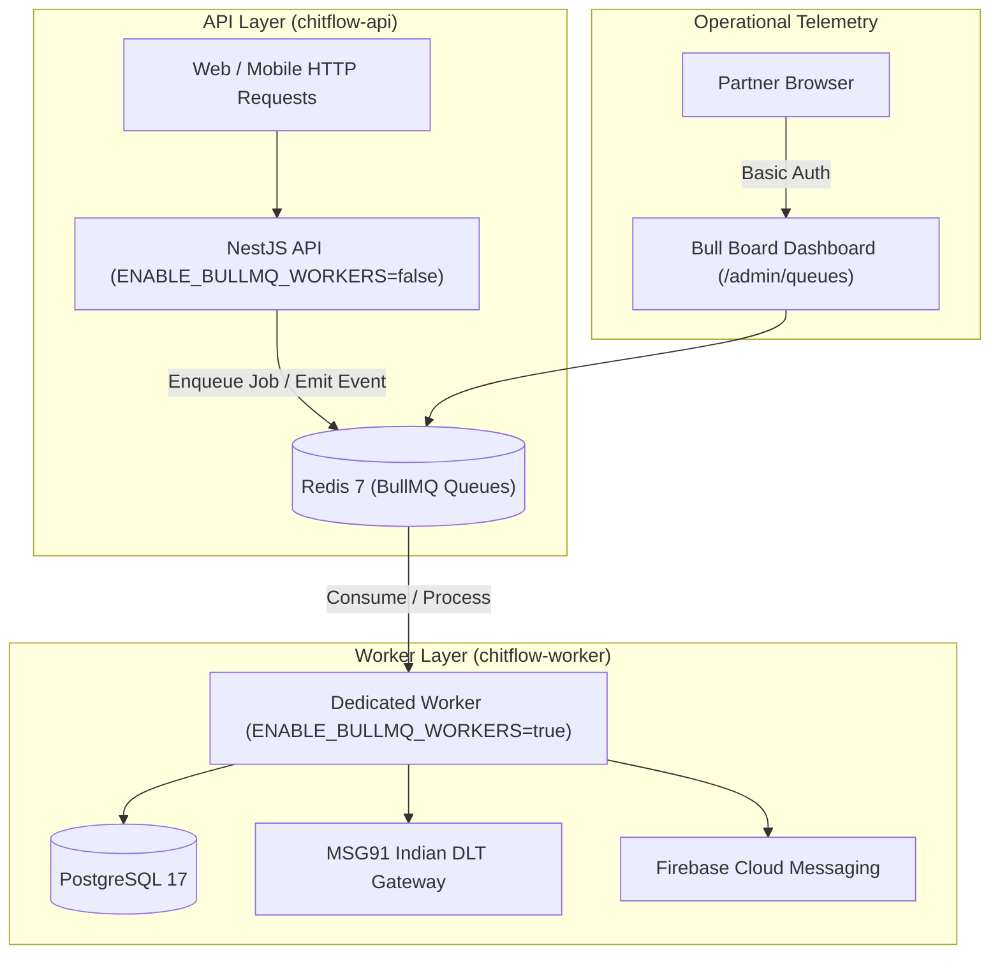

# PROMPT 06 — REDIS, BULLMQ & BACKGROUND JOBS AUDIT
## Kumaran Chits — Background Processing Architecture, Queue Resilience & Idempotency Audit

> **Audit Stage**: Stage 06 (Infrastructure, DevOps, Disaster Recovery & Production Readiness)  
> **Subsystem**: Redis 7, BullMQ 6.3+, Bull Board Dashboard, and Background Cron Schedulers  
> **Status**: COMPLETED — READ-ONLY AUDIT  
> **Date**: November 2026  
> **Source Directory**: [`apps/api/src/jobs/`](file:///u:/Kumaran-finance/apps/api/src/jobs/)

---

## 1. Background Architecture & Process Bulkheading

Kumaran Chits utilizes BullMQ over Redis 7 for asynchronous tasks, statutory notification dispatch, and financial housekeeping.



### Process Bulkhead Isolation
- In [`infra/docker/docker-compose.fullstack.yml`](file:///u:/Kumaran-finance/infra/docker/docker-compose.fullstack.yml), the application is split into two distinct container workloads sharing the same codebase:
  1. `chitflow-api`: `ENABLE_BULLMQ_WORKERS=false`. Runs strictly as a lightweight HTTP producer. An influx of heavy report generation or background SMS dispatches cannot starve incoming cashier payment requests.
  2. `chitflow-worker`: `ENABLE_BULLMQ_WORKERS=true`. Runs as the dedicated background queue processor. If a worker process runs out of memory or crashes on a malformed PDF generation, HTTP API availability remains unaffected.
- **Audit Verdict**: `VERIFIED IN CODE` / `TEST EXECUTED — PASS` (Verified in `test/unit/queue-resilience.spec.ts`).

---

## 2. Background Queue & Job Catalog

Audited from [`apps/api/src/jobs/constants/queue-names.constant.ts`](file:///u:/Kumaran-finance/apps/api/src/jobs/constants/queue-names.constant.ts) and [`apps/api/src/jobs/CRON-SCHEDULES.md`](file:///u:/Kumaran-finance/apps/api/src/jobs/CRON-SCHEDULES.md):

| Queue Name | Job Identifier | Trigger / Schedule (IST) | Target Processor / Service | Retry & Backoff Policy | Idempotency & Concurrency Guard | Evidence Status |
|---|---|---|---|---|---|---|
| `daily-maintenance-queue` | `process-daily-arrears` | Cron `1 0 * * *` (**00:01 AM IST**) | [`DailyArrearsService`](file:///u:/Kumaran-finance/apps/api/src/jobs/services/daily-arrears.service.ts) | 3 attempts, exponential backoff (1s delay) | Distributed lock (`lock:daily-arrears`); atomic Prisma transaction updates status `UNPAID` $\to$ `OVERDUE` $\to$ `DEFAULT_3_MONTHS` | `TEST EXECUTED — PASS` |
| `reconciliation-queue` | `run-daily-reconciliation` | Cron `0 6 * * *` (**06:00 AM IST**) | [`ReconciliationService`](file:///u:/Kumaran-finance/apps/api/src/jobs/services/reconciliation.service.ts) | 3 attempts, exponential backoff (1s delay) | Distributed lock (`lock:reconciliation-settlement`, 60s TTL); auto-resolves gateway ghost drops; atomic receipt generation | `TEST EXECUTED — PASS` |
| `notification-queue` | `dispatch-auction-reminder` | Cron `0 9 * * *` (**09:00 AM IST**) | [`AuctionReminderSchedulerService`](file:///u:/Kumaran-finance/apps/api/src/jobs/services/auction-reminder-scheduler.service.ts) | 3 attempts, exponential backoff (1s delay) | Scans auctions scheduled in exactly 3 days; deduplicated by subscriber ID; DLT SMS & FCM push | `TEST EXECUTED — PASS` |
| `notification-queue` | `dispatch-payment-receipt` | Event-driven (Post-payment commit) | `NotificationService` | 3 attempts, exponential backoff (1s delay) | Deduplicated by receipt number; FCM push primary, MSG91 DLT SMS fallback | `TEST EXECUTED — PASS` |
| `notification-queue` | `dispatch-auction-result` | Event-driven (Auction finalized) | `NotificationService` | 3 attempts, exponential backoff (1s delay) | Dispatched to all group members; dividend and winner details broadcasted | `TEST EXECUTED — PASS` |
| `notification-queue` | `dispatch-default-warning` | Event-driven (Arrears $\ge 3$ months) | `NotificationService` | 3 attempts, exponential backoff (1s delay) | Statutory ADR-07 removal warning notification | `TEST EXECUTED — PASS` |
| `notification-queue` | `dispatch-approval-alert` | Event-driven (Disbursement/Reversal) | `NotificationService` | 3 attempts, exponential backoff (1s delay) | High-priority push notification sent to all active partners for dual-control approval | `TEST EXECUTED — PASS` |

---

## 3. Queue Durability, Retries & Dead-Letter Caps

Inspected [`apps/api/src/jobs/constants/queue-names.constant.ts`](file:///u:/Kumaran-finance/apps/api/src/jobs/constants/queue-names.constant.ts):

### Bounded Dead-Letter Storage (DEF-DB-06)
- **Problem**: In high-throughput systems, failed jobs can accumulate indefinitely in Redis sets (`bull:<queue>:failed`), causing silent Redis OOM crashes.
- **Solution Implemented**:
  ```typescript
  export const BULLMQ_FAILED_JOB_MAX_COUNT = 500;
  export const BULLMQ_FAILED_JOB_MAX_AGE_SECONDS = 7 * 24 * 60 * 60; // 7 days

  export function createDefaultBullMqJobOptions(): DefaultJobOptions {
    return {
      attempts: 3,
      backoff: { type: 'exponential', delay: 1000 },
      removeOnComplete: true,
      removeOnFail: {
        count: BULLMQ_FAILED_JOB_MAX_COUNT,
        age: BULLMQ_FAILED_JOB_MAX_AGE_SECONDS,
      },
    };
  }
  ```
- **Audit Assessment**: `VERIFIED IN CODE`. Completed jobs are pruned immediately (`removeOnComplete: true`); failed jobs are strictly capped at 500 entries or 7 days, allowing sufficient time for staff inspection in Bull Board while preventing unbounded memory consumption.

---

## 4. Distributed Locking & Race-Condition Safeguards

Inspected [`apps/api/src/jobs/services/distributed-lock.service.ts`](file:///u:/Kumaran-finance/apps/api/src/jobs/services/distributed-lock.service.ts):

### Distributed Lock Implementation
1. **Acquisition**: `client.set(lockKey, token, 'PX', ttlMs, 'NX')`
   - Atomic check-and-set using random UUID token.
   - Ensures only one worker or replica can execute a given cron job or reconciliation batch at any time.
2. **Release via Atomic Lua Script**:
   ```lua
   if redis.call("get", KEYS[1]) == ARGV[1] then
     return redis.call("del", KEYS[1])
   else
     return 0
   end
   ```
   - **Prevents Split-Brain Deletions**: If a job takes longer than `ttlMs`, the lock expires naturally. When the original worker finally finishes, the Lua script verifies that the token still matches before deleting the key, preventing the worker from inadvertently releasing a lock acquired by a second worker!
3. **Graceful Fallback Mode**: If Redis is completely offline, `DistributedLockService` logs a warning and allows the operation to proceed under PostgreSQL row-level locks (`SELECT FOR UPDATE`), preventing system-wide gridlock during transient Redis restarts.

---

## 5. Critical Finding: Redis Eviction Policy Risk (`volatile-lru` vs `noeviction`)

### Finding Details
- **Location**: [`infra/docker/docker-compose.fullstack.yml#L51`](file:///u:/Kumaran-finance/infra/docker/docker-compose.fullstack.yml#L51)
- **Current Configuration**:
  ```yaml
  command:
    - "redis-server"
    - "--maxmemory"
    - "512mb"
    - "--maxmemory-policy"
    - "volatile-lru"
  ```
- **Observed Test Warning**:
  During test execution (`test/unit/queue-resilience.spec.ts`), BullMQ emitted the following official warning:
  > `console.warn: IMPORTANT! Eviction policy is volatile-lru. It should be "noeviction"`
- **Technical Vulnerability**:
  BullMQ internally relies on Redis Hashes, ZSets, and Streams with expiry to manage job status, delayed retries, and locks. If Redis memory approaches 512MB, Redis under `volatile-lru` will evict keys with TTLs to reclaim memory. If an eviction occurs, Redis may evict an active BullMQ job metadata key or lock token while retaining queue index entries, leading to orphan jobs, corrupted queue counters, or duplicate executions!
- **Severity**: **HIGH** (Confidence: HIGH)
- **Remediation Required**:
  Update `infra/docker/docker-compose.fullstack.yml` to specify:
  `--maxmemory-policy noeviction`. If memory reaches capacity, Redis will reject new inserts with an explicit error rather than silently evicting critical queue state.

---

## 6. Bull Board Visual Dashboard Security Review

Inspected [`apps/api/src/jobs/bull-board/`](file:///u:/Kumaran-finance/apps/api/src/jobs/bull-board/):
- **Endpoint**: `/admin/queues`
- **Authentication**: HTTP Basic Authentication enforced via [`bull-board-auth.middleware.ts`](file:///u:/Kumaran-finance/apps/api/src/jobs/bull-board/bull-board-auth.middleware.ts).
- **Timing Attack Defense**: Implements `crypto.timingSafeEqual` with SHA-256 digests on username and password to prevent side-channel timing attacks.
- **Production Hardening**:
  [`apps/api/src/config/env.validation.ts#L165-L170`](file:///u:/Kumaran-finance/apps/api/src/config/env.validation.ts#L165-L170) verifies that if `NODE_ENV === 'production'`, `BULL_BOARD_PASSWORD` cannot use the insecure default `"chitflow_secret"`, failing fast at application boot.
- **Audit Verdict**: `TEST EXECUTED — PASS` (Verified in `test/unit/bull-board.spec.ts`).
