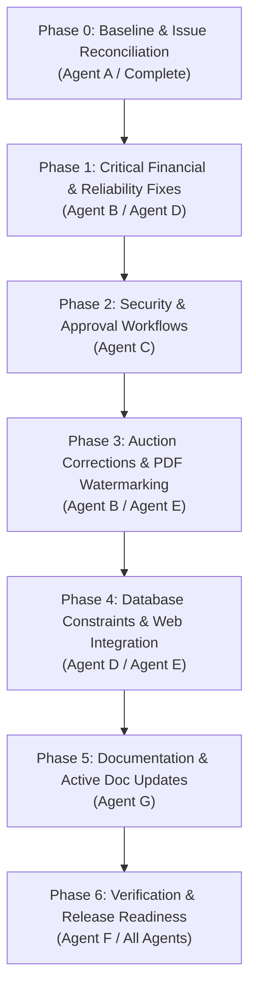

# KUMARAN CHITS — REMEDIATION IMPLEMENTATION PLAN

> **Product**: **Kumaran Chits**  
> **Company**: **Kumaran Finance** (Perundurai, Erode District, Tamil Nadu)  
> **Scope Directive**: Flutter Mobile UI and Android implementation are **DEFERRED — OWNER-APPROVED SCOPE EXCLUSION**.  
> **Baseline Commit / Status**: Git `main` branch, 52/52 Unit Test Suites Passing (820/820 tests), Zero Regressions Allowed.  
> **Date**: November 13, 2026  

---

## 1. Execution Phases & Workstream Ownership

---

## 2. Phase-by-Phase Implementation Specifications

### Phase 1: Critical Financial & Reliability Fixes (Agent B & Agent D)
- **Task 1.1 (KFC-FIN-001)**: Fix `settleFinalMonth` in `disbursement.service.ts`:
  - Calculate `commissionAmount = (chitValue * 4n) / 100n`.
  - Calculate `baseInstallment = chit.baseInstallment`.
  - Calculate `netPrizeMoney = chitValue - commissionAmount - baseInstallment` (e.g. ₹91,000 for a ₹1L scheme).
  - Inside the locked transaction, query or create Month $N$'s `InstallmentDue` for the winner's ticket, and mark it as `PAID` (`paidAmount = baseInstallment, status = DueStatus.PAID`).
  - Update settlement response DTO and bilingual audit log.
- **Task 1.2 (KFC-FIN-002)**: Enforce whole-rupee dividend divisibility in `auction.service.ts`:
  - In `recordBid`, `recordTieBreak`, and `calculateAuctionMath`:
    Assert `(bidDiscount - commissionAmount) % totalTickets === 0n`.
    If remainder $\ne 0$, throw `BadRequestException: NON_DIVISIBLE_DIVIDEND: Bid discount ₹... produces a non-divisible dividend...`.
- **Task 1.3 (KFC-FIN-003 & KFC-FIN-004)**: Automated arrears offset & payout override removal in `disbursement.service.ts`:
  - In `authorizePayout`:
    - Fetch all unpaid dues (`DueStatus.UNPAID` / `OVERDUE`) for the winning ticket.
    - Compute `totalArrears`.
    - If `totalArrears >= grossPrizeMoney`, reject with `OUTSTANDING_ARREARS_EXCEED_PRIZE`.
    - Compute `authorizedNetPayout = grossPrizeMoney - totalArrears`.
    - Enforce that client-supplied `dto.disbursedAmount` (if passed) must strictly equal `authorizedNetPayout`.
  - In `releasePayout`:
    - In the same transaction marking status `DISBURSED`, mark all offset `InstallmentDue` records as `PAID` (`status = DueStatus.PAID, paidAmount = netPayableAmount`).
- **Task 1.4 (KFC-INF-001)**: Redis `noeviction` configuration for BullMQ:
  - Inspect `docker-compose.yml` and `infra/docker/redis.conf`.
  - Configure `--maxmemory-policy noeviction`.

---

### Phase 2: Security & Approval Workflows (Agent C)
- **Task 2.1 (KFC-SEC-001)**: Payment reversal Partner-only initiation:
  - In `payment.controller.ts#L201`: Restrict `@Roles` on `POST :id/request-reversal` strictly to `Role.SUPER_ADMIN` (Partners).
  - Verify `maker_user_id !== checker_user_id` where both are `SUPER_ADMIN`.
- **Task 2.2 (KFC-SEC-002)**: Two-Partner Defaulter Removal & Settlement:
  - In `installment/ticket.controller.ts` & `installment.service.ts`:
    - Restructure `removeDefaulter` into a two-step approval:
      1. `requestDefaulterRemoval`: Initiated by Partner A (`removalRequestedByUserId = partnerA.id, status = 'REMOVAL_REQUESTED'`).
      2. `approveDefaulterRemoval`: Authorized by Partner B (`maker != checker`, status transitions to `REMOVED_DEF_3M`).
    - Restructure `settleRemoval` into a two-step approval:
      1. `requestRemovalSettlement`: Partner A calculates damages & refund, status `SETTLEMENT_REQUESTED`.
      2. `approveRemovalSettlement`: Partner B verifies & signs off (`maker != checker`).
- **Task 2.3 (KFC-SEC-003)**: Auction Finalization restricted exclusively to Partners:
  - In `auction.controller.ts#L201`: Remove `Role.BRANCH_MANAGER` from `@Roles` on `POST :id/finalize`. Restrict strictly to `Role.SUPER_ADMIN`.
- **Task 2.4 (KFC-SEC-004)**: Prized ticket removal/transfer guard:
  - In `installment.service.ts`: In `removeDefaulter` and `substituteSubscriber`, add:
    `if (ticket.isPrized) throw BadRequestException('PRIZED_TICKET_IMMUTABLE: Prized subscriber tickets cannot be removed or substituted under defaulter rules.')`.

---

### Phase 3: Auction Corrections & PDF Watermarking (Agent B & Agent E)
- **Task 3.1 (KFC-FIN-005)**: Controlled Finalized Auction Correction:
  - Add `POST /auctions/:id/correction/request` (Partner A):
    - Validates auction is `COMPLETED` and prize has NOT been disbursed (`auction.winner.disbursementStatus !== 'DISBURSED'`).
    - Captures proposed winning ticket, bid discount, and reason.
  - Add `POST /auctions/:id/correction/approve` (Partner B, `maker != checker`):
    - Updates winning ticket and discount.
    - Recalculates dividends for all tickets in group and updates non-settled `InstallmentDue` records.
    - Writes immutable audit log with compensating entries.
- **Task 3.2 (KFC-PDF-001)**: Cancelled Receipt Watermark:
  - In `subscription-receipt.template.ts`: Add `isCancelled: boolean`, `cancelledAt?: Date`, `cancelledReason?: string`.
  - Render bold red diagonal watermark `ரத்து செய்யப்பட்டது / CANCELLED` across printable area.
  - In `pdf.service.ts`: If `payment.paymentStatus === 'REVERSED'`, pass `isCancelled: true` and evict/invalidate cached S3 object.
- **Task 3.3 (KFC-NOT-001)**: WhatsApp simulation code purge:
  - In `jobs/services/notification.service.ts`: Purge WhatsApp simulation stubs; ensure notification dispatch is SMS DLT only.

---

### Phase 4: Database Constraints & Web Integration (Agent D & Agent E)
- **Task 4.1**: Safe schema constraints and migrations:
  - Update `schema.prisma` with new models/fields (e.g. for `AuctionCorrection`, `DefaulterRemovalRequest`).
  - Create idempotent migration.
- **Task 4.2**: Web application workflow alignment (`apps/web`):
  - Ensure auction finalization page requires Partner credentials.
  - Display arrears offset breakdown on disbursement screens.
  - Ensure pending approvals queue includes new two-partner queues.
  - Display cancelled watermark and badge on reversed receipts in web view.

---

### Phase 5: Documentation & Active Doc Updates (Agent G)
- **Task 5.1**: Comprehensive documentation update across `docs/` and root READMEs.
- **Task 5.2**: Generate `DOCUMENTATION-CONSISTENCY-REGISTER.md` auditing all active files.

---

### Phase 6: Verification & Release Readiness (Agent F / All Agents)
- **Task 6.1**: Run full unit, regression, and e2e test suites.
- **Task 6.2**: Compile final verification evidence documents (`docs/08-audit/`).
- **Task 6.3**: Formulate final production readiness verdict (`FINAL-PRODUCTION-READINESS.md`).
