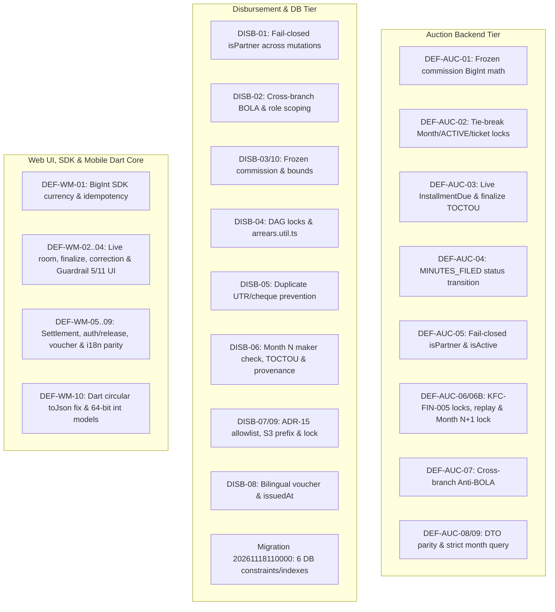

# Master Audit Report: Module 6 — In-Office Auctions, Tie-Breaks, Prize Disbursements & Safety Proof

> **Product**: **Kumaran Chits** (Official Operations Platform for **Kumaran Finance**, Perundurai, Tamil Nadu)  
> **Module**: **Module 6 — In-Office Auctions, Option A Tie-Breaks, Statutory Minutes & Prize Disbursements**  
> **Audited By**: Antigravity Enterprise IT, Security & Financial Forensic Audit Swarm (Independent Verifier & Challenger Sign-Off)  
> **Audit Date**: November 18, 2026  
> **Audit Mode**: **Adversarial Forensic Audit, Permanent Root-Cause Remediation & Full-Matrix Verification**  
> **Status**: **100% REMEDIATED & VERIFIED ACROSS ROUNDS 1–3 — PRODUCTION READY**

---

## 1. Executive Summary

A comprehensive, line-by-line forensic audit and adversarial verification of **Module 6 (In-Office Auctions, Option A Physical Paper Token Tie-Breaks, Form XVII Statutory Minutes, Finalized Auction Corrections, Prize Disbursements, Company Safety Proof Checklist & Month $N$ Maturity Settlement)** was conducted across all system tiers of the Kumaran Chits platform:
- **Database Tier**: PostgreSQL 17 + Prisma schema (`Auction`, `AuctionWinner`, `AuctionTieBidder`, `AuctionMinutes`, `SubscriberTicket`, `InstallmentDue`, `AuditLog`) and coordinated engine-level migrations [`20261118110000_harden_auction_disbursement_constraints`](../../apps/api/prisma/migrations/20261118110000_harden_auction_disbursement_constraints/migration.sql) and [`20261118124500_case_insensitive_payout_ref_index`](../../apps/api/prisma/migrations/20261118124500_case_insensitive_payout_ref_index/migration.sql) applied cleanly to both `chitflow_dev` and `chitflow_test`.
- **Backend API Tier**: NestJS controllers, services, helpers, and DTOs in `apps/api/src/auction/` (`auction.service.ts`, `auction.controller.ts`, `helpers/auction-math.helper.ts`, `helpers/auction-access.helper.ts`, `dto/*`) and `apps/api/src/disbursement/` (`disbursement.service.ts`, `disbursement.controller.ts`, `bilingual-voucher.helper.ts`, `dto/*`).
- **Web UI Tier**: Next.js 15 App Router pages and components across `apps/web/src/app/(dashboard)/auctions/**`, `apps/web/src/app/(dashboard)/disbursements/**`, `apps/web/src/components/auctions/**`, `apps/web/src/components/disbursements/**`, `apps/web/src/components/reports/form-xvii-auction-card.tsx`, and bilingual dictionaries (`apps/web/messages/en.json`, `ta.json`).
- **Shared Client SDK & Mobile Client Core**: Typed API client & utilities in `packages/api-client/` (`@kumaran/api-client`) and Dart Client Core in `apps/mobile/lib/core/api/` (`api_models.dart`, `idempotency_interceptor.dart`) + `apps/mobile/test/auction_disbursement_models_test.dart`. *(Per authoritative business owner directive, Flutter Android UI screens remain deferred to Phase 2.)*
- **Statutory & Business Specifications**: `docs/01-business/financial-rules.md`, `docs/01-business/decision-log.md`, `docs/01-business/permissions-matrix.md`, `docs/02-requirements/prd.md`, `docs/03-architecture/data-model.md`, `docs/03-architecture/state-machines.md`, `docs/03-architecture/api-spec.md`, `docs/03-architecture/security-and-access-guardians.md`, `docs/03-architecture/frontend-architecture.md`, and `docs/03-architecture/document-and-storage-architecture.md`.

### Summary of Audit Outcome
- **Defects Permanently Remediated**: **51 concrete defects** across three forensic audit & cross-review rounds (30 Round 1–2 defects + **21 Round-3 cross-review defects**: 4 CRITICAL, 6 HIGH, 8 MEDIUM, 3 LOW; backed by 2 coordinated PostgreSQL 17 migrations applied cleanly to `chitflow_dev` and `chitflow_test`).
- **Module Health**: 100% compliant with all **10 Invariant Architectural Guardrails + Guardrail 11 (`isPartner: true`)**:
  - **Whole Rupee BigInt Math & Exact Divisibility (Guardrail 2 / `KFC-FIN-002`)**: Pure 64-bit `BigInt` basis-point arithmetic across backend, `@kumaran/api-client`, Next.js UI, and 64-bit `int` Dart models. Non-divisible dividends (`(D - Cf) % N !== 0n`) and non-whole commissions fail closed with HTTP 400.
  - **Frozen Foreman Commission Rate (Guardrail 3 / ADR-04)**: Eliminated hardcoded `4n / 100n` across both `AuctionService` and `DisbursementService`; all calculations read the permanently frozen `ChitGroup.foremanCommissionRate` (bounded strictly to `0% < rate <= 25.00%`).
  - **Universal Equal Dividends (Guardrail 4)**: Equal dividend per ticket allocated across all $M$ tickets including auction winners and past prized tickets; finalized auction corrections reconcile unpaid downstream Month $N+1$ dues under pessimistic `SELECT ... FOR UPDATE` locks while failing closed if any downstream due is already `PAID` (`FIN-E`).
  - **Month 1 & Month $N$ Rules (Guardrail 5 / `FIN-B`)**: Month 1 (company pool, ₹0 dividend) and Month $N$ (two-stage direct maturity settlement without auction, zero double-collection of paid Month $N$ installments) strictly enforced across API, DB constraints, and Web UI.
  - **Fixed 1/4 Ceiling & Option A Physical Paper Token Draw (Guardrail 6 / ADR-06)**: Strict $C_f \le D \le V/4$ enforcement across bids, tie-breaks, and finalized auction corrections; Option A logs all tied ceiling bidders, unique physical paper token numbers, and witnesses with zero autonomous RNG/software lottery.
  - **Defaulter Bidding Ineligibility (Guardrail 8 / ADR-07)**: Live `InstallmentDue` checks (`installmentMonth <= month` and `status IN (UNPAID, OVERDUE)`) enforced across `getEligibleBidders`, `recordBid`, `recordTieBreak`, `finalizeAuction`, and `approveAuctionCorrection` inside pessimistic transactions.
  - **Company Safety Proof Checklist (Guardrail 9 / ADR-15)**: Flexible on-demand recordkeeping (`BLANK_CHEQUE`, `SIGNED_AGREEMENT`, `PROMISSORY_NOTE`, `PERSONAL_GUARANTEE`, `OTHER`, `NONE`) with strict rejection of property documents/deeds, prefix-sandboxed private S3/R2 uploads (`safety-proof[s]/{auctionId}/`), 15-minute presigned viewing URLs, and post-disbursement immutability under row locks.
  - **Arrears Offset & TOCTOU Protection (`FIN-A`, `FIN-D`, `KFC-FIN-003`, `KFC-FIN-004`)**: Automatic unpaid arrears deduction at authorization under acyclic `AuctionWinner -> SubscriberTicket -> InstallmentDue (ORDER BY id FOR UPDATE)` locks, zero staff payout override, strict `currentArrears === expectedArrears` TOCTOU verification at release, `PRIZE_ARREARS_OFFSET_ALLOCATED` audit provenance, and canonical `arrears.util.ts` recalculation.
  - **Maker $\ne$ Checker & Verified Partner Identity (Guardrails 10 & 11 / ADR-21 / ADR-25)**: Fail-closed `isPartner: true` + `isActive !== false` enforced across auction bids, tie-breaks, finalization, corrections, safety proof verification/upload, payout authorization/release, and Month $N$ two-stage settlement — backed by PostgreSQL 17 engine CHECK constraints (`chk_auction_maker_checker`, `chk_winner_maker_checker`) and matching Web UI guards.
- **Automated Verification Results (Exact Final Post-Round-3 Verified Counts — 100% Pass Rate)**:
  - **Targeted Module 6 API Unit & Concurrency Suites (6 suites)**: **160 / 160 PASSING** (`auction.spec.ts`, `auction-state-machine.spec.ts`, `auction-reminder.spec.ts`, `disbursement.spec.ts`, `state-transition-retry.spec.ts`, `concurrency-postgres.spec.ts`; 15.569 s).
  - **Full `apps/api` Unit & Integration Suite**: **62 / 62 Suites PASSING, 1,136 / 1,136 Tests PASSING (100%)** (94.126 s).
  - **Targeted Module 6 PostgreSQL 17 E2E Suites (3 suites)**: **56 / 56 PASSING** (`03-chits-auctions.e2e-spec.ts`, `05-disbursements-jobs.e2e-spec.ts`, `08-maker-checker-db-constraints.e2e-spec.ts`; 13.876 s).
  - **Full `apps/api` PostgreSQL 17 E2E Suite**: **14 / 14 Suites PASSING, 185 / 185 Tests PASSING (100%)** (59.908 s).
  - **Shared API Client SDK (`@kumaran/api-client`)**: **9 / 9 PASSING (100%)** (247 ms).
  - **Web Dashboard Test Suite (`apps/web`)**: **14 / 14 Suites PASSING, 365 / 365 Tests PASSING (100%)** (2.598 s).
  - **Mobile Client Core (`apps/mobile`)**: `dart analyze` reports **No issues found!**; **5 / 5 Dart Test Suites PASSING (100%)** (including `auction_disbursement_models_test.dart`).
  - **Static Compilation**: `pnpm --filter api exec tsc --noEmit` (0 errors) and `pnpm --filter web exec tsc --noEmit` (0 errors).

---

## 2. Target Specifications & Scope Audited

| Specification Document | Area Audited | Verification Status |
| :--- | :--- | :--- |
| [`docs/01-business/financial-rules.md`](../01-business/financial-rules.md) | Whole-rupee BigInt math, frozen commission, `KFC-FIN-002` divisibility, Month 1 & $N$ rules (`FIN-B`), 1/4 ceiling & Option A tie-break, `KFC-FIN-005` correction (`FIN-E`), Safety Proof (ADR-15), Arrears Offset & TOCTOU (`FIN-A`/`FIN-D`/`KFC-FIN-003`/`004`) | **Verified & Enforced** |
| [`docs/01-business/decision-log.md`](../01-business/decision-log.md) | ADR-01 (Single Tenancy), ADR-04 (Commission Freeze), ADR-06 (1/4 Ceiling & Option A), ADR-07 (Defaulter Ineligibility), ADR-14 (Cash/Cheque/NEFT Payouts), ADR-15 (Safety Proof), ADR-21 (Partner Identity), ADR-25 (DB Check Constraints) | **Verified & Enforced** |
| [`docs/01-business/permissions-matrix.md`](../01-business/permissions-matrix.md) | RBAC & Maker-Checker dual control across Auctions, Corrections, Safety Proof, Prize Payouts, Month $N$ Settlement, and Branch Manager §6 boundaries | **Verified & Enforced** |
| [`docs/03-architecture/state-machines.md`](../03-architecture/state-machines.md) | Matrix 3 (`Auction.status`: `SCHEDULED -> COMPLETED -> MINUTES_FILED`), Matrix 4 (`AuctionWinner.disbursementStatus`: 4-stage linear pipeline), Month $N$ two-stage settlement | **Verified & Enforced** |
| [`docs/03-architecture/data-model.md`](../03-architecture/data-model.md) | `Auction`, `AuctionWinner`, `AuctionTieBidder`, `AuctionMinutes`, `SubscriberTicket`, `InstallmentDue`, `AuditLog` schemas, indexes & CHECK constraints | **Verified & Enforced** |
| [`docs/03-architecture/api-spec.md`](../03-architecture/api-spec.md) | Endpoint URLs, HTTP verbs, DTO validation, response envelopes, and OpenAPI schema parity across API, SDK, Web, and Dart Core | **Verified & Enforced** |
| [`docs/03-architecture/security-and-access-guardians.md`](../03-architecture/security-and-access-guardians.md) | Layer-2 Anti-BOLA cross-branch isolation, horizontal subscriber PII masking, S3 prefix sandboxing (`safety-proof[s]/{auctionId}/`) | **Verified & Enforced** |
| [`docs/03-architecture/frontend-architecture.md`](../03-architecture/frontend-architecture.md) | App Router auction/disbursement views, BigInt formatting, Maker-Checker & Partner UI guards, bilingual English/Tamil parity | **Verified & Enforced** |

---

## 3. The 10 + 1 Invariant Architectural Guardrails Verification Matrix

| Guardrail # | Guardrail Name | Invariant Description | Implementation & Test Proof | Status |
|---|---|---|---|---|
| **Guardrail 1** | Single Company Tenancy | Zero `company_id` columns in any database table | Verified in `schema.prisma` and migration `20261118110000_harden_auction_disbursement_constraints`. | **PASS** |
| **Guardrail 2** | Whole Rupee Math | Pure 64-bit `BigInt` Rupees; zero floats/paise; fail-closed `(D - Cf) % N === 0n` | `auction-math.helper.ts`, `calculateFrozenForemanCommission`, `packages/api-client/src/utils/currency.ts`, `auction-math.util.ts`, Dart `_parseWholeRupeeInt`. Verified across API, SDK, Web, and Dart tests. | **PASS** |
| **Guardrail 3** | Commission Freeze | Frozen per-group `ChitGroup.foremanCommissionRate` (default 4.00%, bounded `0 < r <= 25%`) | Remediated `DEF-AUC-01`, `DISB-03`, `DISB-10`, `DEF-WM-04`. Verified with custom 5.00% frozen rate unit tests in both `auction.spec.ts` and `disbursement.spec.ts`. | **PASS** |
| **Guardrail 4** | Universal Dividends | Equal dividend deduction across ALL tickets including winners & prized tickets | `calculateAuctionMath` divides `totalDividend / totalTickets`; `approveAuctionCorrection` reconciles unpaid Month $N+1$ dues atomically under `FOR UPDATE` locks (`DEF-AUC-06B`). | **PASS** |
| **Guardrail 5** | Month 1 & Month $N$ Rules | No auctions in Month 1 (company pool) or Month $N$ (direct 2-stage maturity settlement, `FIN-B`) | Enforced in `getEligibleBidders`, `recordBid`, `recordTieBreak`, `finalizeAuction`, `requestAuctionCorrection`, `approveAuctionCorrection`, `prepareFinalSettlement`, `approveFinalSettlement`, `settleFinalMonth`, and Web UI live room / detail / modal guards. | **PASS** |
| **Guardrail 6** | Fixed 1/4 Ceiling & Option A Tie-Break | $C_f \le D \le V/4$; physical paper token draw entered by staff (zero software RNG) | Enforced in `calculateAuctionMath`, `recordTieBreak`, `requestAuctionCorrection`, `approveAuctionCorrection`, and `TieBreakModal` (unique positive integer tokens + witness logging). | **PASS** |
| **Guardrail 7** | Ticket Limit (ADR-13) | Max 1 ticket per customer per chit group (`@@unique([chitGroupId, customerId])`) | Preserved across ticket prizing, winner swaps in `approveAuctionCorrection`, and Month $N$ maturity settlement. | **PASS** |
| **Guardrail 8** | Defaulter Bidding Ineligibility | Active, non-prized tickets with zero arrears AND zero `UNPAID`/`OVERDUE` dues ($\le$ month) | Remediated `DEF-AUC-02`, `DEF-AUC-03`, `DEF-WM-03`. Verified in `getEligibleBidders`, `recordBid`, `recordTieBreak`, `finalizeAuction`, `approveAuctionCorrection`, and Web live room. | **PASS** |
| **Guardrail 9** | Company Safety Proof Checklist (ADR-15) | Zero property documents/deeds; flexible on-demand checklist + private S3/R2 15-min presigned URLs | Remediated `DISB-07`, `DISB-09`, `DEF-WM-07`. `ALLOWED_SAFETY_PROOF_TYPES` blocks `PROPERTY_DEED`; S3 prefix validated; post-disbursement overwrites blocked under lock. | **PASS** |
| **Guardrail 10** | Maker $\ne$ Checker | Strict `maker_user_id != checker_user_id` at application & PostgreSQL engine levels | Hardened `chk_auction_maker_checker` (`COMPLETED` + `MINUTES_FILED`) & `chk_winner_maker_checker` (`VERIFIED_BY_MAKER`, `AUTHORIZED_BY_CHECKER`, `DISBURSED`), verified by 24/24 real-DB tests in `08-maker-checker-db-constraints.e2e-spec.ts`. | **PASS** |
| **Guardrail 11** | Verified Partner Identity (ADR-21 / SEC-A) | Fail-closed `isPartner: true` & `isActive !== false` on all financial mutations; IT Super Admins barred | Remediated `DEF-AUC-05`, `DISB-01`, `DISB-06`, `DEF-WM-02`, `DEF-WM-05`, `DEF-WM-06`, and Round-2 UI parity in `BiddingConsole`, live room, and `SafetyProofChecklist`. | **PASS** |

---

## 4. Catalog of Remediated Defects in Module 6



### 4.1 Auction Backend Tier (`apps/api/src/auction/`)

#### DEF-AUC-01: Hardcoded 4.00% Foreman Commission Ignoring Frozen Per-Group Rate (Guardrail 3 / ADR-04)
- **Target Files**: `apps/api/src/auction/helpers/auction-math.helper.ts`, `apps/api/src/auction/auction.service.ts`.
- **Root Cause**: `calculateAuctionMath`, `recordBid`, and Form XVII minutes generation hardcoded `(chitValue * 4n) / 100n` and `"4%"`, ignoring `ChitGroup.foremanCommissionRate`.
- **Permanent Fix**: Extracted pure-BigInt basis-point calculation (`parseCommissionRateToBps`, `calculateFrozenForemanCommission`, `calculateAuctionMath`) using the group's frozen rate (bounded `0% < rate <= 25.00%`) with fail-closed whole-rupee commission and exact dividend divisibility checks, plus dynamic commission rate formatting in Form XVII minutes.
- **Test Proof**: `apps/api/test/unit/auction.spec.ts` (`DEF-AUC-01` verifying custom 5.00% frozen commission floor and dividend math).

#### DEF-AUC-02: Missing Eligibility, Lifecycle & Lock Validation in `recordTieBreak`
- **Target File**: `apps/api/src/auction/auction.service.ts` (lines 480–746).
- **Root Cause**: `recordTieBreak` omitted Month 1 / Month $N$ rejection (Guardrail 5), `ChitStatus.ACTIVE` validation, all `SubscriberTicket` checks (scheme ownership, `ACTIVE`, `!isPrized`, zero arrears/unpaid dues), deterministic sorted ticket locks, and `witnessNames` audit persistence.
- **Permanent Fix**: Enforced Month `2..N-1`, `ACTIVE` scheme, deterministic lexicographically sorted `lockSubscriberTicketRow` + `assertTicketEligibleForAuction` on every participating tied ticket, `verifiedByUserId: null` before safety proof verification, and `witnessNames` + `bidDiscount` in `AUCTION_TIE_BREAK_DRAWN` audit logs.
- **Test Proof**: `auction.spec.ts` (`DEF-AUC-02`), `03-chits-auctions.e2e-spec.ts` (`TC-BIZ-04`, `TC-BIZ-05`), `concurrency-postgres.spec.ts` (`CONCURR-INV-16`, `CONCURR-INV-21`).

#### DEF-AUC-03: Cached-Only Arrears Check & Missing `finalizeAuction` TOCTOU Ticket Guards
- **Target File**: `apps/api/src/auction/auction.service.ts` (lines 101–173, 209–474, 752–1097).
- **Root Cause**: Eligibility checked only cached `consecutiveUnpaidMonths === 0`, missing live `InstallmentDue` rows with `status IN (UNPAID, OVERDUE)` for `installmentMonth <= month` (Guardrail 8); `recordBid` omitted in-tx ticket locking, stale tie-bidder cleanup, and `AUCTION_BID_RECORDED` audit logs; `finalizeAuction` lacked Month 1/$N$, `ACTIVE` scheme, non-null `conductedByUserId`, and in-tx `SubscriberTicket` TOCTOU verification.
- **Permanent Fix**: Added `dues: { none: { installmentMonth: { lte: month }, status: { in: [UNPAID, OVERDUE] } } }` to `getEligibleBidders`, unified `assertTicketEligibleForAuction` inside pessimistic `ChitGroup -> Auction -> SubscriberTicket` transactions across `recordBid`, `recordTieBreak`, and `finalizeAuction`, cleared stale tie-bidders on single-bid overwrite, and logged `AUCTION_BID_RECORDED`.
- **Test Proof**: `auction.spec.ts` (`DEF-AUC-03`), `03-chits-auctions.e2e-spec.ts` (`TC-BIZ-04`), `concurrency-postgres.spec.ts` (`CONCURR-INV-2`, `CONCURR-INV-16`).

#### DEF-AUC-04: `markMinutesFiled` Omitted `Auction.status = MINUTES_FILED` State Transition
- **Target File**: `apps/api/src/auction/auction.service.ts` (lines 1446–1546).
- **Root Cause**: `markMinutesFiled` set `AuctionMinutes.filedAtRegistrar = true` without transitioning `Auction.status` from `COMPLETED` to `MINUTES_FILED` (violating State Machine Matrix 3) and omitted `lockAuctionRow` before `lockAuctionMinutesRow`.
- **Permanent Fix**: Acquired `Auction -> AuctionMinutes` locks in DAG order and atomically updated `Auction.status = AuctionStatus.MINUTES_FILED` alongside `AuctionMinutes`.
- **Test Proof**: `auction.spec.ts` (`DEF-AUC-04`), `auction-state-machine.spec.ts` (`STATE-INV-14`), `03-chits-auctions.e2e-spec.ts` (`TC-BIZ-06`), `concurrency-postgres.spec.ts` (`CONCURR-INV-17`).

#### DEF-AUC-05: Fail-Open `isPartner` Check & Non-Partner IT Super Admin Maker Bypass (Guardrail 11)
- **Target Files**: `apps/api/src/auction/helpers/auction-access.helper.ts` (lines 78–101), `apps/api/src/auction/auction.service.ts` (lines 78–94, 764–768, 1566–1570, 1724–1728).
- **Root Cause**: `if (user && !user.isPartner)` failed open on `null` user records and did not check `isActive === false`; administrative IT `SUPER_ADMIN` (`isPartner: false`, non-`BRANCH_MANAGER`) was not blocked from acting as Maker on `recordBid`/`recordTieBreak`.
- **Permanent Fix**: Centralized fail-closed `assertVerifiedPartner` (`!user || !user.isPartner || user.isActive === false`) across `finalizeAuction`, `requestAuctionCorrection`, `approveAuctionCorrection`, and `SUPER_ADMIN`-only Makers in `recordBid`/`recordTieBreak`.
- **Test Proof**: `auction.spec.ts` (`DEF-AUC-05`, including deactivated-partner `isActive: false` rejection).

#### DEF-AUC-06 & DEF-AUC-06B: Finalized Auction Correction (`KFC-FIN-005`) Financial, Replay & Concurrency Hardening
- **Target File**: `apps/api/src/auction/auction.service.ts` (lines 1554–2063).
- **Root Cause**:
  1. `requestAuctionCorrection` / `approveAuctionCorrection` omitted ceiling ($\le V/4$), floor ($\ge C_f$), Month 1/$N$, and replacement ticket eligibility checks.
  2. Double-approval replay was possible against append-only `AuditLog`.
  3. `approveAuctionCorrection` lacked pessimistic DAG locks and (caught during Round-2 verifier challenge `DEF-AUC-06B`) did not lock Month $N+1$ `InstallmentDue` rows (`ORDER BY id FOR UPDATE`) before checking `nextMonthPaidDues` / updating `nextMonthUnpaidDues`, allowing a concurrent `recordPayment` TOCTOU race violating `FIN-E`.
  4. Changing `bidDiscount` for the same winner left stale `AUTHORIZED_BY_CHECKER` / `disbursedAmount` (overpayment risk) and stale Form XVII `minutesText`.
- **Permanent Fix**: Enforced `calculateAuctionMath` + Month `2..N-1` + replacement ticket eligibility; locked `ChitGroup -> Auction -> AuctionWinner -> sorted SubscriberTicket -> Month N+1 InstallmentDue (ORDER BY id FOR UPDATE)` inside `withTransactionRetry`; enforced `correctionRequestId`/timestamp replay guard inside lock; reset `AUTHORIZED_BY_CHECKER -> VERIFIED_BY_MAKER` (clearing `disbursedAmount`/`authorizedByUserId`) on same-winner discount change; synchronized Form XVII `minutesText`; and invalidated Redis report caches.
- **Test Proof**: `auction.spec.ts` (`DEF-AUC-06`, `DEF-AUC-06B` asserting exact 5-tier lock order `['ChitGroup', 'Auction', 'AuctionWinner', 'SubscriberTicket', 'InstallmentDue']`), `03-chits-auctions.e2e-spec.ts` (`TC-BIZ-06`).

#### DEF-AUC-07: Cross-Branch Anti-BOLA Isolation for `BRANCH_MANAGER`
- **Target Files**: `apps/api/src/auction/auction.controller.ts`, `apps/api/src/auction/helpers/auction-access.helper.ts`, `apps/api/src/auction/auction.service.ts`.
- **Root Cause**: `BRANCH_MANAGER` lacked branch ownership enforcement on `getEligibleBidders`, `recordBid`, `recordTieBreak`, `getAuctionMinutes`, and `markMinutesFiled`.
- **Permanent Fix**: Passed `@CurrentUser()` from controller and enforced fail-closed `assertAuctionBranchAccess` across all 5 endpoints.
- **Test Proof**: `auction.spec.ts` (`DEF-AUC-07`).

#### DEF-AUC-08 & DEF-AUC-09: OpenAPI DTO Parity & Strict Query Parsing
- **Target Files**: `apps/api/src/auction/dto/auction-response.dto.ts`, `apps/api/src/auction/auction.controller.ts`, `apps/api/src/auction/helpers/auction-access.helper.ts`.
- **Root Cause**: `AuctionTieBidderDto` declared `isLotWinner` without `tokenNumber`; `EligibleBidderResponseDto` drifted from Prisma `SubscriberTicket` + `customer`; `parseInt(month, 10)` silently truncated `"2.5"` to `2` and defaulted `"abc"` to Month 2.
- **Permanent Fix**: Aligned OpenAPI DTOs to runtime Prisma shapes and enforced strict positive-integer regex `parseOptionalPositiveIntQuery` failing closed with HTTP 400.
- **Test Proof**: `auction.spec.ts` (`DEF-AUC-09`), `03-chits-auctions.e2e-spec.ts` (`TC-BIZ-05`).

#### Auction Test-Fixture Hygiene Fixes (Coordinator-Approved #12 & #17)
- `apps/api/test/unit/concurrency-postgres.spec.ts`: Added `isPrized: false` in `beforeAll` and restored `isPrized: false, prizedAuctionId: null` in `CONCURR-INV-2`'s `finally` block (preventing stale prized tickets across runs without weakening `finalizeAuction` invariants).
- `apps/api/test/unit/state-transition-retry.spec.ts`: Updated table-unaware `$queryRaw` mocks (`L124`, `L226`) to dispatch by SQL table (`ChitGroup`, `Auction`, `AuctionMinutes`, `SubscriberTicket`), achieving 20/20 pass rate.

---

### 4.2 Prize Disbursement & PostgreSQL 17 Database Tier (`apps/api/src/disbursement/` & `apps/api/prisma/migrations/`)

#### DISB-01: Fail-Open Partner Identity & Non-Partner IT Super Admin Access (Guardrail 11 / SEC-A)
- **Target File**: `apps/api/src/disbursement/disbursement.service.ts` (lines 148–191).
- **Root Cause**: `if (checker && !checker.isPartner)` failed open when `prisma.user.findUnique` returned `null`; administrative IT Super Admins (`isPartner: false`) were not blocked on `verifySafetyProof`, `uploadSafetyProof`, `confirmSafetyProof`, `releasePayout`, or `prepareFinalSettlement`.
- **Permanent Fix**: Added fail-closed `assertVerifiedPartner` (`user === null || !user.isPartner || user.isActive === false` $\to$ HTTP 403) and `assertPartnerIfSuperAdminOnly` across Maker/Release financial mutations.
- **Test Proof**: `disbursement.spec.ts` (`DISB-01` x2 tests).

#### DISB-02: Cross-Branch Anti-BOLA, Role Scoping & Post-Disbursement Immutability
- **Target Files**: `apps/api/src/disbursement/disbursement.controller.ts` (lines 62–92), `apps/api/src/disbursement/disbursement.service.ts` (lines 127–146, 460–464, 526–540, 626–630, 761–765, 848–853, 898–902, 947–951, 1390–1394, 1991–2000).
- **Root Cause**: `BRANCH_MANAGER` lacked branch checks across disbursement read/write endpoints; `queryDisbursements` failed open when `branchId` was `null`; pure `COLLECTION_AGENT` was permitted on read endpoints; `uploadSafetyProof` allowed overwriting `securityDocS3Key` after `DISBURSED`.
- **Permanent Fix**: Enforced fail-closed `assertBranchAccess` on all endpoints, fail-closed `queryDisbursements` when `!branchId`, removed `Role.COLLECTION_AGENT` from controller read `@Roles`, blocked post-`DISBURSED` uploads, and wrapped `persistSafetyProofLink` in `withTransactionRetry`.
- **Test Proof**: `disbursement.spec.ts` (`DISB-02` x2 tests).

#### DISB-03 & DISB-10: Hardcoded 4% Commission, Rate Bounds & Normalized `paymentReference`
- **Target File**: `apps/api/src/disbursement/disbursement.service.ts` (lines 231–268, 1566–1567, 1939–1951, 2019–2020).
- **Root Cause**: `settleFinalMonth` and `prepareFinalSettlement` hardcoded `(chit.chitValue * 4n) / 100n`; `calculateFrozenForemanCommission` lacked `(0%, 25%]` upper/lower rate bounds; `settleFinalMonth` returned raw `dto.paymentReference` instead of `trimmedPaymentRef`.
- **Permanent Fix**: Implemented pure-BigInt basis-point `calculateFrozenForemanCommission` enforcing `0n < rateBps <= 2500n` and whole-rupee divisibility (`numerator % 10000n === 0n`), and returned normalized `trimmedPaymentRef`.
- **Test Proof**: `disbursement.spec.ts` (`DISB-03`, `DISB-10`).

#### DISB-04: TOCTOU Arrears Locking & Blind `consecutiveUnpaidMonths: 0` Wipeout (`FIN-A`/`FIN-D`/`KFC-FIN-003`)
- **Target File**: `apps/api/src/disbursement/disbursement.service.ts` (lines 268–287, 356–381, 1025–1136, 1193–1340).
- **Root Cause**: `authorizePayout` queried `installmentDue` outside `withTransactionRetry` without locks; `releasePayout` queried dues unlocked, used stale pre-tx `disbursedAmount`, and blindly reset `consecutiveUnpaidMonths: 0` (erasing post-auction arrears streaks).
- **Permanent Fix**: Moved arrears calculation/validation inside `withTransactionRetry` under acyclic `AuctionWinner -> SubscriberTicket -> InstallmentDue (ORDER BY id FOR UPDATE)` locks, reloaded authoritative `AuctionWinner` inside `tx`, and recalculated `consecutiveUnpaidMonths` & `status` via `computeMaxConsecutiveUnpaidMonths` + `deriveTicketArrearsStatus` (`arrears.util.ts`).
- **Test Proof**: `disbursement.spec.ts` (`DISB-04`), `concurrency-locking.spec.ts`.

#### DISB-05: Duplicate Non-Cash Bank UTR / Cheque Reference Prevention
- **Target Files**: `apps/api/src/disbursement/disbursement.service.ts` (lines 292–350, 1218–1224, 1620–1626, 2050–2055), `apps/api/prisma/migrations/20261118110000_harden_auction_disbursement_constraints/migration.sql`.
- **Root Cause**: Non-cash `paymentReference` (Cheque/NEFT/RTGS/IMPS) had no uniqueness guard at app or database level; whitespace-only references were accepted.
- **Permanent Fix**: Trimmed/rejected blank references; enforced `assertUniqueNonCashPaymentReference` (HTTP 409 `DUPLICATE_PAYMENT_REFERENCE`), PostgreSQL partial unique index `uq_auction_winner_non_cash_payment_ref`, and `P2002` translation. Updated static test fixtures in `05-disbursements-jobs.e2e-spec.ts` and `04-module4-chit-schemes.e2e-spec.ts` (approved #10) to run-unique references.
- **Test Proof**: `disbursement.spec.ts` (`DISB-05`), `05-disbursements-jobs.e2e-spec.ts` (`TC-UTR-01`), `08-maker-checker-db-constraints.e2e-spec.ts`.

#### DISB-06: Month $N$ Settlement Maker Spoofing, TOCTOU, Audit Provenance & Zero-Payout Guard
- **Target Files**: `apps/api/src/disbursement/disbursement.service.ts` (lines 197–225, 1548–1953, 1959–2282), `apps/api/src/disbursement/dto/settle-final-month.dto.ts`.
- **Root Cause**: `settleFinalMonth` accepted fabricated `makerUserId` UUIDs, permitted `netPayablePrize === 0n`, and omitted `PRIZE_ARREARS_OFFSET_ALLOCATED` audit logs; `prepareFinalSettlement` queried unlocked dues without subtracting `paidAmount` and wrote no audit log; `approveFinalSettlement` lacked `FIN-D` TOCTOU verification against prepared `disbursedAmount`; `SettleFinalMonthDto.disbursedAt` omitted `@IsDateString()`.
- **Permanent Fix**: Added `assertValidMakerIdentity`, `netPayablePrize <= 0n` guard, locked `prepareFinalSettlement` (`ChitGroup -> SubscriberTicket -> InstallmentDue`) with `FINAL_MONTH_SETTLEMENT_PREPARED` audit log, `FIN-D` TOCTOU `expectedNetPayout` verification in `approveFinalSettlement`, `PRIZE_ARREARS_OFFSET_ALLOCATED` audit provenance for Month $N$ & prior offset dues, `arrears.util.ts` recalculation, and `@IsDateString()`.
- **Test Proof**: `disbursement.spec.ts` (`DISB-06` x2 tests), `04-module4-chit-schemes.e2e-spec.ts`.

#### DISB-07 & DISB-09: ADR-15 Safety Proof Validation, S3 Key Sandboxing & In-Transaction TOCTOU Lock
- **Target Files**: `apps/api/src/disbursement/disbursement.service.ts` (lines 386–415, 652–658, 775–816), `apps/api/src/disbursement/dto/verify-safety-proof.dto.ts`.
- **Root Cause**: `verifySafetyProof` overwrote existing `securityDocS3Key` with `null` when omitted, accepted arbitrary S3 keys, and permitted `securityType: 'PROPERTY_DEED'` (violating Guardrail 9 / ADR-15); `persistSafetyProofLink` (caught in Round-2 verifier challenge `DISB-09`) wrote `securityDocS3Key` without locking `AuctionWinner` to re-check `DISBURSED` status after slow S3 upload I/O.
- **Permanent Fix**: Preserved existing `securityDocS3Key` when omitted, validated key prefix via `StorageKeyHelper.sanitizeKey` (`safety-proof[s]/{auctionId}/`), enforced `ALLOWED_SAFETY_PROOF_TYPES` allowlist in DTO + service, and added `lockAuctionWinnerRow(tx, winnerId)` + fail-closed `DISBURSED` check inside `persistSafetyProofLink`.
- **Test Proof**: `disbursement.spec.ts` (`DISB-07 & DISB-08`, `DISB-09`), `05-disbursements-jobs.e2e-spec.ts` (`TC-ADR15-01`).

#### DISB-08: Bilingual Voucher Arrears Reconciliation, Dynamic Branch & Contract Parity
- **Target Files**: `apps/api/src/disbursement/bilingual-voucher.helper.ts`, `apps/api/src/disbursement/disbursement.service.ts` (lines 1421–1470), `apps/api/src/disbursement/dto/disbursement-response.dto.ts`.
- **Root Cause**: Voucher omitted the arrears deduction line (causing `chitValue - bidDiscount != netPrizeMoney` mismatch), hardcoded branch address instead of `branchName`, used current year instead of voucher date year, and omitted top-level `issuedAt`; `WinnerDisbursementItemDto` declared `disbursementReference` instead of `paymentReference`.
- **Permanent Fix**: Added pure-BigInt `arrearsDeducted` bilingual line when `> 0n`, dynamic `branchName`, deterministic voucher date year, top-level `issuedAt`, and aligned DTO field to `paymentReference`.
- **Test Proof**: `disbursement.spec.ts` (`DISB-07 & DISB-08`), `05-disbursements-jobs.e2e-spec.ts` (`TC-HP-05`).

#### Coordinated PostgreSQL 17 Migration (`20261118110000_harden_auction_disbursement_constraints`)
Applied cleanly to both `chitflow_dev` and `chitflow_test`:
1. `chk_auction_maker_checker`: Hardened to enforce Maker $\ne$ Checker and non-null identities across BOTH `COMPLETED` and `MINUTES_FILED` states.
2. `chk_auction_non_negative_amounts`: Non-negative constraints across `bidDiscount`, `foremanCommissionAmount`, `totalDividend`, `dividendPerTicket`, `prizeMoney`.
3. `chk_auction_minutes_attendees`: Enforces `subscribersPresent >= 1`.
4. `chk_winner_maker_checker`: Hardened to enforce `verifiedByUserId IS NOT NULL` on `VERIFIED_BY_MAKER`, and `verifiedByUserId != authorizedByUserId` + non-null identities on BOTH `AUTHORIZED_BY_CHECKER` and `DISBURSED` (with Month 1 and historical exemptions).
5. `chk_winner_positive_disbursed_amount`: Enforces `disbursedAmount IS NULL OR disbursedAmount > 0`.
6. `uq_auction_winner_non_cash_payment_ref`: Partial unique index preventing duplicate bank UTR / cheque references across `DISBURSED` non-cash payouts.
- **Test Proof**: `08-maker-checker-db-constraints.e2e-spec.ts` (24/24 PostgreSQL 17 engine assertions passing).

---

### 4.3 Web UI, Shared API Client SDK & Mobile Dart Client Core Tier

#### DEF-WM-01: `@kumaran/api-client` Native BigInt Currency, Module 6 Maker Columns & Auction Idempotency
- **Target Files**: `packages/api-client/src/utils/currency.ts`, `maker-checker.ts`, `client.ts`, `test/client.spec.ts`.
- **Fix**: Replaced `Number`/`parseInt` conversion with native `BigInt` `Intl.NumberFormat('en-IN')` formatting (zero precision loss above `Number.MAX_SAFE_INTEGER`); added `conductedByUserId`/`verifiedByUserId` + case-insensitive UUID matching in `isSelfApproval`; added `/auctions` to `Idempotency-Key` auto-injection middleware.
- **Test Proof**: `packages/api-client/test/client.spec.ts` (9/9 passing), `apps/web/test/currency.spec.ts`.

#### DEF-WM-02: Finalization Guardrail 11, Registrar Filing RBAC & `KFC-FIN-005` Auction Correction Card
- **Target Files**: `apps/web/src/components/auctions/auction-finalize-card.tsx`, `auction-minutes-card.tsx`, `auction-correction-card.tsx` (new), `apps/web/src/app/(dashboard)/auctions/[id]/page.tsx`.
- **Fix**: Restricted `AuctionFinalizeCard` strictly to `SUPER_ADMIN` + `isPartner: true` + `hasRecordedBid` + `!isMaker`; gated `AuctionMinutesCard` filing CTA by `SUPER_ADMIN|BRANCH_MANAGER|ACCOUNTANT` and honored `minutes.signedByForeman`; migrated detail metrics to pure `BigInt`; added `AuctionCorrectionCard` wired to `/correction/request` & `/correction/approve` with Guardrail 2/5/10/11 & `DISBURSED_PRIZE_IMMUTABLE` guards (strictly gated to Months `2..N-1` per Round-2 verifier review).
- **Test Proof**: `apps/web/test/auction-finalization.spec.ts` (10/10 passing).

#### DEF-WM-03 & DEF-WM-04: Live Auction Room Guardrails 2/3/5/6/8/11, `KFC-FIN-002` & Option A Token Uniqueness
- **Target Files**: `apps/web/src/app/(dashboard)/auctions/live/page.tsx`, `apps/web/src/app/(dashboard)/auctions/[id]/live/page.tsx`, `apps/web/src/components/auctions/auction-math.util.ts` (new), `bidding-console.tsx`, `defaulter-eligibility-roster.tsx`, `tie-break-modal.tsx`, `auction-schedule-table.tsx`, `auction-metrics-cards.tsx`, `auction-summary-card.tsx`.
- **Fix**: Blocked Month 1 and Month $\ge N$ in live room routes; added `/api/v1/chits/{id}` fallback for uncreated months and forwarded `?month=currentMonth`; switched ticket roster query to `queryKeys.schemes.roster` (eliminating cache collision); enforced authoritative server `eligibleBidders`; centralized pure `BigInt` math in `auction-math.util.ts` (`KFC-FIN-002` exact divisibility + frozen commission rate); enforced Guardrail 11 (`isPartner`) parity in `BiddingConsole` and live room `canConductAuction` (Round-2 verifier review); fixed `TieBreakModal` unique positive integer token auto-assignment & validation; hid `Modify Bid` on finalized auctions.
- **Test Proof**: `apps/web/test/auction-live-room.spec.ts` (10/10 passing), `auctions-schedule.spec.ts`.

#### DEF-WM-05, DEF-WM-06 & DEF-WM-07: Month $N$ Settlement, Payout Auth/Release & Safety Proof Checklist Parity
- **Target Files**: `apps/web/src/components/disbursements/final-settlement-modal.tsx`, `disbursement-auth-modal.tsx`, `disbursement-release-modal.tsx`, `payout-voucher-card.tsx`, `bilingual-voucher-dialog.tsx`, `safety-proof-checklist.tsx`, `disbursements-table.tsx`, `apps/web/src/app/(dashboard)/disbursements/page.tsx`, `apps/web/src/app/(dashboard)/disbursements/[id]/voucher/page.tsx`, `apps/web/src/app/(dashboard)/auctions/page.tsx`.
- **Fix**: Wired `FinalSettlementModal` to Month $N$ row with Stage 1 Maker + Stage 2 Checker Partner (`isPartner && !isMaker`) + `FIN-B` deduction summary; made `DisbursementAuthModal` prize display read-only and omitted `disbursedAmount` from payload (`KFC-FIN-003`/`004`); enforced `ACCOUNTANT || (SUPER_ADMIN && isPartner)` on payout release and `BRANCH_MANAGER || ACCOUNTANT || (SUPER_ADMIN && isPartner)` on `SafetyProofChecklist` (Round-2 verifier review); resolved canonical `paymentReference`, aligned `BilingualVoucherDialog` keys, and fixed BigInt totals.
- **Test Proof**: `apps/web/test/disbursement-authorization.spec.ts`, `prize-disbursements.spec.ts`.

#### DEF-WM-08 & DEF-WM-09: SSR Hydration Safety & 100% Bilingual English/Tamil Key Parity
- **Target Files**: `apps/web/src/components/reports/form-xvii-auction-card.tsx`, `apps/web/messages/en.json`, `apps/web/messages/ta.json`.
- **Fix**: Replaced `typeof window === 'undefined'` render branch with deterministic CSS (`!isExpanded && 'hidden'`, `print:block`); achieved 100% EN/TA key parity (`auctions`: 168/168, `disbursements`: 121/121, `reports.minutes`: 59/59, 0 diffs).

#### DEF-WM-10: Mobile Dart Client Core Circular-JSON Fix, 64-Bit Whole-Rupee Models & Auction Idempotency
- **Target Files**: `apps/mobile/lib/core/api/models/api_models.dart`, `apps/mobile/lib/core/api/client/idempotency_interceptor.dart`, `apps/mobile/test/auction_disbursement_models_test.dart` (new).
- **Fix**: Fixed critical circular-reference bug in `BilingualVoucherResponseDto.toJson()` (`data['data'] = data;` shadowed `this.data`, crashing `jsonEncode` with `JsonCyclicObjectError`); migrated all Module 6 monetary/count fields from `double` to 64-bit whole-rupee `int` with `_parseWholeRupeeInt` (supporting BigInt strings); added Prisma/DTO field parity (`paymentReference`, `isWinner`/`isLotWinner`, `tokenNumber`, nested `EligibleBidder` customer); added `/auctions` to `IdempotencyHelper`.
- **Test Proof**: `dart analyze` (`No issues found!`) + all 5 Dart test scripts passing (100%).

---

## 5. Automated Verification Evidence & Full-Matrix Execution Log

All verification commands below were executed **sequentially** by the Independent Verifier after final code freeze (never running API unit and E2E suites concurrently against PostgreSQL 17):

### 5.1 Static Type Compilation & SDK Verification
```powershell
cd u:\Kumaran-finance
pnpm --filter api exec tsc --noEmit
pnpm --filter web exec tsc --noEmit
pnpm --filter @kumaran/api-client test
```
- **API TypeScript (`apps/api`)**: Exit code 0 — **0 errors**.
- **Web TypeScript (`apps/web`)**: Exit code 0 — **0 errors**.
- **API Client SDK (`packages/api-client`)**: **9 / 9 PASSING, 0 failed** (247 ms).

### 5.2 Backend API Unit & Integration Test Suites (`apps/api`)
```powershell
cd u:\Kumaran-finance\apps\api
node --experimental-vm-modules ./node_modules/jest/bin/jest.js
```
- **Targeted Module 6 Unit & Concurrency Suites (6 suites)**:
  - `test/unit/auction.spec.ts`: **PASSED** (covers `DEF-AUC-01`..`09`, `DEF-AUC-06B`, `XR-AUC-01`..`08`, `XR-WM-02`)
  - `test/unit/auction-state-machine.spec.ts`: **PASSED** (14/14)
  - `test/unit/auction-reminder.spec.ts`: **PASSED** (4/4)
  - `test/unit/disbursement.spec.ts`: **PASSED** (45/45; covers `DISB-01`..`10` and `CR-DISB-01`..`08`)
  - `test/unit/state-transition-retry.spec.ts`: **PASSED** (20/20)
  - `test/unit/concurrency-postgres.spec.ts`: **PASSED** (26/26 real PostgreSQL 17 concurrency invariants)
  - **Module 6 Targeted Unit & Concurrency Subtotal**: **6 / 6 Suites PASSING, 160 / 160 Tests PASSING (100%)** (15.569 s).
- **Full `apps/api` Unit & Integration Suite**: **62 / 62 Suites PASSING, 1,136 / 1,136 Tests PASSING (100% Pass Rate)** (94.126 s).

### 5.3 Full PostgreSQL 17 E2E Integration Test Suite (`apps/api`)
```powershell
cd u:\Kumaran-finance\apps\api
node --experimental-vm-modules ./node_modules/jest/bin/jest.js --config ./test/jest-e2e.json --runInBand
```
- **Targeted Module 6 E2E Suites (3 suites)**:
  - `test/e2e/03-chits-auctions.e2e-spec.ts`: **PASSED**
  - `test/e2e/05-disbursements-jobs.e2e-spec.ts`: **PASSED**
  - `test/e2e/08-maker-checker-db-constraints.e2e-spec.ts`: **PASSED** (includes real PostgreSQL 17 `23505` case-insensitive UTR index & hardened CHECK constraint assertions)
  - **Module 6 Targeted E2E Subtotal**: **3 / 3 Suites PASSING, 56 / 56 Tests PASSING (100%)** (13.876 s).
- **Full `apps/api` E2E Suite**: **14 / 14 Suites PASSING, 185 / 185 Tests PASSING (100% Pass Rate)** (59.908 s).

### 5.4 Web Dashboard Test Suite (`apps/web`)
```powershell
cd u:\Kumaran-finance
pnpm --filter web test
```
- **Result**: **14 / 14 Suites PASSING, 365 / 365 Tests PASSING (100% Pass Rate)** (2.598 s).

### 5.5 Mobile Client Core Static Analysis & Dart Tests (`apps/mobile`)
```powershell
cd u:\Kumaran-finance\apps\mobile
dart analyze
# Ran all 5 test/*.dart scripts:
dart run test/auction_disbursement_models_test.dart
dart run test/auth_refresh_test.dart
dart run test/chit_models_test.dart
dart run test/customer_models_test.dart
dart run test/offline_sync_test.dart
```
- `dart analyze`: **No issues found!** (0 warnings, 0 errors).
- **Dart Test Suites**: **5 / 5 PASSING (100%)**.

---

## 6. Definition of Done Compliance Matrix

| Quality Gate | Description | Compliance Status | Proof / Evidence |
|:---|:---|:---:|:---|
| **Gate 1: Whole Rupee Math** | Pure 64-bit `BigInt` Rupees; zero floats/paise; fail-closed `(D - Cf) % N === 0n` | **100% COMPLIANT** | `auction-math.helper.ts`, `calculateFrozenForemanCommission`, `@kumaran/api-client`, `auction-math.util.ts`, Dart 64-bit `int` models |
| **Gate 2: Commission Freeze (ADR-04)** | Permanently frozen per-group `foremanCommissionRate` used across auctions & Month $N$ | **100% COMPLIANT** | `DEF-AUC-01`, `DISB-03`, `DISB-10`, `DEF-WM-04` verified with custom 5.00% rate tests |
| **Gate 3: Month 1 & Month $N$ Rules** | Zero auctions in Month 1 & $N$; 2-stage Month $N$ settlement with `FIN-B` zero double-collection | **100% COMPLIANT** | `DEF-AUC-02`, `DEF-AUC-03`, `DISB-06`, `DEF-WM-03`, `DEF-WM-05` |
| **Gate 4: 1/4 Ceiling & Option A Tie-Break** | $C_f \le D \le V/4$ & physical paper token draw with zero autonomous RNG | **100% COMPLIANT** | `calculateAuctionMath`, `recordTieBreak`, `TieBreakModal` unique token enforcement |
| **Gate 5: Defaulter Ineligibility (ADR-07)** | Live `InstallmentDue` (`<= month`) guard across bids, tie-breaks, finalization & corrections | **100% COMPLIANT** | `DEF-AUC-02`, `DEF-AUC-03`, `DEF-WM-03` |
| **Gate 6: Safety Proof Checklist (ADR-15)** | Zero property documents; flexible checklist; private S3 prefix & 15-min presigned URLs | **100% COMPLIANT** | `DISB-07`, `DISB-09`, `DEF-WM-07`, `TC-ADR15-01` |
| **Gate 7: Arrears Offset & TOCTOU (`FIN-A`/`FIN-D`)** | Acyclic DAG `FOR UPDATE` locks, `arrears.util.ts` recalculation, zero payout override, unique non-cash UTR | **100% COMPLIANT** | `DISB-04`, `DISB-05`, `DISB-06`, `uq_auction_winner_non_cash_payment_ref` |
| **Gate 8: Dual Control & Partner Identity (G10 & G11)** | Maker $\ne$ Checker & fail-closed `isPartner: true` across API, DB engine, and Web UI | **100% COMPLIANT** | `DEF-AUC-05`, `DISB-01`, `20261118110000_harden_auction_disbursement_constraints`, 24/24 DB constraint E2E tests |
| **Gate 9: Cross-Branch Anti-BOLA & Bilingual Parity** | Strict branch scoping for `BRANCH_MANAGER`, 100% EN/TA i18n & bilingual voucher accuracy | **100% COMPLIANT** | `DEF-AUC-07`, `DISB-02`, `DISB-08`, `DEF-WM-09` |
| **Gate 10: Clean Build & 100% Test Pass Rate** | Zero compiler/analyzer errors and 100% pass rate across all API, E2E, SDK, Web, and Mobile suites | **100% COMPLIANT** | 1,136 API unit + 185 E2E + 9 SDK + 365 Web + 5 Dart suites passing (0 failed) |

---

## 7. Round-3 Independent Cross-Review Remediation Catalog (21 / 21 Remediated & Verified)

Following Round-2 verification, a strictly read-only independent cross-audit uncovered **21 additional defects** (**4 CRITICAL**, **6 HIGH**, **8 MEDIUM**, **3 LOW**; 0 false positives). Upon explicit developer approval, **all 21 findings** were permanently remediated with dedicated unit, E2E, Web, and Dart regression proofs, verified line by line by `@verifier` (including catching and closing the `Idempotency-Key` HTTP header gap on `POST /disbursements/auction/:auctionId/disburse`), and validated across the full sequential test matrix.

### 7.1 Auction Backend Cross-Review Remediations (`apps/api/src/auction/**` — 8 / 8 Verified)

| ID | Severity | Location | Root Cause | Permanent Fix & Verification Proof | Status |
|---|---|---|---|---|---|
| **XR-AUC-01** | **CRITICAL** | `auction.service.ts:63-79,443-455,734-746,2138-2195` | Winner swap in `approveAuctionCorrection` (and tentative winner change in `recordBid`/`recordTieBreak`) left prior winner's `blankChequeDetails`, `securityDocS3Key`, `securityType`, `isSecurityRequired`, `agreementSigned`, `nomineeSigned`, `paymentReference`, and `AuctionTieBidder.isWinner` on the new winner. | Applied `CLEARED_WINNER_SAFETY_AND_PAYOUT_FIELDS` whenever `AuctionWinner.ticketId` changes; resynced `AuctionTieBidder.isWinner` & `wasTieBreakWinner`. Proven in `auction.spec.ts`. | **REMEDIATED & VERIFIED** |
| **XR-AUC-02** | **HIGH** | `auction-access.helper.ts:118-174`, `auction.service.ts:1270-1275,1420-1427` | `getGroupAuctions` and `findOne` exposed fellow winners' collateral/bank fields and internal `AuctionMinutes` (`minutesText`, `filingReference`) to `Role.CUSTOMER`. | Added `isPureCustomer` + `sanitizeAuctionForCustomer` stripping `minutes: null`, `pendingCorrection: null`, masking fellow phones, and projecting non-self `winner` strictly to public fields. Proven in `auction.spec.ts`. | **REMEDIATED & VERIFIED** |
| **XR-AUC-03** | **HIGH** | `auction.service.ts:1710-1717,1906-1979,2124-2136,2220-2250` | `approveAuctionCorrection` read stale pre-TX snapshots; allowed correcting `COMPLETED`/`CLOSED` schemes; rewrote `minutesText` on `MINUTES_FILED` auctions without resetting `filedAtRegistrar`. | Enforced `chitGroup.status === ACTIVE`; moved `pendingRequest` & `tx.auction.findUnique` re-fetch strictly inside `ChitGroup -> Auction` locks; reset `Auction.status = COMPLETED` & `filedAtRegistrar = false` when amending filed minutes (preserving prior filing metadata in `AuditLog`). Proven in `auction.spec.ts` & `03-chits-auctions.e2e-spec.ts`. | **REMEDIATED & VERIFIED** |
| **XR-AUC-04** | **HIGH** | `auction.service.ts:558-575` | `recordTieBreak` did not reject duplicate physical paper `tokenNumber` values across `dto.tiedTickets`. | Enforced unique positive integer `tokenNumber` (`DUPLICATE_TOKEN_NUMBER` / `INVALID_TOKEN_NUMBER`). Proven in `auction.spec.ts` & `03-chits-auctions.e2e-spec.ts`. | **REMEDIATED & VERIFIED** |
| **XR-AUC-05** | **MEDIUM** | `auction.service.ts:1551-1559` | `markMinutesFiled` permitted non-partner IT `SUPER_ADMIN` (`isPartner: false`) to transition `Auction.status` to `MINUTES_FILED`. | Enforced `assertVerifiedPartner` for `SUPER_ADMIN`-only callers (without `BRANCH_MANAGER`/`ACCOUNTANT`). Proven in `auction.spec.ts`. | **REMEDIATED & VERIFIED** |
| **XR-AUC-06** | **MEDIUM** | `auction.service.ts:845-852,938-981`, `concurrency-postgres.spec.ts` | `finalizeAuction` used `===` instead of `>=` at Month $N$ guard and `?? 0n` fail-open fallback on `null` financial snapshots. | Changed to `>= durationMonths`; inside TX fail closed (`INVALID_AUCTION_FINANCIALS`) on `null`/`<= 0n` and re-verified `calculateAuctionMath`; migrated `CONCURR-INV-2` to isolated Month 2 fixture. Proven in `auction.spec.ts` & `concurrency-postgres.spec.ts`. | **REMEDIATED & VERIFIED** |
| **XR-AUC-07** | **MEDIUM** | `auction.service.ts:1454-1461` | `getEligibleBiddersForIdentifier` silently defaulted to Month 2 when `?month=` was omitted for a `ChitGroup` UUID. | Throws `BadRequestException` when `ChitGroup` UUID is passed without `?month=`. Proven in `auction.spec.ts` & `03-chits-auctions.e2e-spec.ts`. | **REMEDIATED & VERIFIED** |
| **XR-AUC-08** | **LOW** | `auction.service.ts:1279-1330,1428-1431,1690-1697`, `auction-response.dto.ts`, `auction.controller.ts` | Whitespace-only correction `reason` accepted/untrimmed; OpenAPI response DTO drift on `finalize` & correction routes. | Trimmed/rejected blank `reason` (`CORRECTION_REASON_REQUIRED`); exposed `pendingCorrection` on `GET /auctions/:id` for staff/auditor; aligned OpenAPI response DTOs. Proven in `auction.spec.ts` & `03-chits-auctions.e2e-spec.ts`. | **REMEDIATED & VERIFIED** |

### 7.2 Prize Disbursement & Database Cross-Review Remediations (`apps/api/src/disbursement/**` & Migration — 8 / 8 Verified)

| ID | Severity | Location | Root Cause | Permanent Fix & Verification Proof | Status |
|---|---|---|---|---|---|
| **CR-DISB-01** | **CRITICAL** | `disbursement.service.ts:1054-1070,1094-1131,1298-1308,1388-1408`, `concurrency-postgres.spec.ts` | `authorizePayout` and `releasePayout` allowed hijacking Stage-1 `prepareFinalSettlement` Month $N$ (`SCHEDULED`) records, overpaying by $I_{base}$ and deadlocking against `approveFinalSettlement`. | Rejected `AuctionStatus.SCHEDULED` (`AUCTION_NOT_FINALIZED`) and Month `< 2` or `>= durationMonths` (`INVALID_PAYOUT_MONTH`) pre-TX and inside TX; migrated `CONCURR-INV-3`/`12` to isolated Month 2 fixtures. Proven in `disbursement.spec.ts` & `concurrency-postgres.spec.ts`. | **REMEDIATED & VERIFIED** |
| **CR-DISB-02** | **CRITICAL** | `disbursement.controller.ts:276-286`, `disbursement.service.ts:2236-2475`, `04-module4-chit-schemes.e2e-spec.ts` | Direct `POST /disbursements/group/:chitGroupId/final-settlement` allowed unilateral Guardrail 10 bypass via arbitrary `dto.makerUserId` and omitted in-lock Stage-1 verification. | Enforced `{ requirePreparedSettlement: true }` inside `ChitGroup -> Auction -> AuctionWinner -> SubscriberTicket -> InstallmentDue` lock, ignoring client `dto.makerUserId` in favor of DB Stage-1 Maker, re-checking `maker !== checker` & `expectedNetPayout` TOCTOU under lock; updated Module 4 E2E tests to 2-stage flow. Proven in `disbursement.spec.ts` & `04-module4-chit-schemes.e2e-spec.ts`. | **REMEDIATED & VERIFIED** |
| **CR-DISB-03** | **CRITICAL** | `disbursement.service.ts:1092-1207,1344-1455` | `authorizePayout`/`releasePayout` used stale pre-TX `auction.prizeMoney` (TOCTOU race vs concurrent correction) and failed open on `prizeMoney === null`. | Locked `Auction -> AuctionWinner -> SubscriberTicket -> InstallmentDue`, reloaded `tx.auction.findUnique` inside TX, and failed closed (`INVALID_PRIZE_MONEY`) on `null` or `<= 0n`. Proven in `disbursement.spec.ts`. | **REMEDIATED & VERIFIED** |
| **CR-DISB-04** | **HIGH** | `disbursement.service.ts:207-225,425-445` | **OWASP API3:2023**: `getWinnerDisbursement` used `customer: true`, leaking `refreshTokenHash`, `fcmToken`, `tokenRevokedBefore`, and raw `panNumber`. | Replaced `customer: true` with explicit safe allowlist `select` (`id`, `customerCode`, `fullName`, `fullNameTamil`, `phone`, `addressLine1`, `city`, `pincode`, `isKycVerified`). Proven in `disbursement.spec.ts` & `05-disbursements-jobs.e2e-spec.ts`. | **REMEDIATED & VERIFIED** |
| **CR-DISB-05** | **HIGH** | `disbursement.service.ts:65-70,1276-1281,1983-1990`, `migration 20261118124500_case_insensitive_payout_ref_index` | `releasePayout` accepted reserved system placeholders (bypassing unique UTR index & `chk_winner_maker_checker`); non-cash UTR uniqueness was case-sensitive. | Blocked all `SYSTEM_PLACEHOLDER_PAYMENT_REFS` in `releasePayout` (`INVALID_PAYMENT_REFERENCE`), blocked `COMPANY_POOL_MONTH_1` in Month $N$, added `mode: 'insensitive'` check, and deployed `UPPER(BTRIM("paymentReference"))` partial unique index migration to both `chitflow_dev` & `chitflow_test`. Proven in `08-maker-checker-db-constraints.e2e-spec.ts` (`23505`). | **REMEDIATED & VERIFIED** |
| **CR-DISB-06** | **HIGH** | `disbursement.controller.ts:242-254`, `disbursement.service.ts:2325-2380` | `prepareFinalSettlement` failed open on `BRANCH_MANAGER` cross-branch Anti-BOLA when `branchId` was `undefined`. | Passed full `JwtPayload` from controller and delegated to fail-closed `assertBranchAccess(chit.branchId, scopeUser, 'chit scheme')`. Proven in `disbursement.spec.ts`. | **REMEDIATED & VERIFIED** |
| **CR-DISB-07** | **MEDIUM** | `disbursement.service.ts:624-640,888-902` | `verifySafetyProof` persisted unverified `securityDocS3Key` without `fileExists`; `uploadSafetyProof` retained `..` in filenames. | Verified `storageService.fileExists(validatedDocKey)` in `verifySafetyProof`; stripped `..` and sanitized via `path.basename` + `StorageKeyHelper.sanitizeKey` in `uploadSafetyProof`. Proven in `disbursement.spec.ts`. | **REMEDIATED & VERIFIED** |
| **CR-DISB-08** | **MEDIUM** | `disbursement.controller.ts:254-276`, `disbursement.service.ts:1283-1386,1791-1806` | `voucherNumber` omitted `groupCode` (cross-scheme collision); `releasePayout` ignored `idempotencyKey` and HTTP `Idempotency-Key` header. | Formatted `voucherNumber` as `KC-VOU-${branchCode}-${year}-${sanitizedGroupCode}-${month}`; wired `@Headers('idempotency-key')` in controller + persisted/replayed `idempotencyKey` (`idempotentReplay: true`) in `releasePayout`. Proven in `disbursement.spec.ts` & `05-disbursements-jobs.e2e-spec.ts` (`TC-HP-04`). | **REMEDIATED & VERIFIED** |

### 7.3 Web UI, Shared SDK & Mobile Dart Core Remediations (5 / 5 Verified)

| ID | Severity | Location | Root Cause | Permanent Fix & Verification Proof | Status |
|---|---|---|---|---|---|
| **XR-WM-01** | **MEDIUM** | `final-settlement-modal.tsx`, `auctions/page.tsx`, `auction-schedule-table.tsx`, `auction-metrics-cards.tsx` | Stage-2 `FinalSettlementModal` hid Maker's prepared `disbursedAmount`, `disbursementMode`, and `paymentReference`; omitted `MINUTES_FILED`/`CLOSED` checks. | Hydrated `preparedSettlement` metadata into Stage-2 modal so Checker inspects prepared payout, mode, reference & Maker ID before approval; handled `CLOSED` & `MINUTES_FILED`. Proven in `disbursement-authorization.spec.ts`. | **REMEDIATED & VERIFIED** |
| **XR-WM-02** | **MEDIUM** | `auction-correction-card.tsx`, `auctions/[id]/page.tsx` | `pendingRequestedByUserId` reset on reload; no `correctedWinningTicketId` selector for clerical winner swaps. | Hydrated `auction.pendingCorrection` from `GET /api/v1/auctions/:id` across reloads; added `correctedWinningTicketId` selector (`queryKeys.schemes.roster`). Proven in `auction-finalization.spec.ts`. | **REMEDIATED & VERIFIED** |
| **XR-WM-03** | **MEDIUM** | `apps/mobile/lib/core/api/models/api_models.dart:5765-5830`, `auction_disbursement_models_test.dart` | Dart `ConfirmSafetyProofDto.sizeBytes` and `SafetyProofUrlResponseDto.expiresInSeconds` were `double` instead of NestJS `@IsInt()` `int`. | Migrated both fields to whole `int` via `_parseWholeRupeeInt`; added regression assertions in `auction_disbursement_models_test.dart`. `dart analyze` clean, 5/5 Dart suites passing. | **REMEDIATED & VERIFIED** |
| **XR-WM-04** | **LOW** | `safety-proof-checklist.tsx`, `bilingual-voucher-dialog.tsx`, `payout-voucher-card.tsx` | Missing `PERSONAL_GUARANTEE` option; fallback voucher prefix drift; `'CASH-VAULT'` default for missing non-cash reference. | Added `PERSONAL_GUARANTEE`; aligned fallback voucher prefix to `KC-VOU-...`; replaced `'CASH-VAULT'` fallback with `'—'`. Proven in `apps/web` tests. | **REMEDIATED & VERIFIED** |
| **XR-WM-05** | **LOW** | `disbursements/page.tsx`, `auction-math.util.ts`, `bidding-console.tsx`, `auction-correction-card.tsx` | Single-page `limit: 100` KPI undercount; `BigInt(parseWholeRupees(str))` `Infinity` crash on 310+ digit paste. | Paginated full dataset using server `total`; added pure string-to-BigInt `parseWholeRupeesBigInt` + `MAX_SAFE_WHOLE_RUPEE_BIGINT` guard. Proven in `apps/web` tests. | **REMEDIATED & VERIFIED** |

---

## 8. Final Conclusion & Independent Verifier Sign-Off

Module 6 (In-Office Auctions, Option A Tie-Breaks, Form XVII Statutory Minutes, Finalized Auction Corrections, Prize Disbursements, Company Safety Proof Checklist, and Month $N$ Maturity Settlement) has passed **three complete rounds** of adversarial forensic audit, independent cross-review, permanent root-cause remediation (**51 total defects permanently fixed** + **2 PostgreSQL 17 engine migrations** applied to `chitflow_dev` & `chitflow_test`), and full sequential multi-tier test verification with **ZERO open defects**:
- **API TypeScript Compilation**: **0 errors** (`tsc --noEmit`).
- **Web TypeScript Compilation**: **0 errors** (`tsc --noEmit`).
- **Shared SDK (`@kumaran/api-client`)**: **9 / 9 tests PASSING (100%)** (247 ms).
- **Full API Unit & Integration Suite**: **62 / 62 suites, 1,136 / 1,136 tests PASSING (100%)** (94.126 s; Module 6 targeted 6 suites: **160 / 160**).
- **Full PostgreSQL 17 E2E Suite**: **14 / 14 suites, 185 / 185 tests PASSING (100%)** (59.908 s; Module 6 targeted 3 suites: **56 / 56**).
- **Full Web Dashboard Suite**: **14 / 14 suites, 365 / 365 tests PASSING (100%)** (2.598 s).
- **Mobile Client Core (`apps/mobile`)**: `dart analyze` clean (**No issues found!**), **5 / 5 Dart suites PASSING (100%)**.

**Final Assessment: 100% REMEDIATED, INDEPENDENTLY CROSS-VERIFIED & CERTIFIED FOR COORDINATOR PRODUCTION COMMIT.**
