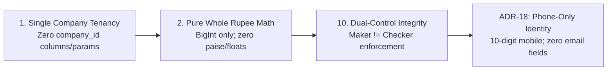

# Kumaran Chits — Web Portal Architecture & Implementation Ledger

> **Product**: **Kumaran Chits** (Kumaran Finance, Perundurai, Tamil Nadu)  
> **Platform**: Web Workstation Portal (`apps/web`)  
> **Tech Stack**: Next.js 15.2 (App Router), React 19, Tailwind CSS v4, TanStack Query v5, Zustand, `@kumaran/api-client`  
> **Status**: **Phase 7 (Task 7.1) Complete & Verified** (160/160 passing unit tests, 0 TypeScript errors, clean Next.js 15 production build)

---

## 1. Master Implementation Index & Progress Matrix

| Module / Milestone | Primary Documentation | Route Paths | Target Personas | Status |
|---|---|---|---|:---:|
| **1. Foundation & Tooling** | [`foundation-and-tooling.md`](./foundation-and-tooling.md) | Shared Shell, Layout | All Personas | **COMPLETED** |
| **2. Authentication & Identity** | [`authentication-and-identity.md`](./authentication-and-identity.md) | `/login`, `/2fa`, Modals | Super Admin, Accountant, Auditor | **COMPLETED** |
| **3. Dashboard Shell & RBAC** | [`dashboard-shell-and-rbac.md`](./dashboard-shell-and-rbac.md) | `/`, `(dashboard)/*`, `/instructions` | All Office Staff | **COMPLETED** (Tasks 3.1, 3.2, 3.3 DONE) |
| **4. Chit Schemes & Onboarding** | [`chit-schemes-management.md`](./chit-schemes-management.md) | `/schemes`, `/schemes/new`, `/schemes/[id]`, `/schemes/onboard` | Super Admin, Accountant, Branch Manager | **COMPLETED** (Tasks 4.1, 4.2, 4.3, 4.4 DONE) |
| **5. Customers & Passbook Directory** | [`customers-and-kyc.md`](./customers-and-kyc.md) | `/customers`, `/customers/new`, `/customers/[id]` | Super Admin, Branch Manager, Collection Agent | **COMPLETED** (Tasks 5.1, 5.2, 5.3 DONE) |
| **6. In-Office Auction Console** | [`auctions-console.md`](./auctions-console.md) | `/auctions`, `/auctions/[id]/live`, `/auctions/[id]`, `/schemes/[id]/defaulters` | Super Admin, Branch Manager, Auditor, Accountant | **COMPLETED** (Tasks 6.1–6.4 DONE) |
| **7. Defaulter Substitution Desk** | [`defaulter-substitution-desk.md`](./defaulter-substitution-desk.md) | `/schemes/[id]/defaulters` | Super Admin, Partner, Accountant | **COMPLETED** (Task 6.4 DONE) |
| **8. Prize Disbursements** | [`prize-disbursements.md`](./prize-disbursements.md) | `/disbursements`, `/disbursements/[id]/voucher` | Super Admin (Maker/Checker) | **IN PROGRESS** (Task 7.1 DONE) |
| **9. Collections & Handover** | [`collections-and-handover.md`](./collections-and-handover.md) | `/collections`, `/handover` | Cashier, Field Agent, Partner | Planned |
| **10. Payment Reversals** | [`payment-reversals.md`](./payment-reversals.md) | `/reversals` | Accountant (Maker), Partner (Checker) | Planned |
| **11. Statutory Reports & Admin** | [`statutory-reports-and-admin.md`](./statutory-reports-and-admin.md) | `/reports`, `/users`, `/branches` | CA Auditor, Super Admin | Planned |
| **12. Production PWA & E2E** | [`production-pwa-and-e2e.md`](./production-pwa-and-e2e.md) | Full Application | All Personas | Planned |

---

## 2. Architectural Guardrails Enforced in Web Portal



1. **Single-Company Tenancy (Guardrail 1 / ADR-01)**: Built exclusively for Kumaran Finance (Head Office, Perundurai). Zero `company_id` columns, query parameters, or HTTP request headers exist anywhere in the application.
2. **Pure Whole Rupee Math (Guardrail 2)**: All financial amounts operate on 64-bit integer rupees (`bigint`). Formatting via `formatRupee(val)` from `@kumaran/api-client` strictly suppresses paise (`₹50,000`, never `₹50,000.00`).
3. **Phone-Only Staff Identity (ADR-18)**: Office desk login requires strictly a 10-digit Indian mobile number (`^[6-9]\d{9}$`) with a `+91` visual prefix. Email authentication is completely eliminated.
4. **RFC 6238 Two-Factor Authentication (ADR-18)**: Mandatory two-factor authentication for office staff via **Microsoft Authenticator**.
5. **Dual-Control Security (Guardrail 10)**: Sensitive workflows (reversals, disbursements, 2FA deactivation) strictly enforce Maker $\ne$ Checker validation.

---

## 3. Directory Layout

```
docs/web/
├── README.md                            # Master index & implementation tracking matrix (This File)
├── foundation-and-tooling.md             # Scaffolding, Tailwind v4, i18n atoms, TanStack Query, BigInt math
├── authentication-and-identity.md        # Phone+Password login, RFC 6238 TOTP, 20-min inactivity guardian, modals
├── dashboard-shell-and-rbac.md           # App shell, dynamic RBAC sidebar, topbar, branch context, SSE stream
├── chit-schemes-management.md            # Scheme wizard, 4% commission lock, mid-cycle onboarding grid, monthly dues tracker
├── customers-and-kyc.md                  # Customer directory, intake wizard, Form XXI passbook, 15-min S3 KYC scans
├── auctions-console.md                   # In-office auction console, 1/4 ceiling math, Option A tie-break, Maker-Checker finalization
├── defaulter-substitution-desk.md        # Defaulter substitution, 3-month removal desk & 4% damages exit settlement
├── prize-disbursements.md                # (Upcoming) Safety proof checklist, dual-control prize vouchers
├── collections-and-handover.md           # (Upcoming) Counter collections, single discrete dues, cash handover
├── payment-reversals.md                  # (Upcoming) Maker-Checker reversal requests & approvals
├── statutory-reports-and-admin.md        # (Upcoming) Form XVII countdown, CA Auditor portal, staff user admin
└── production-pwa-and-e2e.md             # (Upcoming) End-to-end multi-role journeys & PWA offline manifest
```
