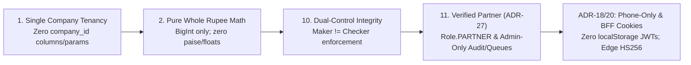

# Kumaran Chits — Web Portal Architecture & Implementation Ledger

> **Product**: **Kumaran Chits** (Kumaran Finance, Perundurai, Tamil Nadu)  
> **Platform**: Web Workstation Portal (`apps/web`) — Phase 1 Production Operational Surface (`ADR-26`; Flutter Android UI/APK deferred to Phase 2, Q2 2027)  
> **Tech Stack**: Next.js 15.2 (App Router), React 19, Tailwind CSS v4, TanStack Query v5, Zustand v5, `next-intl` v3, `@kumaran/api-client`  
> **Status**: **Phase 12 Complete & Verified** (`376/376` passing unit tests across **52** `test/*.spec.ts` files / 14 suites via Node native `--test` runner; **14** Playwright E2E spec files (`00`–`11`, `02-onboarding-totp-lifecycle`, `visual-audit`) totaling **46** test cases across **35** App Router `page.tsx` routes + 5 BFF auth routes + 1 BFF proxy route; **1,921** English/Tamil i18n keys across 22 namespaces at 100% parity; 0 TypeScript errors; Next.js 15 standalone build verified)

---

## 1. Master Implementation Index & Progress Matrix

| Module / Milestone | Primary Documentation | Route Paths | Target Personas | Status |
|---|---|---|---|:---:|
| **Phase 1: Foundation & Tooling** | [`foundation-and-tooling.md`](./foundation-and-tooling.md) | Shared Shell, Layout, i18n, WCAG 2.2 AA | All Personas | **COMPLETED** |
| **Phase 2: Authentication & Identity** | [`authentication-and-identity.md`](./authentication-and-identity.md) | `/login`, `/2fa`, `/onboarding`, BFF `/api/auth/*` | Super Admin, Branch Manager, Accountant, Auditor, Collection Agent | **COMPLETED** |
| **Phase 3: Dashboard Shell & RBAC** | [`dashboard-shell-and-rbac.md`](./dashboard-shell-and-rbac.md) | `/`, `(dashboard)/*`, `/instructions` | All Office Staff | **COMPLETED** (Tasks 3.1, 3.2, 3.3 DONE) |
| **Phase 4: Chit Schemes & Onboarding** | [`chit-schemes-management.md`](./chit-schemes-management.md) | `/schemes`, `/schemes/new`, `/schemes/[id]`, `/schemes/onboard` | Super Admin, Accountant, Branch Manager, Auditor (Read-Only) | **COMPLETED** (Tasks 4.1, 4.2, 4.3, 4.4 DONE) |
| **Phase 5: Customers & Passbook Directory** | [`customers-and-kyc.md`](./customers-and-kyc.md) | `/customers`, `/customers/new`, `/customers/[id]` | Super Admin, Branch Manager, Accountant, Collection Agent, Auditor | **COMPLETED** (Tasks 5.1, 5.2, 5.3 DONE) |
| **Phase 6: In-Office Auction Console & Defaulter Desk** | [`auctions-console.md`](./auctions-console.md), [`defaulter-substitution-desk.md`](./defaulter-substitution-desk.md) | `/auctions`, `/auctions/live`, `/auctions/[id]/live`, `/auctions/[id]`, `/schemes/[id]/defaulters` | Super Admin (Verified Partner), Branch Manager, Auditor (Read-Only) | **COMPLETED** (Tasks 6.1–6.4 DONE) |
| **Phase 7: Prize Disbursements & Safety Proof** | [`prize-disbursements.md`](./prize-disbursements.md) | `/disbursements`, `/disbursements/[id]/voucher` | Super Admin (Verified Partner Checker), Branch Manager, Accountant | **COMPLETED** (Tasks 7.1, 7.2 DONE) |
| **Phase 8: Collections, Handover & Reversals** | [`collections-and-handover.md`](./collections-and-handover.md), [`payment-reversals.md`](./payment-reversals.md) | `/collections`, `/collections/handover`, `/reversals` | Accountant, Collection Agent, Branch Manager, Super Admin (Verified Partner Reversals) | **COMPLETED** (Tasks 8.1–8.4 DONE) |
| **Phase 9: Staff Administration, Branches & Operations** | [`branch-management.md`](./branch-management.md), [`staff-administration.md`](./staff-administration.md), [`background-jobs-admin.md`](./background-jobs-admin.md) | `/branches`, `/branches/new`, `/users`, `/users/new`, `/admin/jobs` | Super Admin | **COMPLETED** (Tasks 9.1, 9.2, 9.3 DONE) |
| **Phase 10: Statutory Reports & CA Auditor Portal** | [`form-xxii-cash-book.md`](./form-xxii-cash-book.md), [`form-xvii-minutes.md`](./form-xvii-minutes.md), [`form-xxi-and-defaulters.md`](./form-xxi-and-defaulters.md), [`audit-logs-report.md`](./audit-logs-report.md) | `/reports`, `/reports/cash-book`, `/reports/minutes`, `/reports/ledger`, `/reports/defaulters` (Staff/Auditor), `/reports/audit-logs` (Super Admin Only) | Super Admin, Accountant, Auditor, Branch Manager, Collection Agent | **COMPLETED** (Tasks 10.1–10.4 DONE) |
| **Phase 11: Bilingual Print & Document Engine** | [`print-templates.md`](./print-templates.md) | `/print/receipt/[id]`, `/print/voucher/[id]` | Accountant, Branch Manager, Super Admin, Auditor, Collection Agent | **COMPLETED** (Task 11.1 DONE) |
| **Phase 12: Playwright E2E Tests & Docker Packaging** | [`playwright-e2e-testing.md`](./playwright-e2e-testing.md), [`docker-and-production-spec.md`](./docker-and-production-spec.md) | Full Application | All Personas | **COMPLETED** (Tasks 12.1, 12.2, 12.3 DONE) |

---

## 2. Architectural Guardrails & Verified Frontend Readiness



1. **Single-Company Tenancy (Guardrail 1 / ADR-01)**: Built exclusively for Kumaran Finance (Head Office, Perundurai). Zero `company_id` columns, query parameters, or HTTP request headers exist anywhere in the application.
2. **Pure Whole Rupee Math (Guardrail 2)**: All financial amounts operate on 64-bit integer rupees (`bigint`). Formatting via `apps/web/src/lib/currency.ts` (`formatRupee`) and `rupee-words.ts` strictly suppresses paise (`₹50,000`, never `₹50,000.00`).
3. **Phone-Only Staff Identity & RFC 6238 2FA (ADR-18)**: Office desk login requires strictly a 10-digit Indian mobile number (`^[6-9]\d{9}$`) with zero email fields, backed by Microsoft Authenticator TOTP 2FA.
4. **BFF HttpOnly Cookie Isolation & Zero-FOUC Edge Middleware (ADR-20)**: All JWTs (`kc_access_token`, `kc_refresh_token`, `kc_totp_pending_token`, `kc_onboarding_token`) reside exclusively in `HttpOnly`, `SameSite=Lax` cookies; `middleware.ts` cryptographically verifies tokens at the Edge via `jose` HS256 with longest-prefix RBAC from `src/lib/route-permissions.ts`.
5. **Dual-Control & Verified Partner Exclusivity (Guardrails 10 & 11 / ADR-27)**: Sensitive financial authorizations (reversals, auction finalization, prize authorization, defaulter removal) enforce `maker != checker` AND `Role.PARTNER`; `/reports/audit-logs` and `/admin/jobs` are restricted strictly to `SUPER_ADMIN`.
6. **Verified Frontend Audit & Visual Crawl Readiness**:
   - **Responsive Web Coverage (320px–1440px)**: Automated Playwright visual crawler (`e2e/visual-audit.e2e.spec.ts`) verified **21 core routes across 4 permutations** (English/Tamil $\times$ Desktop `1440×900` & Mobile `390×844` = **84 full-page crawls**) with **0 horizontal scroll overflows (`scrollWidth === innerWidth`)**, **0 untranslated raw keys**, and **0 unhandled exceptions**.
   - **Phase 1 Responsive Web vs. Phase 2 Flutter Android (`ADR-26`)**: Field agents operate via the mobile-responsive Web Portal (`390px` viewport, `min-h-[44px]` touch targets) during Phase 1; native Flutter Android UI screens and APK packaging are deferred to Phase 2 (Q2 2027), building on `apps/mobile/lib/core/`.
   - **Post-Audit Remediations Closed**: Both frontend/backend continuity items surfaced during Stage 05 auditing were subsequently remediated — server-side PDF `ரத்து செய்யப்பட்டது / CANCELLED` diagonal watermarking (`KFC-PDF-001`) and strict server-computed prize payout enforcement with automatic arrears offset and zero manual override (`KFC-FIN-003` / `KFC-FIN-004`).

---

## 3. Directory Layout

```
docs/web/
├── README.md                            # Master index & implementation tracking matrix (This File)
├── foundation-and-tooling.md             # Scaffolding, Tailwind v4, 1,921-key i18n, WCAG 2.2 AA, TanStack Query, BigInt math
├── authentication-and-identity.md        # Phone+Password login, RFC 6238 TOTP, F16 onboarding, 20-min inactivity guardian, BFF/Edge
├── dashboard-shell-and-rbac.md           # App shell, dynamic RBAC sidebar, topbar, branch context, SSE stream
├── chit-schemes-management.md            # Scheme wizard, 4% commission lock, mid-cycle onboarding grid, monthly dues tracker
├── customers-and-kyc.md                  # Customer directory, intake wizard, Form XXI passbook, 15-min S3 KYC scans
├── auctions-console.md                   # In-office auction console, 1/4 ceiling math, Option A tie-break, Maker-Checker finalization
├── defaulter-substitution-desk.md        # Defaulter substitution, two-partner removal desk (SEC-B) & Q25 fail-closed settlement
├── prize-disbursements.md                # Safety proof checklist, dual-control prize vouchers, final settlement
├── collections-and-handover.md           # Counter collections, ADR-07 discrete single due, ADR-19 Native UPI Intent & UTR claims, receipts
├── payment-reversals.md                  # Verified Partner Maker-Checker reversal requests & approvals (KFC-SEC-001)
├── branch-management.md                  # Branch offices administration, HO anchor, and regional expansion
├── staff-administration.md               # Staff user onboarding, RBAC roles, dual-role support & password resets
├── background-jobs-admin.md              # BullMQ queue telemetry, repeatable IST cron schedules, triggers & audit logs
├── form-xxii-cash-book.md                # Form XXII 12-column daily chit cash book & multi-mode financial day book
├── form-xvii-minutes.md                  # Form XVII auction minutes, 21-day filing countdown & Registrar filing portal
├── form-xxi-and-defaulters.md            # Form XXI subscriber continuous ledger & ADR-07 defaulters register
├── audit-logs-report.md                  # Immutable forensic audit trail viewer, diff inspection (Super Admin strictly)
├── print-templates.md                    # Bilingual A5 counter receipt & prize payout voucher print templates (ADR-11)
├── docker-and-production-spec.md         # Next.js 15 standalone Docker container, non-root security & Nginx routing
└── playwright-e2e-testing.md             # Playwright E2E testing architecture, 6-persona fixtures & smoke runner
```
