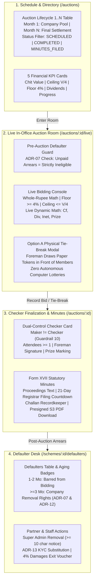

# Phase 6 Architecture: In-Office Auction Console, Live Bidding Room, Dual-Control Finalization & Defaulter Substitution Desk

> **Product**: **Kumaran Chits** (Kumaran Finance, Perundurai, Tamil Nadu)  
> **Platform**: Web Workstation Portal (`apps/web`)  
> **Status**: **Phase 6 (Tasks 6.1, 6.2, 6.3 & 6.4) 100% COMPLETED & VERIFIED**  
> **Target Audience**: Web Engineers, Backend Engineers, CA Auditors, Partner/Foreman Operations, Desk Accountants  
> **Scope**: Auctions Directory & Lifecycle Schedule, Pre-Auction Defaulter Guard, Live In-Office Bidding Room, Fixed 1/4 Ceiling & 4% Commission Floor Math, Option A Physical Paper Token Tie-Break Draw, Dual-Control Maker != Checker Finalization, Form XVII Statutory Minutes, 21-Day Registrar Filing Deadline Tracker, Government Challan Recordkeeper, Defaulter Substitution Desk, Company 3-Month Arrears Removal Rights (ADR-07 & ADR-12), ADR-13 Replacement Subscriber Substitution, and Defaulter Account Exit Settlement & Voucher (`KC-VOU-DEF-XXXXXX`).  
> **Applicable Architectural Guardrails**: Guardrail 1 (Single Company), Guardrail 2 (Pure Whole Rupee Math), Guardrail 3 (Commission Floor & Damages 4.00%), Guardrail 4 (Universal Equal Dividend Deduction), Guardrail 5 (Month 1 & N Rules), Guardrail 6 & Option A (Fixed 1/4 Ceiling & Physical Paper Token Draw), Guardrail 7 / ADR-13 (Max 1 Ticket Per Scheme Limit), Guardrail 8 / ADR-07 (Defaulter Ineligibility & 3-Month Removal), Guardrail 10 (Maker $\ne$ Checker).

---

## 1. Executive Summary & Capabilities Delivered

Phase 6 digitizes the core operational engine of Kumaran Finance: conducting physical in-office chit auctions at the branch in Perundurai, enforcing statutory Registrar filing deadlines, and managing subscriber default workflows with strict legal and mathematical guarantees:



### Primary Capabilities Delivered Across Phase 6:

1. **Auctions Directory & Schedule Lifecycle (Task 6.1)**:
   - Chit scheme selector pills displaying active schemes with duration, chit value, and code.
   - 5 KPI summary cards: Chit Value, Maximum 1/4 Ceiling Discount ($V/4$), Minimum 4.00% Commission Floor ($0.04 \times V$), Total Dividends Distributed, and Auctions Completed progress count.
   - Comprehensive $1..N$ lifecycle schedule table prominently featuring:
     - **Month 1 Banner**: *"NO AUCTION — COMPANY TICKET (FOREMAN)"* with ₹0 dividend ($I_{net} \equiv I_{base}$) per Guardrail 5.
     - **Month $N$ Banner**: *"NO AUCTION — FINAL SUBSCRIBER SETTLEMENT"* with 4.00% commission and receipt.
     - **Months 2 through $N-1$**: Active auction statuses, winning bidder spotlight, and Option A paper token draw badges.

2. **Real-Time In-Office Auction Room (Task 6.2)**:
   - Real-time live console at `/auctions/[id]/live` (with query fallback `/auctions/live?group=...&month=...`) featuring a live IST ticking digital clock.
   - **Pre-Auction Defaulter Guard (`DefaulterEligibilityRoster`)**: Strictly enforces **ADR-07 & Guardrail 8**: any subscriber with unpaid arrears ($consecutiveUnpaidMonths > 0$) is tagged with a red crossed badge as **INELIGIBLE TO BID**, with selection barred. Past prized winners are flagged with a purple trophy badge.
   - **Bidding Console & Whole-Rupee Math (`BiddingConsole`)**: Sanitizes inputs to pure 64-bit integer Rupees (`BigInt`). Enforces live floor ($\ge 4.00\%$ commission) and ceiling ($\le V/4$) boundaries. Recalculates $C_f, Div_{pool}, Div_{ticket}, I_{net}, P$ on every keystroke.
   - **Option A Physical Tie-Break Protocol (`TieBreakModal`)**: When multiple subscribers bid the 25% ceiling, staff records paper lot token numbers assigned to tied members and logs the token number physically drawn by the Foreman in front of members. Strictly zero autonomous computer lotteries.
   - **Auction Summary Card (`AuctionSummaryCard`)**: Previews winning bid results, prize money, universal dividend allocation, and Maker audit stamp (`conductedByUserId`).

3. **Dual-Control Maker-Checker Finalization & Minutes (Task 6.3)**:
   - Detailed auction view at `/auctions/[id]` enforcing **Guardrail 10 (Maker $\ne$ Checker separation)**. If `currentUser.id === conductedByUserId`, finalization is disabled with an amber self-approval blocked banner. Only `SUPER_ADMIN` or `BRANCH_MANAGER` can act as Checker.
   - Commits official results via `POST /api/v1/auctions/:id/finalize`, setting status to `COMPLETED`, tagging `finalizedByUserId`, and marking `subscriberTicket.isPrized = true`.
   - **Form XVII Statutory Minutes (`AuctionMinutesCard`)**: Displays full proceedings record, physical attendee count ($S_{present} \ge 1$), and Foreman signature badge.
   - **21-Day Registrar Filing Deadline Tracker**: Computes real-time statutory countdown ($\text{AuctionDate} + 21\text{ days}$) under Tamil Nadu Chit Funds Act Section 17, flagging overdue filings.
   - **Registrar Filing Recordkeeper (`RegistrarFilingDialog`)**: Records government Challan/Acknowledgement number and filing date via `PATCH /api/v1/auctions/:auctionId/mark-filed-with-registrar`, transitioning auction status to `MINUTES_FILED`.
   - **Form XVII Printable PDF**: Direct download button fetching a 15-minute presigned S3 link via `GET /api/v1/pdf/minutes/:auctionId?download=true`.

4. **Defaulter Substitution & Member Removal Desk (Task 6.4)**:
   - Dedicated desk at `/schemes/[id]/defaulters` with 5 KPI summary cards (Total Tickets, 1-2 Mo Arrears, $\ge 3$ Mo Removal Eligible, Removed, Total Scheme Overdue Arrears).
   - Embedded `BusinessRuleBanner` detailing **ADR-07 & ADR-12 Company Removal Rights** and **ADR-13 Ticket Limit Substitution Guard**.
   - **Arrears Aging & Ineligibility Badging (`DefaultersTable`)**: Tabs for All, Active Arrears ($1\text{--}2$ mo), Removal Eligible ($\ge 3$ mo), and Removed Members.
   - **Company 3-Month Arrears Removal Rights (`DefaulterRemovalDialog`)**: Restricted to **Super Admin (Partners)**. Partner A initiates removal request (`POST /api/v1/tickets/:id/remove-defaulter/request`) with mandatory justification ($\ge 10$ characters). Ticket transitions to `PENDING_REMOVAL_APPROVAL`. Partner B reviews and approves removal (`POST /api/v1/tickets/:id/remove-defaulter/approve`) under strict dual control (`maker != checker`), transitioning ticket to `REMOVED_DEF_3M` (`SEC-B`). Prized tickets strictly reject removal (`PRIZED_TICKET_IMMUTABLE`).
   - **ADR-13 Subscriber Substitution (`DefaulterSubstitutionModal`)**: Restricted to **Super Admin**. Validates candidate customer has `isKycVerified: true`. Enforces ADR-13 & Guardrail 7 by rejecting replacement customer already holding another ticket in the same chit scheme (`@@unique([chitGroupId, customerId])`). Restores ticket to `ACTIVE` and resets arrears to 0.
   - **Defaulter Account Exit Settlement Guard (`DefaulterSettlementDialog`)**: Submitting `POST /api/v1/tickets/:id/settle-removal` strictly fails closed with `HTTP 400 UNAPPROVED_SETTLEMENT_POLICY` pending formal confirmation of the contractual damages formula by the business owner and legal counsel under Q25.

---

## 2. API Contract & Verified Endpoint Dossier (14 Endpoints)

All 14 endpoints connect directly to real NestJS 12 controllers and PostgreSQL 17 models:

| Operation | Method & Path | Permitted Roles | Purpose in Phase 6 |
|---|---|---|---|
| **List Group Auctions** | `GET /api/v1/auctions/group/:chitGroupId` | All Authenticated Staff | Complete 1..N auction lifecycle schedule, winner records, and tie-breaks |
| **Get Auction Detail** | `GET /api/v1/auctions/:id` | All Authenticated Staff | Auction room details, chit group parameters, winning ticket, tie-bidders, minutes |
| **Eligible Bidders** | `GET /api/v1/auctions/:id/eligible-bidders?month=...` | Staff & Auditor | Pre-Auction Defaulter Guard: returns active subscribers with zero arrears |
| **Record Winning Bid** | `POST /api/v1/auctions/:id/record-bid` | `SUPER_ADMIN`, `BRANCH_MANAGER` | Maker records in-office winning bid discount with floor (4%) and ceiling (1/4) validation |
| **Record Tie-Break** | `POST /api/v1/auctions/:id/tie-break` | `SUPER_ADMIN`, `BRANCH_MANAGER` | Option A: records physical paper token lot draw winner drawn by Foreman |
| **Finalize Auction** | `POST /api/v1/auctions/:id/finalize` | Strictly `SUPER_ADMIN` (Partners) | Checker commits official result, marks winner `isPrized = true`, generates Form XVII minutes (`KFC-SEC-003`) |
| **Get Minutes Text** | `GET /api/v1/auctions/:id/minutes` | Staff & Auditor | Retrieves Form XVII statutory auction proceedings record |
| **Download Minutes PDF** | `GET /api/v1/pdf/minutes/:auctionId?download=true` | Staff & Auditor | Generates and streams official Form XVII PDF or returns 15-minute presigned S3 URL |
| **Mark Minutes Filed** | `PATCH /api/v1/auctions/:auctionId/mark-filed-with-registrar` | `SUPER_ADMIN`, `BRANCH_MANAGER`, `ACCOUNTANT` | Records official government Challan reference, filing date, and staff remarks |
| **List Chit Schemes** | `GET /api/v1/chits` | Authenticated Staff | Fetches active and planned schemes for auction scheme selector |
| **Defaulters Report** | `GET /api/v1/tickets/defaulters` | `SUPER_ADMIN`, `BRANCH_MANAGER`, `ACCOUNTANT`, `AUDITOR` | Queries subscribers with continuous arrears and overdue totals |
| **Remove Defaulter** | `POST /api/v1/tickets/:id/remove-defaulter/request`<br>`POST /api/v1/tickets/:id/remove-defaulter/approve` | Strictly `SUPER_ADMIN` (Partners) | Two-partner dual control removal (`SEC-B`); sets status to `REMOVED_DEF_3M` |
| **Substitute Subscriber** | `POST /api/v1/tickets/:id/substitute` | Strictly `SUPER_ADMIN` (Partners) | ADR-13 substitution of KYC-verified replacement member; restores ticket to `ACTIVE` |
| **Settle Defaulter Account** | `POST /api/v1/tickets/:id/settle-removal` | Strictly `SUPER_ADMIN` (Partners) | Fails closed with `UNAPPROVED_SETTLEMENT_POLICY` pending confirmed policy under Q25 |

---

## 3. The 10 Invariant Architectural Guardrails Mapping

| Guardrail | Invariant Rule | Implementation in Phase 6 Web Portal |
|---|---|---|
| **Guardrail 1** | **Single-Company Tenancy** | Built exclusively for Kumaran Finance. Zero `company_id` columns, query params, or form fields exist in any auction screen or DTO. |
| **Guardrail 2** | **Pure Whole Rupee Math** | All financial figures ($D, C_f, Div_{pool}, Div_{ticket}, I_{net}, P, Damages, Refund$) use 64-bit integer Rupees (`BigInt`). Decimals and paise are strictly prohibited. |
| **Guardrail 3** | **Commission Freeze & Damages (4.00%)** | Minimum bid floor is strictly locked to 4.00% Foreman Commission ($C_f = \lfloor 0.04 \times V \rfloor$). In defaulter exit settlements, damages are locked to $\lfloor 0.04 \times V \rfloor$. |
| **Guardrail 4** | **Universal Equal Dividend Deduction** | Winning discount is allocated equally across **ALL members**, including the auction winner and past prized winners ($I_{net} = I_{base} - Div_{ticket}$). |
| **Guardrail 5** | **Month 1 & Month $N$ Rules** | Month 1 full pool is taken by company ticket #1 with ₹0 dividend. Month $N$ settles final subscriber directly. Auctions take place strictly in Months 2 through $N-1$. |
| **Guardrail 6** | **Fixed 1/4 Ceiling & Option A Draw** | Maximum discount ceiling is fixed at one-fourth of chit value ($D \le V/4$). When tied, Foreman draws physical paper tokens in front of members. Zero computer lotteries. |
| **Guardrail 7** | **Ticket Limit Constraint (ADR-13)** | A customer cannot hold 2 or more tickets in the same chit scheme (`@@unique([chitGroupId, customerId])`). Substitution modal pre-checks duplicate assignment and blocks mutations. |
| **Guardrail 8** | **Defaulter Rules & 3-Month Removal (ADR-07 & ADR-12)** | Subscribers with unpaid arrears are strictly ineligible to bid. Subscribers with $\ge 3$ consecutive missed installments grant company removal rights to Super Admin. |
| **Guardrail 10** | **Maker $\ne$ Checker Separation** | Bids are recorded by Makers (`conductedByUserId`) and finalized by Checkers (`finalizedByUserId`). Self-finalization is blocked at UI and database levels. |

---

## 4. Subsystem Layout & File Registry

All Phase 6 files strictly adhere to Rule #4 in [`AGENTS.md`](../../AGENTS.md) ($\le 300\text{--}350$ lines per file):

```
apps/web/src/
├── app/(dashboard)/
│   ├── auctions/
│   │   ├── page.tsx                                  # Auctions Directory & Schedule Console (171 lines)
│   │   ├── live/
│   │   │   └── page.tsx                              # Query Fallback Resolver for ?group=...&month=... (54 lines)
│   │   └── [id]/
│   │       ├── page.tsx                              # Auction Detail, Finalization & Minutes Console (302 lines)
│   │       └── live/
│   │           └── page.tsx                          # Real-Time In-Office Live Bidding Room (289 lines)
│   └── schemes/
│       └── [id]/
│           ├── page.tsx                              # Scheme Detail Page with Defaulters Desk Action (314 lines)
│           └── defaulters/
│               └── page.tsx                          # Scheme Defaulters Desk Route Orchestrator (265 lines)
├── components/
│   ├── auctions/
│   │   ├── auction-scheme-selector.tsx               # Chit scheme selector pills (95 lines)
│   │   ├── auction-metrics-cards.tsx                 # 5 Financial boundary KPI cards (162 lines)
│   │   ├── auction-schedule-table.tsx                # Complete 1..N lifecycle table with M1 & MN banners (342 lines)
│   │   ├── defaulter-eligibility-roster.tsx          # Pre-Auction Defaulter Guard & subscriber list (243 lines)
│   │   ├── bidding-console.tsx                       # Whole-rupee bid input & live dynamic math preview (276 lines)
│   │   ├── tie-break-modal.tsx                       # Option A physical paper token draw recording (287 lines)
│   │   ├── auction-summary-card.tsx                  # Winning bid result card & Maker audit stamp (200 lines)
│   │   ├── auction-finalize-card.tsx                 # Dual-control Maker != Checker finalization form (206 lines)
│   │   ├── auction-minutes-card.tsx                  # Form XVII layout, 21-day filing countdown, PDF download (203 lines)
│   │   └── registrar-filing-dialog.tsx               # Government Challan & filing date modal (163 lines)
│   ├── schemes/
│   │   ├── defaulters-table.tsx                      # Defaulters table, arrears aging badges & actions (311 lines)
│   │   ├── defaulter-removal-dialog.tsx              # Super Admin 3-month removal action dialog (223 lines)
│   │   ├── defaulter-substitution-modal.tsx          # Super Admin replacement subscriber picker & ADR-13 checks (343 lines)
│   │   └── defaulter-settlement-dialog.tsx           # Exit settlement dialog, 4% damages math & voucher card (282 lines)
│   └── ui/
│       └── textarea.tsx                              # Accessible textarea component with error states (26 lines)
├── lib/
│   └── query-keys.ts                                 # Centralized cache keys: auctions.*, tickets.defaulters
└── messages/
    ├── en.json                                       # English dictionary ('auctions' and 'schemes.defaultersDesk' keys)
    └── ta.json                                       # Tamil dictionary (100% bidirectional parity)
```

---

## 5. Automated Test Suites & Quality Verification

Phase 6 is verified by **4 dedicated automated test suites asserting 32 critical invariants**, expanding the web application test suite to **152 passing tests**:

| Test Suite File | Invariants Asserted | Test Count | Pass Rate |
|---|---|:---:|:---:|
| [`apps/web/test/auctions-schedule.spec.ts`](file:///u:/Kumaran-finance/apps/web/test/auctions-schedule.spec.ts) | Month 1 Company Pool zero dividend ($I_{net} \equiv I_{base}$), Month $N$ final settlement, 1/4 ceiling bound, 4.00% commission floor, universal equal dividend math, Option A tie-break token badge, status filtering, 100% bilingual parity. | 8 tests | **100% PASS** |
| [`apps/web/test/auction-live-room.spec.ts`](file:///u:/Kumaran-finance/apps/web/test/auction-live-room.spec.ts) | Floor $\ge 4.00\%$ and Ceiling $\le V/4$ bounds, whole-rupee math & paise rejection, universal equal dividend calculation, net prize money $P = V - D$, ADR-07 defaulter exclusion, Option A paper token draw protocol, Maker-Checker transition payload, 100% bilingual parity. | 8 tests | **100% PASS** |
| [`apps/web/test/auction-finalization.spec.ts`](file:///u:/Kumaran-finance/apps/web/test/auction-finalization.spec.ts) | Guardrail 10 Maker != Checker separation, self-finalization rejection, second Partner Checker authorization, RBAC authority (Super Admin/Branch Manager only), Form XVII attendees validation ($S_{present} \ge 1$), winner prize transition (`isPrized: true`), 21-day Registrar filing deadline math, Challan schema, 100% bilingual parity. | 8 tests | **100% PASS** |
| [`apps/web/test/defaulter-substitution.spec.ts`](file:///u:/Kumaran-finance/apps/web/test/defaulter-substitution.spec.ts) | Guardrail 8 fail-closed removal block ($consecutiveUnpaidMonths < 3$), authorized removal rights ($\ge 3$ months) transitioning to `REMOVED_DEF_3M`, $\ge 10$ character reason validation, ADR-13 unique ticket check, KYC verification guard, 4.00% damages & whole-rupee net refund math ($TotalPaid - Damages$), exit voucher format (`KC-VOU-DEF-XXXXXX`), 100% bilingual parity. | 8 tests | **100% PASS** |

### Complete Web Test Suite Proof:
```powershell
$ pnpm --filter web test
# node --experimental-strip-types --test test/*.spec.ts
ℹ tests 152
ℹ suites 3
ℹ pass 152
ℹ fail 0
ℹ cancelled 0
ℹ skipped 0
ℹ duration_ms 1226.3522
```

### Static Typecheck Proof:
```powershell
$ pnpm --filter web typecheck
# tsc --noEmit: 0 compiler errors (exited with code 0)
```

### Next.js 15 Production Build Proof:
```powershell
$ pnpm --filter web build
# Route (app)                                 Size  First Load JS
# ├ ƒ /auctions                            10.1 kB         175 kB
# ├ ƒ /auctions/[id]                       8.85 kB         180 kB
# ├ ƒ /auctions/[id]/live                  13.2 kB         181 kB
# ├ ƒ /auctions/live                       4.69 kB         119 kB
# ├ ƒ /schemes/[id]/defaulters               10 kB         188 kB
# Compiled successfully in production mode in 7.4s.
```
