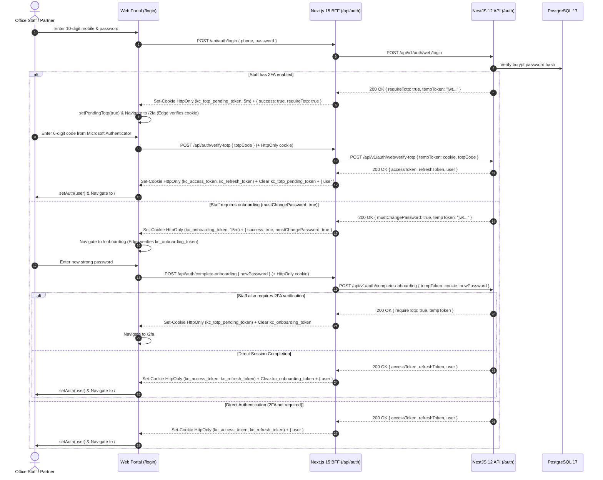
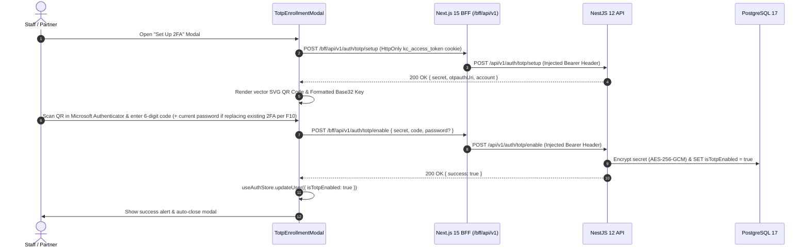

# Web Portal Architecture — Authentication & Staff Identity

> **Module**: **Staff Authentication, 2FA Lifecycle & Security Management**  
> **Status**: **100% Complete & Verified**  
> **Target Audience**: Web Engineers, Security Engineers, Auditors  
> **Associated Tasks**: Task 2.1, Task 2.2, Task 2.3  
> **Key Architectural Decisions**: [ADR-18 (Phone-Only Staff Identity)](../01-business/decision-log.md#adr-18-phone-only-identity--login-architecture), [Guardrail 10 (Dual Control)](../01-business/financial-rules.md)

---

## 1. Overview & Objectives

The Authentication & Identity module governs office staff access to the **Kumaran Chits** Web Portal:
- Enforces ADR-18: Phone-only staff identity via 10-digit Indian mobile numbers (`^[6-9]\d{9}$`) with zero email inputs.
- Implements two-factor challenge routing: When a staff member authenticates with valid credentials, the system requires an RFC 6238 TOTP rotating code from **Microsoft Authenticator**.
- Provides a dedicated 6-cell auto-advancing TOTP input (`/2fa`) supporting keyboard typing, backspace retreat, and full clipboard paste.
- Offers in-app self-service 2FA enrollment with client-side vector SVG QR code generation and 1-click Base32 key copy.
- Enforces re-authentication with current password before disabling 2FA protection.

---

## 2. API Contract & Endpoint Integration Dossier

| Operation | Method & Path | Authorization | Request Body / Query | Response Payload (200 OK) | Error Codes |
|---|---|---|---|---|:---:|
| **Staff Web Login** | `POST /api/v1/auth/web/login` | Public | `{ phone: string, password: string, clientType?: 'WEB' }` | • **First-Login Onboarding (`F16`)**: `{ mustChangePassword: true, tempToken }` (15m `onboarding_restricted`)<br>• **2FA Challenge**: `{ requireTotp: true, tempToken }` (5m `totp_pending`)<br>• **Direct Auth**: `{ accessToken, refreshToken, user }` | `401` Invalid credentials<br>`429` Rate limited |
| **Verify Staff TOTP** | `POST /api/v1/auth/web/verify-totp` | Public | `{ tempToken: string, totpCode: string }` | `{ accessToken, refreshToken, user }` | `401` Invalid/expired code<br>`429` Rate limited |
| **Complete First-Login Onboarding** | `POST /api/v1/auth/complete-onboarding` | Public (tempToken) | `{ tempToken: string, newPassword: string }` | `{ accessToken, refreshToken, user }` (or `{ requireTotp: true, tempToken }` if 2FA enabled; atomic Redis `SET NX` single-use consumption) | `400` Weak password<br>`401` Invalid/replayed token |
| **Rotate Session Tokens** | `POST /api/v1/auth/refresh-token` | Public (Refresh JWT) | `{ refreshToken: string, clientType?: 'WEB'\|'MOBILE'\|'DESKTOP' }` | `{ accessToken, refreshToken, user }` (client-scoped `Session` vault, `ADR-24` & RFC 6819 reuse trap) | `401` Invalid/revoked token |
| **Initiate TOTP Setup** | `POST /api/v1/auth/totp/setup` | `Bearer <JWT>` (via BFF) | *None* | `{ secret: string, otpauthUri: string, issuer: string, account: string }` | `401` Unauthorized |
| **Enable / Replace 2FA** | `POST /api/v1/auth/totp/enable` | `Bearer <JWT>` (via BFF) | `{ secret: string, code: string, password?: string }` *(current `password` required strictly when replacing an existing factor — `F10`)* | `{ success: true, message: string }` | `400` Invalid code<br>`401` Unauthorized<br>`429` Rate limited |
| **Disable 2FA** | `POST /api/v1/auth/totp/disable` | `Bearer <JWT>` (via BFF) | `{ password: string }` | `{ success: true, message: string }` | `401` Invalid password<br>`429` Rate limited |
| **Change Password** | `POST /api/v1/auth/change-password` | `Bearer <JWT>` (via BFF) | `{ currentPassword: string, newPassword: string }` | `{ success: true, message: string }` (stamps `tokenRevokedBefore` & revokes active sessions) | `400` New pass <8 chars<br>`401` Incorrect current pass |
| **Get Staff Profile** | `GET /api/v1/auth/me` | `Bearer <JWT>` (via BFF) | *None* | `AuthUser` object with `roles`, `isPartner`, `isTotpEnabled`, and assigned branch | `401` Unauthorized |
| **Staff Logout** | `POST /api/v1/auth/logout?clientType=WEB\|MOBILE\|DESKTOP\|ALL` | `Bearer <JWT>` (via BFF) | Query `clientType` (defaults to `ALL`; Web BFF passes `WEB` to preserve mobile field rounds per `ADR-24`) | `{ success: true, message: string }` | `401` Unauthorized |

> [!NOTE]
> **Hardened Cryptographic & Session Guarantees (`F04` / `F10` / `F16` / `ADR-24`)**:
> - **Password & Token Hashing**: Passwords, MPINs, and SHA-256 pre-hashed refresh tokens use `bcrypt` cost factor 12 (`BCRYPT_SALT_ROUNDS = 12`), avoiding bcrypt's 72-byte truncation limit on JWTs.
> - **Zero Shared Default Passwords (`F16`)**: Newly provisioned staff without an explicit password receive a 12-character `crypto.randomBytes(9).toString('base64url')` temporary password with `mustChangePassword = true`, restricting login exclusively to `/onboarding`.
> - **Session Identity (`sid`) & Epoch Revocation (`F04`)**: Every access/refresh JWT embeds PostgreSQL `Session.id` (`sid`) and is validated against both the active `Session` row and durable `User.tokenRevokedBefore`, preventing session resurrection across Redis restarts.

---

## 3. Screen, BFF & Test Catalog

```
apps/web/
├── src/
│   ├── middleware.ts                                 # Next.js Edge JWT (jose HS256), /2fa & /onboarding gates & canonical RBAC barrier
│   ├── app/(auth)/
│   │   ├── layout.tsx                                # Auth workstation layout with monograms & locale switch
│   │   ├── login/page.tsx                            # /login entrypoint wrapped in Suspense boundary
│   │   ├── 2fa/page.tsx                              # /2fa entrypoint wrapped in Suspense boundary
│   │   └── onboarding/page.tsx                       # /onboarding entrypoint for first-time password setup (F16)
│   ├── app/
│   │   ├── api/auth/
│   │   │   ├── login/route.ts                        # BFF login handler setting HttpOnly session / pending cookies
│   │   │   ├── verify-totp/route.ts                  # BFF 2FA TOTP verification handler consuming kc_totp_pending_token
│   │   │   ├── complete-onboarding/route.ts          # BFF onboarding handler consuming kc_onboarding_token -> /api/v1/auth/complete-onboarding
│   │   │   ├── session/route.ts                      # BFF session hydration sharing coalesced refresh & symmetric cookie clearing
│   │   │   └── logout/route.ts                       # BFF logout handler invalidating Redis/BFF caches & cookies
│   │   └── bff/api/v1/[...path]/route.ts             # Dedicated Web BFF proxy route (isolated from Nginx /api/v1/*)
│   ├── lib/
│   │   ├── auth-cookies.ts                           # Dynamic Secure flag resolution & HttpOnly cookie options
│   │   ├── bff-auth-handlers.ts                      # Shared BFF login, verify-totp, complete-onboarding, session & logout cores (DEF-FE-08)
│   │   ├── bff-api-proxy.ts                          # Shared BFF proxy handler with unbuffered SSE pass-through
│   │   ├── bff-forward-headers.ts                    # X-Forwarded-For & client IP forwarding helpers
│   │   ├── bff-token-refresh.ts                      # Unified server-side single-flight BFF refresh coalescing & cookie utils
│   │   ├── edge-auth.ts                              # Cryptographic HS256 Edge JWT, /2fa & /onboarding route verifiers
│   │   └── route-permissions.ts                      # Single canonical RBAC route permissions source of truth
│   ├── stores/
│   │   └── auth-store.ts                             # Re-entrancy-guarded logout, non-secret pendingTotp flag & zero-storage hydration
│   └── components/auth/
│       ├── login-form.tsx                            # Phone+Password form, 2FA fork, onboarding redirect & active session redirect
│       ├── onboarding-form.tsx                       # First-login password setup form with confirmation & strength validation
│       ├── totp-form.tsx                             # 6-cell RFC 6238 TOTP form with clipboard paste, cookie-backed guards & Back-to-Login purge
│       ├── totp-enrollment-modal.tsx                 # 3-step setup modal with SVG QR code & 1-click Base32 copy
│       ├── totp-disable-modal.tsx                    # Password-verified 2FA deactivation modal
│       └── change-password-modal.tsx                 # Self-service password change modal with min-8 char validation
└── test/
    ├── login-validation.spec.ts                      # ADR-18 10-digit regex, password length & BFF 2FA fork tests
    ├── totp-validation.spec.ts                       # RFC 6238 6-digit validation, paste extraction & guard tests
    ├── totp-enrollment.spec.ts                       # Base32 formatting, SVG QR, enable/disable & store sync tests
    ├── change-password.spec.ts                       # Current/new password validation, DTO matching & i18n parity tests
    ├── edge-auth-middleware.spec.ts                  # Edge jose HS256, tokenType, /2fa & /onboarding gates, fail-closed secret & RBAC tests
    ├── bff-totp-routes.spec.ts                       # HttpOnly kc_totp_pending_token login/verify-totp/session/logout handler tests
    ├── bff-onboarding-routes.spec.ts                 # HttpOnly kc_onboarding_token complete-onboarding handler tests
    ├── bff-auth-cookies.spec.ts                      # Dynamic Secure cookie & HttpOnly attribute tests
    ├── bff-token-refresh.spec.ts                     # Server-side single-flight refresh coalescing tests
    ├── bff-api-proxy.spec.ts                         # BFF proxy Bearer injection & SSE streaming tests
    └── bff-forward-headers.spec.ts                   # Client IP forwarding hygiene tests
```

---

## 4. UI/UX Workflow & State Machines

### 4.1 Login & 2FA Challenge Flow



### 4.2 In-App TOTP Enrollment Flow (`TotpEnrollmentModal`)



---

## 5. Verification Proofs & Live Test Results

```
Live Command: pnpm --filter web test (node --experimental-strip-types --test test/*.spec.ts)
-----------------------------------------------------------------------------------------
Verified Auth, BFF & Edge Test Suites:
  ✔ login-validation.spec.ts       (ADR-18 10-digit regex, password rules, 2FA & onboarding forks)
  ✔ totp-validation.spec.ts        (RFC 6238 6-digit validation, clipboard paste cleaning & DEF-FE-08 pendingTotp guard)
  ✔ totp-enrollment.spec.ts        (Base32 4-char chunking, vector SVG QR, enable/disable & store sync)
  ✔ change-password.spec.ts        (current/new password validation, NestJS DTO parity & EN/TA i18n parity)
  ✔ edge-auth-middleware.spec.ts   (Edge jose HS256, tokenType, /2fa & /onboarding cookie gates, fail-closed secret & RBAC)
  ✔ bff-totp-routes.spec.ts        (HttpOnly kc_totp_pending_token login/verify-totp/session/logout — zero client tempToken)
  ✔ bff-onboarding-routes.spec.ts  (HttpOnly kc_onboarding_token complete-onboarding handler & cookie cleanup)
  ✔ bff-auth-cookies.spec.ts       (HttpOnly, SameSite=Lax & dynamic Secure cookie attributes)
  ✔ bff-token-refresh.spec.ts      (server-side single-flight refresh coalescing)
  ✔ bff-api-proxy.spec.ts          (Bearer header injection & unbuffered SSE pass-through)
  ✔ bff-forward-headers.spec.ts    (client IP forwarding integrity)
-----------------------------------------------------------------------------------------
Full Web Unit Suite:  376 passing / 0 failing across 52 spec files (14 top-level suites)
TypeScript / Lint:    pnpm --filter web typecheck & lint — 0 errors / 0 warnings
Next.js Build:        Dynamic /login, /2fa, /onboarding, BFF routes & Edge Middleware verified
```
