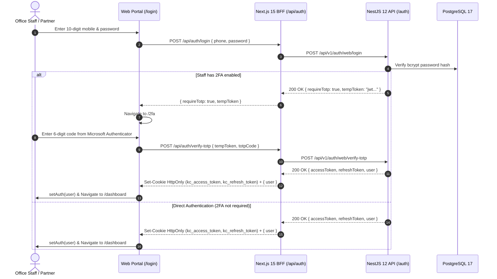
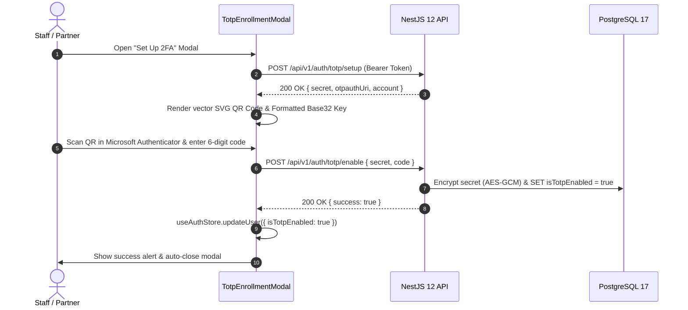

# Web Portal Architecture — Authentication & Staff Identity

> **Module**: **Staff Authentication, 2FA Lifecycle & Security Management**  
> **Status**: **100% Complete & Verified**  
> **Target Audience**: Web Engineers, Security Engineers, Auditors  
> **Associated Tasks**: Task 2.1, Task 2.2, Task 2.3  
> **Key Architectural Decisions**: [ADR-18 (Phone-Only Staff Identity)](../01-business/decision-log.md#adr-18-phone-only-identity--login-architecture), [Guardrail 10 (Dual Control)](../01-business/financial-rules.md)

---

## 1. Overview & Objectives

The Authentication & Identity module governs office staff access to the **Kumaran Chits** Web Portal:
- Enforces ADR-18: Phone-only staff identity via 10-digit Indian mobile numbers (`^[6-9]\d{9}$`) with zero email inputs.
- Implements two-factor challenge routing: When a staff member authenticates with valid credentials, the system requires an RFC 6238 TOTP rotating code from **Microsoft Authenticator**.
- Provides a dedicated 6-cell auto-advancing TOTP input (`/2fa`) supporting keyboard typing, backspace retreat, and full clipboard paste.
- Offers in-app self-service 2FA enrollment with client-side vector SVG QR code generation and 1-click Base32 key copy.
- Enforces re-authentication with current password before disabling 2FA protection.

---

## 2. API Contract & Endpoint Integration Dossier

| Operation | Method & Path | Authorization | Request Body | Response Payload (200 OK) | Error Codes |
|---|---|---|---|---|:---:|
| **Staff Web Login** | `POST /api/v1/auth/web/login` | Public | `{ phone: string, password: string }` | • **2FA Challenge**: `{ requireTotp: true, tempToken: string }`<br>• **Direct Auth**: `{ accessToken, refreshToken, user }` | `401` Invalid credentials<br>`429` Rate limited |
| **Verify Staff TOTP** | `POST /api/v1/auth/web/verify-totp` | Public | `{ tempToken: string, totpCode: string }` | `{ accessToken, refreshToken, user }` | `401` Invalid/expired code<br>`429` Rate limited |
| **Initiate TOTP Setup** | `POST /api/v1/auth/totp/setup` | `Bearer <JWT>` | *None* | `{ secret: string, otpauthUri: string, issuer: string, account: string }` | `401` Unauthorized |
| **Enable 2FA** | `POST /api/v1/auth/totp/enable` | `Bearer <JWT>` | `{ secret: string, code: string }` | `{ success: true, message: string }` | `400` Invalid code<br>`401` Unauthorized<br>`429` Rate limited |
| **Disable 2FA** | `POST /api/v1/auth/totp/disable` | `Bearer <JWT>` | `{ password: string }` | `{ success: true, message: string }` | `401` Invalid password |
| **Change Password** | `POST /api/v1/auth/change-password` | `Bearer <JWT>` | `{ currentPassword: string, newPassword: string }` | `{ success: true, message: string }` | `400` New pass <8 chars<br>`401` Incorrect current pass |
| **Get Staff Profile** | `GET /api/v1/auth/me` | `Bearer <JWT>` | *None* | `AuthUser` object with assigned branch | `401` Unauthorized |
| **Staff Logout** | `POST /api/v1/auth/logout` | `Bearer <JWT>` | *None* | `{ success: true, message: string }` | `401` Unauthorized |

---

## 3. Screen & Component Catalog

```
apps/web/src/
├── app/(auth)/
│   ├── layout.tsx                              # Auth workstation layout with monograms & locale switch
│   ├── login/page.tsx                          # /login entrypoint wrapped in Suspense boundary
│   └── 2fa/page.tsx                            # /2fa entrypoint wrapped in Suspense boundary
├── app/api/auth/
│   ├── login/route.ts                          # BFF login handler setting HttpOnly session cookies
│   ├── verify-totp/route.ts                    # BFF 2FA TOTP verification handler setting HttpOnly cookies
│   ├── session/route.ts                        # BFF session hydration sharing coalesced refresh helper
│   └── logout/route.ts                         # BFF logout handler invalidating Redis/BFF caches & cookies
├── lib/
│   ├── auth-cookies.ts                         # Dynamic Secure flag resolution (COOKIE_SECURE env / proxy proto)
│   └── bff-token-refresh.ts                    # Unified single-flight BFF refresh coalescing & cookie utils
├── stores/
│   └── auth-store.ts                           # Re-entrancy-guarded logout & non-looping unauthenticated hydration
├── components/auth/
│   ├── login-form.tsx                          # Phone+Password form, 2FA fork & active session redirect
│   ├── totp-form.tsx                           # 6-cell RFC 6238 TOTP form with clipboard paste & guards
│   ├── totp-enrollment-modal.tsx               # 3-step setup modal with SVG QR code & 1-click Base32 copy
│   ├── totp-disable-modal.tsx                  # Password-verified 2FA deactivation modal
│   └── change-password-modal.tsx               # Self-service password change modal with min-8 char validation
└── test/
    ├── login-validation.spec.ts                # ADR-18 10-digit regex, password length & 2FA fork tests
    ├── totp-validation.spec.ts                 # RFC 6238 6-digit validation, paste extraction & guard tests
    ├── totp-enrollment.spec.ts                 # Base32 formatting, SVG QR, enable/disable & store sync tests
    └── change-password.spec.ts                 # Current/new password validation, DTO matching & i18n parity tests
```

---

## 4. UI/UX Workflow & State Machines

### 4.1 Login & 2FA Challenge Flow



### 4.2 In-App TOTP Enrollment Flow (`TotpEnrollmentModal`)



---

## 5. Verification Proofs & Test Results

```
✔ ADR-18 Phone Validation: Accepts valid 10-digit Indian mobile numbers (4.89ms)
✔ ADR-18 Phone Validation: Rejects invalid phone numbers (1.68ms)
✔ Login Validation: Password requires at least 6 characters (0.72ms)
✔ AuthStore: setTempToken securely stores 2FA temporary token and clears on session establishment (77.20ms)
✔ Login Flow: Discerning 2FA challenge response vs full token response (0.64ms)
✔ Base32 Secret Formatting: Correctly chunks keys into 4-character blocks for readability (2.21ms)
✔ SVG QR Code Generation: Generates valid vector SVG from RFC 6238 otpauth URI (27.94ms)
✔ TOTP Code Validation: Strictly validates 6-digit numeric confirmation code (0.82ms)
✔ Disable 2FA Validation: Requires non-empty password (0.55ms)
✔ AuthStore 2FA Lifecycle: Synchronizes isTotpEnabled state on enrollment and deactivation (0.96ms)
✔ Backend Contract Invariants: Payload schemas match NestJS DTO definitions (0.34ms)
✔ RFC 6238 TOTP Validation: Accepts valid 6-digit numeric codes (2.79ms)
✔ RFC 6238 TOTP Validation: Rejects invalid codes (0.67ms)
✔ Clipboard Paste Extraction: Cleans dirty inputs and limits to 6 digits (0.83ms)
✔ 2FA State Guard: Verification requires valid tempToken (0.61ms)
-----------------------------------------------------------------------------------------
Authentication Tests: 16 passing, 0 failing
TypeScript:           tsc --noEmit passed with 0 errors
Next.js Build:        Dynamic /login and /2fa routes generated cleanly
```
