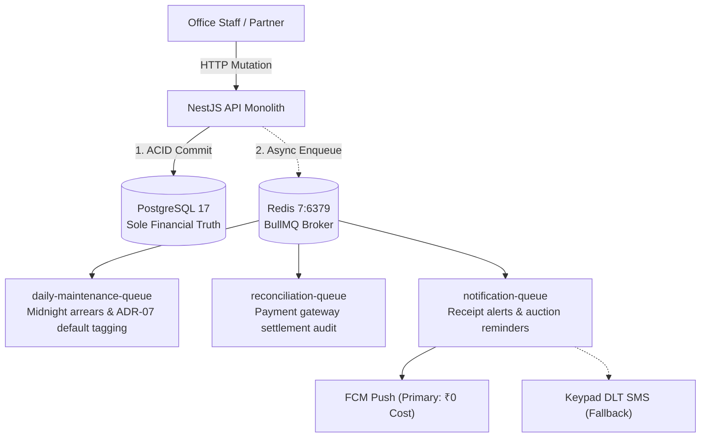

# Background Jobs Telemetry & Operations Control Console (`/admin/jobs`)

> **Product**: **Kumaran Chits** (Kumaran Finance, Perundurai, Tamil Nadu)  
> **Route**: `/admin/jobs`  
> **Primary Authority**: `SUPER_ADMIN` (Full Operations Control), `AUDITOR` / `BRANCH_MANAGER` (Read-Only Telemetry)  
> **Broker Engine**: Redis 7 on Port `6379` (`chitflow-redis`) with BullMQ  
> **Authoritative Invariant**: **PostgreSQL 17 is the sole source of financial truth.** BullMQ background workers never hold independent financial authority.

---

## 1. Architectural Role & Queue Topology

BullMQ offloads long-running and periodic background tasks without blocking synchronous NestJS HTTP request threads:

---

## 2. Real Backend Endpoints Wired

| Endpoint | Method | Role Required | Operational Purpose |
|---|:---:|---|---|
| `/api/v1/jobs/queue-status` | `GET` | Super Admin, Auditor, Branch Manager | Real-time task metrics (active, waiting, completed, failed, delayed, paused) |
| `/api/v1/jobs/repeatable-schedules` | `GET` | Super Admin, Auditor | Lists automated Asia/Kolkata cron schedules and next execution timestamps |
| `/api/v1/jobs/notification-audit-logs` | `GET` | Super Admin, Auditor | Paginated audit trail of dispatched Push Notifications and DLT SMS messages |
| `/api/v1/jobs/run-daily-arrears` | `POST` | Super Admin, Branch Manager | Synchronous on-demand midnight arrears evaluation with optional `cutoffDate` |
| `/api/v1/jobs/enqueue-daily-arrears` | `POST` | Super Admin | Enqueues arrears evaluation to `daily-maintenance-queue` |
| `/api/v1/jobs/run-pre-auction-scan` | `POST` | Super Admin, Branch Manager | Scans auctions scheduled 3 days ahead and broadcasts bilingual notices |
| `/api/v1/jobs/run-reconciliation` | `POST` | Super Admin, Accountant | Synchronous settlement reconciliation resolving ghost drops |
| `/api/v1/jobs/enqueue-reconciliation` | `POST` | Super Admin, Accountant | Enqueues settlement reconciliation to `reconciliation-queue` |

---

## 3. UI Component Architecture

All components adhere to the modularity standard ($\le 300\text{--}350$ lines per file):

1. **`BackgroundJobsPage` (`/admin/jobs/page.tsx` - 279 lines)**:
   - Super Admin RBAC gate with access restricted alert.
   - Breadcrumb navigation and real-time Redis connectivity indicator.
   - Bull Board direct integration button (`http://localhost:3000/admin/queues`).
   - 4 Pulse KPI cards (Redis Broker Status, Active Jobs, Queued Tasks, Failed Tasks).
   - Radix Tabs orchestrator switching between Telemetry, Triggers, and Audit Logs.
2. **`JobsStatusPanel` (`jobs-status-panel.tsx` - 265 lines)**:
   - 3 Production Queues visual status cards with real-time job counters.
   - Active repeatable IST schedules table with cron pattern mapping.
3. **`JobTriggersPanel` (`job-triggers-panel.tsx` - 312 lines)**:
   - Daily Arrears Scan with optional cutoff date.
   - Pre-Auction Reminders Scan with 3-day lookahead target date.
   - Settlement Reconciliation with ghost drop resolution.
4. **`NotificationAuditTable` (`notification-audit-table.tsx` - 250 lines)**:
   - Multi-channel notification audit trail with phone search and channel filters.
   - Cost-controlled delivery hierarchy educational banner (FCM free primary vs Keypad SMS fallback).

---

## 4. Verification Evidence

1. **Automated Unit Tests**: 8/8 tests passing in `background-jobs-admin.spec.ts` (224/224 total passing).
2. **TypeScript Compilation**: 0 diagnostic errors (`pnpm --filter web typecheck`).
3. **Next.js 15 Production Build**: Clean static and dynamic route compilation (`/admin/jobs` - 11.3 kB).
