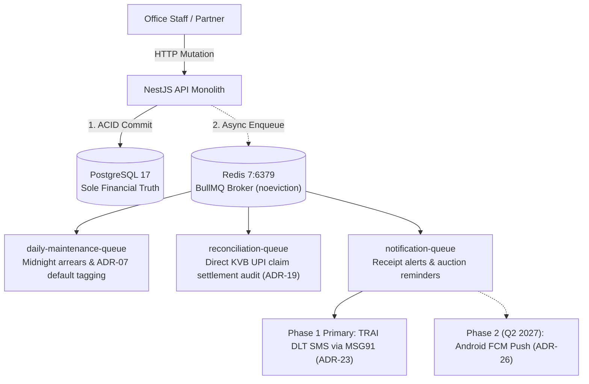

# Background Jobs Telemetry & Operations Control Console (`/admin/jobs`)

> **Product**: **Kumaran Chits** (Kumaran Finance, Perundurai, Tamil Nadu)  
> **Route**: `/admin/jobs`  
> **Primary Authority**: **`SUPER_ADMIN` strictly** (`apps/web/src/lib/route-permissions.ts` & `JobsController` telemetry guards; both Administrative IT Super Admins and Verified Partner Super Admins per Guardrail 11 / `ADR-21`). Non-`SUPER_ADMIN` roles receive `HTTP 403` on the `/admin/jobs` console and all read-telemetry endpoints.  
> **Operational Trigger Scoping**: `BRANCH_MANAGER` may invoke branch-scoped reminder/arrears trigger APIs (`run-daily-arrears`, `run-pre-auction-scan`, `send-auction-reminder`), and `ACCOUNTANT` may invoke settlement reconciliation triggers (`run-reconciliation`, `enqueue-reconciliation`) — never the `/admin/jobs` telemetry console or notification audit log.  
> **Broker Engine**: Redis 7 on Port `6379` (`chitflow-redis`, pinned to `--maxmemory 512mb --maxmemory-policy noeviction` per `KFC-INF-001`) with BullMQ  
> **Authoritative Invariant**: **PostgreSQL 17 is the sole source of financial truth.** BullMQ background workers never hold independent financial authority.

---

## 1. Architectural Role & Queue Topology

BullMQ offloads long-running and periodic background tasks without blocking synchronous NestJS HTTP request threads:

- **Zero Payment Gateway (`ADR-19`)**: Reconciliation audits direct Karur Vysya Bank (KVB) UPI claim submissions and pending receipts — no third-party payment gateway is integrated.
- **Notification Channel Hierarchy (`ADR-23` / `ADR-26`)**: Phase 1 dispatches bilingual English + Tamil receipts, OTPs, and auction reminders via **MSG91 TRAI DLT SMS** (`KMRCHT` sender ID; WhatsApp Business API is permanently excluded per `Q34` / `KFC-NOT-001`). Android FCM Push notifications are deferred to Phase 2 (Q2 2027) alongside the Flutter Android app rollout (`ADR-26`).
- **Broker Memory Safety (`KFC-INF-001`)**: `chitflow-redis` enforces `--maxmemory 512mb --maxmemory-policy noeviction` so active BullMQ job metadata and OTP lockout keys are never silently evicted under memory pressure.

---

## 2. Real Backend Endpoints Wired (`JobsController` — 9 Live Routes)

All 9 routes are served by `apps/api/src/jobs/jobs.controller.ts`:

| Endpoint | Method | Role Required | Operational Purpose |
|---|:---:|---|---|
| `/api/v1/jobs/queue-status` | `GET` | `SUPER_ADMIN` only | Real-time task metrics (active, waiting, completed, failed, delayed, paused) across BullMQ queues |
| `/api/v1/jobs/repeatable-schedules` | `GET` | `SUPER_ADMIN` only | Lists automated `Asia/Kolkata` cron schedules and next execution timestamps |
| `/api/v1/jobs/notification-audit-logs` | `GET` | `SUPER_ADMIN` only | Paginated audit trail of dispatched TRAI DLT SMS and Push notification records |
| `/api/v1/jobs/run-daily-arrears` | `POST` | `SUPER_ADMIN`, `BRANCH_MANAGER` | Synchronous on-demand midnight arrears evaluation with optional `cutoffDate` |
| `/api/v1/jobs/enqueue-daily-arrears` | `POST` | `SUPER_ADMIN` only | Enqueues arrears evaluation to `daily-maintenance-queue` |
| `/api/v1/jobs/run-pre-auction-scan` | `POST` | `SUPER_ADMIN`, `BRANCH_MANAGER` | Scans auctions scheduled 3 days ahead and broadcasts bilingual notices |
| `/api/v1/jobs/send-auction-reminder/:chitGroupId/:month` | `POST` | `SUPER_ADMIN`, `BRANCH_MANAGER` | Dispatches bilingual auction reminder for a specific chit group and auction month (strictly Months $2$ through $N-1$ per Guardrail 5; branch-scoped for Branch Managers) |
| `/api/v1/jobs/run-reconciliation` | `POST` | `SUPER_ADMIN`, `ACCOUNTANT` | Synchronous direct KVB UPI claim & receipt reconciliation resolving stale pending states |
| `/api/v1/jobs/enqueue-reconciliation` | `POST` | `SUPER_ADMIN`, `ACCOUNTANT` | Enqueues settlement reconciliation to `reconciliation-queue` |

---

## 3. UI Component Architecture

All components adhere to the modularity standard ($\le 300\text{--}350$ lines per file) and consume **105 / 105** bilingual leaf keys in the `jobs` i18n namespace (`apps/web/messages/en.json` & `ta.json`):

1. **`BackgroundJobsPage` (`/admin/jobs/page.tsx`)**:
   - Strict `SUPER_ADMIN`-only RBAC gate (`route-permissions.ts` + server guard) with access-restricted alert for non-Super-Admin roles.
   - Breadcrumb navigation and real-time Redis connectivity indicator.
   - Bull Board direct integration link (`NEXT_PUBLIC_BULL_BOARD_URL`, defaulting to `/admin/queues`, protected by Super Admin JWT + secondary HTTP Basic Auth).
   - 4 Pulse KPI cards (Redis Broker Status, Active Jobs, Queued Tasks, Failed Tasks).
   - Radix Tabs orchestrator switching between Telemetry, Manual Triggers, and Notification Audit Logs.
2. **`JobsStatusPanel` (`jobs-status-panel.tsx`)**:
   - 3 Production Queues visual status cards (`daily-maintenance-queue`, `reconciliation-queue`, `notification-queue`) with real-time job counters.
   - Active repeatable IST (`Asia/Kolkata`) schedules table with cron pattern mapping.
3. **`JobTriggersPanel` (`job-triggers-panel.tsx`)**:
   - Daily Arrears Scan with optional cutoff date (`ADR-07` overdue tagging).
   - Pre-Auction Reminders Scan with 3-day lookahead target date.
   - Direct UPI Claim & Settlement Reconciliation trigger.
4. **`NotificationAuditTable` (`notification-audit-table.tsx`)**:
   - Multi-channel notification audit trail with phone search and channel/status filters.
   - Delivery hierarchy guidance banner reflecting Phase 1 TRAI DLT SMS (`MSG91` / `KMRCHT`, zero WhatsApp per `Q34`) and Phase 2 Q2 2027 Android FCM Push roadmap (`ADR-23` / `ADR-26`).

---

## 4. Verification Evidence

1. **Automated Web Unit Tests**: `376/376` passing across `52` spec files (`14` suites) via native Node runner (`node --experimental-strip-types --test test/*.spec.ts`), including `background-jobs-admin.spec.ts`.
2. **Localization Parity**: `105/105` `jobs` namespace leaf keys (`1,921/1,921` total portal keys) at 100% EN/TA parity.
3. **TypeScript & Production Build**: 0 diagnostic errors (`pnpm --filter web typecheck`) and clean Next.js 15 standalone compilation across all `35` App Router `page.tsx` routes.
