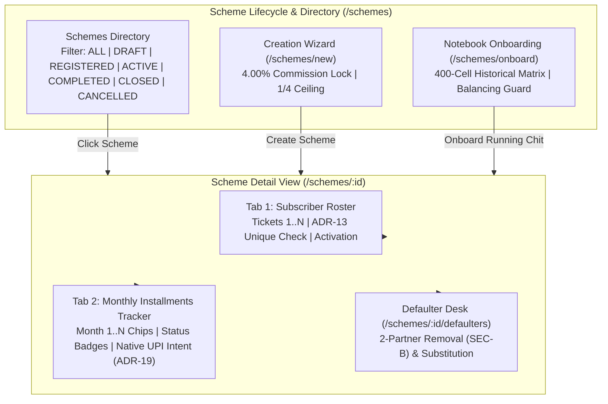

# Phase 4 Architecture: Chit Schemes Management & Physical Notebook Onboarding

> **Product**: **Kumaran Chits** (Kumaran Finance, Perundurai, Tamil Nadu)  
> **Platform**: Web Workstation Portal (`apps/web`)  
> **Status**: **Phase 4 (Tasks 4.1, 4.2, 4.3 & 4.4) 100% COMPLETED & VERIFIED**  
> **Target Audience**: Web Engineers, Backend Engineers, CA Auditors, Partner/Foreman Operations, Desk Accountants  
> **Scope**: Scheme Directory, Ticket Roster (1..N), Roster Activation, Scheme Creation Wizard, Mid-Cycle Physical Notebook Onboarding Grid, Monthly Installments Panel, Universal Dividend Engine, and Dynamic NPCI UPI QR Intent  
> **Applicable Architectural Guardrails**: Guardrail 1 (Single Company), Guardrail 2 (Whole Rupee Math), Guardrail 3 (4% Commission Lock), Guardrail 4 (Universal Equal Dividend Deduction), Guardrail 5 (Month 1 & N Rules), Guardrail 6 (Fixed 1/4 Ceiling), Guardrail 7 / ADR-13 (Ticket Limit Constraint), Guardrail 8 (Defaulter & Single Discrete Payment), Guardrail 10 (Maker $\ne$ Checker).

---

## 1. Executive Summary & Capabilities Delivered

Phase 4 establishes the operational core of Kumaran Chits, bridging physical paper notebooks with real-time digital accounting. It supports fresh scheme creation as well as mid-cycle onboarding of running chits from physical paper notebooks.



### Primary Capabilities Delivered:

1. **Schemes Directory & Lifecycle Management (Task 4.1)**:
   - High-density directory at `/schemes` with status filtering aligned to live `ChitStatus` enum (`ALL`, `DRAFT`, `REGISTERED`, `ACTIVE`, `COMPLETED`, `CLOSED`, `CANCELLED`), search by group code or name, and branch filtering.
   - Comprehensive scheme detail page at `/schemes/[id]` displaying key financial invariants (Chit Value, Base Installment, Duration, 4% Commission, Max Ceiling Discount, and Roster Fill).
   - Ticket Roster Table managing all $N$ slots with subscriber assignment dialog, live customer search, and ADR-13 unique ticket validation.
   - Scheme activation modal enforcing 100% full subscription before launching into `ACTIVE` state (plus `register`, `cancel`, and `close` lifecycle transitions).

2. **New Scheme Creation Wizard with Real-Time Chit Math (Task 4.2)**:
   - Super Admin creation wizard at `/schemes/new` with statutory role guard (`user.roles.includes('SUPER_ADMIN')`).
   - Quick preset chips for standard denominations (₹1L/20M, ₹2L/20M, ₹5L/20M, ₹10L/25M).
   - Interactive live financial invariants preview (`SchemeMathPreview`) auto-calculating $I_{base} = V/N$, $C_f = V \times 4\%$, $Ceiling = V/4$, and minimum prize payout ($3V/4$).
   - Divisibility invariant validation ($V \pmod N == 0$) strictly preventing fractional paise.
   - Foreman commission permanently frozen at **4.00%** (read-only, uneditable).
   - Prior Sanction Order Number & Sanction Date inputs for Government Chit Registrar compliance.

3. **Mid-Cycle Physical Notebook Onboarding Grid (Task 4.3)**:
   - Dedicated 400-cell historical transcription matrix ($N$ subscribers $\times N$ months) at `/schemes/onboard` mirroring physical paper notebooks per [`manual-onboarding-sop.md`](../07-operations/manual-onboarding-sop.md).
   - Excel-like keyboard navigation: Arrow keys (`↑`, `↓`, `←`, `→`), `Tab`, `Enter`, and `Space`/`Enter` to toggle `PAID` / `UNPAID`.
   - Local storage draft auto-save (`kc_onboard_draft_active`) with restore and clear controls.
   - Pre-Activation Balancing Guard comparing transcribed system total against physical notebook ledger total to the exact whole Rupee.
   - One-click **"Fill Sample Test Data"** helper auto-filling 20 real subscribers from PostgreSQL, past auctions, and balanced collections for rapid verification.
   - Submits real batch payload to `POST /api/v1/chits/onboard-ongoing` creating chit in `DRAFT` status ready for Partner Checker activation.

4. **Monthly Installments Panel & Dues Tracker (Task 4.4)**:
   - Tabbed workspace at `/schemes/[id]`: Tab 1 (Subscriber Roster 1..$N$) & Tab 2 (Monthly Installments & Dues Tracker).
   - High-density horizontal 1..$N$ month selector bar with "M1 (Company Pool)", "Active", and "M{N} (Final)" badges.
   - 5-metric financial overview bar: Base Gross ($I_{base}$), Universal Dividend ($Div$), Net Payable ($I_{net}$), Paid count ($X / N$), and Rupee progress gauge.
   - Member dues table with instant client-side filtering (`ALL`, `PAID`, `UNPAID`, `OVERDUE`) and consecutive unpaid warnings under **ADR-07**.
   - **Zero-Fee NPCI Native UPI Intent (`UpiQrDialog` — `ADR-19`)**: Generates `upi://pay` deep-link/QR locking exact whole-rupee net amount and Karur Vysya Bank payee VPA (`kumaranfinance@kvb`). Subscribers submit their 12-digit Bank UTR claim (`POST /api/v1/payments/upi-claim` $\to$ `INITIATED`) for independent Accounting Desk verification (`POST /api/v1/payments/:id/verify-upi-claim` $\to$ `SUCCESS`).
   - Maker dues generation dialog (`GenerateDuesDialog`) enforcing Month 1 ₹0 dividend (Guardrail 5) and Month 2..$N$ finalized auction validation.

---

## 2. API Contract & Verified Endpoint Dossier

All 18 endpoints connect directly to live NestJS 12 controllers (`ChitController`, `InstallmentController`, `AuctionController`, `BranchController`, `CustomerController`) and PostgreSQL 17 models:

| Operation | Method & Path | Permitted Roles | Purpose in Phase 4 |
|---|---|---|---|
| **List Schemes** | `GET /api/v1/chits` | All Authenticated Personas | Paginated scheme directory with live `ChitStatus` tabs (`DRAFT`, `REGISTERED`, `ACTIVE`, `COMPLETED`, `CLOSED`, `CANCELLED`) |
| **Create Scheme** | `POST /api/v1/chits` *(alias `/api/v1/chits/new`)* | `SUPER_ADMIN` | Creates new scheme in `DRAFT` with 4.00% frozen commission and $V/4$ ceiling |
| **Scheme Details** | `GET /api/v1/chits/:id` | All Authenticated Personas | Fetches scheme overview, duration, commission, ceiling, and ticket counts |
| **Update Draft Scheme** | `PATCH /api/v1/chits/:id` | `SUPER_ADMIN` | Updates metadata, sanction order, and auction timing **strictly while `status === 'DRAFT'`** |
| **Register Scheme** | `POST /api/v1/chits/:id/register` | `SUPER_ADMIN` | Records sanction order (`DRAFT -> REGISTERED`) |
| **Cancel Draft Scheme** | `POST /api/v1/chits/:id/cancel` | `SUPER_ADMIN` | Cancels unactivated draft scheme (`DRAFT -> CANCELLED`) |
| **Scheme Tickets** | `GET /api/v1/chits/:id/tickets` | All Authenticated Personas | Retrieves all $N$ subscriber ticket allocations for the scheme |
| **Assign Ticket** | `POST /api/v1/chits/:id/tickets/assign` | `SUPER_ADMIN`, `BRANCH_MANAGER` | Assigns ticket slot to subscriber with ADR-13 unique customer check |
| **Unassign Ticket** | `DELETE /api/v1/chits/:id/tickets/:ticketNumber` | `SUPER_ADMIN`, `BRANCH_MANAGER` | Vacates an assigned ticket slot in `DRAFT` before scheme activation |
| **Activate Scheme** | `POST /api/v1/chits/:id/activate` | `SUPER_ADMIN` *(Verified Partner `isPartner: true`)* | Locks commission, activates scheme once roster is 100% full, executes Month 1 company pool |
| **Close Completed Scheme** | `POST /api/v1/chits/:id/close` | `SUPER_ADMIN` | Final account reconciliation and scheme closure (`COMPLETED -> CLOSED`) |
| **Onboard Ongoing** | `POST /api/v1/chits/onboard-ongoing` | `SUPER_ADMIN`, `BRANCH_MANAGER`, `ACCOUNTANT` | Transcribes mid-cycle running chit from physical notebook into `DRAFT` status |
| **Month Dues** | `GET /api/v1/installments/group/:chitGroupId/month/:month` | `SUPER_ADMIN`, `BRANCH_MANAGER`, `ACCOUNTANT`, `AUDITOR` | Lists subscriber gross, dividend, net payable, paid amount, and payment status |
| **Generate Dues** | `POST /api/v1/installments/group/:chitGroupId/month/:month/generate` | `SUPER_ADMIN`, `BRANCH_MANAGER` | Calculates universal equal dividend and generates/syncs monthly dues |
| **NPCI UPI Intent** | `GET /api/v1/installments/:dueId/upi-intent` | All Authenticated Personas | Generates zero-fee `upi://pay` URI locking whole-rupee net amount & KVB VPA (`ADR-19`) |
| **List Auctions** | `GET /api/v1/auctions/group/:chitGroupId` | All Authenticated Personas | Verifies past auction winners, winning discounts, and dividend per ticket |
| **Branches List** | `GET /api/v1/branches` | Staff & Auditor | Fetches operating branches for scheme assignment |
| **Customer Search** | `GET /api/v1/customers` | Staff & Auditor | Live subscriber search for ticket assignment |

---

## 3. Invariant Architectural Guardrails Mapping

Every requirement in Phase 4 maps directly to the master invariants confirmed in [`AGENTS.md`](../../AGENTS.md):

| Guardrail | Invariant Rule | Implementation in Phase 4 Web Portal |
|---|---|---|
| **Guardrail 1** | **Single-Company Tenancy** | Built exclusively for Kumaran Finance. Zero `company_id` columns, query params, or form fields exist in any screen or DTO. |
| **Guardrail 2** | **Pure Whole Rupee Math & Divisibility (`KFC-FIN-002`)** | All currency fields ($V$, $I_{base}$, $Div$, $I_{net}$, $D$, $C_f$, Paid Amount) use integer Rupees (`BigInt`). Scheme creation enforces $V \pmod N == 0$ and auction dividend calculations enforce exact whole-rupee divisibility $(D - C_f) \pmod N == 0$ (`NON_DIVISIBLE_DIVIDEND`), eliminating truncation loss. |
| **Guardrail 3** | **Commission Freeze (4.00%)** | Foreman commission is hardcoded and locked at strictly 4.00% upon scheme creation and frozen permanently upon activation. |
| **Guardrail 4** | **Universal Equal Dividend Deduction** | For Months 2 to $N$, universal dividend $Div = (D - C_f) / N$ is distributed equally across **ALL members**, including the auction winner and past prized winners. All members pay $I_{net} = I_{base} - Div$. |
| **Guardrail 5** | **Month 1 & Month $N$ Rules** | Month 1 full pool is taken by company representative ticket #1 with strictly ₹0 dividend ($I_{net} \equiv I_{base}$). Month $N$ final settlement without auction (`FIN-B`). |
| **Guardrail 6** | **Fixed 1/4 Ceiling & Tie-Break** | Winning bid discount cannot exceed $V/4$ (25.00%). Enforced in creation wizard, onboarding grid, and dues generator. |
| **Guardrail 7** | **Ticket Limit Constraint (ADR-13)** | A customer cannot hold 2 or more tickets in the same chit group (`@@unique([chitGroupId, customerId])`). Enforced in ticket assignment dialog and onboarding grid. |
| **Guardrail 8** | **Defaulter & Discrete Single Payment** | Dues status is strictly `PAID`, `UNPAID`, or `OVERDUE`. Rejects double payments, partial payments, or advance balances. Flags $\ge 3$ consecutive unpaid months (`DEFAULT_3_MONTHS`) for removal under ADR-07. |
| **Guardrails 10 & 11** | **Maker $\ne$ Checker & Verified Partner Identity (`ADR-21`)** | Mid-cycle onboarding drafts initiated by Makers (`ACCOUNTANT` / `BRANCH_MANAGER` / Partner A) require activation by an independent **Verified Partner (`SUPER_ADMIN` with `isPartner: true`)**. |

---

## 4. Subsystem Layout & File Registry

```
apps/web/
├── src/
│   ├── app/(dashboard)/schemes/
│   │   ├── page.tsx                                  # Schemes Directory & Status Filter Tabs (/schemes)
│   │   ├── new/
│   │   │   └── page.tsx                              # Scheme Creation Wizard Hub (/schemes/new)
│   │   ├── onboard/
│   │   │   └── page.tsx                              # Mid-Cycle Notebook Onboarding Grid Hub (/schemes/onboard)
│   │   └── [id]/
│   │       ├── page.tsx                              # Scheme Detail Page with Tabbed Roster & Installments (/schemes/[id])
│   │       └── defaulters/
│   │           └── page.tsx                          # Defaulter Removal & Substitution Desk (see defaulter-substitution-desk.md)
│   ├── components/schemes/
│   │   ├── scheme-card.tsx                           # Scheme summary card with live ChitStatus badges
│   │   ├── scheme-form.tsx                           # Master creation wizard form with validation
│   │   ├── scheme-math-preview.tsx                   # Live whole-rupee math & invariants preview card
│   │   ├── customer-search-picker.tsx                # Subscriber live search picker with debounce
│   │   ├── assign-ticket-dialog.tsx                  # Ticket slot assignment modal with ADR-13 check
│   │   ├── edit-scheme-dialog.tsx                    # Draft scheme metadata & sanction order editor
│   │   ├── activate-scheme-dialog.tsx                # Full roster verification & activation modal
│   │   ├── ticket-roster-table.tsx                   # 1..N Subscriber ticket roster table
│   │   ├── ticket-roster-row.tsx                     # Individual subscriber ticket row item
│   │   ├── notebook-master-form.tsx                  # Section 1: Scheme master & intake month form
│   │   ├── notebook-entry-grid.tsx                   # Section 2: 400-cell historical transcription matrix
│   │   ├── notebook-validation-panel.tsx             # Section 3: Pre-Activation Balancing Guard & Checklist
│   │   ├── month-selector-bar.tsx                    # Horizontal 1..N scrollable month selector bar
│   │   ├── month-financial-summary.tsx               # 5-Metric month financial overview bar
│   │   ├── monthly-installments-panel.tsx            # Installments tracker panel orchestrator
│   │   ├── monthly-dues-table.tsx                    # Member dues table with status filters
│   │   ├── generate-dues-dialog.tsx                  # Maker dues generation modal with auction guard
│   │   ├── upi-qr-dialog.tsx                         # ADR-19 zero-fee NPCI Native UPI Intent modal
│   │   ├── defaulters-table.tsx                      # Defaulter desk roster (3M arrears)
│   │   ├── defaulter-removal-dialog.tsx              # SEC-B two-partner defaulter removal workflow
│   │   ├── defaulter-substitution-modal.tsx          # Replacement subscriber substitution workflow
│   │   └── defaulter-settlement-dialog.tsx           # Q25 fail-closed exit settlement guard
│   └── lib/
│       ├── query-keys.ts                             # Centralized TanStack Query cache key factory
│       └── date-utils.ts                             # Safe ISO date parser preventing runtime crashes
└── messages/
    ├── en.json                                       # 'schemes' (175), 'onboarding' (84), 'installments' (55) leaf keys
    └── ta.json                                       # 100% bidirectional Tamil parity (175 / 84 / 55)
```

---

## 5. Automated Test Suites & Quality Verification

Phase 4 is covered by 4 dedicated automated test suites (plus `defaulter-substitution.spec.ts` for `/schemes/[id]/defaulters`) asserting financial invariants, edge cases, and localization parity:

| Test Suite File | Invariants Asserted | Pass Rate |
|---|---|:---:|
| [`apps/web/test/schemes-and-roster.spec.ts`](file:///u:/Kumaran-finance/apps/web/test/schemes-and-roster.spec.ts) | Ticket count equals duration, Slot #1 Company Rep invariant, ADR-13 duplicate prevention, full-roster activation guard. | **100% PASS** |
| [`apps/web/test/scheme-form-validation.spec.ts`](file:///u:/Kumaran-finance/apps/web/test/scheme-form-validation.spec.ts) | Whole-rupee divisibility ($V \pmod N == 0$), 4.00% commission freeze, 1/4 ceiling discount, maturity projection. | **100% PASS** |
| [`apps/web/test/notebook-onboarding.spec.ts`](file:///u:/Kumaran-finance/apps/web/test/notebook-onboarding.spec.ts) | 400-cell grid math, Month 1 zero-dividend rule, historical bid discounts $\le V/4$, ADR-13 unique check, Pre-Activation Balancing Guard. | **100% PASS** |
| [`apps/web/test/monthly-installments.spec.ts`](file:///u:/Kumaran-finance/apps/web/test/monthly-installments.spec.ts) | Universal dividend allocation ($I_{net} = I_{base} - Div$), Month 1 pool zero-dividend, NPCI UPI locked integer amount (`ADR-19`), discrete dues status (`PAID`, `UNPAID`, `OVERDUE`). | **100% PASS** |

### Complete Verified Web Test Suite & Build Status:
```powershell
$ pnpm --filter web test
# 376 passing tests across 52 spec files (14 top-level suites), 0 failures, 0 skipped.

$ pnpm --filter web typecheck
# next typegen && tsc --noEmit && tsc --noEmit -p tsconfig.test.json: 0 compiler errors

$ pnpm --filter web build
# Next.js 15 standalone build across all 35 App Router page.tsx routes compiled cleanly.
```
