# Collections, Cash Handover & Receipts Architecture (Web Portal)

> **Product**: **Kumaran Chits**  
> **Company**: **Kumaran Finance** (Head Office — Perundurai, Tamil Nadu)  
> **Route Path**: `/collections`, `/handover`  
> **Status**: **Phase 8 (Tasks 8.1 & 8.2) COMPLETED & VERIFIED** (16/16 Phase 8 tests pass, 184/184 full web test suite pass, 0 TS errors, clean Next.js 15 build)

---

## 1. Overview & Business Reality

At the Perundurai branch office counter, subscribers pay their monthly chit subscription installments both in person (cash, cheque, or scanning the dynamic counter UPI QR) and remotely through mobile UPI applications. Desk accountants and cashiers record discrete payments, verify self-reported bank credits against company bank statements, and issue official sequential bilingual receipts.

### Key Operational Capabilities

#### A. Task 8.1: Counter Payment Collection & Immediate Net Due Matching
1. **ADR-07 Single Discrete Payment Rule**:
   - Each installment month requires strictly a single discrete payment.
   - Payment amount must identically match the exact net installment due ($I_{net} = I_{base} - Div_{ticket}$).
   - **Zero partial payments**: Attempting to pay less than $I_{net}$ is strictly rejected at UI and API levels (`PARTIAL_PAYMENTS_NOT_ALLOWED`).
   - **Zero double payments / advance balances**: Attempting to pay ahead in one single transaction is strictly rejected (`ADVANCE_OR_DOUBLE_PAYMENT_NOT_ALLOWED`).
2. **Four Supported Payment Methods**:
   - `CASH`: Collected directly into the counter drawer / safe.
   - `UPI`: Generates a dynamic NPCI-compliant UPI QR code on the counter screen (`GET /api/v1/installments/:dueId/upi-intent`) with payee VPA and locked $I_{net}$ amount for walk-in scanning.
   - `CHEQUE`: Captures Cheque # and Bank Name (`transactionRef`).
   - `BANK_TRANSFER`: Captures NEFT/RTGS/IMPS bank UTR (`transactionRef`).
3. **Sequential Bilingual Receipts**:
   - Atomically generates sequential receipt numbers in format `KC-REC-{BRANCH}-{YYYY}-{XXXXX}` with 5-digit padding.
   - Opens structured A5 digital receipt view with direct browser print (`window.print()`).
   - Direct download of pixel-accurate printable A5 bilingual PDF via `GET /api/v1/pdf/receipt/:paymentId`.
4. **Counter Collections Dashboard & Pulse Metrics**:
   - Total daily collections (count of receipts issued today).
   - Total cash in drawer (₹ whole rupees).
   - Total UPI settlements (₹ whole rupees).
   - Total cheques in clearance (₹ whole rupees).
   - Filterable by payment method (`ALL`, `CASH`, `UPI`, `CHEQUE`, `BANK_TRANSFER`) and payment status (`ALL`, `SUCCESS`, `INITIATED`, `REVERSED`).

#### B. Task 8.2: Customer Self-Reported UPI Claims Verification Desk
1. **Customer Mobile UPI Payment Claim**:
   - Customers paying remotely via deep-link or counter QR self-report their Bank UTR number (`POST /api/v1/payments/upi-claim`).
   - Initial claim recorded in `PaymentStatus.INITIATED` without issuing a receipt. Due remains `UNPAID` or `OVERDUE`.
2. **Accounting Desk Verification Queue**:
   - Accounting staff accesses the **UPI Claims Verification Desk** tab at `/collections`.
   - Lists all pending claims from `GET /api/v1/payments/pending-upi-claims`.
   - Displays Subscriber, Ticket #, Month #, Locked Rupee Amount, Bank UTR with one-click clipboard copy, and Submitter details.
3. **Bank Statement Reconciliation & Receipt Generation**:
   - Desk Accountant cross-references the reported Bank UTR against the office bank account statement (KVB NetBanking / corporate statement).
   - Once credit is confirmed, clicks **"Verify Bank Credit"** opening `VerifyClaimDialog`.
   - Enforces credit confirmation checkbox and optional verification notes (e.g. `"Verified in KVB NetBanking at 15:30"`).
   - Calls `POST /api/v1/payments/:id/verify-upi-claim` $\to$ transitions payment to `SUCCESS`, settles due to `PAID`, generates sequential receipt, recalculates arrears, and writes an audit log.
   - Automatically opens `BilingualReceiptModal` to view/print/download the receipt.
4. **Guardrail 10 Maker $\ne$ Checker Hard Guard**:
   - A user who submitted the UPI claim (`claim.submittedByUser.id === currentUser.id`) **CANNOT** verify the bank credit.
   - UI disables the verify CTA with a dedicated `Maker Guard` badge, backed by database-level exception `MAKER_CHECKER_VIOLATION`.

---

## 2. Invariant Architectural Guardrails & State Machine

```mermaid
flowchart TD
    subgraph CounterDesk["Task 8.1: Counter Collections"]
        W["Walk-in Subscriber at Counter"] --> S["Select Chit Group & Month\nLookup Member Ticket"]
        S --> L["Auto-Calculate & Lock Inet\nInet = Ibase - Div (BigInt)"]
        L --> G1{"ADR-07 Match Guard\nAmount === Inet?"}
        G1 -- "No (Partial/Advance)" --> REJ["Strict Rejection: PARTIAL_PAYMENTS_NOT_ALLOWED"]
        G1 -- "Yes (Exact Match)" --> M["Select Payment Method\n(CASH, UPI, CHEQUE, BANK_TRANSFER)"]
        M --> POST1["POST /api/v1/payments"]
        POST1 --> R1["Atomic Result:\n1. Payment SUCCESS\n2. Due PAID\n3. Receipt KC-REC-PRD-YYYY-XXXXX"]
    end

    subgraph ClaimsDesk["Task 8.2: Customer UPI Claims Desk"]
        MOB["Mobile Customer / Agent Submits UTR\nPOST /api/v1/payments/upi-claim"] --> PEND["Payment INITIATED\nDue UNPAID\nNo Receipt Issued"]
        PEND --> QUEUE["GET /api/v1/payments/pending-upi-claims"]
        QUEUE --> ACCT["Desk Accountant Matches Bank Statement\n(KVB NetBanking Credit)"]
        ACCT --> G2{"Guardrail 10\nmaker != checker?"}
        G2 -- "Same User (Self-Verify)" --> BLK["Blocked: MAKER_CHECKER_VIOLATION"]
        G2 -- "Different Staff" --> VMOD["VerifyClaimDialog\nConfirm UTR Credit"]
        VMOD --> POST2["POST /api/v1/payments/:id/verify-upi-claim"]
        POST2 --> R2["Atomic Result:\n1. Payment SUCCESS\n2. Due PAID\n3. Receipt Issued\n4. AuditLog Created"]
    end
```



---

## 3. Modular File Architecture

All files strictly comply with the $\le 300\text{--}350$ lines limit per **AGENTS.md Rule 4**:

| File Path | Description | Line Count | Status |
|---|---|:---:|:---:|
| `apps/web/src/app/(dashboard)/collections/page.tsx` | Master collections route with dual-tab desk switcher & 4 metrics | 292 | **Complete** |
| `apps/web/src/components/collections/payments-table.tsx` | Collections data table with method/status badges and receipt actions | 239 | **Complete** |
| `apps/web/src/components/collections/counter-payment-modal.tsx` | Scheme & ticket lookup, ADR-07 locked amount, payment recording | 337 | **Complete** |
| `apps/web/src/components/collections/counter-upi-qr.tsx` | Dynamic NPCI QR generator rendering offline vector SVG | 121 | **Complete** |
| `apps/web/src/components/collections/bilingual-receipt-modal.tsx` | Printable bilingual receipt viewer and A5 PDF download | 263 | **Complete** |
| `apps/web/src/components/collections/upi-claims-table.tsx` | Pending UPI claims queue with UTR copy and Maker!=Checker guard | 235 | **Complete** |
| `apps/web/src/components/collections/verify-claim-dialog.tsx` | Bank statement credit confirmation modal with statement notes | 232 | **Complete** |
| `apps/web/src/lib/query-keys.ts` | Centralized React Query cache keys for payments & claims | 108 | **Complete** |
| `apps/web/test/counter-collections.spec.ts` | Task 8.1 invariant test suites | 326 | **Complete** |
| `apps/web/test/upi-claims-verification.spec.ts` | Task 8.2 invariant test suites | 274 | **Complete** |

---

## 4. API Integration Endpoints

- **`POST /api/v1/payments`**: Records discrete counter payment with `{ ticketId, installmentMonth, amount, paymentMethod, transactionRef, notes, idempotencyKey }`.
- **`GET /api/v1/payments`**: Queries paginated ledger with filters (`paymentMethod`, `paymentStatus`, `limit`).
- **`GET /api/v1/payments/:id/receipt`**: Returns structured bilingual receipt data (`BilingualReceiptResponseDto`).
- **`GET /api/v1/pdf/receipt/:paymentId`**: Streams pixel-accurate A5 bilingual printable PDF.
- **`GET /api/v1/installments/:dueId/upi-intent`**: Returns NPCI UPI deep-link URI with locked $I_{net}$ amount.
- **`GET /api/v1/installments/group/:chitGroupId/month/:month`**: Returns member dues for selected scheme and month.
- **`GET /api/v1/payments/pending-upi-claims`**: Lists all pending self-reported UPI claims in `INITIATED` status.
- **`POST /api/v1/payments/:id/verify-upi-claim`**: Verifies bank statement credit, transitions payment to `SUCCESS`, and issues sequential receipt (`maker != checker`).

---

## 5. Automated Verification & Quality Gate Proofs

Phase 8 is validated by **two dedicated automated test suites asserting 16 non-negotiable financial and security invariants**:

### A. Task 8.1 Tests (`apps/web/test/counter-collections.spec.ts`)
```text
▶ Task 8.1: Counter Payment Collection & Immediate Net Due Matching Unit Tests
  ✔ ADR-07 Exact Match: Accepts exact Inet and strictly rejects partial or advance amounts
  ✔ Guardrail 2 Whole Rupee Math: Rejects floating-point paise and fractional values
  ✔ Due Status Transition: Transitions UNPAID and OVERDUE dues strictly to PAID
  ✔ Sequential Receipt Numbering: Generates standard format with 5-digit padding
  ✔ Payment Methods: Enforces allowed 4 payment methods and rejects unsupported ones
  ✔ NPCI Counter UPI Intent: Generates valid UPI deep-link URI with locked whole rupee amount
  ✔ Idempotency Protection: Re-submitting with identical idempotencyKey returns existing receipt
  ✔ Bilingual Parity: All collections keys match 100% between en.json and ta.json
✔ Task 8.1: Counter Payment Collection & Immediate Net Due Matching Unit Tests (8/8 pass)
```

### B. Task 8.2 Tests (`apps/web/test/upi-claims-verification.spec.ts`)
```text
▶ Task 8.2: Customer Self-Reported UPI Claims Verification Desk Unit Tests
  ✔ Guardrail 10: Rejects self-verification when checkerUserId === recordedByUserId
  ✔ RBAC Authority: Restricts verification strictly to Super Admin, Branch Manager, and Accountant
  ✔ Payment State Transition: Transitions payment strictly from INITIATED to SUCCESS
  ✔ Due Settlement: Marks due PAID with exact net amount upon claim verification
  ✔ Sequential Receipt: Issues collision-proof receipt KC-REC-{BRANCH}-{YYYY}-{XXXXX}
  ✔ Arrears Recalculation: Decrements consecutive unpaid arrears and updates ticket status
  ✔ Bank UTR Validation: Enforces 6 to 35 alphanumeric characters and prevents duplicate claim submission
  ✔ Bilingual Parity: All collections keys match 100% between en.json and ta.json
✔ Task 8.2: Customer Self-Reported UPI Claims Verification Desk Unit Tests (8/8 pass)
```

### C. Workspace Health
- **Total Tests**: **184 / 184 tests passing** (`pnpm --filter web test`).
- **Static Typecheck**: `tsc --noEmit` exited with **0 errors**.
- **Production Build**: `next build` compiled all 16 routes cleanly.
- **Bilingual Dictionary Parity**: 100% bidirectional parity across all `collections` keys.
