# Collections, Cash Handover & Receipts Architecture (Web Portal)

> **Product**: **Kumaran Chits**  
> **Company**: **Kumaran Finance** (Head Office — Perundurai, Tamil Nadu)  
> **Route Paths**: `/collections`, `/collections/handover`  
> **Status**: **Phase 8 (Tasks 8.1, 8.2, 8.3) COMPLETED & VERIFIED** (24/24 Phase 8 unit tests passing; **376/376** full Web test suite passing across 52 spec files / 14 suites; 0 TS errors; clean Next.js 15 build across 35 App Router routes)

---

## 1. Overview & Business Reality

At the Perundurai branch office counter and during field rounds, subscribers pay their monthly chit subscription installments in person (cash, cheque, or zero-fee NPCI Native UPI Intent directly to Karur Vysya Bank per `ADR-19`) and remotely through mobile UPI applications. Desk accountants, cashiers, and partners record discrete payments, verify self-reported 12-digit Bank UTR credits against KVB corporate net banking statements, count evening field collection cash bags into the vault, and issue official sequential bilingual receipts.

### Key Operational Capabilities

#### A. Task 8.1: Counter Payment Collection & Immediate Net Due Matching
1. **ADR-07 Single Discrete Payment Rule**:
   - Each installment month requires strictly a single discrete payment.
   - Payment amount must identically match the exact net installment due ($I_{net} = I_{base} - Div_{ticket}$).
   - **Zero partial payments**: Attempting to pay less than $I_{net}$ is strictly rejected (`PARTIAL_PAYMENTS_NOT_ALLOWED`).
   - **Zero double payments / advance balances**: Attempting to pay ahead in one single transaction is strictly rejected (`ADVANCE_OR_DOUBLE_PAYMENT_NOT_ALLOWED`).
2. **Four Supported Payment Methods**:
   - `CASH`: Collected directly into the counter drawer / safe.
   - `UPI`: Generates zero-fee NPCI Native UPI Intent QR (`GET /api/v1/installments/:dueId/upi-intent`, `ADR-19`) locking Kumaran Finance's KVB payee VPA (`kumaranfinance@kvb`) and exact whole-rupee $I_{net}$ amount (zero commercial payment gateway fees).
   - `CHEQUE`: Captures Cheque # and Bank Name (`transactionRef`).
   - `BANK_TRANSFER`: Captures NEFT/RTGS/IMPS bank UTR (`transactionRef`).
3. **Sequential Bilingual Receipts & Reversed Watermark (`KFC-PDF-001`)**:
   - Atomically generates sequential receipt numbers in format `KC-REC-{BRANCH}-{YYYY}-{XXXXX}` with 5-digit padding.
   - Direct download of pixel-accurate printable A5 bilingual PDF via `GET /api/v1/pdf/receipt/:paymentId` (streamed via BFF). Any reversed payment (`paymentStatus === 'REVERSED'`) automatically stamps a bold diagonal red **`ரத்து செய்யப்பட்டது / CANCELLED`** watermark on both the A5 web print preview and server-generated PDF (`KFC-PDF-001`).
4. **Same-Branch Idempotency Isolation & Branch Scope Locking (F09)**:
   - Replaying a cached idempotency key is strictly restricted to the user who recorded the payment (`existingPayment.recordedByUserId === currentUser.id`), preventing cross-agent payment sniffing within the branch.
   - Accounting branch is strictly derived from `ticket.chitGroup.branchId`, ensuring ticket payments cannot be diverted to foreign branch ledgers.

#### B. Task 8.2: Customer Self-Reported UPI Claims Verification Desk (`ADR-19`)
1. **Customer / Branch Desk UPI Payment Claim**:
   - Subscribers (or office desk staff on their behalf: `CUSTOMER`, `SUPER_ADMIN`, `BRANCH_MANAGER`, `ACCOUNTANT` per `payment.controller.ts:309`) submit the 12-digit Bank UTR number via `POST /api/v1/payments/upi-claim` (`COLLECTION_AGENT` is not permitted to invoke `upi-claim`).
   - Initial claim recorded in `PaymentStatus.INITIATED` without issuing a receipt. Due remains `UNPAID` or `OVERDUE`.
2. **Accounting Desk Verification Queue**:
   - Accounting staff accesses the **UPI Claims Verification Desk** tab at `/collections`.
   - Lists all pending claims from `GET /api/v1/payments/pending-upi-claims`.
   - Displays Subscriber, Ticket #, Month #, Locked Rupee Amount, Bank UTR with one-click clipboard copy, and Submitter details.
3. **Bank Statement Reconciliation & Receipt Generation**:
   - Desk Accountant cross-references the reported Bank UTR against the office bank account statement (KVB NetBanking).
   - Once credit is confirmed, clicks **"Verify Bank Credit"** opening `VerifyClaimDialog`.
   - Calls `POST /api/v1/payments/:id/verify-upi-claim` $\to$ transitions payment to `SUCCESS`, settles due to `PAID`, generates sequential receipt, recalculates arrears, and writes an audit log.
4. **Guardrail 10 Maker $\ne$ Checker Hard Guard**:
   - A user who submitted the UPI claim (`claim.submittedByUser.id === currentUser.id`) **CANNOT** verify the bank credit.

#### C. Task 8.3: Evening Field Cash Handover Verification Desk (`/collections/handover`)
1. **Zero Overnight Cash Retention Policy**:
   - Field collection agents collect cash installments during daytime doorstep visits (`POST /api/v1/collections/record`).
   - Customer dues are satisfied immediately (`PAID`), but physical cash custody remains `PENDING_HANDOVER`.
   - Agents return to Perundurai Head Office between 5:00 PM and 7:30 PM to surrender all physical cash.
2. **Interactive Denomination Counter & Variance Checking**:
   - Desk Cashier/Partner opens `/collections/handover` and selects the field agent's pending collection batch.
   - Physically counts currency notes across ₹500, ₹200, ₹100, ₹50, ₹20, ₹10 notes.
   - System performs live tallying of physically counted cash vs system receipts sum.
   - Submission is strictly blocked if there is any variance between counted cash and receipts total.
3. **Guardrail 10 Maker $\ne$ Checker Hard Guard**:
   - Enforces $\texttt{collector\_user\_id} \ne \texttt{acknowledger\_user\_id}$ at UI and database levels (`chk_payment_cash_handover_maker_checker`).
   - An agent who collected the cash can never sign off on their own vault deposit.
   - Only a different Partner, Branch Manager, or Desk Accountant can acknowledge cash into the branch vault.
4. **Daily Cash Settlement Voucher**:
   - On successful acknowledgment (`POST /api/v1/collections/cash-handover/acknowledge`), atomically transitions payments to `ACKNOWLEDGED`, stamps checker ID, and generates official settlement voucher (`KC-VAULT-YYYYMMDD-XXXXX`) with dual signature blocks.

---

## 2. Invariant Architectural Guardrails & State Machine

```mermaid
flowchart TD
    subgraph CounterDesk["Task 8.1: Counter Collections"]
        W["Walk-in Subscriber at Counter"] --> S["Select Chit Group & Month\nLookup Member Ticket"]
        S --> L["Auto-Calculate & Lock Inet\nInet = Ibase - Div (BigInt)"]
        L --> G1{"ADR-07 Match Guard\nAmount === Inet?"}
        G1 -- "No (Partial/Advance)" --> REJ["Strict Rejection: PARTIAL_PAYMENTS_NOT_ALLOWED"]
        G1 -- "Yes (Exact Match)" --> M["Select Payment Method\n(CASH, UPI, CHEQUE, BANK_TRANSFER)"]
        M --> POST1["POST /api/v1/payments"]
        POST1 --> R1["Atomic Result:\n1. Payment SUCCESS\n2. Due PAID\n3. Receipt KC-REC-PRD-YYYY-XXXXX"]
    end

    subgraph ClaimsDesk["Task 8.2: Customer UPI Claims Desk (ADR-19)"]
        MOB["Customer or Branch Staff Submits UTR\nPOST /api/v1/payments/upi-claim"] --> PEND["Payment INITIATED\nDue UNPAID\nNo Receipt Issued"]
        PEND --> QUEUE["GET /api/v1/payments/pending-upi-claims"]
        QUEUE --> ACCT["Desk Accountant Matches Bank Statement\n(KVB NetBanking Credit)"]
        ACCT --> G2{"Guardrail 10\nmaker != checker?"}
        G2 -- "Same User (Self-Verify)" --> BLK["Blocked: MAKER_CHECKER_VIOLATION"]
        G2 -- "Different Staff" --> VMOD["VerifyClaimDialog\nConfirm UTR Credit"]
        VMOD --> POST2["POST /api/v1/payments/:id/verify-upi-claim"]
        POST2 --> R2["Atomic Result:\n1. Payment SUCCESS\n2. Due PAID\n3. Receipt Issued\n4. AuditLog Created"]
    end

    subgraph HandoverDesk["Task 8.3: Evening Cash Handover Desk"]
        AGT["Agent Returns to Head Office\nwith Cash Bag (PENDING_HANDOVER)"] --> DESK["GET /api/v1/collections/daily-summary\nInspect Agent Pending Batch"]
        DESK --> COUNT["Interactive Denomination Counter\n(500, 200, 100, 50, 20, 10)"]
        COUNT --> MATCH{"Physical Count ===\nBatch Receipts Sum?"}
        MATCH -- "No (Variance)" --> VARERR["Discrepancy Warning: Submission Blocked"]
        MATCH -- "Yes (Match)" --> G3{"Guardrail 10\ncollector != checker?"}
        G3 -- "Same User (Collector)" --> MAKERBLK["Blocked: Maker Guard Badge"]
        G3 -- "Different Officer" --> ACKPOST["POST /api/v1/collections/cash-handover/acknowledge"]
        ACKPOST --> R3["Atomic Result:\n1. Status: ACKNOWLEDGED\n2. Liability -> Branch Vault\n3. Stamped: acknowledgedByUserId\n4. AuditLog Created\n5. Settlement Voucher Issued"]
    end
```

---

## 3. Modular File Architecture

All files strictly comply with the $\le 300\text{--}350$ lines limit per **AGENTS.md Rule 4**:

| File Path | Description | Line Count | Status |
|---|---|:---:|:---:|
| `apps/web/src/app/(dashboard)/collections/page.tsx` | Master collections route with dual-tab desk switcher & 4 metrics | 292 | **Complete** |
| `apps/web/src/app/(dashboard)/collections/handover/page.tsx` | Evening handover desk route orchestrator with date filter & tabs | 302 | **Complete** |
| `apps/web/src/components/collections/handover-verification-card.tsx` | Agent batch card & interactive denomination counter with Maker guard | 324 | **Complete** |
| `apps/web/src/components/collections/cash-settlement-voucher-modal.tsx` | Printable daily cash settlement voucher with dual signature blocks | 184 | **Complete** |
| `apps/web/src/components/collections/payments-table.tsx` | Collections data table with method/status badges and receipt actions | 239 | **Complete** |
| `apps/web/src/components/collections/counter-payment-modal.tsx` | Scheme & ticket lookup, ADR-07 locked amount, payment recording | 337 | **Complete** |
| `apps/web/src/components/collections/counter-upi-qr.tsx` | Dynamic NPCI QR generator rendering offline vector SVG | 121 | **Complete** |
| `apps/web/src/components/collections/bilingual-receipt-modal.tsx` | Printable bilingual receipt viewer and A5 PDF download | 263 | **Complete** |
| `apps/web/src/components/collections/upi-claims-table.tsx` | Pending UPI claims queue with UTR copy and Maker!=Checker guard | 235 | **Complete** |
| `apps/web/src/components/collections/verify-claim-dialog.tsx` | Bank statement credit confirmation modal with statement notes | 232 | **Complete** |
| `apps/web/src/lib/query-keys.ts` | Centralized React Query cache keys for payments & collections | 111 | **Complete** |
| `apps/web/test/counter-collections.spec.ts` | Task 8.1 invariant test suites | 326 | **Complete** |
| `apps/web/test/upi-claims-verification.spec.ts` | Task 8.2 invariant test suites | 274 | **Complete** |
| `apps/web/test/cash-handover-verification.spec.ts` | Task 8.3 invariant test suites | 333 | **Complete** |

---

## 4. API Integration Endpoints

- **`POST /api/v1/payments`**: Records discrete counter payment with `{ ticketId, installmentMonth, amount, paymentMethod, transactionRef, notes, idempotencyKey }`.
- **`GET /api/v1/payments`**: Queries paginated ledger with filters (`paymentMethod`, `paymentStatus`, `limit`).
- **`GET /api/v1/payments/:id/receipt`**: Returns structured bilingual receipt data (`BilingualReceiptResponseDto`).
- **`GET /api/v1/pdf/receipt/:paymentId`**: Streams pixel-accurate A5 bilingual printable PDF via BFF (stamps diagonal red `ரத்து செய்யப்பட்டது / CANCELLED` watermark when `paymentStatus === 'REVERSED'` per `KFC-PDF-001`).
- **`GET /api/v1/installments/:dueId/upi-intent`**: Returns zero-fee NPCI Native UPI Intent URI (`ADR-19`) locking KVB VPA and exact $I_{net}$ amount.
- **`GET /api/v1/installments/group/:chitGroupId/month/:month`**: Returns member dues for selected scheme and month.
- **`GET /api/v1/payments/pending-upi-claims`**: Lists paginated pending self-reported UPI claims in `INITIATED` status (`ApiPaginatedResponseEnvelope` `{ data, total, page, limit, totalPages }`, unwrapped safely via `unwrapPaginatedList` in `apps/web/src/app/(dashboard)/collections/page.tsx`).
- **`POST /api/v1/payments/:id/verify-upi-claim`**: Verifies bank statement credit, transitions payment to `SUCCESS`, and issues sequential receipt (`maker != checker`).
- **`GET /api/v1/collections/daily-summary`**: Queries daily collections totals, pending agent cash batches, and vault deposits.
- **`POST /api/v1/collections/cash-handover/acknowledge`**: Acknowledges physical cash deposit into branch vault (`collector_user_id != acknowledger_user_id`).
- **`POST /api/v1/collections/cash-handover/submit`**: Submits agent's evening cash handover batch for vault deposit.

---

## 5. Automated Verification & Quality Gate Proofs

Phase 8 is validated by **three dedicated automated test suites asserting 24 non-negotiable financial and security invariants**:

### A. Task 8.1 Tests (`apps/web/test/counter-collections.spec.ts`) — 8/8 Pass
- ADR-07 Exact Match: Accepts exact $I_{net}$ and strictly rejects partial or advance amounts.
- Guardrail 2 Whole Rupee Math: Rejects floating-point paise and fractional values.
- Due Status Transition: Transitions `UNPAID` and `OVERDUE` dues strictly to `PAID`.
- Sequential Receipt Numbering: Generates standard format with 5-digit padding.
- Payment Methods: Enforces allowed 4 payment methods and rejects unsupported ones.
- NPCI Counter UPI Intent: Generates valid UPI deep-link URI with locked whole rupee amount.
- Idempotency Protection: Re-submitting with identical idempotencyKey returns existing receipt.
- Bilingual Parity: All collections keys match 100% between en.json and ta.json.

### B. Task 8.2 Tests (`apps/web/test/upi-claims-verification.spec.ts`) — 8/8 Pass
- Guardrail 10: Rejects self-verification when checkerUserId === recordedByUserId.
- RBAC Authority: Restricts verification strictly to Super Admin, Branch Manager, and Accountant.
- Payment State Transition: Transitions payment strictly from `INITIATED` to `SUCCESS`.
- Due Settlement: Marks due `PAID` with exact net amount upon claim verification.
- Sequential Receipt: Issues collision-proof receipt `KC-REC-{BRANCH}-{YYYY}-{XXXXX}`.
- Arrears Recalculation: Decrements consecutive unpaid arrears and updates ticket status.
- Bank UTR Validation: Enforces 6 to 35 alphanumeric characters and prevents duplicate claim submission.
- Bilingual Parity: All collections keys match 100% between en.json and ta.json.

### C. Task 8.3 Tests (`apps/web/test/cash-handover-verification.spec.ts`) — 8/8 Pass
- Guardrail 10: Strictly rejects self-acknowledgment when `collectorUserId === acknowledgerUserId`.
- RBAC Authority: Restricts cash handover acknowledgment to Super Admin, Branch Manager, and Accountant.
- Amount Exact Match: Strictly rejects acknowledgment if physically counted cash $\ne$ receipts sum.
- Guardrail 2: Rejects negative amounts, zero, and fractional paise/decimals.
- Denomination Counter: Accurately computes $\sum (\text{count} \times \text{denomination})$ across ₹500, ₹200, ₹100, ₹50, ₹20, ₹10.
- Cash Handover State Transition: Transitions payments from `PENDING_HANDOVER` to `ACKNOWLEDGED`.
- Liability Transfer: Atomically stamps `acknowledgedByUserId`, timestamp, and audit record.
- Bilingual Parity: All collections handover keys match 100% between en.json and ta.json.

### D. Workspace Health
- **Total Tests**: **376 / 376 tests passing across 52 spec files (14 top-level suites)** (`pnpm --filter web test`).
- **Static Typecheck**: `pnpm --filter web typecheck` exited with **0 errors**.
- **Production Build**: `next build` compiled all **35** App Router `page.tsx` routes cleanly.
- **Bilingual Dictionary Parity**: **117 / 117** `'collections'` leaf keys (and `1,921 / 1,921` total keys across 22 namespaces) match 100% across English and Tamil.
