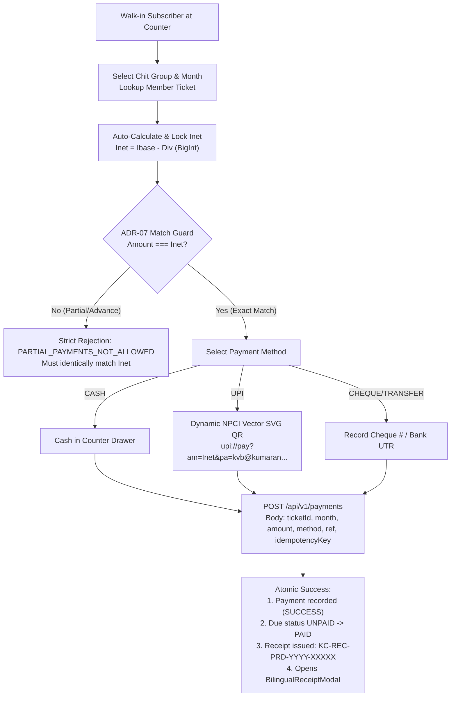

# Collections, Cash Handover & Receipts Architecture (Web Portal)

> **Product**: **Kumaran Chits**  
> **Company**: **Kumaran Finance** (Head Office — Perundurai, Tamil Nadu)  
> **Route Path**: `/collections`, `/handover`  
> **Status**: **Task 8.1 (Counter Payment Collection & Immediate Net Due Matching) COMPLETED** (Commit verified, 176/176 passing tests, 0 TS errors, clean Next.js build)

---

## 1. Overview & Business Reality

At the Perundurai branch office counter, subscribers walk in daily to pay their monthly chit subscription installments. Desk accountants and cashiers record discrete payments, provide instant NPCI UPI QR codes for scanning, and issue official sequential bilingual receipts.

### Key Operational Capabilities (Task 8.1)
1. **ADR-07 Single Discrete Payment Rule**:
   - Each installment month requires strictly a single discrete payment.
   - Payment amount must identically match the exact net installment due ($I_{net} = I_{base} - Div_{ticket}$).
   - **Zero partial payments**: Attempting to pay less than $I_{net}$ is strictly rejected at UI and API levels (`PARTIAL_PAYMENTS_NOT_ALLOWED`).
   - **Zero double payments / advance balances**: Attempting to pay ahead in one single transaction is strictly rejected (`ADVANCE_OR_DOUBLE_PAYMENT_NOT_ALLOWED`).
2. **Four Supported Payment Methods**:
   - `CASH`: Collected directly into the counter drawer / safe.
   - `UPI`: Generates a dynamic NPCI-compliant UPI QR code on the counter screen (`GET /api/v1/installments/:dueId/upi-intent`) with payee VPA and locked $I_{net}$ amount for walk-in scanning.
   - `CHEQUE`: Captures Cheque # and Bank Name (`transactionRef`).
   - `BANK_TRANSFER`: Captures NEFT/RTGS/IMPS bank UTR (`transactionRef`).
3. **Sequential Bilingual Receipts**:
   - Atomically generates sequential receipt numbers in format `KC-REC-{BRANCH}-{YYYY}-{XXXXX}` with 5-digit padding.
   - Opens structured A5 digital receipt view with direct browser print (`window.print()`).
   - Direct download of pixel-accurate printable A5 bilingual PDF via `GET /api/v1/pdf/receipt/:paymentId`.
4. **Counter Collections Dashboard & Pulse Metrics**:
   - Total daily collections (count of receipts issued today).
   - Total cash in drawer (₹ whole rupees).
   - Total UPI settlements (₹ whole rupees).
   - Total cheques in clearance (₹ whole rupees).
   - Filterable by payment method (`ALL`, `CASH`, `UPI`, `CHEQUE`, `BANK_TRANSFER`) and payment status (`ALL`, `SUCCESS`, `INITIATED`, `REVERSED`).

---

## 2. Invariant Architectural Guardrails Enforced

1. **Guardrail 1: Single Company Tenancy**: Zero `company_id` columns, query parameters, or HTTP headers.
2. **Guardrail 2: Pure Whole Rupee Math**: All monetary values are 64-bit integer Rupees (`bigint`). Decimal paise and floats (`3750.50`, `3750.00`) are strictly rejected.
3. **Guardrail 8 / ADR-07: Single Discrete Payment Matching**: Strict equality $Amount == I_{net}$.
4. **Idempotency Protection**: Client generates `idempotencyKey: crypto.randomUUID()` to prevent duplicate submissions over unreliable networks.
5. **NPCI Dynamic UPI QR Intent**: Generates standard `upi://pay?pa=...&pn=...&am=...&cu=INR&tn=...` with locked whole-rupee amount and merchant VPA (`kvb@kumaran`), rendered offline as a vector SVG via `qrcode`.
6. **100% Bilingual Parity**: All receipts, UI labels, and modals have identical English and Tamil (`தமிழ்`) key coverage.

---

## 3. Modular File Architecture

All files are strictly maintained $\le 300\text{--}350$ lines per **AGENTS.md Rule 4**:

| File Path | Description | Line Count | Status |
|---|---|:---:|:---:|
| `apps/web/src/app/(dashboard)/collections/page.tsx` | Master counter collections desk route with 4 metrics & filters | 254 | **Complete** |
| `apps/web/src/components/collections/payments-table.tsx` | Collections data table with method/status badges and receipt actions | 239 | **Complete** |
| `apps/web/src/components/collections/counter-payment-modal.tsx` | Scheme & ticket lookup, ADR-07 locked amount, payment recording | 337 | **Complete** |
| `apps/web/src/components/collections/counter-upi-qr.tsx` | Dynamic NPCI QR generator rendering offline vector SVG | 121 | **Complete** |
| `apps/web/src/components/collections/bilingual-receipt-modal.tsx` | Printable bilingual receipt viewer and A5 PDF download | 263 | **Complete** |
| `apps/web/src/lib/query-keys.ts` | React Query cache keys for payments (`list`, `detail`, `receipt`) | 108 | **Complete** |
| `apps/web/test/counter-collections.spec.ts` | 8 automated invariant test suites | 326 | **Complete** |

---

## 4. API Integration Endpoints

- **`POST /api/v1/payments`**: Records discrete payment with `{ ticketId, installmentMonth, amount, paymentMethod, transactionRef, notes, idempotencyKey }`.
- **`GET /api/v1/payments`**: Queries paginated ledger with filters (`paymentMethod`, `paymentStatus`, `limit`).
- **`GET /api/v1/payments/:id/receipt`**: Returns structured bilingual receipt data (`BilingualReceiptResponseDto`).
- **`GET /api/v1/pdf/receipt/:paymentId`**: Streams pixel-accurate A5 bilingual printable PDF.
- **`GET /api/v1/installments/:dueId/upi-intent`**: Returns NPCI UPI deep-link URI with locked $I_{net}$ amount.
- **`GET /api/v1/installments/group/:chitGroupId/month/:month`**: Returns member dues for selected scheme and month.

---

## 5. Automated Verification & Test Proofs

- **Unit Test Suite**: `apps/web/test/counter-collections.spec.ts` asserts 8 non-negotiable invariants:
  1. *ADR-07 Exact Match*: Rejects partial payments ($amount < I_{net}$) and overpayments ($amount > I_{net}$).
  2. *Guardrail 2 Whole Rupee Math*: Rejects floating-point paise and fractional values.
  3. *Due Status Transition*: `UNPAID` / `OVERDUE` $\to$ `PAID`.
  4. *Sequential Receipt Numbering*: Format `KC-REC-PRD-2026-00045`.
  5. *Payment Methods Enum*: `CASH`, `UPI`, `BANK_TRANSFER`, `CHEQUE`.
  6. *NPCI Counter UPI Intent URI*: Valid format with locked whole rupees.
  7. *Idempotency Protection*: Duplicate idempotency key returns existing payment without duplication.
  8. *Bilingual Parity*: 100% dictionary match between `en.json` and `ta.json`.
- **Full Web Test Suite**: `176/176` tests passing (100% pass rate).
- **TypeScript Check**: `pnpm --filter web typecheck` (0 errors).
- **Next.js 15 Build**: `pnpm --filter web build` (compiled and optimized cleanly).
