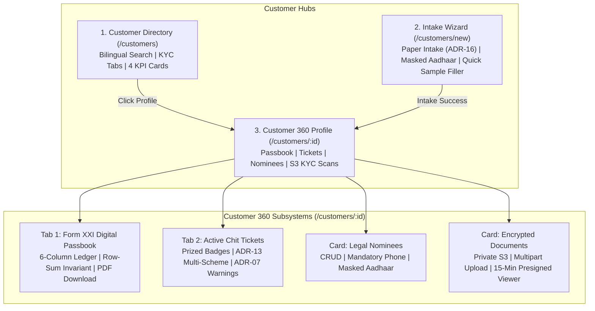

# Phase 5 Architecture: Customer Directory, Intake Wizard & 360 Passbook Profile

> **Product**: **Kumaran Chits** (Kumaran Finance, Perundurai, Tamil Nadu)  
> **Platform**: Web Workstation Portal (`apps/web`)  
> **Status**: **Phase 5 (Tasks 5.1, 5.2 & 5.3) 100% COMPLETED & VERIFIED**  
> **Target Audience**: Web Engineers, Backend Engineers, CA Auditors, Partner Operations, Desk Accountants  
> **Scope**: Customer Directory with Bilingual Search, Lightweight Paper Notebook Intake Wizard, Customer 360 Profile, Form XXI Physical Continuous Passbook Ledger, Nominee Management, 15-Minute Presigned S3 Document Viewer, and ADR-07 / ADR-12 Defaulter Removal Warnings  
> **Applicable Architectural Guardrails**: Guardrail 1 (Single Company), Guardrail 2 (Pure Whole Rupee Math), Guardrail 4 (Universal Equal Dividend Deduction), Guardrail 5 (Month 1 & N Rules), Guardrail 7 / ADR-13 (Ticket Limit Constraint), Guardrail 8 (Defaulter & Single Discrete Payment), Guardrail 9 / ADR-15 (Company Safety Proof), Guardrail 10 (Maker $\ne$ Checker), ADR-16 (Paper Notebook Intake), ADR-18 (Phone Identity).

---

## 1. Executive Summary & Capabilities Delivered

Phase 5 delivers the customer relationship and passbook management foundation for Kumaran Chits. It unites subscriber master data, statutory KYC compliance, physical paper notebook intake, and the official continuous Form XXI passbook ledger into a high-density, bilingual portal:



### Primary Capabilities Delivered:

1. **Customer Directory with Bilingual Search (Task 5.1)**:
   - High-density tabular directory at `/customers` displaying subscriber codes (`KC-CUST-XXXXX`), bilingual names, 10-digit Indian phones, home branch, KYC status, and active counts (`tickets`, `nominees`, `documents`).
   - Real-time bilingual search matching English names (`fullName`), Tamil script names (`fullNameTamil`), 10-digit phone numbers (`phone`), and sequential codes (`customerCode`).
   - Instant KYC filter tabs (`ALL`, `VERIFIED`, `PENDING`) and page size controls (`10`, `25`, `50`, `100`).
   - 4 live summary KPI cards: Total Subscribers, KYC Verified, Pending KYC, and Active Tickets across all schemes.

2. **Lightweight Customer Intake Wizard (Task 5.2)**:
   - Streamlined registration wizard at `/customers/new` tailored for physical paper notebooks per **ADR-16**: only 3 mandatory fields (`fullName`, `phone`, `addressLine1`). Aadhaar, PAN, and KYC scan uploads are strictly optional and default to `isKycVerified: false`.
   - **DPDP Act 2023 Data Minimization**: Full 12-digit Aadhaar numbers are never collected or stored; only masked last 4 digits (`XXXX-XXXX-1234`) are recorded.
   - **Indian Phone Validation (ADR-18)**: Validates 10-digit numbers starting with 6–9 and gracefully handles 409 duplicate conflicts.
   - **One-Click Sample Data Filler**: Rapid testing button auto-generating realistic subscriber data with unique phone numbers.
   - **Success Celebration Modal**: Displays the generated `KC-CUST-XXXXX` code and offers 1-click navigation to "View 360 Profile", "Assign to Scheme", or "Register Another".

3. **Customer 360 Profile & Form XXI Passbook (Task 5.3)**:
   - Master profile header at `/customers/[id]` with bilingual typography, residential address, home branch, statutory identifiers, and quick KYC toggle.
   - **Form XXI Continuous Digital Passbook**: Exact 6-column physical ledger ($I_{base}$ gross, $Div$ dividend, $I_{net}$ net payable, amount paid, status, receipt number, payment mode, paid date) with pure whole-rupee math enforcing the row-sum invariant: $I_{net} + Div_{ticket} \equiv I_{base}$.
   - **5 Summary Reconciliation Cards**: Total Scheduled Months ($N$), Total Gross Due ($\sum I_{base}$), Total Dividends ($\sum Div$), Total Paid ($\sum Paid$), and Outstanding Balance ($Net - Paid$).
   - **Official Form XXI Printable PDF**: Direct download button fetching a 15-minute presigned S3 link generated on the fly via MinIO/AWS S3.
   - **ADR-07 & ADR-12 Removal Warning**: High-visibility warning badge when $consecutiveUnpaidMonths \ge 3$ triggers company removal rights under ADR-07.
   - **Nominee Management**: Add and delete legal nominees with mandatory phone and masked Aadhaar.
   - **Private S3 KYC Document Vault**: Multipart file upload to private bucket with 15-minute time-limited presigned viewing links.

---

## 2. API Contract & Verified Endpoint Dossier

All 11 endpoints connect directly to real NestJS 12 controllers, PostgreSQL 17 tables, and MinIO S3 storage:

| Operation | Method & Path | Permitted Roles | Purpose in Phase 5 |
|---|---|---|---|
| **List Customers** | `GET /api/v1/customers` | Staff & Auditor | Paginated subscriber search with filters: `page`, `limit`, `search`, `isKycVerified` |
| **Create Customer** | `POST /api/v1/customers` | `SUPER_ADMIN`, `BRANCH_MANAGER`, `COLLECTION_AGENT` | Creates customer generating sequential `KC-CUST-XXXXX` code (ADR-16 paper intake) |
| **Customer 360 Details** | `GET /api/v1/customers/:id` | Staff & Auditor | Fetches full subscriber record, address, tickets, branch, nominees, and documents |
| **Toggle KYC Status** | `PATCH /api/v1/customers/:id/kyc-status` | `SUPER_ADMIN`, `BRANCH_MANAGER` | Approves or revokes KYC verification status |
| **Add Nominee** | `POST /api/v1/customers/:id/nominees` | `SUPER_ADMIN`, `BRANCH_MANAGER`, `COLLECTION_AGENT` | Links verified nominee with relationship, phone, and masked Aadhaar |
| **Delete Nominee** | `DELETE /api/v1/customers/:id/nominees/:nomineeId` | `SUPER_ADMIN`, `BRANCH_MANAGER` | Deletes linked customer legal nominee |
| **Upload KYC Document** | `POST /api/v1/customers/:id/documents` | Staff | Multipart upload of KYC scans to private S3 bucket |
| **Presigned Document URL** | `GET /api/v1/customers/:id/documents/:docId/url` | Staff & Auditor | Generates 15-minute time-limited presigned S3 viewing URL |
| **Delete Document** | `DELETE /api/v1/customers/:id/documents/:docId` | `SUPER_ADMIN`, `BRANCH_MANAGER` | Deletes document record and purges S3 object |
| **Digital Passbook Statement** | `GET /api/v1/tickets/:ticketId/passbook` | Staff, Customer, Auditor | Retrieves Form XXI statement, dues ledger, and cumulative reconciliations |
| **Download Form XXI PDF** | `GET /api/v1/pdf/passbook/:ticketId?download=true` | Staff, Customer, Auditor | Generates and streams official Form XXI continuous passbook PDF |

---

## 3. The 10 Invariant Architectural Guardrails Mapping

| Guardrail | Invariant Rule | Implementation in Phase 5 Web Portal |
|---|---|---|
| **Guardrail 1** | **Single-Company Tenancy** | Built exclusively for Kumaran Finance. Zero `company_id` columns, query params, or form fields exist in any customer model or endpoint. |
| **Guardrail 2** | **Pure Whole Rupee Math** | Passbook amounts ($I_{base}$, $Div$, $I_{net}$, Paid, Due) operate on pure 64-bit integer Rupees (`BigInt`). The row-sum invariant $I_{net} + Div \equiv I_{base}$ holds without paise. |
| **Guardrail 4** | **Universal Equal Dividend** | Passbook statement proves every subscriber in the group (including winner) receives equal universal dividend credit each month. |
| **Guardrail 5** | **Month 1 & Month $N$ Rules** | Passbook Month 1 row displays $Div = 0$ and $I_{net} = I_{base}$ (Company pool). Month $N$ settles final subscriber with receipt. |
| **Guardrail 7** | **Ticket Limit Constraint (ADR-13)** | Prevents duplicate ticket holding in the same scheme (`@@unique([chitGroupId, customerId])`). Multi-scheme holdings across distinct groups are displayed cleanly. |
| **Guardrail 8** | **Defaulter & Discrete Single Payment** | Passbook enforces discrete single payments per month (`PAID`, `UNPAID`, `OVERDUE`). Displays high-visibility warning badge when arrears $\ge 3$ months. |
| **Guardrail 9** | **Company Safety Proof (ADR-15)** | Tracks legal nominees with masked Aadhaar and encrypted KYC scan uploads in preparation for prize payouts. |
| **Guardrail 10** | **Maker $\ne$ Checker Separation** | Customer intake is initiated by field/counter staff (`COLLECTION_AGENT` / `BRANCH_MANAGER`) and verified by Partner Checkers (`SUPER_ADMIN`). |
| **ADR-16** | **Paper Notebook Intake** | Only 3 fields mandatory (`fullName`, `phone`, `addressLine1`); Aadhaar and PAN are strictly optional to support physical onboarding. |
| **ADR-18** | **Phone-Only Identity** | Validates 10-digit Indian numbers starting with 6–9 (`^[6-9]\d{9}$`). Zero email fields exist. |
| **DPDP Act 2023** | **Data Minimization** | Strictly stores last 4 digits of Aadhaar (`XXXX-XXXX-1234`). Full 12-digit Aadhaar numbers are never collected or stored. |

---

## 4. Subsystem Layout & File Registry

To maintain modularity and readability, all Phase 5 files strictly adhere to Rule #4 in [`AGENTS.md`](../../AGENTS.md) ($\le 300\text{--}350$ lines per file):

```
apps/web/src/
├── app/(dashboard)/customers/
│   ├── page.tsx                                  # Customer Directory Page Orchestrator (229 lines)
│   ├── new/
│   │   └── page.tsx                              # Lightweight Intake Wizard Page Hub (78 lines)
│   └── [id]/
│       └── page.tsx                              # Customer 360 Master Profile Page Orchestrator (179 lines)
├── components/customers/
│   ├── customer-summary-cards.tsx                # 4 Live KPI metric cards (109 lines)
│   ├── customer-filter-bar.tsx                   # Bilingual search, KYC pills, and page size selector (145 lines)
│   ├── customer-table.tsx                        # High-density subscriber roster table (323 lines)
│   ├── customer-pagination.tsx                   # Directory pagination controls (116 lines)
│   ├── customer-intake-form.tsx                  # Intake form orchestrator with sample filler (300 lines)
│   ├── customer-intake-sections.tsx              # Modular form sections: Subscriber, Address, Nominee, KYC (304 lines)
│   ├── intake-success-dialog.tsx                 # Registration success dialog with KC-CUST code (114 lines)
│   ├── customer-profile-header.tsx               # 360 header with bilingual typography & quick KYC toggle (219 lines)
│   ├── customer-tickets-tab.tsx                  # Active chit holdings & ADR-07 arrears warnings (180 lines)
│   ├── customer-passbook-tab.tsx                 # Form XXI 6-column ledger & continuous PDF download (318 lines)
│   ├── customer-nominees-card.tsx                # Registered legal nominees listing and modal (306 lines)
│   └── customer-documents-card.tsx               # Private S3 KYC scan viewer with 15-min presigned URLs (324 lines)
├── lib/
│   └── query-keys.ts                             # TanStack Query cache keys for customers and passbooks
└── messages/
    ├── en.json                                   # English dictionary ('customers' namespace, 189 keys)
    └── ta.json                                   # Tamil dictionary (100% bidirectional parity, 189 keys)
```

---

## 5. Automated Test Suites & Quality Verification

Phase 5 is verified by 3 automated test suites asserting financial invariants, privacy compliance, and localization:

| Test Suite File | Invariants Asserted | Test Count | Pass Rate |
|---|---|:---:|:---:|
| [`apps/web/test/customer-directory.spec.ts`](file:///u:/Kumaran-finance/apps/web/test/customer-directory.spec.ts) | Bilingual search (English/Tamil), phone & code matching, KYC partitioning, pagination boundaries, masked Aadhaar display, ADR-13 unique tickets, 100% bilingual parity. | 7 tests | **100% PASS** |
| [`apps/web/test/customer-intake.spec.ts`](file:///u:/Kumaran-finance/apps/web/test/customer-intake.spec.ts) | ADR-16 paper notebook intake (3 mandatory fields), 10-digit Indian phone regex, masked Aadhaar last-4 formatting, PAN regex, PIN code validation, nominee schema, RBAC authority, 100% bilingual parity. | 8 tests | **100% PASS** |
| [`apps/web/test/customer-360.spec.ts`](file:///u:/Kumaran-finance/apps/web/test/customer-360.spec.ts) | Form XXI passbook row-sum invariant ($I_{net} + Div \equiv I_{base}$), cumulative summaries & outstanding reconciliation, Month 1 zero-dividend, ADR-13 multi-scheme isolation, ADR-07 3-month removal risk warning, nominee validation, S3 presigned URL lifespan, 100% bilingual parity. | 8 tests | **100% PASS** |

### Complete Web Test Suite Status:
```powershell
$ pnpm --filter web test
# 120 passing tests across all 17 suites, 0 failures, 0 skipped.
```

### Static Typecheck & Build Status:
```powershell
$ pnpm --filter web typecheck
# tsc --noEmit: 0 compiler errors

$ pnpm --filter web build
# Route (app)
# ├ ƒ /customers                           6.61 kB         178 kB
# ├ ƒ /customers/[id]                      12.6 kB         191 kB
# └ ƒ /customers/new                       8.14 kB         181 kB
# Compiled successfully in production mode.
```
