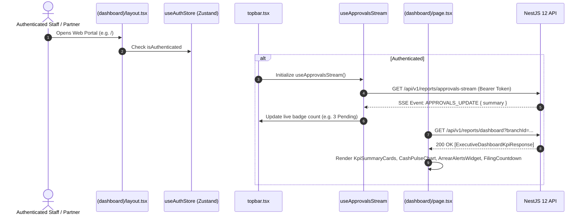

# Phase 3 Architecture: Dashboard Shell, RBAC & Executive KPI Pulse

> **Subsystem**: Web Workstation Portal (`apps/web`)  
> **Status**: **Tasks 3.1 & 3.2 COMPLETED & VERIFIED** (62/62 passing unit tests, 0 TypeScript errors, clean Next.js 15 production build)  
> **Applicable Architectural Guardrails**: Guardrail 1 (Single Company), Guardrail 2 (Whole Rupee Math), Guardrail 8 & ADR-07 (Defaulter Ineligibility & 3M Removal), Guardrail 10 (Maker $\ne$ Checker), ADR-18 (Phone Identity).

---

## 1. Overview & Business Purpose

The authenticated desktop shell (`apps/web/src/app/(dashboard)/layout.tsx`) and executive pulse page (`apps/web/src/app/(dashboard)/page.tsx`) form the operational nerve center for Kumaran Finance operations across the 4 Partners (Super Admin), Branch Manager, Desk Accountant, Field Collection Agents, and CA Auditor.

It delivers:
1. **Dynamic RBAC Sidebar Navigation**: Navigation links are dynamically filtered according to the authenticated user's real roles from `useAuthStore` (`user.roles`), strictly enforcing the RBAC permissions matrix.
2. **Real-Time Maker-Checker SSE Stream**: Subscribes to live Server-Sent Events stream (`GET /api/v1/reports/approvals-stream`) via `useApprovalsStream` hook to display real-time badges for pending cash handovers, prize disbursements, and payment reversals.
3. **Multi-Branch Context Switcher**: Fetches registered physical branches (`GET /api/v1/branches?activeOnly=true`) and updates `activeBranchId` in `useAuthStore`, automatically refreshing TanStack Query caches.
4. **Executive KPI Dashboard & Real-Time Pulse (Task 3.2)**:
   - **KPI Summary Cards**: Live schemes, today's collections by mode (Cash, UPI, Bank Transfer, Cheque), office safe vault balance, and overdue subscribers.
   - **Cash Pulse Chart**: Recharts whole-rupee collection receipts vs disbursements comparison.
   - **Arrears Aging & ADR-07 Alerts**: Tiered 1-Month, 2-Months, and 3+-Months critical removal warning buckets.
   - **Form XVII 21-Day Filing Countdown**: Statutory filing deadline monitor under Section 17 of the Chit Funds Act 1982.
   - **Pending Approvals Dual-Control Banner**: Aggregates items requiring Partner Checker sign-off ($Maker \ne Checker$).
5. **Bilingual Toggle (English ↔ தமிழ்)**: 100% dictionary key parity across navigation items, topbar, sidebar, and dashboard widgets.

---

## 2. Dynamic RBAC Navigation Matrix

| Route Path | Translation Key | Icon | Super Admin | Accountant | Auditor | Branch Manager | Collection Agent |
|---|---|---|:---:|:---:|:---:|:---:|:---:|
| `/` | `nav.dashboard` | `LayoutDashboard` | Visible | Visible | Visible (Read-only) | Visible | Visible |
| `/schemes` | `nav.schemes` | `Landmark` | Visible | Visible | Visible (Read-only) | Visible | **Hidden** |
| `/schemes/onboard` | `nav.onboardGrid` | `BookOpen` | Visible | Visible (Maker) | **Hidden** | **Hidden** | **Hidden** |
| `/customers` | `nav.customers` | `Users` | Visible | Visible | Visible (Read-only) | Visible | Visible |
| `/auctions` | `nav.auctions` | `Gavel` | Visible | **Hidden** | Visible (Read-only) | Visible | **Hidden** |
| `/disbursements` | `nav.disbursements` | `Award` | Visible | Visible (Voucher) | **Hidden** | Visible | **Hidden** |
| `/collections` | `nav.collections` | `Receipt` | Visible | Visible | **Hidden** | Visible | Visible |
| `/collections/handover` | `nav.handover` | `Banknote` | Visible | Visible | **Hidden** | Visible | Visible |
| `/reversals` | `nav.reversals` | `RefreshCw` | Visible | Visible (Maker) | **Hidden** | Visible | **Hidden** |
| `/reports` | `nav.reports` | `FileSpreadsheet` | Visible | Visible | Visible (Ledgers) | Visible | **Hidden** |
| `/instructions` | `nav.instructions` | `BookCheck` | Visible | Visible | Visible | Visible | Visible |
| `/branches` | `nav.branches` | `Building2` | Visible | **Hidden** | **Hidden** | **Hidden** | **Hidden** |
| `/users` | `nav.users` | `UserCog` | Visible | **Hidden** | **Hidden** | **Hidden** | **Hidden** |

---

## 3. Real-Time Stream Architecture & Dual-Control



---

## 4. Components & File Registry

| File | Subsystem / Role | Key Responsibilities |
|---|---|---|
| `apps/web/src/components/layout/nav-items.ts` | Navigation Descriptor | Master definition of 13 navigation items with strongly-typed `allowedRoles` and `filterNavItemsByRoles()`. |
| `apps/web/src/components/layout/sidebar.tsx` | Responsive Sidebar | Desktop collapsible sidebar (260px $\leftrightarrow$ 72px) with tooltips, active emerald indicator bar, and mobile drawer. |
| `apps/web/src/components/layout/topbar.tsx` | Topbar Header | Active Branch dropdown, Maker-Checker Pending Approvals pill badge, bilingual locale toggle, and staff user profile menu. |
| `apps/web/src/stores/approvals-store.ts` | Approvals State | Zustand store tracking `totalPendingCount`, `cashHandoversCount`, `disbursementAuthorizationsCount`, `paymentReversalsCount`, `safetyProofVerificationsCount`. |
| `apps/web/src/hooks/use-approvals-stream.ts` | SSE Client Hook | Streaming client connecting to `GET /api/v1/reports/approvals-stream` with chunk decoding, reconnect backoff, and TanStack Query fallback. |
| `apps/web/src/components/dashboard/kpi-summary-cards.tsx` | KPI Cards Widget | Renders 4 primary KPI cards: Live Schemes, Today's Collections (Cash, UPI, Bank, Cheque), Vault Safe Cash, and Defaulters. |
| `apps/web/src/components/dashboard/pending-approvals-banner.tsx` | Dual-Control Banner | High-visibility alert highlighting Maker $\ne$ Checker separation of duties and itemized approval queues. |
| `apps/web/src/components/dashboard/cash-pulse-chart.tsx` | Recharts Pulse Chart | SSR-safe BarChart visualizing collections by payment mode vs prize disbursements in whole Rupees (`formatRupee`). |
| `apps/web/src/components/dashboard/arrear-alerts-widget.tsx` | Defaulter Aging Widget | Visual 1M, 2M, and 3M+ arrears tiers with ADR-07 removal eligibility warning callouts. |
| `apps/web/src/components/dashboard/filing-countdown-widget.tsx` | Statutory Compliance | Form XVII 21-day Chit Registrar filing countdown with dynamic status badges (`OVERDUE`, `URGENT`, `ON_TRACK`, `FILED`). |
| `apps/web/src/app/(dashboard)/page.tsx` | Dashboard Root (`/`) | Coordinates TanStack Query fetching, approvals store, widgets, rule banner, and quick launch tiles. |
| `apps/web/test/app-shell-rbac.spec.ts` | Automated Tests | 9 unit test suites verifying RBAC filtering, Approvals store, branch switcher, and bilingual key parity. |
| `apps/web/test/dashboard-kpis.spec.ts` | Automated Tests | 6 unit test suites verifying Whole Rupee Math, mode balancing, vault isolation, ADR-07 tiers, and 21-day filing countdown. |

---

## 5. Automated Verification & Test Proofs

- **Unit Test Suite**: **62/62 passing tests** (`node --experimental-strip-types --test apps/web/test/*.spec.ts`) in ~540ms.
- **TypeScript Typecheck**: `pnpm --filter web typecheck` passed with 0 errors.
- **Production Next.js Build**: `pnpm --filter web build` succeeded in 8.5s with code 0:
  ```text
  Route (app)                                 Size  First Load JS
  ┌ ƒ /                                     112 kB         281 kB
  ├ ƒ /_not-found                             1 kB         104 kB
  ├ ƒ /2fa                                 3.23 kB         140 kB
  └ ƒ /login                               28.8 kB         166 kB
  + First Load JS shared by all             103 kB
  ```
