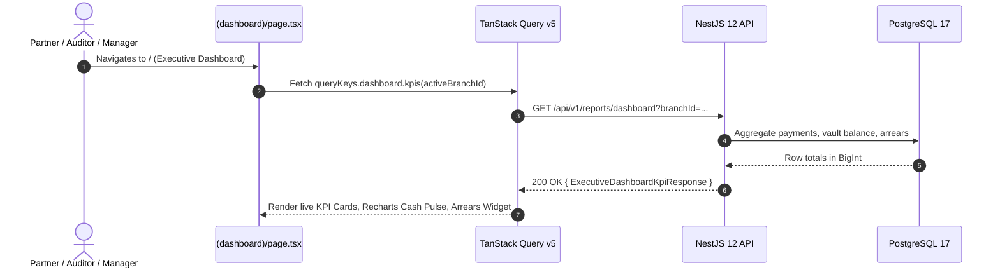
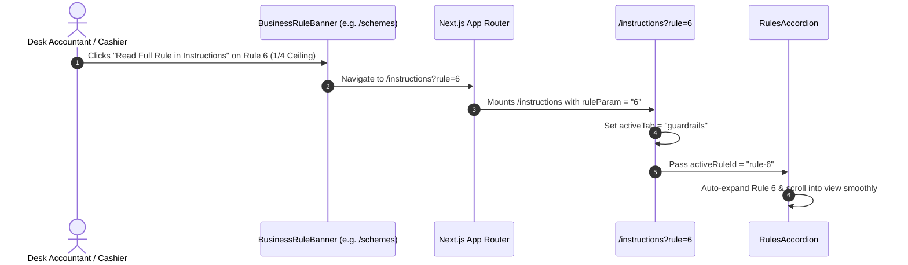

# Phase 3 Architecture: Dashboard Shell, RBAC & Operating Instructions

> **Platform**: Web Workstation Portal (`apps/web`)  
> **Status**: **Phase 3 (Tasks 3.1, 3.2 & 3.3) 100% COMPLETED & VERIFIED**  
> **Target Audience**: Web Engineers, Backend Engineers, CA Auditors, Partner/Foreman Operations  
> **Scope**: Desktop App Shell, Dynamic RBAC Sidebar, Real-Time SSE Approvals Stream, Executive KPI Pulse, Chit Math Simulator & Staff Operating Reference Manual  
> **Applicable Architectural Guardrails**: Guardrails 1 through 10, ADR-01, ADR-04, ADR-06, ADR-07, ADR-13, ADR-15, ADR-18.

---

## 1. Executive Summary & Objectives

Phase 3 transforms the authenticated desktop experience into an authoritative, transparent, real-time command center for Kumaran Finance operations across the 4 equal Partners (Super Admin), Branch Manager, Desk Accountant, Field Collection Agents, and CA Auditor.

### Primary Capabilities Delivered:
1. **Dynamic RBAC App Shell (Task 3.1)**:
   - Collapsible desktop sidebar (260px $\leftrightarrow$ 72px) with role-tailored navigation items matching the master RBAC permissions matrix.
   - Topbar with active physical branch switcher (`GET /api/v1/branches?activeOnly=true`), real-time Maker-Checker pending badge, bilingual toggle (English $\leftrightarrow$ தமிழ்), and staff profile dropdown.
   - Server-Sent Events client (`useApprovalsStream`) maintaining a 15-second live push heartbeat (`GET /api/v1/reports/approvals-stream`).
2. **Executive KPI Dashboard & Real-Time Pulse (Task 3.2)**:
   - Real-time KPI summary cards displaying live schemes, today's collections by mode (Cash, UPI, Bank Transfer, Cheque), office safe vault balance, and overdue accounts.
   - Recharts whole-rupee collection receipts vs prize disbursements pulse chart with daily net cash flow.
   - 3-tier arrears aging widget with high-visibility Rose badge alerting management of 3-month legal removal eligibility under **ADR-07**.
   - Form XVII 21-day statutory filing countdown monitor under Section 17 of the Chit Funds Act 1982.
   - Prominent Maker $\ne$ Checker pending queue banner enforcing **Guardrail 10**.
3. **Product Business Rules & Staff Operating Instructions Manual (Task 3.3)**:
   - Dedicated full-page reference handbook at `/instructions` with live search and deep-linking support (`?rule=N`).
   - The 10 Invariant Architectural Guardrails interactive accordion detailing code/database enforcement proofs and violation consequences.
   - Interactive Whole-Rupee Chit Calculation Simulator enforcing Floor ($C_f$) and Ceiling ($V/4$) with live 6-column physical passbook preview.
   - Formal mathematical glossary demonstrating the physical passbook row-sum invariant ($I_{net} + Div_{ticket} = I_{base}$).
   - Role-tailored daily checklists for Desk Accountant, Field Agent, Partner/Foreman, and CA Auditor.

---

## 2. API Contract & Endpoint Integration Dossier

| Operation | Method & Path | Authorization | Request Parameters / Body | Response Payload (200 OK) | Error Codes |
|---|---|---|---|---|:---:|
| **Staff Profile** | `GET /api/v1/auth/me` | `Bearer <JWT>` | *None* | `{ id, phone, name, roles, branchId, isTotpEnabled }` | `401` Unauthorized |
| **Branches List** | `GET /api/v1/branches` | `Bearer <JWT>` | `?activeOnly=true` | Array of physical branches: `[{ id, branchCode, branchName, city }]` | `401` Unauthorized |
| **Executive Dashboard KPIs** | `GET /api/v1/reports/dashboard` | `SUPER_ADMIN`, `BRANCH_MANAGER`, `ACCOUNTANT`, `AUDITOR` | `?branchId=uuid` | `{ scope, activeChitsCount, todayCollections, todayDisbursements, branchVault, arrearsAging }` | `401` Unauthorized<br>`403` Forbidden |
| **Pending Approvals Queue** | `GET /api/v1/reports/pending-approvals` | `SUPER_ADMIN`, `BRANCH_MANAGER`, `ACCOUNTANT`, `AUDITOR` | `?branchId=uuid` | `{ summary: { totalPendingCount, cashHandoversCount, disbursementAuthorizationsCount, paymentReversalsCount, safetyProofVerificationsCount }, handovers, authorizations, reversals, safetyProofs }` | `401` Unauthorized<br>`403` Forbidden |
| **Approvals Live SSE Stream** | `GET /api/v1/reports/approvals-stream` | `SUPER_ADMIN`, `BRANCH_MANAGER`, `ACCOUNTANT`, `AUDITOR` | `?branchId=uuid` | `text/event-stream` emitting `APPROVALS_UPDATE` every 15s | `401` Unauthorized<br>`403` Forbidden |
| **Chit Schemes Directory** | `GET /api/v1/chits` | Authenticated Staff | `?status=ACTIVE&limit=5` | Paginated scheme list with `currentInstallmentMonth`, `chitValue`, `baseInstallment` | `401` Unauthorized |
| **Staff Logout** | `POST /api/v1/auth/logout` | `Bearer <JWT>` | *None* | `{ success: true, message: string }` | `401` Unauthorized |

---

### 3.0 Two-Tier Navigation Guarding (BFF + Edge Middleware)
1. **Tier 1 (Server Edge Middleware — `apps/web/src/middleware.ts`)**: Cryptographically verifies `kc_access_token` (`jose` HS256) and checks `isRoleAuthorizedForPath()` from `apps/web/src/lib/route-permissions.ts` before rendering HTML. Unauthenticated visitors receive an HTTP 307 redirect at 0ms latency with zero FOUC.
2. **Tier 2 (Client Route Guardian — `apps/web/src/app/(dashboard)/layout.tsx`)**: Matches the active pathname against canonical `ROUTE_PERMISSIONS` (`apps/web/src/lib/route-permissions.ts`) using longest-prefix matching (`nav-items.ts` imports `ROUTE_PERMISSIONS_BY_HREF`). Unauthorized authenticated staff see a localized `AccessDeniedView` preventing unauthorized API requests.

## 3. Dynamic RBAC Permissions & Navigation Matrix

In accordance with [`permissions-matrix.md`](../01-business/permissions-matrix.md) and `apps/web/src/lib/route-permissions.ts` (`NAV_ROUTE_PERMISSIONS`), sidebar navigation items (14 primary entries in `nav-items.ts`) plus restricted sub-routes are dynamically filtered by `user.roles`:

| Route Path | Translation Key | Icon | Super Admin | Accountant | Auditor | Branch Manager | Collection Agent |
|---|---|---|:---:|:---:|:---:|:---:|:---:|
| `/` | `nav.dashboard` | `LayoutDashboard` | Visible | Visible | Visible (Read-only) | Visible | Visible |
| `/schemes` | `nav.schemes` | `Landmark` | Visible | Visible | Visible (Read-only) | Visible | **Hidden** |
| `/schemes/onboard` | `nav.onboardGrid` | `BookOpen` | Visible | Visible (Maker) | **Hidden** | **Hidden** | **Hidden** |
| `/customers` | `nav.customers` | `Users` | Visible | Visible | Visible (Read-only) | Visible | Visible |
| `/auctions` | `nav.auctions` | `Gavel` | Visible | **Hidden** | Visible (Read-only) | Visible | **Hidden** |
| `/disbursements` | `nav.disbursements` | `Award` | Visible | Visible (Maker) | **Hidden** *(Read-only API & `/print/voucher`)* | Visible | **Hidden** |
| `/collections` | `nav.collections` | `Receipt` | Visible | Visible | **Hidden** | Visible | Visible |
| `/collections/handover` | `nav.handover` | `Banknote` | Visible | Visible | **Hidden** | Visible | Visible |
| `/reversals` | `nav.reversals` | `RefreshCw` | Visible *(Verified Partner `isPartner: true` Maker/Checker — `KFC-SEC-001`)* | Visible *(View / Escalate — `HTTP 403` on mutations)* | **Hidden** | Visible *(View / Escalate)* | **Hidden** |
| `/reports` | `nav.reports` | `FileSpreadsheet` | Visible | Visible | Visible (Ledgers) | Visible | **Hidden** |
| `/reports/audit-logs` | *(Sub-route)* | `Shield` | Visible **(Strictly `SUPER_ADMIN` — Guardrail 11)** | **Hidden (`403`)** | **Hidden (`403`)** | **Hidden (`403`)** | **Hidden (`403`)** |
| `/instructions` | `nav.instructions` | `BookCheck` | Visible | Visible | Visible | Visible | Visible |
| `/branches` | `nav.branches` | `Building2` | Visible | **Hidden** | **Hidden** | **Hidden** | **Hidden** |
| `/users` | `nav.users` | `UserCog` | Visible | **Hidden** | **Hidden** | **Hidden** | **Hidden** |
| `/admin/jobs` | `nav.jobs` | `Activity` | Visible **(Strictly `SUPER_ADMIN` — Guardrail 11)** | **Hidden (`403`)** | **Hidden (`403`)** | **Hidden (`403`)** | **Hidden (`403`)** |

---

## 4. Subsystem Layout & File Registry

```
apps/web/
├── src/
│   ├── app/(dashboard)/
│   │   ├── layout.tsx                                # Authenticated app shell layout with Tier 2 RBAC guard
│   │   ├── page.tsx                                  # Executive KPI Dashboard & Real-Time Pulse (/)
│   │   └── instructions/
│   │       └── page.tsx                              # Centralized reference manual & search hub (/instructions)
│   ├── components/
│   │   ├── layout/
│   │   │   ├── nav-items.ts                          # 14 primary navigation items linked to ROUTE_PERMISSIONS_BY_HREF
│   │   │   ├── sidebar.tsx                           # Collapsible sidebar (260px <-> 72px) with active indicator
│   │   │   └── topbar.tsx                            # Branch selector, SSE pending badge, locale toggle, profile
│   │   ├── dashboard/
│   │   │   ├── kpi-summary-cards.tsx                 # 4 primary KPI cards (Schemes, Inflows, Vault, Arrears)
│   │   │   ├── pending-approvals-banner.tsx          # Dual-control Maker != Checker pending banner
│   │   │   ├── cash-pulse-chart.tsx                  # Recharts whole-rupee collection mode breakdown
│   │   │   ├── arrear-alerts-widget.tsx              # Tiered arrears aging buckets (1M, 2M, 3M+ ADR-07)
│   │   │   └── filing-countdown-widget.tsx           # Form XVII 21-day Registrar filing deadline countdown
│   │   └── instructions/
│   │       ├── guardrails-data.ts                    # Invariant Guardrails definitions & code proofs
│   │       ├── rules-accordion.tsx                   # Interactive accordion with search & deep-linking
│   │       ├── calculator-simulator.tsx              # Whole-rupee auction math simulator with floor/ceiling checks
│   │       ├── formula-reference-card.tsx            # Mathematical glossary & worked 20-month example
│   │       └── sop-guide-card.tsx                    # Role-tailored daily checklists (Accountant, Agent, Partner, CA)
│   ├── lib/
│   │   └── route-permissions.ts                      # Single canonical RBAC route permissions source of truth
│   ├── stores/
│   │   └── approvals-store.ts                        # Zustand store tracking real-time pending approvals
│   └── hooks/
│       └── use-approvals-stream.ts                   # SSE client stream hook with auto-reconnect backoff
└── test/
    ├── app-shell-rbac.spec.ts                        # RBAC navigation filtering & approvals store unit tests
    ├── route-rbac-guardian.spec.ts                   # Longest-prefix route-permissions enforcement unit tests
    ├── in-app-alerts-stream.spec.ts                  # SSE approvals stream lifecycle tests
    ├── dashboard-kpis.spec.ts                        # Whole Rupee Math, mode balancing, vault isolation tests
    └── instructions-and-formulas.spec.ts             # Math simulator, passbook invariant & guardrails tests
```

---

## 5. Sequence Workflows & Architectural Interactions

### 5.1 Real-Time Approvals Push Stream & App Shell
```mermaid
sequenceDiagram
    autonumber
    actor Staff as Authenticated Staff / Partner
    participant Layout as (dashboard)/layout.tsx
    participant Store as useAuthStore (Zustand)
    participant Topbar as topbar.tsx
    participant Sidebar as sidebar.tsx
    participant Hook as useApprovalsStream
    participant BFF as Next.js 15 BFF (/bff/api/v1)
    participant API as NestJS 12 API

    Staff->>Layout: Opens Web Portal (e.g. / or /instructions)
    Layout->>Store: Check isAuthenticated
    alt Authenticated
        Layout->>Sidebar: Render with user.roles & active pathname
        Sidebar->>Sidebar: Filter 14 nav items via ROUTE_PERMISSIONS_BY_HREF
        Layout->>Topbar: Render Topbar with activeBranchId
        Topbar->>BFF: GET /bff/api/v1/branches?activeOnly=true (HttpOnly cookie)
        BFF->>API: GET /api/v1/branches?activeOnly=true (Injected Bearer)
        API-->>Topbar: 200 OK [Branches List]
        Topbar->>Hook: Initialize useApprovalsStream()
        Hook->>BFF: GET /bff/api/v1/reports/approvals-stream (HttpOnly cookie)
        BFF->>API: Unbuffered SSE pass-through (X-Accel-Buffering: no; mid-flight auth/role refresh)
        API-->>Hook: SSE Event: APPROVALS_UPDATE { summary } (15s cadence)
        Hook->>Topbar: Update live badge count (e.g. 3 Pending)
    end
```

### 5.2 Executive KPI Dashboard Real-Time Synchronization


### 5.3 Contextual Deep-Linking Architecture


---

## 6. Mathematical Invariants & Calculation Engine

### 6.1 Core Arithmetic Formulation
$$\begin{aligned}
V &= \text{Chit Value (Gross Pool Amount)} \\
N &= \text{Duration in Months} \\
M &= \text{Total Tickets Participating } (M = N) \\
I_{base} &= \frac{V}{N} \quad (\text{Base Gross Installment}) \\
C_f &= \left\lfloor \frac{V \times 4}{100} \right\rfloor \quad (\text{Foreman Commission Amount — 4.00\%}) \\
D_{floor} &= C_f \quad (\text{Minimum Bid Discount}) \\
D_{ceiling} &= \left\lfloor \frac{V}{4} \right\rfloor \quad (\text{Maximum Bid Discount — 25\% Ceiling}) \\
Div_{total} &= D - C_f \quad (\text{Total Member Dividend}) \\
Div_{ticket} &= \frac{Div_{total}}{M} \quad (\text{Exact Whole-Rupee Equal Dividend per Ticket; } Div_{total} \bmod M = 0 \text{ per KFC-FIN-002}) \\
I_{net} &= I_{base} - Div_{ticket} \quad (\text{Net Monthly Due Payable by All}) \\
P &= V - D \quad (\text{Prize Money Disbursed to Winner; auto-offset by any unpaid arrears per KFC-FIN-003})
\end{aligned}$$

### 6.2 Passbook Row-Sum Invariant
Every subscriber's physical 6-column passbook ledger maintains strictly this row-sum equality:
$$\text{Amount Paid } (I_{net}) + \text{Dividend Credited } (Div_{ticket}) \equiv \text{Total Base Gross Installment } (I_{base})$$

### 6.3 Gross Pool Conservation Invariant
$$\text{Winner Prize Money } (P) + \text{Winning Bid Discount } (D) \equiv \text{Total Chit Value } (V)$$

---

## 7. The 11 Invariant Architectural Guardrails Matrix

| # | Architectural Rule | Primary ADR | Mathematical / Operational Invariant | Code & Database Enforcement Proof | Violation Consequence |
|---|---|:---:|---|---|---|
| **1** | **Single Company Tenancy** | ADR-01 | Built solely for Kumaran Finance (Head Office, Perundurai). Zero `company_id` columns exist. | Prisma Schema has 0 `company_id` columns across all **18 models**. | Multi-tenant cross-talk prevented by schema design. |
| **2** | **Pure Whole Rupee Math & Divisibility** | ADR-02 | All financial values use 64-bit integer Rupees (`BigInt`). Zero paise, zero decimals (`.00`); auction dividends must divide evenly across all $M$ tickets (`KFC-FIN-002`). | `assertWholeRupee()` in `currency.ts`, `BigIntInterceptor`, & `NON_DIVISIBLE_DIVIDEND` guard. | Throws `RangeError` / `HTTP 400 NON_DIVISIBLE_DIVIDEND`. |
| **3** | **4.00% Commission Freeze** | ADR-04 | Foreman commission rate is locked at 4.00% upon scheme creation; frozen per group. | `ChitGroup.foremanCommissionRate` locked upon activation. | `HTTP 400 Bad Request: Commission rate is frozen`. |
| **4** | **Universal Equal Dividend** | ADR-05 | Dividend is allocated equally across ALL members, including current winner and past prized winners. | `InstallmentDue` batch creation iterates all $M$ tickets equally ($I_{net} = I_{base} - Div$). | Financial assertion failure if prized members excluded. |
| **5** | **Month 1 & Month $N$ Rules** | ADR-05 | Month 1 full pool taken by company (₹0 dividend). Month $N$ settled to final subscriber without auction (`FIN-B`). | `AuctionService` blocks `installmentMonth === 1 \|\| installmentMonth === N`. | `HTTP 400 Bad Request: Auctions forbidden in Month 1 & N`. |
| **6** | **Fixed 1/4 Ceiling & Physical Token Draw** | ADR-06 | Max discount is strictly 25% ($D \le V/4$). Ties trigger Foreman to physically draw paper lot tokens (Option A). | `AuctionService` enforces $D \le V/4$; `RecordTieBreakDto` records drawn ticket. | `HTTP 400 Bad Request: Bid discount exceeds 25% ceiling`. |
| **7** | **Ticket Limit Constraint** | ADR-13 | A customer can join multiple chit groups, but cannot hold 2 or more tickets in the same group. | PostgreSQL Constraint: `@@unique([chitGroupId, customerId])` on `SubscriberTicket`. | `HTTP 409 Conflict: Customer already holds a ticket`. |
| **8** | **Defaulter & Single Discrete Payment** | ADR-07 | Unpaid installment blocks bidding. Single discrete payment per month (zero partial/advance/late fees). 3M default grants removal rights (`DEFAULT_3_MONTHS`). | `AuctionService.getEligibleBidders` filters unpaid dues; `SubscriberTicket.consecutiveUnpaidMonths`. | `HTTP 400 Bad Request: Unpaid subscriber cannot bid`. |
| **9** | **Company Safety Proof Checklist** | ADR-15 | Property documents eliminated. Flexible checklist: signed agreement, signed blank cheques, promissory notes. | `AuctionWinner` checklist booleans (`agreementSigned`, `nomineeSigned`, `chequesCollected`). | `HTTP 400 Bad Request: Safety checklist incomplete`. |
| **10** | **Maker $\ne$ Checker Separation** | ADR-10 | The person initiating an action cannot authorize it ($maker\_user\_id \ne checker\_user\_id$). | NestJS service guards + **8 PostgreSQL engine-level `CHECK` constraints** (`23514`). | `HTTP 403 Forbidden: Maker-Checker separation violated`. |
| **11** | **Verified Partner Identity & Admin Telemetry Boundary** | ADR-21 (`SEC-A`) | Financial Maker/Checker approvals (reversals, auction finalization, prize authorization, defaulter removal) require `isPartner: true`. Audit logs & BullMQ queues are strictly `SUPER_ADMIN`-only. | `User.isPartner` checks in `PaymentService`, `AuctionService`, `DisbursementService`, `InstallmentService`; `@Roles(SUPER_ADMIN)` on `/reports/audit-logs` & `/jobs/*`. | `HTTP 403 PARTNER_IDENTITY_REQUIRED` / `Forbidden`. |

---

## 8. Automated Verification & Live Quality Gate Proofs

```text
Live Command: pnpm --filter web test (node --experimental-strip-types --test test/*.spec.ts)
-----------------------------------------------------------------------------------------
Verified Phase 3 & RBAC Test Suites:
  ✔ app-shell-rbac.spec.ts             (14 nav items filtering across all 5 staff roles + ApprovalsStore)
  ✔ route-rbac-guardian.spec.ts        (canonical longest-prefix route-permissions.ts enforcement)
  ✔ in-app-alerts-stream.spec.ts       (SSE approvals stream reconnect & live counter synchronization)
  ✔ dashboard-kpis.spec.ts             (whole-rupee KPIs, payment mode sum, vault isolation, 21-day Form XVII countdown)
  ✔ instructions-and-formulas.spec.ts  (chit math simulator, passbook row-sum invariant & EN/TA parity)
-----------------------------------------------------------------------------------------
Full Web Unit Suite:  376 passing / 0 failing across 52 spec files (14 top-level suites)
TypeScript / Lint:    pnpm --filter web typecheck & lint — 0 errors / 0 warnings
Next.js Build:        Standalone production build across all 35 App Router page.tsx routes
Localization Parity:  1,921 EN leaf keys === 1,921 TA leaf keys across 22 namespaces (0 missing)
```

---

## 9. Multi-Viewport Responsiveness, Visual Crawl Evidence & Complete Route/Workflow Matrix

### 9.1 Automated Visual Crawler & Multi-Viewport Responsiveness (`320px` – `1440px`)
Executed via `apps/web/e2e/visual-audit.e2e.spec.ts` against the live Next.js 15 portal across **4 locale $\times$ viewport permutations** (21 core routes each = **84 full-page captures**, `0` DOM horizontal overflows `document.documentElement.scrollWidth === window.innerWidth`, `0` raw i18n keys, `0` console/5xx anomalies):

| Viewport Width | Device Target Class | Layout & Navigation Behavior | Touch Targets ($\ge 44\times44\text{px}$) | Overflow Check |
|---|---|---|---|---|
| **320px** | Compact Android smartphones | Single-column stack; collapsible drawer nav; bounded `overflow-x-auto` tables | `h-10` / `h-11` inputs & padded buttons | 0 page overflow |
| **375px** | Compact phones (iPhone SE / Android) | 1-column stat cards; full-width primary CTAs | Full-width / `min-h-[44px]` CTAs | 0 page overflow |
| **390px** | Modern Android field-agent baseline | 1–2 column KPIs; responsive collection desk, subscriber search & instant receipt modal | Compliant with HIG & Material targets | **PASS** (Playwright EN & TA) |
| **768px** | Tablet portrait | 2-column dashboard; sticky topbar; split master-detail views | Touch-friendly table rows | 0 page overflow |
| **1024px** | Small laptops / iPad Pro | Expanded desktop sidebar; 3-column metric grids; full tables | Hybrid pointer + touch | 0 page overflow |
| **1440px** | Perundurai Head Office desktop | Centered `max-w` layout; 4-column KPI cards; sticky sidebar & headers | Mouse hover & keyboard focus rings | **PASS** (Playwright EN & TA) |

**Field-Agent Mobile Ergonomics (`ADR-26` Phase 1 Responsive Web)**:
- **High Sunlight Readability**: Slate-950 `#020617` background, Slate-100 `#f1f5f9` text (`18.2:1`), Emerald-400 `#34d399` rupee amounts (`8.4:1`), and Rose-400 `#f87171` alerts (`5.1:1`).
- **Cellular Idempotency**: Mobile counter/collection modals invoke `useIdempotentAction()` with unique UUIDv4 `Idempotency-Key` headers to prevent double postings on intermittent rural Erode links.
- **Instant Receipt Export**: `downloadReceiptPdf` and A5 `@media print` layouts support immediate receipt saving and Bluetooth thermal/office counter printing.

### 9.2 Complete Canonical Web Route & BFF Inventory (35 Pages + 6 BFF Routes)

| Route Group | Live App Router Paths (`apps/web/src/app/`) | Enforced RBAC (`route-permissions.ts` / Edge Middleware) | Primary Backend API Surface |
|---|---|---|---|
| **Auth & Onboarding (3)** | `/login`, `/2fa`, `/onboarding` | Public (`/login`); HttpOnly `kc_totp_pending_token` (`/2fa`); HttpOnly `kc_onboarding_token` (`/onboarding`) | `/api/v1/auth/web/login`, `web/verify-totp`, `complete-onboarding` |
| **BFF Auth & Proxy (6)** | `/api/auth/login`, `/api/auth/verify-totp`, `/api/auth/complete-onboarding`, `/api/auth/session`, `/api/auth/logout`, `/bff/api/v1/[...path]` | Server-side HttpOnly cookies (`kc_access_token`, `kc_refresh_token`, `SameSite=Lax`, dynamic `Secure`); single-flight refresh (`bff-token-refresh.ts`) | Transparent Bearer injection + unbuffered SSE pass-through to NestJS `/api/v1/*` |
| **Core Shell & Reference (2)** | `/`, `/instructions` | All 5 Staff Roles (`SUPER_ADMIN`, `BRANCH_MANAGER`, `ACCOUNTANT`, `AUDITOR`, `COLLECTION_AGENT`; `CUSTOMER` rejected) | `GET /api/v1/reports/dashboard`, `pending-approvals`, `approvals-stream` |
| **Chit Schemes & Defaulters (5)** | `/schemes`, `/schemes/new`, `/schemes/onboard`, `/schemes/[id]`, `/schemes/[id]/defaulters` | `/schemes*`: Staff + Auditor (excl. Agent); `/schemes/onboard`: `SUPER_ADMIN`, `ACCOUNTANT` | `/api/v1/chits/*`, `/api/v1/installments/*` |
| **Customers & Passbook (3)** | `/customers`, `/customers/new`, `/customers/[id]` | All 5 Staff Roles (mutations gated per `CustomerController` RBAC) | `/api/v1/customers/*`, `/api/v1/tickets/:id/passbook`, `/api/v1/pdf/passbook/:id` |
| **Auctions Console (4)** | `/auctions`, `/auctions/live`, `/auctions/[id]`, `/auctions/[id]/live` | `SUPER_ADMIN`, `BRANCH_MANAGER`, `AUDITOR` (Read-Only); finalization requires Verified Partner (`isPartner: true`) | `/api/v1/auctions/*` |
| **Disbursements (2)** | `/disbursements`, `/disbursements/[id]/voucher` | `SUPER_ADMIN`, `BRANCH_MANAGER`, `ACCOUNTANT` (Authorization requires Verified Partner `isPartner: true`) | `/api/v1/disbursements/*` |
| **Collections, Handover & Reversals (3)** | `/collections`, `/collections/handover`, `/reversals` | Collections/Handover: Staff (excl. Auditor); `/reversals`: `SUPER_ADMIN`, `BRANCH_MANAGER`, `ACCOUNTANT` (API mutations strictly Verified Partner `isPartner: true` per `KFC-SEC-001`) | `/api/v1/payments/*`, `/api/v1/collections/*` |
| **Statutory Reports (6)** | `/reports`, `/reports/cash-book`, `/reports/minutes`, `/reports/ledger`, `/reports/defaulters`, `/reports/audit-logs` | `/reports*`: `SUPER_ADMIN`, `BRANCH_MANAGER`, `ACCOUNTANT`, `AUDITOR`; **`/reports/audit-logs`: `SUPER_ADMIN` strictly** | `/api/v1/reports/*` |
| **Administration & Ops (5)** | `/branches`, `/branches/new`, `/users`, `/users/new`, `/admin/jobs` | **`SUPER_ADMIN` strictly** | `/api/v1/branches/*`, `/api/v1/users/*`, `/api/v1/jobs/*` |
| **Bilingual Print Templates (2)** | `/print/receipt/[id]`, `/print/voucher/[id]` | `/print/receipt`: All 5 Staff Roles; `/print/voucher`: Staff + Auditor (excl. Agent) | `/api/v1/payments/:id/receipt`, `/api/v1/disbursements/auction/:id/voucher` |

### 9.3 End-to-End Business Workflow Traceability (11 Verified Core Workflows)
All 11 Perundurai branch workflows are traced from Web UI through BFF proxy to PostgreSQL 17 and covered by Playwright Suites `00`–`11`:
1. **Staff Auth, 2FA TOTP, F16 Onboarding & 20m Inactivity** (`01-auth-lifecycle`, `02-onboarding-totp-lifecycle`)
2. **Chit Scheme Creation (4% lock, $V/4$ ceiling)** (`02-schemes-onboard`)
3. **Physical Notebook Mid-Cycle 400-Cell Onboarding** (`02-schemes-onboard`)
4. **Subscriber Registration & DPDP-Compliant Masked KYC** (`03-customer-passbook`)
5. **Ticket Allocation & ADR-13 1-Ticket Limit Guard** (`02-schemes-onboard`)
6. **Monthly Auction Execution, Defaulter Disqualification & Option A Physical Lot Draw** (`04-auction-tiebreak`)
7. **Counter Discrete Single-Payment Collection & A5 Bilingual Receipt** (`06-counter-payments`)
8. **Field Agent Cash Handover & Anti-Self-Acknowledgment Settlement** (`07-cash-handover`)
9. **Prize Money Safety Checklist (`ADR-15`), Arrears Auto-Offset (`KFC-FIN-003/004`) & Partner Authorization** (`05-disbursement-safety`)
10. **Two-Partner Dual-Control Payment Reversals (`KFC-SEC-001`) & `CANCELLED` Watermark (`KFC-PDF-001`)** (`08-payment-reversals`)
11. **Statutory Reports (Form XVII, XXI, XXII), Defaulters, Direct KVB UPI Claims (`ADR-19`) & EN/TA i18n** (`09-reports-registers`, `10-bilingual-i18n`, `11-claims-and-defaulters`)
