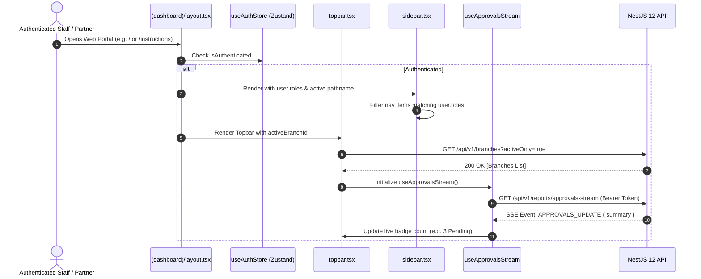
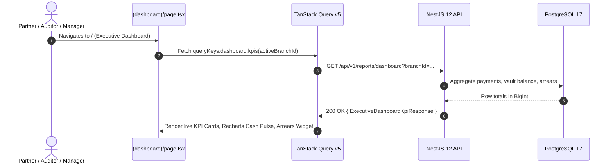
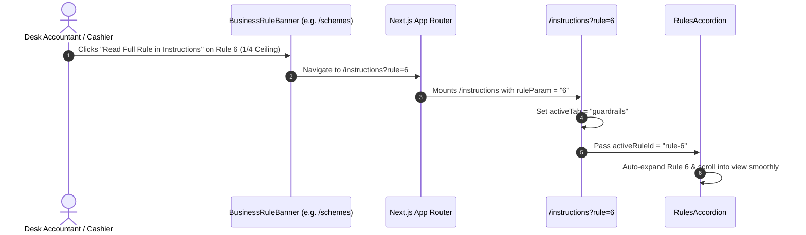

# Phase 3 Architecture: Dashboard Shell, RBAC & Operating Instructions

> **Platform**: Web Workstation Portal (`apps/web`)  
> **Status**: **Phase 3 (Tasks 3.1, 3.2 & 3.3) 100% COMPLETED & VERIFIED**  
> **Target Audience**: Web Engineers, Backend Engineers, CA Auditors, Partner/Foreman Operations  
> **Scope**: Desktop App Shell, Dynamic RBAC Sidebar, Real-Time SSE Approvals Stream, Executive KPI Pulse, Chit Math Simulator & Staff Operating Reference Manual  
> **Applicable Architectural Guardrails**: Guardrails 1 through 10, ADR-01, ADR-04, ADR-06, ADR-07, ADR-13, ADR-15, ADR-18.

---

## 1. Executive Summary & Objectives

Phase 3 transforms the authenticated desktop experience into an authoritative, transparent, real-time command center for Kumaran Finance operations across the 4 equal Partners (Super Admin), Branch Manager, Desk Accountant, Field Collection Agents, and CA Auditor.

### Primary Capabilities Delivered:
1. **Dynamic RBAC App Shell (Task 3.1)**:
   - Collapsible desktop sidebar (260px $\leftrightarrow$ 72px) with role-tailored navigation items matching the master RBAC permissions matrix.
   - Topbar with active physical branch switcher (`GET /api/v1/branches?activeOnly=true`), real-time Maker-Checker pending badge, bilingual toggle (English $\leftrightarrow$ தமிழ்), and staff profile dropdown.
   - Server-Sent Events client (`useApprovalsStream`) maintaining a 15-second live push heartbeat (`GET /api/v1/reports/approvals-stream`).
2. **Executive KPI Dashboard & Real-Time Pulse (Task 3.2)**:
   - Real-time KPI summary cards displaying live schemes, today's collections by mode (Cash, UPI, Bank Transfer, Cheque), office safe vault balance, and overdue accounts.
   - Recharts whole-rupee collection receipts vs prize disbursements pulse chart with daily net cash flow.
   - 3-tier arrears aging widget with high-visibility Rose badge alerting management of 3-month legal removal eligibility under **ADR-07**.
   - Form XVII 21-day statutory filing countdown monitor under Section 17 of the Chit Funds Act 1982.
   - Prominent Maker $\ne$ Checker pending queue banner enforcing **Guardrail 10**.
3. **Product Business Rules & Staff Operating Instructions Manual (Task 3.3)**:
   - Dedicated full-page reference handbook at `/instructions` with live search and deep-linking support (`?rule=N`).
   - The 10 Invariant Architectural Guardrails interactive accordion detailing code/database enforcement proofs and violation consequences.
   - Interactive Whole-Rupee Chit Calculation Simulator enforcing Floor ($C_f$) and Ceiling ($V/4$) with live 6-column physical passbook preview.
   - Formal mathematical glossary demonstrating the physical passbook row-sum invariant ($I_{net} + Div_{ticket} = I_{base}$).
   - Role-tailored daily checklists for Desk Accountant, Field Agent, Partner/Foreman, and CA Auditor.

---

## 2. API Contract & Endpoint Integration Dossier

| Operation | Method & Path | Authorization | Request Parameters / Body | Response Payload (200 OK) | Error Codes |
|---|---|---|---|---|:---:|
| **Staff Profile** | `GET /api/v1/auth/me` | `Bearer <JWT>` | *None* | `{ id, phone, name, roles, branchId, isTotpEnabled }` | `401` Unauthorized |
| **Branches List** | `GET /api/v1/branches` | `Bearer <JWT>` | `?activeOnly=true` | Array of physical branches: `[{ id, branchCode, branchName, city }]` | `401` Unauthorized |
| **Executive Dashboard KPIs** | `GET /api/v1/reports/dashboard` | `SUPER_ADMIN`, `BRANCH_MANAGER`, `ACCOUNTANT`, `AUDITOR` | `?branchId=uuid` | `{ scope, activeChitsCount, todayCollections, todayDisbursements, branchVault, arrearsAging }` | `401` Unauthorized<br>`403` Forbidden |
| **Pending Approvals Queue** | `GET /api/v1/reports/pending-approvals` | `SUPER_ADMIN`, `BRANCH_MANAGER`, `ACCOUNTANT`, `AUDITOR` | `?branchId=uuid` | `{ summary: { totalPendingCount, cashHandoversCount, disbursementAuthorizationsCount, paymentReversalsCount, safetyProofVerificationsCount }, handovers, authorizations, reversals, safetyProofs }` | `401` Unauthorized<br>`403` Forbidden |
| **Approvals Live SSE Stream** | `GET /api/v1/reports/approvals-stream` | `SUPER_ADMIN`, `BRANCH_MANAGER`, `ACCOUNTANT`, `AUDITOR` | `?branchId=uuid` | `text/event-stream` emitting `APPROVALS_UPDATE` every 15s | `401` Unauthorized<br>`403` Forbidden |
| **Chit Schemes Directory** | `GET /api/v1/chits` | Authenticated Staff | `?status=ACTIVE&limit=5` | Paginated scheme list with `currentInstallmentMonth`, `chitValue`, `baseInstallment` | `401` Unauthorized |
| **Staff Logout** | `POST /api/v1/auth/logout` | `Bearer <JWT>` | *None* | `{ success: true, message: string }` | `401` Unauthorized |

---

## 3. Dynamic RBAC Permissions & Navigation Matrix

In accordance with [`permissions-matrix.md`](../01-business/permissions-matrix.md), sidebar navigation items are dynamically filtered based on the authenticated user's real roles from `useAuthStore` (`user.roles`):

| Route Path | Translation Key | Icon | Super Admin | Accountant | Auditor | Branch Manager | Collection Agent |
|---|---|---|:---:|:---:|:---:|:---:|:---:|
| `/` | `nav.dashboard` | `LayoutDashboard` | Visible | Visible | Visible (Read-only) | Visible | Visible |
| `/schemes` | `nav.schemes` | `Landmark` | Visible | Visible | Visible (Read-only) | Visible | **Hidden** |
| `/schemes/onboard` | `nav.onboardGrid` | `BookOpen` | Visible | Visible (Maker) | **Hidden** | **Hidden** | **Hidden** |
| `/customers` | `nav.customers` | `Users` | Visible | Visible | Visible (Read-only) | Visible | Visible |
| `/auctions` | `nav.auctions` | `Gavel` | Visible | **Hidden** | Visible (Read-only) | Visible | **Hidden** |
| `/disbursements` | `nav.disbursements` | `Award` | Visible | Visible (Voucher) | **Hidden** | Visible | **Hidden** |
| `/collections` | `nav.collections` | `Receipt` | Visible | Visible | **Hidden** | Visible | Visible |
| `/collections/handover` | `nav.handover` | `Banknote` | Visible | Visible | **Hidden** | Visible | Visible |
| `/reversals` | `nav.reversals` | `RefreshCw` | Visible | Visible (Maker) | **Hidden** | Visible | **Hidden** |
| `/reports` | `nav.reports` | `FileSpreadsheet` | Visible | Visible | Visible (Ledgers) | Visible | **Hidden** |
| `/instructions` | `nav.instructions` | `BookCheck` | Visible | Visible | Visible | Visible | Visible |
| `/branches` | `nav.branches` | `Building2` | Visible | **Hidden** | **Hidden** | **Hidden** | **Hidden** |
| `/users` | `nav.users` | `UserCog` | Visible | **Hidden** | **Hidden** | **Hidden** | **Hidden** |

---

## 4. Subsystem Layout & File Registry

```
apps/web/src/
├── app/(dashboard)/
│   ├── layout.tsx                                # Authenticated app shell layout with unauth guard
│   ├── page.tsx                                  # Executive KPI Dashboard & Real-Time Pulse (/)
│   └── instructions/
│       └── page.tsx                              # Centralized reference manual & search hub (/instructions)
├── components/
│   ├── layout/
│   │   ├── nav-items.ts                          # 13 navigation items with RBAC role predicates
│   │   ├── sidebar.tsx                           # Collapsible sidebar (260px <-> 72px) with active indicator
│   │   └── topbar.tsx                            # Branch selector, SSE pending badge, locale toggle, profile
│   ├── dashboard/
│   │   ├── kpi-summary-cards.tsx                 # 4 primary KPI cards (Schemes, Inflows, Vault, Arrears)
│   │   ├── pending-approvals-banner.tsx          # Dual-control Maker != Checker pending banner
│   │   ├── cash-pulse-chart.tsx                  # Recharts whole-rupee collection mode breakdown
│   │   ├── arrear-alerts-widget.tsx              # Tiered arrears aging buckets (1M, 2M, 3M+ ADR-07)
│   │   └── filing-countdown-widget.tsx           # Form XVII 21-day Registrar filing deadline countdown
│   └── instructions/
│       ├── guardrails-data.ts                    # The 10 Invariant Guardrails definitions & code proofs
│       ├── rules-accordion.tsx                   # Interactive accordion with search & deep-linking
│       ├── calculator-simulator.tsx              # Whole-rupee auction math simulator with floor/ceiling checks
│       ├── formula-reference-card.tsx            # Mathematical glossary & worked 20-month example
│       └── sop-guide-card.tsx                    # Role-tailored daily checklists (Accountant, Agent, Partner, CA)
├── stores/
│   └── approvals-store.ts                        # Zustand store tracking real-time pending approvals
├── hooks/
│   └── use-approvals-stream.ts                   # SSE client stream hook with auto-reconnect backoff
└── test/
    ├── app-shell-rbac.spec.ts                    # RBAC navigation filtering & approvals store unit tests (9 tests)
    ├── dashboard-kpis.spec.ts                    # Whole Rupee Math, mode balancing, vault isolation tests (6 tests)
    └── instructions-and-formulas.spec.ts         # Math simulator, passbook invariant & guardrails tests (5 tests)
```

---

## 5. Sequence Workflows & Architectural Interactions

### 5.1 Real-Time Approvals Push Stream & App Shell


### 5.2 Executive KPI Dashboard Real-Time Synchronization


### 5.3 Contextual Deep-Linking Architecture


---

## 6. Mathematical Invariants & Calculation Engine

### 6.1 Core Arithmetic Formulation
$$\begin{aligned}
V &= \text{Chit Value (Gross Pool Amount)} \\
N &= \text{Duration in Months} \\
M &= \text{Total Tickets Participating } (M = N) \\
I_{base} &= \frac{V}{N} \quad (\text{Base Gross Installment}) \\
C_f &= \left\lfloor \frac{V \times 4}{100} \right\rfloor \quad (\text{Foreman Commission Amount — 4.00\%}) \\
D_{floor} &= C_f \quad (\text{Minimum Bid Discount}) \\
D_{ceiling} &= \left\lfloor \frac{V}{4} \right\rfloor \quad (\text{Maximum Bid Discount — 25\% Ceiling}) \\
Div_{total} &= D - C_f \quad (\text{Total Member Dividend}) \\
Div_{ticket} &= \left\lfloor \frac{Div_{total}}{M} \right\rfloor \quad (\text{Equal Dividend per Ticket for ALL Members}) \\
I_{net} &= I_{base} - Div_{ticket} \quad (\text{Net Monthly Due Payable by All}) \\
P &= V - D \quad (\text{Prize Money Disbursed to Winner})
\end{aligned}$$

### 6.2 Passbook Row-Sum Invariant
Every subscriber's physical 6-column passbook ledger maintains strictly this row-sum equality:
$$\text{Amount Paid } (I_{net}) + \text{Dividend Credited } (Div_{ticket}) \equiv \text{Total Base Gross Installment } (I_{base})$$

### 6.3 Gross Pool Conservation Invariant
$$\text{Winner Prize Money } (P) + \text{Winning Bid Discount } (D) \equiv \text{Total Chit Value } (V)$$

---

## 7. The 10 Invariant Architectural Guardrails Matrix

| # | Architectural Rule | Primary ADR | Mathematical / Operational Invariant | Code & Database Enforcement Proof | Violation Consequence |
|---|---|:---:|---|---|---|
| **1** | **Single Company Tenancy** | ADR-01 | Built solely for Kumaran Finance (Head Office, Perundurai). Zero `company_id` columns exist. | Prisma Schema has 0 `company_id` columns across all 25 tables. | Multi-tenant cross-talk prevented by schema design. |
| **2** | **Pure Whole Rupee Math** | ADR-02 | All financial values use 64-bit integer Rupees (`BigInt`). Zero paise, zero decimals (`.00`). | `assertWholeRupee()` in `currency.ts` & `BigIntInterceptor` in NestJS API. | Throws `RangeError: Fractional rupees prohibited`. |
| **3** | **4.00% Commission Freeze** | ADR-04 | Foreman commission rate is locked at 4.00% upon scheme creation; frozen per group. | `ChitGroup.foremanCommissionRate Decimal(5,4)` copied from settings on creation. | `HTTP 400 Bad Request: Commission rate is frozen`. |
| **4** | **Universal Equal Dividend** | ADR-05 | Dividend is allocated equally across ALL members, including current winner and past prized winners. | `InstallmentDue` batch creation iterates all $M$ tickets equally ($I_{net} = I_{base} - Div$). | Financial assertion failure if prized members excluded. |
| **5** | **Month 1 & Month $N$ Rules** | ADR-05 | Month 1 full pool taken by company (₹0 dividend). Month $N$ settled to final subscriber (no auction). | `AuctionService.recordBid` blocks `installmentMonth === 1 \|\| installmentMonth === N`. | `HTTP 400 Bad Request: Auctions forbidden in Month 1 & N`. |
| **6** | **Fixed 1/4 Ceiling & Physical Token Draw** | ADR-06 | Max discount is strictly 25% ($D \le V/4$). Ties trigger Foreman to physically draw paper lot tokens. | `AuctionService.recordBid` enforces $D \le V/4$. `RecordTieBreakDto` records tokens. | `HTTP 400 Bad Request: Bid discount exceeds 25% ceiling`. |
| **7** | **Ticket Limit Constraint** | ADR-13 | A customer can join multiple chit groups, but cannot hold 2 or more tickets in the same group. | PostgreSQL Constraint: `@@unique([chitGroupId, customerId])` on `SubscriberTicket`. | `HTTP 409 Conflict: Customer already holds a ticket`. |
| **8** | **Defaulter & Single Discrete Payment** | ADR-07 | Unpaid installment blocks bidding. Single discrete payment per month (zero partial/advance). 3M default grants removal. | `AuctionService.getEligibleBidders` filters unpaid dues. `SubscriberTicket.consecutiveUnpaidMonths`. | `HTTP 400 Bad Request: Unpaid subscriber cannot bid`. |
| **9** | **Company Safety Proof Checklist** | ADR-15 | Property documents eliminated. Flexible checklist: signed agreement, signed blank cheques, promissory notes. | `AuctionWinner` checklist booleans (`agreementSigned`, `nomineeSigned`, `chequesCollected`). | `HTTP 400 Bad Request: Safety checklist incomplete`. |
| **10** | **Maker $\ne$ Checker Separation** | ADR-10 | The person initiating an action cannot authorize it ($maker\_user\_id \ne checker\_user\_id$). | NestJS controllers check: `if (currentUser.sub === record.makerUserId) throw new ForbiddenException()`. | `HTTP 403 Forbidden: Maker-Checker separation violated`. |

---

## 8. Automated Verification & Quality Gate Proofs

### 8.1 Test Execution Suite (67 / 67 Tests Passing)
Executed via native Node.js test runner:
```bash
node --experimental-strip-types --test apps/web/test/*.spec.ts
```

```text
✔ ApiClient: getApiBaseUrl falls back to localhost when env is unset (4.4486ms)
✔ ApiClient: Token storage bridge handles SSR environment safely (0.843ms)
✔ ApiClient: Token storage bridge operates correctly when window/localStorage are present (0.9907ms)
✔ ApiClient: unwrapApiResponse successfully unwraps standard NestJS data envelopes (2.1978ms)
✔ ApiClient: unwrapApiResponse transforms 401 error into KumaranApiError (1.679ms)
✔ ApiClient: unwrapApiResponse transforms 403 Maker-Checker violation into KumaranApiError (0.7443ms)
✔ ApiClient: unwrapApiResponse transforms 409 Conflict into KumaranApiError (0.9068ms)
✔ QueryKeys: Registry guarantees deterministic keys matching cache invalidation graph (3.3646ms)
✔ RBAC Navigation: SUPER_ADMIN has full access to all 13 modules (1.5586ms)
✔ RBAC Navigation: ACCOUNTANT has operational access, excluding admin & auctions (0.3104ms)
✔ RBAC Navigation: AUDITOR has read-only audit access, excluding write mutations (0.1837ms)
✔ RBAC Navigation: BRANCH_MANAGER has operational access within branch, excluding global company admin (0.1773ms)
✔ RBAC Navigation: COLLECTION_AGENT has strictly doorstep & mobile collections routes (0.1861ms)
✔ RBAC Navigation: Unauthenticated or empty role returns empty navigation list (0.8544ms)
✔ ApprovalsStore: Correctly tracks and calculates pending approval counts (0.3282ms)
✔ AuthStore: Branch context switcher mutates activeBranchId correctly (0.2701ms)
✔ Bilingual i18n: Nav, Topbar, and Sidebar keys match 100% parity across English and Tamil (0.3764ms)
✔ AuthStore: Initial state is unauthenticated with null user (1.9069ms)
✔ AuthStore: setAuth correctly establishes session with user and tokens (2.1772ms)
✔ AuthStore: updateUser mutates partial profile without overwriting existing fields (0.5207ms)
✔ AuthStore: setActiveBranchId switches current workstation branch context (0.5367ms)
✔ AuthStore: recordActivity updates timestamp (0.6463ms)
✔ AuthStore: logout purges user and tokens, resetting auth state (80.2104ms)
✔ AuthStore: hydrate gracefully handles absent tokens (0.8761ms)
✔ Change Password: Current password is required (8.4771ms)
✔ Change Password: New password requires minimum 8 characters matching NestJS DTO (0.5474ms)
✔ Change Password: Confirm password must match new password (0.4051ms)
✔ Change Password: Backend contract expects POST /api/v1/auth/change-password with currentPassword and newPassword (0.4984ms)
✔ Change Password: i18n keys exist and match 100% parity across English and Tamil (0.5419ms)
✔ Guardrail 2: formatRupee correctly formats whole rupees without decimals (35.7809ms)
✔ Guardrail 2: formatRupeeAmount produces comma-grouped whole integer strings (2.6407ms)
✔ Guardrail 2: parseWholeRupees converts inputs to integer rupees, stripping decimals (0.6429ms)
✔ Guardrail 2: assertWholeRupee rejects negative numbers, fractions, and paise (1.5429ms)
✔ Guardrail 2: sanitizeWholeRupeeInput strips non-digits and leading zeros (0.6084ms)
✔ Guardrail 2: isValidWholeRupeeInput validates whole integer strings (0.5689ms)
✔ Guardrail 2: formatRupeeWords converts integer amounts to Indian denominations (0.9462ms)
✔ Guardrail 2: Dashboard monetary values parse and format without paise or decimals (42.1644ms)
✔ Invariant: Payment Mode Breakdown Sum strictly equals Total Collections (0.445ms)
✔ Invariant: Vault Safe Cash Balance strictly isolates physical cash flows (1.8221ms)
✔ Guardrail 8 & ADR-07: Defaulters categorized into 1M, 2M, and 3M+ Removal tiers (1.1948ms)
✔ Form XVII: Statutory 21-Day Filing Countdown accurately classifies deadlines (0.6412ms)
✔ Guardrail 10: Maker != Checker separation of duties in approval queue validation (0.4407ms)
✔ Guardrail 2: Math engine produces pure whole rupees across all standard denominations (40.1697ms)
✔ Invariant: Passbook Row-Sum Invariant Inet + Div === Ibase (0.6542ms)
✔ Guardrail 6: Floor and Ceiling Boundary Enforcement (2.1202ms)
✔ Completeness: All 10 Invariant Guardrails exist with code and violation proofs (2.1977ms)
✔ Bilingual Parity: Instructions dictionary keys match 100% between English and Tamil (4.351ms)
✔ ADR-18 Phone Validation: Accepts valid 10-digit Indian mobile numbers (2.0633ms)
✔ ADR-18 Phone Validation: Rejects invalid phone numbers (1.216ms)
✔ Login Validation: Password requires at least 6 characters (0.2717ms)
✔ AuthStore: setTempToken securely stores 2FA temporary token and clears on session establishment (37.2342ms)
✔ Login Flow: Discerning 2FA challenge response vs full token response (0.6273ms)
✔ InactivityGuard: Active state when idle time is under 18 minutes (1.6074ms)
✔ InactivityGuard: Warning state triggers at exactly 18 minutes (1,080,000 ms) (0.3928ms)
✔ InactivityGuard: Timeout triggers at 20 minutes (1,200,000 ms) (0.3804ms)
✔ InactivityGuard: Reset action restores status to ACTIVE and clears countdown (0.3083ms)
✔ InactivityGuard: Custom threshold configuration operates accurately (0.2853ms)
✔ Base32 Secret Formatting: Correctly chunks keys into 4-character blocks for readability (1.1367ms)
✔ SVG QR Code Generation: Generates valid vector SVG from RFC 6238 otpauth URI (14.9058ms)
✔ TOTP Code Validation: Strictly validates 6-digit numeric confirmation code (0.3801ms)
✔ Disable 2FA Validation: Requires non-empty password (0.2161ms)
✔ AuthStore 2FA Lifecycle: Synchronizes isTotpEnabled state on enrollment and deactivation (0.4427ms)
✔ Backend Contract Invariants: Payload schemas match NestJS DTO definitions (0.1868ms)
✔ RFC 6238 TOTP Validation: Accepts valid 6-digit numeric codes (2.291ms)
✔ RFC 6238 TOTP Validation: Rejects invalid codes (0.5003ms)
✔ Clipboard Paste Extraction: Cleans dirty inputs and limits to 6 digits (0.4934ms)
✔ 2FA State Guard: Verification requires valid tempToken (0.4295ms)
ℹ tests 67
ℹ suites 0
ℹ pass 67
ℹ fail 0
ℹ duration_ms 573.7784
```

### 8.2 Strict Typecheck Verification (`tsc --noEmit`)
```text
$ tsc --noEmit
Exit code: 0 (Zero errors)
```

### 8.3 Next.js 15 Production Build Artifacts (`next build`)
```text
Route (app)                                 Size  First Load JS
┌ ƒ /                                     112 kB         281 kB
├ ƒ /_not-found                             1 kB         104 kB
├ ƒ /2fa                                  6.2 kB         140 kB
├ ƒ /instructions                        14.9 kB         157 kB
└ ƒ /login                               31.4 kB         165 kB
+ First Load JS shared by all             103 kB
  ├ chunks/338-6f675535635719c6.js       46.5 kB
  ├ chunks/57a4a921-c39f8488fb9ca0cd.js  54.2 kB
  └ other shared chunks (total)          2.05 kB

ƒ  (Dynamic)  server-rendered on demand
Exit code: 0 (Built successfully in 6.0s)
```

### 8.4 Bilingual Dictionary Parity Proof
```text
Total English keys: 321
Total Tamil keys: 321
Missing in Tamil: 0
Missing in English: 0
PROOF: 100% Bilingual Parity Confirmed with Zero Missing Keys
```
