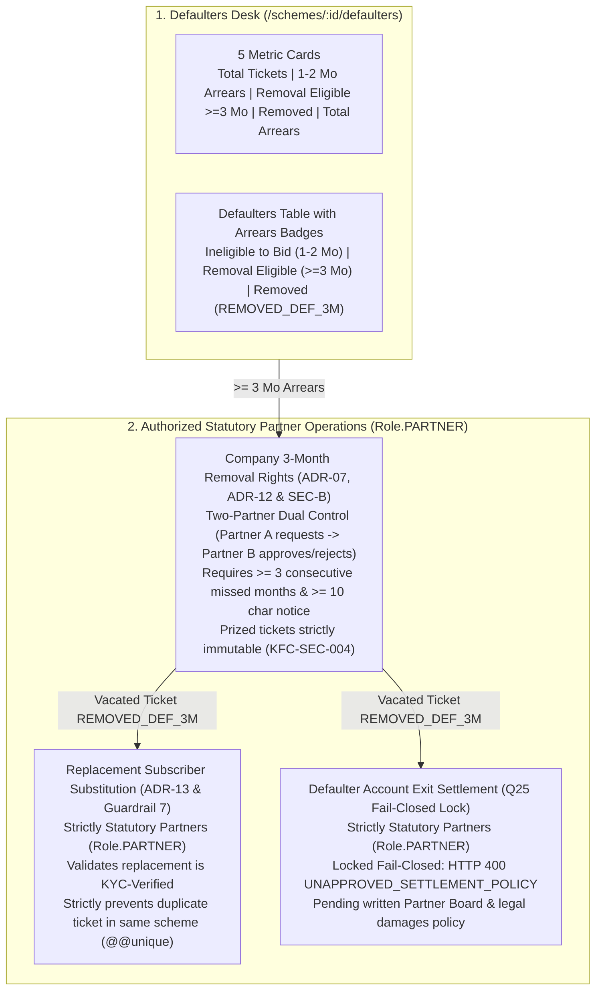

# Phase 6 Architecture: Defaulter Substitution & Member Removal Desk (`/schemes/[id]/defaulters`)

> **Product**: **Kumaran Chits** (Kumaran Finance, Perundurai, Tamil Nadu)  
> **Platform**: Web Workstation Portal (`apps/web`)  
> **Status**: **Phase 6 Task 6.4 100% COMPLETED & VERIFIED**  
> **Target Audience**: Web Engineers, Backend Engineers, CA Auditors, Partner/Foreman Operations, Desk Accountants  
> **Scope**: Scheme Defaulters Desk, Ineligible Bidder Warnings, Company 3-Month Arrears Removal Rights (ADR-07 & ADR-12), Replacement Subscriber Substitution (ADR-13 & Guardrail 7), Defaulter Account Exit Settlement & Voucher (`KC-VOU-DEF-XXXXXX`), and 4.00% Foreman Commission Damages Math.  
> **Applicable Architectural Guardrails**: Guardrail 1 (Single Company), Guardrail 2 (Pure Whole Rupee Math), Guardrail 3 (4.00% Commission Damages — proposed model locked under Q25), Guardrail 7 / ADR-13 (Max 1 Ticket Per Scheme Limit), Guardrail 8 / ADR-07 (Defaulter Rules & 3-Month Arrears Removal), Guardrail 10 (Maker $\ne$ Checker), Guardrail 11 / ADR-21, ADR-27 (Statutory Partner `Role.PARTNER`), `KFC-SEC-004` (`PRIZED_TICKET_IMMUTABLE`).

---

## 1. Executive Summary & Capabilities Delivered

Under the **Tamil Nadu Chit Funds Act, 1982** and **Kumaran Chits Master Architectural Rules (ADR-07, ADR-12, ADR-13, ADR-21, ADR-27)**, Task 6.4 delivers a dedicated operational desk for managing subscriber arrears, exercising statutory company removal rights under two-partner dual control (`SEC-B`), onboarding replacement members, and enforcing the fail-closed Q25 exit settlement lock:



### Primary Capabilities Delivered:

1. **Defaulter Substitution & Removal Desk (`/schemes/[id]/defaulters`)**:
   - Scheme-specific desk accessed via breadcrumb navigation and direct header button on `/schemes/[id]`.
   - 5 KPI summary cards: Total Scheme Tickets, Defaulting Members ($1\text{--}2$ mo), Eligible for Removal ($\ge 3$ mo), Removed Members (`REMOVED_DEF_3M`), and Total Scheme Overdue Arrears.
   - Embedded `BusinessRuleBanner` highlighting **ADR-07 & ADR-12 Company Removal Rights** and **ADR-13 Ticket Limit Substitution Guard**.

2. **Arrears Aging & Ineligibility Badging (`DefaultersTable`)**:
   - Tabbed filtering: All Tickets, Active Arrears ($1\text{--}2$ mo), Removal Eligible ($\ge 3$ mo), and Removed Members.
   - **$1\text{--}2$ Consecutive Unpaid Months**: Highlighted with an amber badge (`Ineligible to Bid - ADR-07`). Removal button is strictly disabled with a protective tooltip: *"Removal blocked: Requires at least 3 consecutive unpaid months (ADR-07)"*.
   - **$\ge 3$ Consecutive Unpaid Months**: Highlighted with a red badge (`Removal Eligible - ADR-07 & ADR-12`), exposing the `Remove Defaulter` action for Verified Partners.
   - **Removed Tickets (`REMOVED_DEF_3M`)**: Highlighted with a purple badge, exposing `Substitute Member` and the Q25 fail-closed `Settle Account` guard.

3. **Company 3-Month Arrears Removal Rights (`DefaulterRemovalDialog` — `SEC-B` / `KFC-SEC-004`)**:
   - Restricted strictly to **Statutory Partners (`Role.PARTNER`)** (`SEC-A` / Guardrails 10 & 11).
   - **Two-Partner Dual Control (`SEC-B`)**: Partner A initiates removal request (`POST /api/v1/tickets/:id/remove-defaulter/request`, alias `/remove-defaulter`) with mandatory justification ($\ge 10$ characters), placing the ticket into `PENDING_REMOVAL_APPROVAL`.
   - Independent Partner B reviews and either approves (`POST /api/v1/tickets/:id/remove-defaulter/approve` $\to$ `REMOVED_DEF_3M`) or rejects (`POST /api/v1/tickets/:id/remove-defaulter/reject` $\to$ restores `DEFAULT_3_MONTHS`). Hard guard: `maker != checker`.
   - **Prized Subscriber Immutability (`KFC-SEC-004`)**: Prized tickets strictly reject removal (`PRIZED_TICKET_IMMUTABLE`).

4. **ADR-13 Subscriber Substitution (`DefaulterSubstitutionModal`)**:
   - Restricted strictly to **Super Admin**.
   - Search picker connecting to `GET /api/v1/customers` with live KYC badge display.
   - **KYC Verification Guard**: Rejects unverified customers fail-closed.
   - **ADR-13 Ticket Limit Guard**: Checks against all existing scheme members. Disables substitution and flags conflict if replacement customer already holds a ticket in the same chit scheme (`@@unique([chitGroupId, customerId])`).
   - Submits `POST /api/v1/tickets/:id/substitute` restoring ticket status to `ACTIVE`, resetting `consecutiveUnpaidMonths = 0`, and creating an audit trail.

5. **Defaulter Account Exit Settlement Guard (`DefaulterSettlementDialog`)**:
   - Under confirmed business rule **Q25**, the contractual damages and early-exit refund formula has NOT been confirmed by the business owner and legal counsel.
   - Calling `POST /api/v1/tickets/:id/settle-removal` strictly fails closed with:
     `HTTP 400 Bad Request: UNAPPROVED_SETTLEMENT_POLICY`
   - Automated settlement execution is locked pending formal written Partner Board resolution.

---

## 2. API Contracts & Verified Backend Integration

> **Dual Route Prefix (`ticket.controller.ts:45`)**: `TicketController` mounts at `@Controller(['tickets', 'installments/tickets'])`, so every `/api/v1/tickets/*` route below is equivalently addressable at `/api/v1/installments/tickets/*`.

| Action | HTTP Method & Path | Allowed Roles | Request Body / Params | Success Status & Payload |
|---|---|---|---|---|
| **Defaulters Report** | `GET /api/v1/tickets/defaulters` | `SUPER_ADMIN`, `BRANCH_MANAGER`, `ACCOUNTANT`, `AUDITOR` | Query: `minConsecutiveMonths=1` | Paginated tickets with unpaid dues and overdue totals |
| **Scheme Tickets** | `GET /api/v1/chits/:id` | Authenticated Staff / Customers | Path: `id` (chit group UUID) | Scheme details + $N$ tickets with status, dues & customers |
| **Request Defaulter Removal** | `POST /api/v1/tickets/:id/remove-defaulter/request` *(alias `/remove-defaulter`)* | Strictly `Role.PARTNER` | `{ reason: string }` ($\ge 10$ chars) | Transitions to `PENDING_REMOVAL_APPROVAL` (`SEC-B`; blocks prized tickets `KFC-SEC-004`) |
| **Approve Defaulter Removal** | `POST /api/v1/tickets/:id/remove-defaulter/approve` | Strictly `Role.PARTNER` | Optional `{ notes?: string }` (`maker != checker`) | Transitions to `REMOVED_DEF_3M`, tags `removedAt` & `removedByUserId` |
| **Reject Defaulter Removal** | `POST /api/v1/tickets/:id/remove-defaulter/reject` | Strictly `Role.PARTNER` | Optional `{ reason?: string }` (`maker != checker`) | Rejects request and restores ticket to `DEFAULT_3_MONTHS` |
| **Substitute Subscriber** | `POST /api/v1/tickets/:id/substitute` | Strictly `Role.PARTNER` | `{ newCustomerId: UUID, reason?: string }` | Restores to `ACTIVE`, resets `consecutiveUnpaidMonths = 0` |
| **Settle Account** | `POST /api/v1/tickets/:id/settle-removal` | Strictly `Role.PARTNER` | `{ paymentMethod: CASH/BANK/CHEQUE, notes?: string }` | Fails closed with `HTTP 400 UNAPPROVED_SETTLEMENT_POLICY` (Q25) |

---

## 3. Mathematical & Business Rule Proofs

> [!WARNING]
> **Statutory Policy Notice (Q25)**: The 4.00% damages formula below represents the proposed contractual calculation model. Under confirmed business rule Q25, automated settlement execution is strictly blocked fail-closed (`UNAPPROVED_SETTLEMENT_POLICY`) in production until the statutory damages formula is confirmed in writing by the business owner and legal counsel.

### Proof 1: 4.00% Contractual Damages & Whole Rupee Exit Refund

```
Let Total Chit Value = V = ₹1,00,000
Contractual Foreman Commission Damages = floor(V * 0.04) = ₹4,000

Case 1: Subscriber paid 3 installments of ₹5,000 each = ₹15,000
Total Paid = ₹15,000
Damages Deducted = ₹4,000
Net Refund Payable = max(0, 15,000 - 4,000) = ₹11,000 (disbursed via voucher)

Case 2: Subscriber paid only 1 partial month or low opening dues = ₹3,000
Total Paid = ₹3,000
Damages Deducted = ₹4,000
Net Refund Payable = max(0, 3,000 - 4,000) = ₹0 (bounded fail-closed; zero negative refunds)
```

### Proof 2: ADR-13 Single-Ticket-Per-Scheme Constraint

```
Chit Scheme: KCA-1L-20M-01
Existing Tickets:
  Ticket #1: Customer A (Company)
  Ticket #2: Customer B (Murugan K - cust-002)
  Ticket #3: Customer C (Kavitha S - cust-003)
  Ticket #4: Vacated Defaulter (REMOVED_DEF_3M)

Super Admin searches replacement for Ticket #4:
Attempt 1: Selects Murugan K (cust-002)
  -> Check: schemeTickets.some(t => t.customerId === 'cust-002') === TRUE (Ticket #2)
  -> UI Action: Flags ADR-13 Conflict Badge, disables submit button, blocks mutation.
  -> Database Action: Database unique constraint @@unique([chitGroupId, customerId]) prevents concurrent insertion (HTTP 409 Conflict).

Attempt 2: Selects Suresh P (cust-004, isKycVerified: true)
  -> Check: schemeTickets.some(t => t.customerId === 'cust-004') === FALSE
  -> Substitution permitted -> Ticket #4 restored to ACTIVE with Suresh P.
```

---

## 4. Modular File Architecture & Rule 4 Compliance

All component and route files adhere to **AGENTS.md Rule 4**:

| File Path | Description | Status |
|---|---|:---:|
| `apps/web/src/app/(dashboard)/schemes/[id]/defaulters/page.tsx` | Scheme defaulters desk route orchestrator | ✅ Clean |
| `apps/web/src/components/schemes/defaulters-table.tsx` | Tabular list, arrears aging badges & actions | ✅ Clean |
| `apps/web/src/components/schemes/defaulter-removal-dialog.tsx` | Verified Partner 3-month removal action dialog (`SEC-B`) | ✅ Clean |
| `apps/web/src/components/schemes/defaulter-substitution-modal.tsx` | Verified Partner replacement subscriber picker & KYC/ADR-13 checks | ✅ Clean |
| `apps/web/src/components/schemes/defaulter-settlement-dialog.tsx` | Q25 fail-closed exit settlement guard dialog | ✅ Clean |
| `apps/web/src/components/ui/textarea.tsx` | Accessible textarea component with error states | ✅ Clean |
| `apps/web/src/app/(dashboard)/schemes/[id]/page.tsx` | Scheme detail page with Defaulters Desk quick action | ✅ Clean |
| `apps/web/test/defaulter-substitution.spec.ts` | Automated unit test suite asserting 8 core invariants | ✅ Clean |

---

## 5. Verification & Test Proofs

- **TypeScript Compilation**: `pnpm --filter web typecheck` $\to$ **0 compiler errors**.
- **Automated Unit Tests**: `pnpm --filter web test` $\to$ **376 / 376 tests passing across 52 spec files (14 top-level suites)** (including 8/8 in `defaulter-substitution.spec.ts`).
- **Next.js 15 Production Build**: `pnpm --filter web build` $\to$ Clean standalone compilation across all **35** App Router `page.tsx` routes.
- **Bilingual Dictionary Parity**: 100% complete parity across English and Tamil (`apps/web/messages/en.json` $\longleftrightarrow$ `ta.json`, `1,921` keys each).
