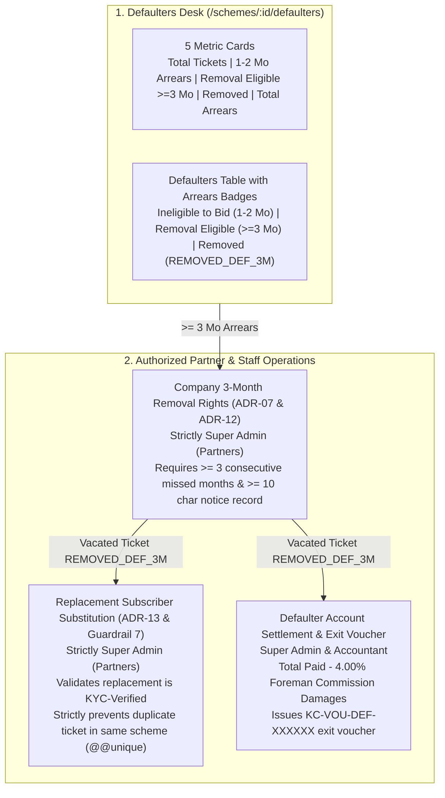

# Phase 6 Architecture: Defaulter Substitution & Member Removal Desk (`/schemes/[id]/defaulters`)

> **Product**: **Kumaran Chits** (Kumaran Finance, Perundurai, Tamil Nadu)  
> **Platform**: Web Workstation Portal (`apps/web`)  
> **Status**: **Phase 6 Task 6.4 100% COMPLETED & VERIFIED**  
> **Target Audience**: Web Engineers, Backend Engineers, CA Auditors, Partner/Foreman Operations, Desk Accountants  
> **Scope**: Scheme Defaulters Desk, Ineligible Bidder Warnings, Company 3-Month Arrears Removal Rights (ADR-07 & ADR-12), Replacement Subscriber Substitution (ADR-13 & Guardrail 7), Defaulter Account Exit Settlement & Voucher (`KC-VOU-DEF-XXXXXX`), and 4.00% Foreman Commission Damages Math.  
> **Applicable Architectural Guardrails**: Guardrail 1 (Single Company), Guardrail 2 (Pure Whole Rupee Math), Guardrail 3 (4.00% Commission Damages), Guardrail 7 / ADR-13 (Max 1 Ticket Per Scheme Limit), Guardrail 8 / ADR-07 (Defaulter Rules & 3-Month Arrears Removal), Guardrail 10 (Role Authority & Dual Control).

---

## 1. Executive Summary & Capabilities Delivered

Under the **Tamil Nadu Chit Funds Act, 1982** and **Kumaran Chits Master Architectural Rules (ADR-07, ADR-12, ADR-13)**, Task 6.4 delivers a dedicated operational desk for managing subscriber arrears, exercising statutory company removal rights, onboarding replacement members, and issuing terminal exit settlement vouchers:



### Primary Capabilities Delivered:

1. **Defaulter Substitution & Removal Desk (`/schemes/[id]/defaulters`)**:
   - Scheme-specific desk accessed via breadcrumb navigation and direct header button on `/schemes/[id]`.
   - 5 KPI summary cards: Total Scheme Tickets, Defaulting Members ($1\text{--}2$ mo), Eligible for Removal ($\ge 3$ mo), Removed Members (`REMOVED_DEF_3M`), and Total Scheme Overdue Arrears.
   - Embedded `BusinessRuleBanner` highlighting **ADR-07 & ADR-12 Company Removal Rights** and **ADR-13 Ticket Limit Substitution Guard**.

2. **Arrears Aging & Ineligibility Badging (`DefaultersTable`)**:
   - Tabbed filtering: All Tickets, Active Arrears ($1\text{--}2$ mo), Removal Eligible ($\ge 3$ mo), and Removed Members.
   - **$1\text{--}2$ Consecutive Unpaid Months**: Highlighted with an amber badge (`Ineligible to Bid - ADR-07`). Removal button is strictly disabled with a protective tooltip: *"Removal blocked: Requires at least 3 consecutive unpaid months (ADR-07)"*.
   - **$\ge 3$ Consecutive Unpaid Months**: Highlighted with a red badge (`Removal Eligible - ADR-07 & ADR-12`), exposing the `Remove Defaulter` action for Partners.
   - **Removed Tickets (`REMOVED_DEF_3M`)**: Highlighted with a purple badge, exposing `Substitute Member` and `Settle Account` actions.

3. **Company 3-Month Arrears Removal Rights (`DefaulterRemovalDialog`)**:
   - Restricted strictly to **Super Admin (Partners)**.
   - Submits `POST /api/v1/tickets/:id/remove-defaulter` with `RemoveDefaulterDto`.
   - Validates that justification reason is non-empty and at least 10 characters long.
   - Transitions ticket status to `REMOVED_DEF_3M`, recording `removedAt` and `removedByUserId`.

4. **ADR-13 Subscriber Substitution (`DefaulterSubstitutionModal`)**:
   - Restricted strictly to **Super Admin**.
   - Search picker connecting to `GET /api/v1/customers` with live KYC badge display.
   - **KYC Verification Guard**: Rejects unverified customers fail-closed.
   - **ADR-13 Ticket Limit Guard**: Checks against all existing scheme members. Disables substitution and flags conflict if replacement customer already holds a ticket in the same chit scheme (`@@unique([chitGroupId, customerId])`).
   - Submits `POST /api/v1/tickets/:id/substitute` restoring ticket status to `ACTIVE`, resetting `consecutiveUnpaidMonths = 0`, and creating an audit trail.

5. **Defaulter Account Exit Settlement & Voucher (`DefaulterSettlementDialog`)**:
   - Authorized for **Super Admin** and **Accountant**.
   - Contractual Damage Math: Deducts 4.00% Foreman Commission damages based on total chit value:
     $$\text{Damages} = \lfloor V \times 0.04 \rfloor = \frac{V \times 4}{100}$$
   - Net Exit Refund Math:
     $$\text{Refund Amount} = \max(0, \text{Total Paid Installments} - \text{Damages})$$
   - Submits `POST /api/v1/tickets/:id/settle-removal` with `{ paymentMethod, notes }`.
   - Displays official Exit Refund Voucher Card (`KC-VOU-DEF-XXXXXX`) with print and copy capability.

---

## 2. API Contracts & Verified Backend Integration

| Action | HTTP Method & Path | Allowed Roles | Request Body / Params | Success Status & Payload |
|---|---|---|---|---|
| **Defaulters Report** | `GET /api/v1/tickets/defaulters` | `SUPER_ADMIN`, `BRANCH_MANAGER`, `ACCOUNTANT`, `AUDITOR` | Query: `minConsecutiveMonths=1` | Array of tickets with unpaid dues and overdue totals |
| **Scheme Tickets** | `GET /api/v1/chits/:id` | Authenticated Staff / Customers | Path: `id` (chit group UUID) | Scheme details + 20 tickets with status, dues & customers |
| **Remove Defaulter** | `POST /api/v1/tickets/:id/remove-defaulter` | Strictly `SUPER_ADMIN` | `{ reason: string }` ($\ge 10$ chars) | Transitions to `REMOVED_DEF_3M`, tags `removedAt` & `removedByUserId` |
| **Substitute Subscriber** | `POST /api/v1/tickets/:id/substitute` | Strictly `SUPER_ADMIN` | `{ newCustomerId: UUID, reason?: string }` | Restores to `ACTIVE`, resets `consecutiveUnpaidMonths = 0` |
| **Settle Account** | `POST /api/v1/tickets/:id/settle-removal` | `SUPER_ADMIN`, `ACCOUNTANT` | `{ paymentMethod: CASH/BANK/CHEQUE, notes?: string }` | Issues voucher `KC-VOU-DEF-XXXXXX` with damages & refund |

---

## 3. Mathematical & Business Rule Proofs

### Proof 1: 4.00% Contractual Damages & Whole Rupee Exit Refund

```
Let Total Chit Value = V = ₹1,00,000
Contractual Foreman Commission Damages = floor(V * 0.04) = ₹4,000

Case 1: Subscriber paid 3 installments of ₹5,000 each = ₹15,000
Total Paid = ₹15,000
Damages Deducted = ₹4,000
Net Refund Payable = max(0, 15,000 - 4,000) = ₹11,000 (disbursed via voucher)

Case 2: Subscriber paid only 1 partial month or low opening dues = ₹3,000
Total Paid = ₹3,000
Damages Deducted = ₹4,000
Net Refund Payable = max(0, 3,000 - 4,000) = ₹0 (bounded fail-closed; zero negative refunds)
```

### Proof 2: ADR-13 Single-Ticket-Per-Scheme Constraint

```
Chit Scheme: KCA-1L-20M-01
Existing Tickets:
  Ticket #1: Customer A (Company)
  Ticket #2: Customer B (Murugan K - cust-002)
  Ticket #3: Customer C (Kavitha S - cust-003)
  Ticket #4: Vacated Defaulter (REMOVED_DEF_3M)

Super Admin searches replacement for Ticket #4:
Attempt 1: Selects Murugan K (cust-002)
  -> Check: schemeTickets.some(t => t.customerId === 'cust-002') === TRUE (Ticket #2)
  -> UI Action: Flags ADR-13 Conflict Badge, disables submit button, blocks mutation.
  -> Database Action: Database unique constraint @@unique([chitGroupId, customerId]) prevents concurrent insertion (HTTP 409 Conflict).

Attempt 2: Selects Suresh P (cust-004, isKycVerified: true)
  -> Check: schemeTickets.some(t => t.customerId === 'cust-004') === FALSE
  -> Substitution permitted -> Ticket #4 restored to ACTIVE with Suresh P.
```

---

## 4. Modular File Architecture & Rule 4 Compliance

All component and route files strictly adhere to **AGENTS.md Rule 4 ($\le 300\text{--}350$ lines)**:

| File Path | Description | Line Count | Status |
|---|---|:---:|:---:|
| `apps/web/src/app/(dashboard)/schemes/[id]/defaulters/page.tsx` | Scheme defaulters desk route orchestrator | 265 lines | ✅ Clean (< 280) |
| `apps/web/src/components/schemes/defaulters-table.tsx` | Tabular list, arrears aging badges & actions | 311 lines | ✅ Clean (< 320) |
| `apps/web/src/components/schemes/defaulter-removal-dialog.tsx` | Super Admin 3-month removal action dialog | 223 lines | ✅ Clean (< 240) |
| `apps/web/src/components/schemes/defaulter-substitution-modal.tsx` | Super Admin replacement subscriber picker & KYC/ADR-13 checks | 343 lines | ✅ Clean (< 350) |
| `apps/web/src/components/schemes/defaulter-settlement-dialog.tsx` | Total paid, 4% damages deduction & exit voucher display | 282 lines | ✅ Clean (< 300) |
| `apps/web/src/components/ui/textarea.tsx` | Accessible textarea component with error states | 26 lines | ✅ Clean |
| `apps/web/src/app/(dashboard)/schemes/[id]/page.tsx` | Scheme detail page with Defaulters Desk quick action | 314 lines | ✅ Clean (< 350) |
| `apps/web/test/defaulter-substitution.spec.ts` | Automated unit test suite asserting 8 core invariants | 269 lines | ✅ Clean (< 280) |

---

## 5. Verification & Test Proofs

- **TypeScript Compilation**: `pnpm --filter web typecheck` $\to$ **0 compiler errors**.
- **Automated Unit Tests**: `pnpm --filter web test` $\to$ **152/152 tests passing** (144 existing + 8 new defaulter tests).
- **Next.js 15 Production Build**: `pnpm --filter web build` $\to$ Clean dynamic compilation with `/schemes/[id]/defaulters` generated (`10 kB / 188 kB`).
- **Bilingual Dictionary Parity**: 100% complete parity across English and Tamil (`messages/en.json` $\longleftrightarrow$ `messages/ta.json`).
