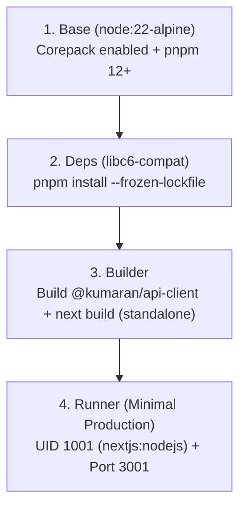
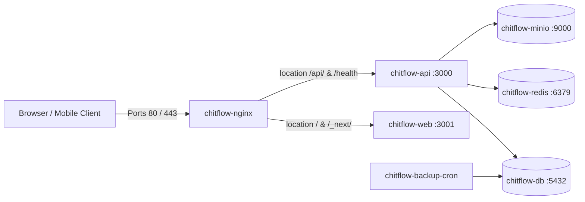

# Next.js 15 Production Docker Architecture & Environment Specification

> **Subsystem**: Web Operations Portal (`apps/web/`)  
> **Base Runtime**: Node.js 22 Alpine (`node:22-alpine`)  
> **Package Manager**: `pnpm 12+` (Workspace Monorepo via Corepack)  
> **Build Mode**: Next.js 15 App Router Standalone Output (`output: 'standalone'`)  
> **Orchestration**: Fullstack Docker Compose (`infra/docker/docker-compose.fullstack.yml`) + Nginx Ingress

---

## 1. Multi-Stage Container Architecture

To achieve sub-second cold starts and minimal image footprint (~80 MB runtime content), `apps/web/Dockerfile` uses a 4-stage build pipeline:



### Stage Summary
1. **Base**: Starts from official `node:22-alpine`. Enables Corepack for automated `pnpm 12.16.1` resolution.
2. **Deps**: Installs `libc6-compat` for musl/glibc compatibility. Copies `package.json`, `pnpm-workspace.yaml`, and `pnpm-lock.yaml`. Executes `pnpm install --frozen-lockfile` to cache dependencies in Docker layer.
3. **Builder**: Copies workspace packages (`packages/api-client` and `apps/web`). Compiles `@kumaran/api-client` via `tsc`. Runs `pnpm --filter web build` with `NEXT_TELEMETRY_DISABLED=1`. Standalone tracing copies only required runtime dependencies into `.next/standalone`.
4. **Runner**: Creates unprivileged system group `nodejs` (GID 1001) and user `nextjs` (UID 1001). Copies standalone server bundle, static assets (`.next/static`), and public folder (`public/`). Sets `PORT=3001` and adds a container healthcheck.

---

## 2. Environment Variables Specification

Runtime configuration adheres to 12-factor application standards documented in `apps/web/.env.example`:

| Variable Name | Required | Default / Example | Purpose |
|---|---|---|---|
| `NODE_ENV` | Yes | `production` | Enables React/Next production optimizations |
| `PORT` | Yes | `3001` | Listening port for standalone Node HTTP server |
| `HOSTNAME` | No | `0.0.0.0` | Container network bind address |
| `NEXT_PUBLIC_API_URL` | Yes | `http://localhost:3000` | Gateway endpoint for `@kumaran/api-client` SDK |
| `NEXT_PUBLIC_BULL_BOARD_URL` | No | `http://localhost:3000/admin/queues` | Quick link to BullMQ background monitoring |
| `NEXT_TELEMETRY_DISABLED` | Yes | `1` | Disables telemetry pings for network isolation |

---

## 3. Full-Stack Docker Compose Orchestration

The Web portal runs as service `web` in `infra/docker/docker-compose.fullstack.yml`:

```yaml
web:
  build:
    context: ../..
    dockerfile: apps/web/Dockerfile
  container_name: chitflow-web
  restart: unless-stopped
  depends_on:
    - api
  environment:
    NODE_ENV: production
    PORT: 3001
    NEXT_PUBLIC_API_URL: ${NEXT_PUBLIC_API_URL:-http://localhost:3000}
    NEXT_PUBLIC_BULL_BOARD_URL: ${NEXT_PUBLIC_BULL_BOARD_URL:-http://localhost:3000/admin/queues}
    NEXT_TELEMETRY_DISABLED: "1"
  ports:
    - "127.0.0.1:${WEB_PORT:-3001}:3001"
```

### The 7-Service Production Topology


---

## 4. Nginx Reverse Proxy Route Splitting

`infra/docker/nginx/conf.d/chitflow.conf` routes ingress traffic between Web and API:

1. **Static Assets (`location /_next/static/`)**:
   - Reverse proxies to `web_upstream:3001`.
   - Injects `Cache-Control: "public, max-age=31536000, immutable"` for aggressive browser caching of immutable chunks.
2. **Operations Dashboard (`location /`)**:
   - Reverse proxies to `web_upstream:3001`.
   - Passes WebSocket `Upgrade` headers for HMR/live refreshes.
3. **Backend API (`location /api/`)**:
   - Reverse proxies to `api_upstream:3000`.
   - Enforces 60-second timeouts, custom buffers, and raw SSE streaming.

---

## 5. Build & Verification Commands

| Command | Action | Expected Output |
|---|---|---|
| `pnpm docker:web:build` | Build standalone production image | Tagged `chitflow-web:latest` (~80 MB) |
| `docker run -d --name chitflow-web-test -p 3002:3001 chitflow-web:latest` | Run ephemeral test container | Container starts in <700ms |
| `docker exec chitflow-web-test whoami` | Verify non-root execution | `nextjs` (UID 1001) |
| `curl -I http://localhost:3002/login` | Verify HTTP response | `HTTP/1.1 200 OK` |
| `docker compose -f infra/docker/docker-compose.fullstack.yml config` | Validate fullstack compose | Exits with code 0 |
