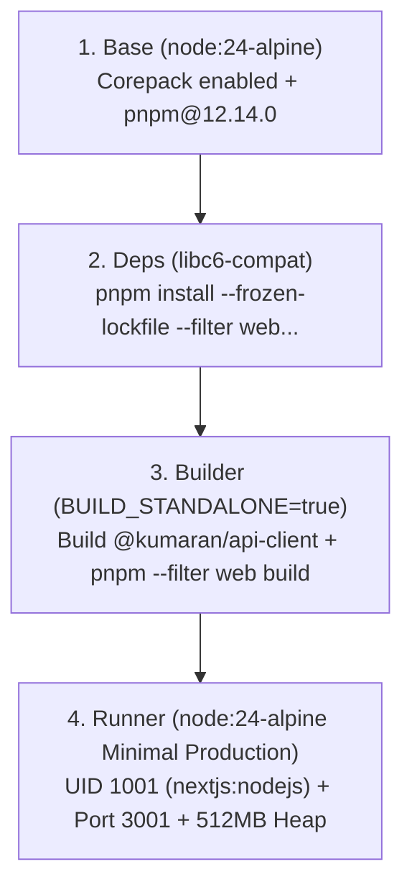
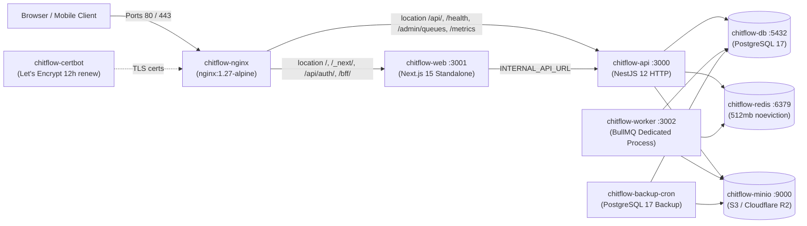

# Next.js 15 Production Docker Architecture & Environment Specification

> **Subsystem**: Web Operations Portal (`apps/web/`)  
> **Base Runtime**: Node.js 24 LTS Alpine (`node:24-alpine`)  
> **Package Manager**: `pnpm@12.14.0` (Workspace Monorepo via Corepack)  
> **Build Mode**: Next.js 15 App Router Standalone Output (`BUILD_STANDALONE=true` $\to$ `output: 'standalone'`)  
> **Orchestration**: 9-Service Fullstack Docker Compose (`infra/docker/docker-compose.fullstack.yml`) + Nginx 1.27 TLS Ingress

---

## 1. Multi-Stage Container Architecture

To achieve sub-second cold starts and a minimal image footprint (~80 MB runtime content), `apps/web/Dockerfile` uses a 4-stage build pipeline:



### Stage Summary
1. **Base**: Starts from official `node:24-alpine`, configures `PNPM_HOME="/pnpm"`, and runs `corepack enable && corepack prepare pnpm@12.14.0 --activate`.
2. **Deps**: Installs `libc6-compat` for musl/glibc compatibility. Copies `pnpm-lock.yaml`, `pnpm-workspace.yaml`, `package.json`, `.npmrc`, and package manifests. Executes `pnpm install --frozen-lockfile --filter web...` with a BuildKit cache mount (`id=pnpm,target=/pnpm/store`).
3. **Builder**: Copies `tsconfig.base.json`, `packages/api-client`, and `apps/web`. Compiles `@kumaran/api-client` (`pnpm --filter @kumaran/api-client build`), sets `BUILD_STANDALONE=true` and `NEXT_TELEMETRY_DISABLED=1`, and runs `pnpm --filter web build`. Standalone tracing emits minimal runtime artifacts into `.next/standalone`.
4. **Runner**: Starts fresh from `node:24-alpine`, creates unprivileged group `nodejs` (GID 1001) and user `nextjs` (UID 1001), copies `.next/standalone`, `.next/static`, and `public/`. Sets `PORT=3001`, `NODE_OPTIONS="--max-old-space-size=512"`, and registers a 30-second Docker `HEALTHCHECK` (`interval=30s`, `timeout=5s`, `start-period=15s`, `retries=3`).

---

## 2. Environment Variables Specification

Runtime configuration adheres to 12-factor standards defined in `apps/web/.env.example` and `infra/docker/docker-compose.fullstack.yml`:

| Variable Name | Required | Default / Example | Purpose |
|---|---|---|---|
| `NODE_ENV` | Yes | `production` | Enables React 19 / Next.js 15 production optimizations |
| `PORT` | Yes | `3001` | Listening port for standalone Node HTTP server |
| `HOSTNAME` | No | `0.0.0.0` | Container network bind address inside Docker |
| `NODE_OPTIONS` | Yes (Compose) | `--max-old-space-size=512` | Caps Node.js V8 heap inside the `512m` container `mem_limit` |
| `INTERNAL_API_URL` | Yes | `http://api:3000` | Private Docker-network backend origin used by Next.js BFF Route Handlers (`/api/auth/*` and `/bff/api/v1/*`) |
| `NEXT_PUBLIC_API_URL` | Yes | `http://localhost:3000` | Public API base URL metadata for client links and SDK fallbacks |
| `NEXT_PUBLIC_BULL_BOARD_URL` | No | `http://localhost:3000/admin/queues` | Super Admin quick link to the BullMQ queue dashboard |
| `JWT_SECRET` | **Yes** | Shared with `api` ($\ge 32$ chars in prod) | Verifies `HttpOnly` BFF JWT signatures inside Next.js Edge Middleware (`jose` HS256) |
| `COOKIE_SECURE` | Optional | Driven by `X-Forwarded-Proto: https` | Explicit override (`"true"`) to force `Secure` flag on BFF session cookies |
| `NEXT_TELEMETRY_DISABLED` | Yes | `1` | Disables Next.js telemetry pings for strict network isolation |

---

## 3. Full-Stack Docker Compose Orchestration

The Web portal runs as service `web` in `infra/docker/docker-compose.fullstack.yml` (`mem_limit: 512m`, `nofile: 65535`, waiting for `api` `service_healthy`):

```yaml
web:
  logging: *default-logging
  build:
    context: ../..
    dockerfile: apps/web/Dockerfile
  container_name: chitflow-web
  restart: unless-stopped
  mem_limit: 512m
  ulimits:
    nofile:
      soft: 65535
      hard: 65535
  depends_on:
    api:
      condition: service_healthy
  environment:
    NODE_ENV: production
    PORT: 3001
    NODE_OPTIONS: "--max-old-space-size=512"
    INTERNAL_API_URL: ${INTERNAL_API_URL:-http://api:3000}
    NEXT_PUBLIC_API_URL: ${NEXT_PUBLIC_API_URL:-http://localhost:3000}
    NEXT_PUBLIC_BULL_BOARD_URL: ${NEXT_PUBLIC_BULL_BOARD_URL:-http://localhost:3000/admin/queues}
    JWT_SECRET: ${JWT_SECRET:-kumaran-chits-dev-secret-key-replace-in-production-2026}
    # COOKIE_SECURE: "true" # Optional explicit override; otherwise driven by X-Forwarded-Proto https
    NEXT_TELEMETRY_DISABLED: "1"
  ports:
    - "127.0.0.1:${WEB_PORT:-3001}:3001"
```

### The 9-Service Production Topology

`infra/docker/docker-compose.fullstack.yml` orchestrates **9 dedicated containers**:



1. `chitflow-db` — PostgreSQL 17 primary financial database.
2. `chitflow-redis` — Redis 7 broker & cache (`--maxmemory 512mb --maxmemory-policy noeviction` per `KFC-INF-001`).
3. `chitflow-minio` — Local S3-compatible object store (production may point directly to Cloudflare R2).
4. `chitflow-api` — NestJS 12 HTTP monolith (`:3000`, `ENABLE_BULLMQ_WORKERS="false"` for process bulkheading).
5. `chitflow-worker` — Dedicated NestJS BullMQ worker process (`:3002`, `ENABLE_BULLMQ_WORKERS="true"`).
6. `chitflow-web` — Next.js 15 Operations Portal & BFF (`:3001`, localhost-bound `127.0.0.1:3001`).
7. `chitflow-nginx` — Nginx 1.27 TLS 1.2/1.3 reverse proxy, security headers, and edge rate limiting (`:80`, `:443`).
8. `chitflow-certbot` — Automated ACME/Let's Encrypt certificate renewal loop (12-hour interval).
9. `chitflow-backup-cron` — Automated encrypted PostgreSQL 17 backup job shipping snapshots to object storage.

---

## 4. Nginx Reverse Proxy Route Splitting (`chitflow.conf`)

`infra/docker/nginx/conf.d/chitflow.conf` cleanly isolates `HttpOnly`-cookie browser BFF routes from Bearer-authenticated direct API traffic:

| Nginx `location` Block | Target Upstream | Rate Limit / Key Directives |
|---|---|---|
| `location /api/auth/` | `web_upstream:3001` | `api_auth_limit burst=10 nodelay`; `Cache-Control: no-store`; Web BFF login/TOTP/onboarding/session/logout |
| `location ~* ^/bff/api/v1/(customers/[^/]+/documents\|disbursements/auction/[^/]+/upload-safety-proof\|storage/upload/)` | `web_upstream:3001` | `client_max_body_size 25M`; `api_general_limit burst=30`; `no-store`; KYC & safety-proof uploads via BFF |
| `location /bff/api/v1/reports/approvals-stream` | `web_upstream:3001` | `proxy_buffering off`; `proxy_cache off`; `proxy_read_timeout 24h`; real-time browser SSE approval notifications |
| `location /bff/` | `web_upstream:3001` | `api_general_limit burst=30 nodelay`; `no-store`; general authenticated browser BFF proxy |
| `location ~* ^/api/v1/(customers/[^/]+/documents\|disbursements/auction/[^/]+/upload-safety-proof)` | `api_upstream:3000` | `client_max_body_size 25M`; direct mobile/API document upload path |
| `location /api/v1/reports/approvals-stream` | `api_upstream:3000` | `proxy_buffering off`; `proxy_read_timeout 24h`; direct SSE stream |
| `location /api/v1/auth/` | `api_upstream:3000` | Tighter auth throttle (`api_auth_limit burst=5 nodelay`); `no-store` |
| `location /api/` | `api_upstream:3000` | `api_general_limit burst=30 nodelay`; `no-store`; direct REST & mobile SDK endpoints |
| `location ~* ^/health(/readiness\|/liveness)?$` | `api_upstream:3000` | Allowed over HTTP (`:80`) & HTTPS (`:443`); `access_log off` |
| `location /admin/queues` | `api_upstream:3000` | Bull Board Queue Monitor UI (Super Admin JWT + secondary HTTP Basic Auth) |
| `location /metrics` | `api_upstream:3000` | Prometheus metrics exporter (HTTP Basic Auth verified at NestJS layer) |
| `location /_next/static/` | `web_upstream:3001` | `Cache-Control: "public, max-age=31536000, immutable"` |
| `location /` | `web_upstream:3001` | Dynamic Next.js HTML with `Cache-Control: no-cache, no-store, must-revalidate, max-age=0` |

---

## 5. Build & Pre-Production Verification Checklist

| Command / Check | Action | Expected Output |
|---|---|---|
| `pnpm docker:web:build` | Build standalone production image | Tagged `chitflow-web:latest` (~80 MB runtime) |
| `docker run -d --name chitflow-web-test -p 3002:3001 chitflow-web:latest` | Run ephemeral test container | Container starts in < 700ms |
| `docker exec chitflow-web-test whoami` | Verify non-root execution | `nextjs` (UID 1001) |
| `curl -I http://localhost:3002/login` | Verify HTTP response | `HTTP/1.1 200 OK` |
| `docker compose -f infra/docker/docker-compose.fullstack.yml config` | Validate 9-service fullstack compose | Exits with code `0` |
| **`JWT_SECRET` Parity Check** | Verify `api`, `worker`, and `web` share identical `JWT_SECRET` ($\ge 32$ chars) | Edge Middleware verifies BFF session tokens cleanly; API passes `env.validation.ts` production guard |
| **Redis Eviction Guard (`KFC-INF-001`)** | `docker exec chitflow-redis redis-cli CONFIG GET maxmemory-policy` | Returns `noeviction` |
