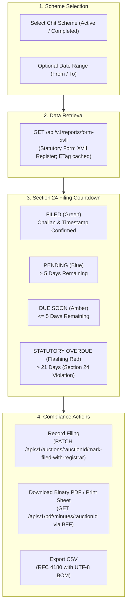

# Form XVII Auction Minutes & Registrar Filing Portal (`/reports/minutes`)

> **Product**: **Kumaran Chits** (Kumaran Finance, Perundurai, Tamil Nadu)  
> **Route Path**: `/reports/minutes` (Statutory Form XVII Auction Minutes Consolidated Register)  
> **Target Personas**: `SUPER_ADMIN`, `ACCOUNTANT`, `BRANCH_MANAGER`, `AUDITOR`  
> **Statutory Law**: Section 24 of Chit Funds Act, 1982 & Tamil Nadu Chit Funds Rules (Form XVII: Minutes of Auction Proceedings — `[UNVERIFIED-LEGAL]` pending formal TN Chit Registrar legal counsel sign-off)  
> **Status**: **Verified & Complete** (**376/376** passing Web unit tests across 52 spec files / 14 suites; 0 TypeScript errors; clean Next.js 15 build across 35 App Router routes)

---

## 1. Overview & Statutory Background

Under **Section 24 of the Chit Funds Act, 1982** and the **Tamil Nadu Chit Funds Rules**, every chit fund foreman must record the minutes of auction proceedings in **Form XVII**. Within strictly **21 calendar days** from the date of the auction, a true copy of the minutes, signed by the Foreman and the prize winner / subscribers present, must be filed with the **Registrar of Chits** *(format and filing workflow tagged `[UNVERIFIED-LEGAL]` in `ReportController` pending formal Registrar legal counsel sign-off)*.

Task 10.2 delivers the **Form XVII Auction Minutes Consolidated Register & Registrar Filing Portal (`/reports/minutes`)**, allowing authorized staff and CA auditors to inspect the full chronological auction history of any chit scheme, monitor statutory 21-day filing deadlines with real-time visual alerts, record government challans, download binary minutes PDFs (`downloadMinutesPdf`), and export official reports to CSV or printable sheets.

---

## 2. Invariant Architectural Guardrails

### 2.1 Section 24 Statutory 21-Day Filing Traffic Light
- **Filing Deadline**: `auctionDate + 21 calendar days`.
- **Status Classification**:
  - `filedAtRegistrar === true`: **FILED** (Green badge with government challan reference).
  - Unfiled and $\text{Days Remaining} < 0$: **STATUTORY OVERDUE** (Flashing red alert — Section 24 statutory non-compliance).
  - Unfiled and $0 \le \text{Days Remaining} \le 5$: **DUE SOON** (Amber badge — urgent filing required).
  - Unfiled and $\text{Days Remaining} > 5$: **PENDING** (Blue/slate badge — within permissible window).

### 2.2 Month 1 & Month $N$ Exclusion (Guardrail 5)
- Auctions occur exclusively in **Months 2 through $N-1$**.
- Month 1 is Company pool payout (no auction, ₹0 dividend).
- Month $N$ is final subscriber settlement (no auction, `FIN-B`).

### 2.3 Pure Whole Rupee Standard & Divisibility (Guardrail 2 / `KFC-FIN-002`)
- All monetary values ($V, D, P, C_f, Div, I_{net}$) operate strictly on 64-bit integer Rupees (`bigint`) via `apps/web/src/lib/currency.ts` (`formatRupee`) and `apps/web/src/components/reports/report-bigint.ts`. Paise and decimals are completely suppressed, and dividends satisfy exact whole-rupee divisibility $(D - C_f) \pmod N = 0$.

### 2.4 Option A Tie-Break Token Audit (ADR-06)
- When multiple subscribers bid the 1/4 ceiling discount ($D = V/4$), the UI displays the physical token number drawn by the Foreman and lists all tied ceiling bidders.

### 2.5 Authenticated Binary PDF Streaming (`pdf-download.ts`)
- Downloading Form XVII PDF calls **`GET /api/v1/pdf/minutes/:auctionId`** via `downloadMinutesPdf` (Next.js BFF HttpOnly cookie stream; `Cache-Control: private, no-store`, `X-Content-Type-Options: nosniff`). *(Note: `GET /api/v1/auctions/:id/minutes/pdf` returns structured JSON `AuctionMinutesDto` text layout).*

---

## 3. UI Component Architecture

| Component | File Path | Purpose & Features |
|---|---|---|
| **Minutes Page Orchestrator** | `apps/web/src/app/(dashboard)/reports/minutes/page.tsx` | Scheme selector, date range filter, breadcrumbs, CSV export, print trigger. |
| **Form XVII KPI Bar** | `apps/web/src/components/reports/form-xvii-kpi-bar.tsx` | 4 KPI cards (Total Finalized, Filed, Pending, Overdue) with Section 24 alert banner. |
| **Form XVII Viewer** | `apps/web/src/components/reports/form-xvii-viewer.tsx` | Scheme parameters overview card ($V, N, 4\%, I_{base}$, branch) & auction card list. |
| **Form XVII Auction Card** | `apps/web/src/components/reports/form-xvii-auction-card.tsx` | Month header, 21-day filing badge, financial grid, winner info, tie-break draw, BFF PDF download, expandable monospace text. |
| **Registrar Filing Modal** | `apps/web/src/components/reports/registrar-filing-modal.tsx` | Government challan ref, filing date, and staff notes submission dialog. |
| **Shared Report Helpers** | `apps/web/src/components/reports/report-bigint.ts`, `report-access.ts` | Whole-rupee `BigInt` parsing, IST date formatting & RBAC helpers. |

---

## 4. Automated Test Assertions (`form-xvii-minutes.spec.ts`)

The automated test suite (`apps/web/test/form-xvii-minutes.spec.ts`) validates 8 core invariants within the full verified Web suite (**376/376 passing across 52 spec files / 14 suites**):
1. **21-Day Deadline Calculation**: Accurately classifies FILED, PENDING, URGENT, and OVERDUE.
2. **Statutory Financial Invariants**: $P \equiv V - D$, Foreman Commission $\equiv 4.00\% \times V$, Universal Dividend credit.
3. **Month 1 & Month N Exclusion**: Verifies auctions exist strictly in Months 2 through $N-1$.
4. **Option A Paper Token Tie-Break**: Validates token draw structure and single winner assignment.
5. **Registrar Filing Payload Schema**: Enforces non-empty challan reference, valid ISO date, and notes.
6. **RBAC Authority Gate**: Restricts read to Staff/Auditor and write strictly to Staff.
7. **CSV Export Formatting**: Verifies RFC 4180 escaping and UTF-8 BOM encoding.
8. **100% Bilingual Dictionary Parity**: Validates all **59** leaf keys in `reports.minutes` across `apps/web/messages/en.json` and `ta.json`.
