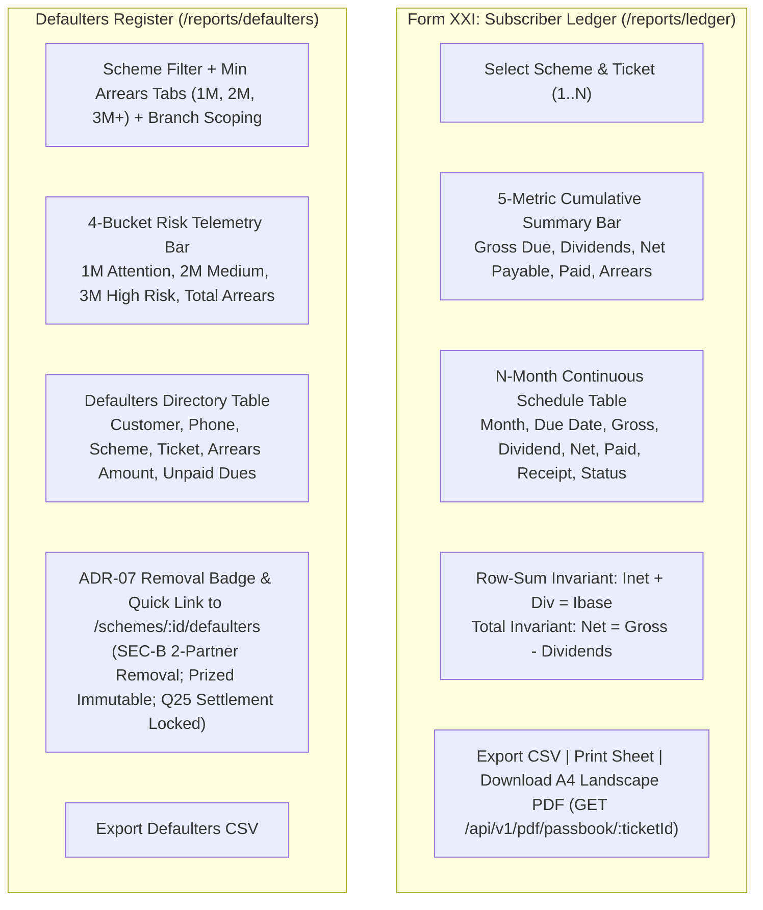

# Form XXI Subscribers' Ledger & Defaulters Register (`/reports/ledger`, `/reports/defaulters`)

> **Product**: **Kumaran Chits** (Kumaran Finance, Perundurai, Tamil Nadu)  
> **Route Paths**:  
>   1. `/reports/ledger` (Statutory Form XXI Continuous Subscriber Ledger)  
>   2. `/reports/defaulters` (Defaulters & Arrears Analysis Register)  
> **Target Personas**: Web `/reports*` routes (`route-permissions.ts`): `SUPER_ADMIN`, `ACCOUNTANT`, `BRANCH_MANAGER`, `AUDITOR`; backend APIs additionally grant `COLLECTION_AGENT` on `GET /api/v1/reports/defaulters` and self-scoped `CUSTOMER` on `GET /api/v1/reports/form-xxi`  
> **Statutory Law**: Tamil Nadu Chit Funds Rules (Form XXI: Subscriber Ledger — `[UNVERIFIED-LEGAL]` pending formal Registrar sign-off) & ADR-07 / ADR-12 / SEC-B (Defaulter Removal Protocol)  
> **Status**: **Verified & Complete** (**376/376** passing Web unit tests across 52 spec files / 14 suites; 0 TypeScript errors; clean Next.js 15 build across 35 App Router routes)

---

## 1. Overview & Statutory Context

Under the **Tamil Nadu Chit Funds Rules**, every chit fund foreman must maintain **Form XXI: Subscribers' Ledger**. This ledger records the continuous month-by-month financial history for every subscriber ticket across the full term of the chit scheme ($N$ months), detailing gross base dues ($I_{base}$), universal dividend deductions ($Div_{ticket}$), discounted net dues payable ($I_{net}$), actual amounts paid, receipt numbers, and outstanding arrears.

Alongside Form XXI, management and audit staff use the **Defaulters & Arrears Analysis Register (`/reports/defaulters`)** to track overdue installments, categorize subscribers into default risk tiers (`1-Month Attention`, `2-Month Medium Risk`, `3-Month High Risk Removal`), and link directly to the **Defaulter Removal & Substitution Desk (`/schemes/[id]/defaulters`)** where Verified Partners (`isPartner: true`) execute **SEC-B** two-partner dual-control removal on non-prized 3-month defaulters (`KFC-SEC-004` prized immutability; Q25 fail-closed exit settlement lock `UNAPPROVED_SETTLEMENT_POLICY`).

---

## 2. Invariant Architectural Guardrails

### 2.1 Form XXI Row-Sum Invariant (Guardrail 4)
- **Every Monthly Row**:
  $$I_{net} + Div_{ticket} \equiv I_{base}$$
- **Full-Term Reconciliations**:
  $$\text{Total Net Payable} \equiv \text{Total Gross Due} - \text{Total Dividend Credits}$$
  $$\text{Total Outstanding Arrears} \equiv \sum_{\text{status} \ne \text{'PAID'}} (I_{net} - \text{paidAmount})$$
- **A4 Landscape PDF Delivery**: `downloadPassbookPdf` streams the official Form XXI continuous ledger PDF (`GET /api/v1/pdf/passbook/:ticketId`, `Cache-Control: private, no-store`) in **A4 Landscape** orientation via the Next.js BFF proxy.

### 2.2 ADR-07, ADR-12, SEC-B, `KFC-SEC-004` & Q25 Defaulter Protocol
- `DueStatus` is strictly `UNPAID`, `PAID`, `OVERDUE`.
- Zero double payments, zero partial payments, zero advance balances, and zero automated late-fee penalties.
- Consecutive unpaid months counter increments upon nightly `00:01 AM IST` arrears maintenance scan.
- $\ge 3$ consecutive unpaid months tags the subscriber as **`DEFAULT_3_MONTHS` / `HIGH_RISK_3M_REMOVAL`**, enabling **Verified Partners (`isPartner: true`)** to execute **SEC-B** two-partner dual-control removal (`PENDING_REMOVAL_APPROVAL -> REMOVED_DEF_3M`) on **non-prized** tickets.
- **Prized Subscriber Immutability (`KFC-SEC-004`)**: Prized tickets strictly reject removal (`PRIZED_TICKET_IMMUTABLE`).
- **Q25 Exit Settlement Fail-Closed Lock**: Early-exit refund/damages settlement (`settle-removal`) fails closed with `HTTP 400 UNAPPROVED_SETTLEMENT_POLICY` pending formal written Partner Board & legal counsel confirmation.

### 2.3 Pure Whole Rupee Standard (Guardrail 2)
- All monetary values operate on 64-bit integer Rupees (`bigint`) via `apps/web/src/lib/currency.ts` (`formatRupee`) and `apps/web/src/components/reports/report-bigint.ts`. Paise and decimals are strictly omitted.

### 2.4 Single Company Tenancy (Guardrail 1 / ADR-01)
- Zero `company_id` columns, query params, or headers.

---

## 3. UI Component Architecture

| Component | File Path | Purpose & Features |
|---|---|---|
| **Form XXI Ledger Page** | `apps/web/src/app/(dashboard)/reports/ledger/page.tsx` | Scheme & ticket selector, Form XXI query, CSV, print passbook & A4 Landscape PDF download triggers. |
| **Form XXI KPI Bar** | `apps/web/src/components/reports/form-xxi-kpi-bar.tsx` | 5 cumulative cards (Gross, Div, Net, Paid, Arrears) with live mathematical check. |
| **Form XXI Table** | `apps/web/src/components/reports/form-xxi-table.tsx` | Continuous $N$-month schedule table with row-sum check & `@media print` layout. |
| **Defaulters Register Page** | `apps/web/src/app/(dashboard)/reports/defaulters/page.tsx` | Risk filter tabs (1M, 2M, 3M+), branch selector, scheme filter, pagination, CSV export. |
| **Defaulters KPI Bar** | `apps/web/src/components/reports/defaulter-kpi-bar.tsx` | 4 risk bucket cards (1M, 2M, 3M+, Total Arrears) with ADR-07 removal alert. |
| **Defaulter Analysis Table** | `apps/web/src/components/reports/defaulter-analysis-table.tsx` | Defaulters directory table, risk badges, itemized unpaid dues expander, quick links. |
| **Reports Landing Hub** | `apps/web/src/app/(dashboard)/reports/page.tsx` | 5 statutory cards: Form XXII, Form XVII, Form XXI, Defaulters, and Audit Logs (`SUPER_ADMIN` only). |
| **Shared Report Helpers** | `apps/web/src/components/reports/report-bigint.ts`, `report-access.ts` | Whole-rupee `BigInt` parsing & RBAC helpers. |

---

## 4. Automated Test Assertions (`form-xxi-and-defaulters.spec.ts`)

The automated test suite (`apps/web/test/form-xxi-and-defaulters.spec.ts`) validates 8 core invariants within the full verified Web suite (**376/376 passing across 52 spec files / 14 suites**):
1. **Form XXI Row-Sum Invariant**: Enforces $I_{net} + Div_{ticket} \equiv I_{base}$ across all monthly rows.
2. **Cumulative Financial Math**: Verifies $\text{Total Net Payable} \equiv \text{Total Gross Due} - \text{Total Dividend Credits}$.
3. **Arrears Summation**: Accurately computes $\text{Total Outstanding Arrears} \equiv \sum \text{unpaid dues}$.
4. **ADR-07 Risk Categorization**: Validates 1M (`ATTENTION_1M`), 2M (`MEDIUM_RISK_2M`), and 3M+ (`HIGH_RISK_3M_REMOVAL`) risk buckets.
5. **ADR-07 Company Removal Rights**: Asserts `eligibleForRemovalRights === true` strictly when `consecutiveUnpaidMonths >= 3`.
6. **RBAC Authority Gates**: Web `/reports*` gated to Staff & Auditor; backend API grants `COLLECTION_AGENT` on defaulters & self-scoped `CUSTOMER` on Form XXI.
7. **RFC 4180 CSV Export**: Validates ledger and defaulter CSV row formatting with UTF-8 BOM.
8. **100% Bilingual Dictionary Parity**: Asserts 100% key parity between `apps/web/messages/en.json` and `ta.json` (`32` `'reports.ledger'` keys & `35` `'reports.defaulters'` keys).
